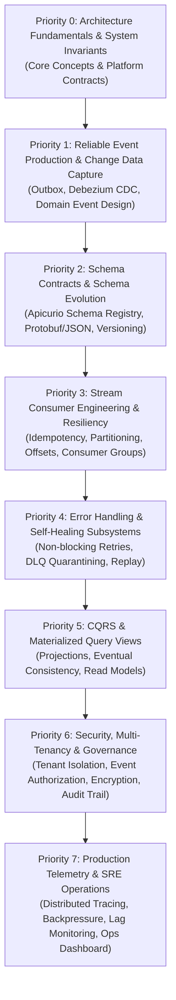

# Event-Driven Platform (EDP)
> Production-grade, mission-critical distributed event-driven platform implementing **CQRS**, **Event Sourcing**, **Transactional Outbox**, **CDC (Change Data Capture)**, and **Multi-Tenant Kafka Architecture**.

---

> [!TIP]
> 📖 **Comprehensive Learning Roadmap**: For an in-depth, categorized study guide linking all 26 feature specifications, failure cases, business logic docs, and migrations, see the dedicated **[Learning Roadmap & Architecture Guide](docs/LEARNING_ROADMAP.md)**.

---

## 🎯 Master Learning Roadmap (Prioritized from Zero to Advanced)

If you want to master event-driven architecture, distributed systems patterns, and everything implemented across this repository, follow this structured, battle-tested learning path.



---

### Phase Breakdown & Feature Guide

#### 🟢 Priority 0: Architectural Foundations & System Invariants
Start here to understand the foundational rules, consistency guarantees, and local development harness before touching operational code.

* **What to Learn:**
  * System-wide invariants: At-least-once delivery, RFC 9562 UUIDv7 monotonic event IDs, single-writer principle, strict monetary representation.
  * API error conventions (RFC 7807 Problem Details) and runtime prerequisites.
* **Core Documentation & Architecture Docs:**
  * [System Requirements & Goals](docs/00-requirements.md)
  * [C4 Architectural Diagrams](docs/01-c4.md)
  * [Event Catalog](docs/02-event-catalog.md)
  * [Kafka Topic Design](docs/03-topic-design.md)
  * [Consistency Contract](docs/04-consistency-contract.md)
* **Key ADRs:**
  * [ADR-0001: Local Debug Toolchain & Port Isolation](docs/adr/ADR-0001-local-debug-toolchain-and-port-isolation.md)
  * [ADR-0002: API Error Semantics, Validation & Persistence Honesty](docs/adr/ADR-0002-api-error-semantics-validation-and-persistence-honesty.md)
  * [ADR-0003: Runtime Prerequisites & Deployment Gotchas](docs/adr/ADR-0003-runtime-prerequisites-and-deployment-gotchas.md)

---

#### 🟡 Priority 1: Reliable Event Ingestion, Outbox & CDC
Understand how to solve the classic "dual-write" problem without distributed 2PC transactions.

* **What to Learn:**
  * Eliminating partial writes via ACID Transactional Outbox pattern (`outbox_events` table).
  * Postgres logical decoding WAL streaming via Debezium CDC Connect.
  * Designing immutable domain event structures with strict tenant scoping.
* **Feature Directories:**
  * Outbox: `src/features/transactional-outbox/`
  * CDC Integration: `src/features/cdc-integration/`
  * Domain Events: `src/features/domain-event-design/`
  * Event-Driven Comm: `src/features/event-driven-communication/`
* **Feature ADRs & Specs:**
  * [ADR: Transactional Outbox](docs/features/transactional-outbox/adr.md)
  * [ADR: CDC Integration](docs/features/cdc-integration/adr.md)
  * [ADR: Domain Event Design](docs/features/domain-event-design/adr.md)
  * [ADR: Event-Driven Communication](docs/features/event-driven-communication/adr.md)

---

#### 🟡 Priority 2: Schema Governance & Safe Evolution
Learn how upstream producers and downstream consumers evolve independently without breaking deserialization.

* **What to Learn:**
  * Central schema registration via Apicurio Schema Registry.
  * Backward, forward, and full compatibility validation rules.
  * Explicit schema versioning and payload migration strategies.
* **Feature Directories:**
  * Schema Registry: `src/features/event-schema-registry/`
  * Schema Evolution: `src/features/schema-evolution/`
  * Versioning: `src/features/event-versioning/`
* **Feature ADRs & Specs:**
  * [ADR: Event Schema Registry](docs/features/event-schema-registry/adr.md)
  * [ADR: Schema Evolution](docs/features/schema-evolution/adr.md)
  * [ADR: Event Versioning](docs/features/event-versioning/adr.md)

---

#### 🟠 Priority 3: Consumer Architecture & In-Order Processing
Learn how distributed consumers reliably ingest partitions, scale across instances, and guarantee exactly-once business processing.

* **What to Learn:**
  * Idempotent consumer design (deduplication tables, atomic deduplication windows).
  * Aggregate-level partition affinity and ordering protection across workers.
  * Consumer group coordinator mechanics, rebalance protocols, and explicit offset commit strategies.
* **Feature Directories:**
  * Idempotency: `src/features/idempotent-consumers/`
  * Ordering: `src/features/event-ordering-protection/`
  * Consumer Groups: `src/features/consumer-groups/`
  * Offset Management: `src/features/offset-management/`
  * Partitioning: `src/features/partitioning-strategy/`
* **Feature ADRs & Specs:**
  * [ADR: Idempotent Consumers](docs/features/idempotent-consumers/adr.md)
  * [ADR: Event Ordering Protection](docs/features/event-ordering-protection/adr.md)
  * [ADR: Consumer Groups](docs/features/consumer-groups/adr.md)
  * [ADR: Offset Management](docs/features/offset-management/adr.md)
  * [ADR: Partitioning Strategy](docs/features/partitioning-strategy/adr.md)

---

#### 🟠 Priority 4: Error Handling, Dead Letters & Historical Replay
Learn how to handle transient network outages, poison pills, and cold data replays without blocking production partitions.

* **What to Learn:**
  * Non-blocking staggered retry topics (`topic.retry-10s`, `topic.retry-60s`).
  * Dead-letter quarantine (DLQ) triage, analysis, and manual/automated re-injection.
  * Replay subsystem: re-driving historical events from specific offsets or timestamps.
* **Feature Directories:**
  * Retries: `src/features/retry-topics/`
  * Dead Letter Handling: `src/features/dead-letter-handling/`
  * Event Replay: `src/features/replay-mechanism/`
* **Feature ADRs & Specs:**
  * [ADR: Retry Topics](docs/features/retry-topics/adr.md)
  * [ADR: Dead Letter Handling](docs/features/dead-letter-handling/adr.md)
  * [ADR: Replay Mechanism](docs/features/replay-mechanism/adr.md)

---

#### 🔵 Priority 5: CQRS & Materialized Read Projections
Learn how to separate transactional write models from query-optimized read models.

* **What to Learn:**
  * Asynchronous projection consumers building specialized relational/document views.
  * Mitigating read-your-own-writes lag with eventual consistency tracking.
  * Atomic view rebuilds, backfilling, and version switching.
* **Feature Directories:**
  * CQRS: `src/features/cqrs/`
  * Materialized Views: `src/features/materialized-views/`
  * Consistency Monitoring: `src/features/eventual-consistency-monitoring/`
* **Feature ADRs & Specs:**
  * [ADR: CQRS](docs/features/cqrs/adr.md)
  * [ADR: Materialized Views](docs/features/materialized-views/adr.md)
  * [ADR: Eventual Consistency Monitoring](docs/features/eventual-consistency-monitoring/adr.md)

---

#### 🟣 Priority 6: Multi-Tenancy, Security & Governance
Learn how enterprise systems protect sensitive data and isolate multiple tenants across shared infrastructure.

* **What to Learn:**
  * Row-Level Security (RLS) and cryptographic tenant boundary isolation.
  * Fine-grained event authorization and topic ACL enforcement.
  * Envelope encryption and payload field encryption for sensitive PII/financial data.
  * Tamper-evident immutable audit logs and lineage tracking.
* **Feature Directories:**
  * Multi-Tenant Isolation: `src/features/multi-tenant-event-isolation/`
  * Event Authorization: `src/features/event-authorization/`
  * Payload Encryption: `src/features/encryption/`
  * Audit Trail: `src/features/audit-trail/`
* **Feature ADRs & Specs:**
  * [ADR: Multi-Tenant Event Isolation](docs/features/multi-tenant-event-isolation/adr.md)
  * [ADR: Event Authorization](docs/features/event-authorization/adr.md)
  * [ADR: Field-Level & Envelope Encryption](docs/features/encryption/adr.md)
  * [ADR: Audit Trail](docs/features/audit-trail/adr.md)

---

#### 🔴 Priority 7: Durability, High-Throughput & SRE Operations
Learn how to maintain, trace, and monitor high-throughput streaming systems under extreme load.

* **What to Learn:**
  * W3C trace context propagation across HTTP, Outbox, Kafka headers, and consumers.
  * Flow control, rate limiting, and backpressure mechanisms when downstream systems degrade.
  * Centralized event operations dashboard and automated SLO alerts.
* **Feature Directories:**
  * Distributed Tracing: `src/features/distributed-tracing/`
  * Backpressure: `src/features/backpressure/`
  * Ops Dashboard: `src/features/event-operations-dashboard/`
* **Feature ADRs & Specs:**
  * [ADR: Distributed Tracing](docs/features/distributed-tracing/adr.md)
  * [ADR: Durable Observability](docs/features/distributed-tracing/adr-durable-observability.md)
  * [ADR: Backpressure](docs/features/backpressure/adr.md)
  * [ADR: Event Operations Dashboard](docs/features/event-operations-dashboard/adr.md)

---

## 📚 Complete Architectural Decision Records (ADR) Catalog

Every major architectural choice in this repository is recorded with its context, options considered, consequences, and invariants:

| Category | ADR / Specification Link | Primary Focus |
|---|---|---|
| **Platform Foundations** | [ADR-0001: Local Toolchain](docs/adr/ADR-0001-local-debug-toolchain-and-port-isolation.md) | Port isolation, reproducible local stack |
| | [ADR-0002: API Error Semantics](docs/adr/ADR-0002-api-error-semantics-validation-and-persistence-honesty.md) | RFC 7807 problem details, boundary validations |
| | [ADR-0003: Deployment Gotchas](docs/adr/ADR-0003-runtime-prerequisites-and-deployment-gotchas.md) | AppArmor, container privileges, kernel prerequisites |
| **Ingestion & Outbox** | [Transactional Outbox](docs/features/transactional-outbox/adr.md) | Dual-write elimination, fencing, poller relay |
| | [CDC Integration](docs/features/cdc-integration/adr.md) | Debezium Postgres WAL logical decoding connector |
| | [Domain Event Design](docs/features/domain-event-design/adr.md) | CloudEvents envelope standard, event boundaries |
| | [Event-Driven Communication](docs/features/event-driven-communication/adr.md) | Choreography vs orchestration, asynchronous contracts |
| **Schema Governance** | [Event Schema Registry](docs/features/event-schema-registry/adr.md) | Apicurio integration, schema caching, fingerprinting |
| | [Schema Evolution](docs/features/schema-evolution/adr.md) | Backward/forward compatibility checking rules |
| | [Event Versioning](docs/features/event-versioning/adr.md) | Major/minor/patch semantic versioning of events |
| **Consumer Resiliency** | [Idempotent Consumers](docs/features/idempotent-consumers/adr.md) | Atomic deduplication, exactly-once processing |
| | [Event Ordering Protection](docs/features/event-ordering-protection/adr.md) | Per-aggregate strictly monotonic ordering locks |
| | [Consumer Groups](docs/features/consumer-groups/adr.md) | Dynamic partition balancing and scaling |
| | [Offset Management](docs/features/offset-management/adr.md) | At-least-once commits, manual synchronization |
| | [Partitioning Strategy](docs/features/partitioning-strategy/adr.md) | Hash partitioning, hot-key mitigation, salt hashing |
| **Fault Tolerance & Healing** | [Retry Topics](docs/features/retry-topics/adr.md) | Staggered exponential backoff retry queues |
| | [Dead Letter Handling](docs/features/dead-letter-handling/adr.md) | Quarantine isolation, automated triage, replay APIs |
| | [Replay Mechanism](docs/features/replay-mechanism/adr.md) | Historical stream re-drive, state snapshotting |
| **Query & Read Architecture** | [CQRS Pattern](docs/features/cqrs/adr.md) | Separation of command mutators and read projections |
| | [Materialized Views](docs/features/materialized-views/adr.md) | Real-time aggregate view generation |
| | [Eventual Consistency Monitoring](docs/features/eventual-consistency-monitoring/adr.md) | Replication lag detection, divergence alarms |
| **Security & Multi-Tenancy** | [Multi-Tenant Event Isolation](docs/features/multi-tenant-event-isolation/adr.md) | Tenant scoping, schema namespaces, RLS barriers |
| | [Event Authorization](docs/features/event-authorization/adr.md) | Topic-level and event-type RBAC/ABAC policies |
| | [Payload Encryption](docs/features/encryption/adr.md) | AES-GCM envelope encryption, KMS key rotation |
| | [Audit Trail](docs/features/audit-trail/adr.md) | Non-repudiation, tamper-evident audit journal |
| **Telemetry & Flow Control** | [Distributed Tracing](docs/features/distributed-tracing/adr.md) | W3C trace context, OpenTelemetry span stitching |
| | [Durable Observability](docs/features/distributed-tracing/adr-durable-observability.md) | Metric persistence, long-term trace retention |
| | [Backpressure Control](docs/features/backpressure/adr.md) | Rate limiting, reactive pause/resume consumer throttling |
| | [Event Operations Dashboard](docs/features/event-operations-dashboard/adr.md) | Real-time broker/consumer topology monitoring UI/API |

---

## 🚀 Quickstart: Running the Entire Platform

Requires Docker with Compose v2. The complete stack starts Postgres (logical WAL), Kafka (single-node KRaft), Apicurio Schema Registry, Debezium/Kafka Connect, runs automated SQL schema migrations, and launches the core service.

```bash
# 1. Start all infrastructure components and services in detached mode
docker compose -f deploy/docker/compose/docker-compose.all.yml up -d --wait

# Alternatively, run the automated health-check wrapper:
scripts/run/quickstart.sh
```

### Stack Endpoints
| Component | Default URL | Purpose |
|---|---|---|
| **Platform REST API** | `http://127.0.0.1:8080` | Command ingestion, querying views, schema APIs |
| **Health Probes** | `http://127.0.0.1:8081/health/live`, `/health/ready` | Kubernetes liveness and readiness probes |
| **Prometheus Metrics** | `http://127.0.0.1:8081/metrics` | System throughput, consumer lag, retry counters |
| **Prometheus UI** | `http://127.0.0.1:9090` | Observability metrics explorer (`--profile observability`) |
| **PostgreSQL** | `127.0.0.1:15432` | Primary database (`event_store`, logical WAL enabled) |

### Environment Configuration
Key environment variables (can be placed in `deploy/docker/compose/.env` using `deploy/docker/compose/.env.example` as a template):

| Variable | Default | Purpose |
|---|---|---|
| `COMPOSE_PROJECT_NAME` | `event-driven-platform` | Compose project namespace |
| `EDP_IMAGE` / `EDP_TAG` | `chiefj/event-driven-platform` / `latest` | Application image |
| `POSTGRES_IMAGE` | `postgres:16-bookworm` | PostgreSQL image |
| `KAFKA_IMAGE` | `apache/kafka:3.8.0` | Apache Kafka image |
| `APICURIO_IMAGE` | `apicurio/apicurio-registry-mem:2.6.5.Final` | Schema registry image |
| `DEBEZIUM_IMAGE` | `debezium/connect:2.7.3.Final` | Kafka Connect CDC image |
| `PROMETHEUS_IMAGE` | `prom/prometheus:v2.54.1` | Prometheus image (`--profile observability`) |
| `EDP_BIND_ADDR` | `127.0.0.1` | Host network binding interface |
| `EDP_API_PORT` | `8080` | Host port for API gateway |
| `EDP_ADMIN_PORT` | `8081` | Host port for internal admin/health/metrics |
| `EDP_POSTGRES_PORT` | `15432` | Host port mapped to PostgreSQL |
| `MAX_REQUEST_BODY_BYTES` | `1048576` | Inbound payload byte limit |
| `NO_NEW_PRIVILEGES` | `true` | Security hardening (`false` if AppArmor restricts exec) |

### Smoke Testing the Pipeline
Validate end-to-end functionality across all components:
```bash
scripts/test/smoke.sh
```

To tear down the stack and wipe volumes:
```bash
docker compose -f deploy/docker/compose/docker-compose.all.yml down -v
```

---

## 📂 Source Code & Architectural Directory Structure

```text
.
├── database/
│   ├── config/          # RLS policies and topology definitions
│   └── migrations/sql/  # 28+ versioned SQL migration scripts & rollbacks
├── deploy/
│   ├── docker/compose/  # Multi-service compose topologies
│   └── k8s/             # Helm charts and manifests
├── docs/
│   ├── adr/             # Platform-wide Architectural Decision Records
│   ├── features/        # Feature specs, ADRs, diagrams, and failure cases
│   └── *.md             # System requirements, capacity model, threat model
├── messaging/
│   ├── policies/        # Dead-letter and retry topic policies
│   ├── topics/          # Kafka topic definitions and configuration
│   └── engine/          # Message envelope serializer and validator
├── scripts/
│   ├── run/             # Quickstart and runner scripts
│   └── test/            # Integration and smoke test suites
└── src/
    ├── api/             # HTTP REST API routers, middlewares, and OpenAPI v1 specs
    ├── features/        # 26 modular enterprise feature subsystems
    ├── infra/          # Kafka, PostgreSQL, Apicurio, and Telemetry clients
    └── shared/         # Shared domain contracts, utilities, and error types
```

---

## 📖 Specifications & Contract References
* [OpenAPI Specification v1](src/api/contracts/openapi/v1.yaml)
* [System Threat Model & Hardening](docs/06-threat-model.md)
* [System Capacity & Resource Sizing Model](docs/05-capacity-model.md)
