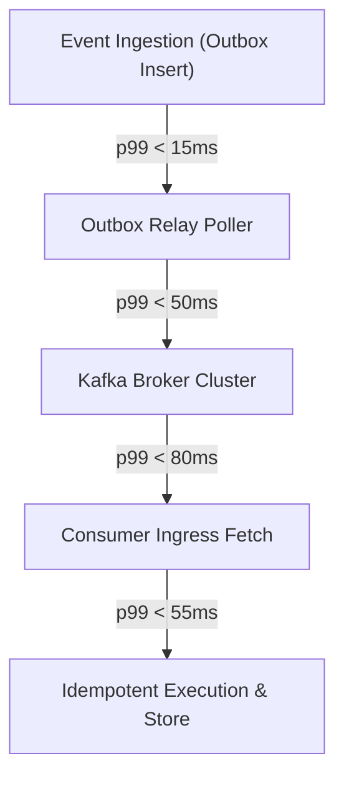

# Production Requirements & SLO Specification — Event-Driven Platform

## 1. Executive Summary & Problem Scope

The Event-Driven Platform (EDP) is an enterprise-scale distributed streaming and asynchronous messaging backbone designed for mission-critical transactional workflows. It guarantees strict ordering per aggregate partition, exactly-once processing semantics through idempotent consumers, zero data loss (RPO = 0), and multi-tenant isolation with end-to-end W3C distributed tracing and cryptographically shreddable data protection.

---

## 2. Functional Requirements

### FR-01: Transactional Outbox Publication
- The platform MUST guarantee atomic dual-write consistency between business state changes and domain events within a single relational database transaction.
- Events MUST be enqueued to an append-only `outbox_events` table before being relayed to the streaming broker by an asynchronous, batched, polling/CDC worker.
- Producers MUST NOT emit events directly over network sockets to Kafka inside user-facing request paths.

### FR-02: Strict Partition Ordering & Versioning
- Events originating from the same aggregate root MUST be published to the same broker partition using deterministic partitioning keys (`aggregate_id` or `tenant_id:aggregate_id`).
- Every event MUST carry a strictly increasing, gapless `aggregate_version` integer ($v_{n} = v_{n-1} + 1$).
- Out-of-order events arriving at consumers MUST be detected, buffered, or quarantined without processing subsequent events for that aggregate.

### FR-03: Idempotent Consumption & Deduplication
- Consumers MUST implement at-least-once transport consumption combined with deterministic deduplication ledgers.
- Duplicate messages (identified by `tenant_id:event_id` or `tenant_id:idempotency_key`) MUST return the previously committed outcome without re-executing business side effects.

### FR-04: Schema Registry & Backward/Forward Evolution
- Every published event MUST reference an immutable schema ID registered in the schema registry.
- Evolution rules MUST enforce strict compatibility modes (`BACKWARD_TRANSITIVE` by default, `FULL_TRANSITIVE` for public integration events).
- Breaking schema changes MUST be rejected at registration time.

### FR-05: Dead-Letter Handling & Automated Quarantine
- Messages that fail business processing due to poison payloads or unhandled exceptions MUST be isolated to dead-letter queues (DLQ) after bounded exponential retries.
- Poison pills MUST NOT block head-of-line processing for valid events on the same topic partition.
- DLQ subsystems MUST support triage categorization, replay with parameter overriding, and permanent quarantine archiving.

### FR-06: Backpressure & Offset Management
- Consumers MUST regulate ingress throughput based on downstream database latency and memory saturation.
- Offset commits MUST only occur after successful business transaction completion and audit logging.

### FR-07: Cryptographic Shredding & Envelope Security
- Sensitive personal data (PII) MUST be encrypted using field-level or payload-level envelope encryption with tenant-specific keys.
- Erasure requests (GDPR/CCPA Right to be Forgotten) MUST be fulfilled by crypto-shredding the corresponding tenant or subject data key, rendering historical immutable append-only logs unreadable without altering log offsets.

### FR-08: Distributed Tracing & Causal Graph Propagation
- All event envelopes MUST carry W3C Trace Context (`traceparent`, `tracestate`).
- Asynchronous hops MUST distinguish between direct child spans (for sequential RPC-style commands) and span links (for batch consumers and queued workers exceeding 120s latency) to prevent distorted waterfall latency attribution.

### FR-09: Distributed Saga Orchestration
- Long-running business transactions spanning multiple microservices MUST execute via forward step commands and backward compensating commands.
- Late or out-of-order saga replies MUST be classified as orphaned or ignored without corrupting terminal saga states.

---

## 3. Non-Functional Requirements (NFRs) & Hard Constraints

| Metric | Target Constraint | Measurement Point | Enforcement Mechanism |
|---|---|---|---|
| **Peak Ingestion Throughput** | $\ge 50,000$ events/sec | Ingress API & Outbox Relay | Horizontal partitioning (min 32 partitions/topic) |
| **End-to-End Latency (p50)** | $\le 40$ ms | Publish to Consumer ACK | In-memory batch relays, low Kafka linger (`5ms`) |
| **End-to-End Latency (p95)** | $\le 120$ ms | Publish to Consumer ACK | Pipelined consumer prefetching |
| **End-to-End Latency (p99)** | $\le 200$ ms | Publish to Consumer ACK | OS page cache tuning, bounded lock contention |
| **Recovery Point Objective (RPO)** | **$0$ (Zero Data Loss)** | Broker disk ack (`acks=all`) | Transactional Outbox + `min.insync.replicas=2` |
| **Recovery Time Objective (RTO)** | $\le 30$ seconds | Consumer instance failure | Kafka consumer group heartbeat rebalance timeout |
| **Availability (Outbox Write)** | $\ge 99.99\%$ | Local database commit | Colocated with core transactional ACID database |
| **Availability (Broker Bus)** | $\ge 99.95\%$ | Kafka produce/consume cluster | 3-AZ replica distribution with Raft/KRaft |
| **Retention Window** | 7 days hot, 30 days cold | Broker log segment retention | Compaction on state topics, delete on event topics |
| **Full Stream Replay Speed** | $\ge 100,000,000$ events in $< 4$ hours | Projection rebuild runner | Dedicated consumer groups with read-ahead caching |

---

## 4. Service Level Objectives (SLOs) & Error Budgets

### SLO-1: Availability of Event Enqueue
- **SLI:** Ratio of successful outbox inserts to total outbox write attempts measured over 30 days.
- **SLO:** $\ge 99.99\%$.
- **Error Budget:** 4.32 minutes of downtime per 30-day window.

### SLO-2: End-to-End Message Delivery Latency
- **SLI:** Percentage of events where $T_{\text{consumed}} - T_{\text{enqueued}} \le 200\text{ ms}$, measured continuously via OpenTelemetry span durations.
- **SLO:** $\ge 99.0\%$ of all events.
- **Error Budget:** $1.0\%$ tail-latency excursion allowed during traffic spikes.

### SLO-3: Consumer Lag Freshness
- **SLI:** The time lag of the oldest uncommitted offset per partition across all consumer groups.
- **SLO:** $\text{Lag} \le 30\text{ seconds}$ for Tier-0 topics; $\text{Lag} \le 120\text{ seconds}$ for Tier-1 topics.

### Multi-Window Multi-Burn-Rate Alerts

| Alert Name | Severity | Burn Rate | Budget Consumed | Time Window | Action Required |
|---|---|---|---|---|---|
| **Critical Outage** | P0 (Page) | $14.4\times$ | $2\%$ in 1 hour | 1 hour | Immediate page on-call; check broker connectivity |
| **High Erosion** | P1 (Page) | $6.0\times$ | $5\%$ in 6 hours | 6 hours | Page on-call; check consumer group pause / DLQ floods |
| **Slow Bleed** | P2 (Ticket) | $1.0\times$ | $10\%$ in 3 days | 3 days | Create Jira ticket; investigate partition skew & GC pauses |

---

## 5. Explicit Non-Goals

1. **Not an OLAP Analytical Warehouse:** The platform does not serve complex SQL aggregation queries over billions of historical events. Downstream consumers project events into analytical stores (ClickHouse, BigQuery).
2. **No Distributed 2PC Across Heterogeneous Brokers:** The platform rejects XA/2PC protocols across multiple message brokers. Consistency is achieved via Saga orchestration and Transactional Outbox.
3. **No Direct Point-to-Point Synchronous RPC Over Kafka:** Kafka topics are strictly reserved for asynchronous events and decoupled commands with explicit reply topics. Synchronous real-time RPC uses gRPC or REST.

