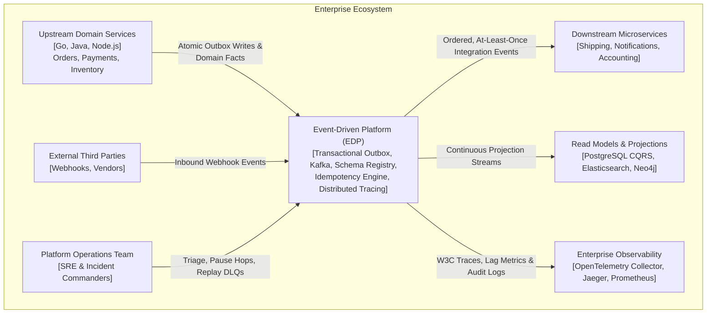
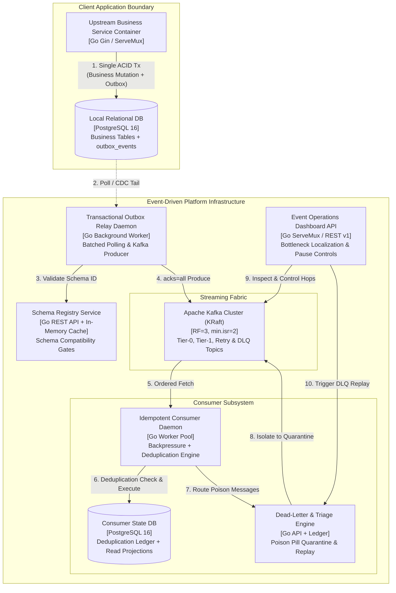
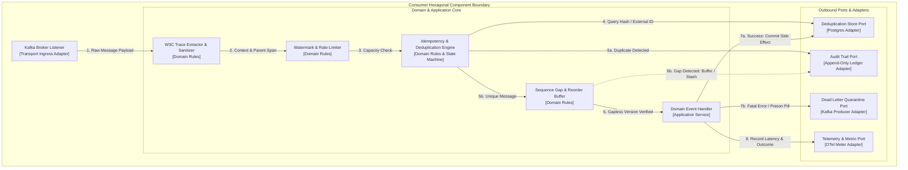

# C4 Architecture Model — Event-Driven Platform

## 1. System Context Diagram (Level 1)

The System Context diagram illustrates how the Event-Driven Platform sits at the center of the enterprise architecture, mediating communication between upstream domain services, downstream projection stores, external systems, and platform operators.

---

## 2. Container Diagram (Level 2)

The Container diagram details the high-level deployable runtime units that comprise the Event-Driven Platform.

---

## 3. Component Diagram (Level 3): Consumer Engine

The Component diagram breaks down the internal hexagonal architecture of the core **Consumer Engine** container, demonstrating how inbound messages are safely processed, deduplicated, and audited.

---

## 4. Key Architectural Invariants Illustrated

1. **Dual-Write Isolation:** Upstream producers NEVER write to Kafka directly; they write only to the local PostgreSQL database where the business entity and the outbox record share the exact same ACID transaction commit boundary.
2. **Zero In-Memory State in Services:** Handlers and services are strictly stateless. State transitions occur through transactional persistence in the PostgreSQL deduplication ledger.
3. **Poison Isolation:** A poison message fails bounded retries and gets immediately routed to the DLQ topic via `DLQRouterPort`, allowing the consumer partition cursor to advance without stalling valid traffic.

