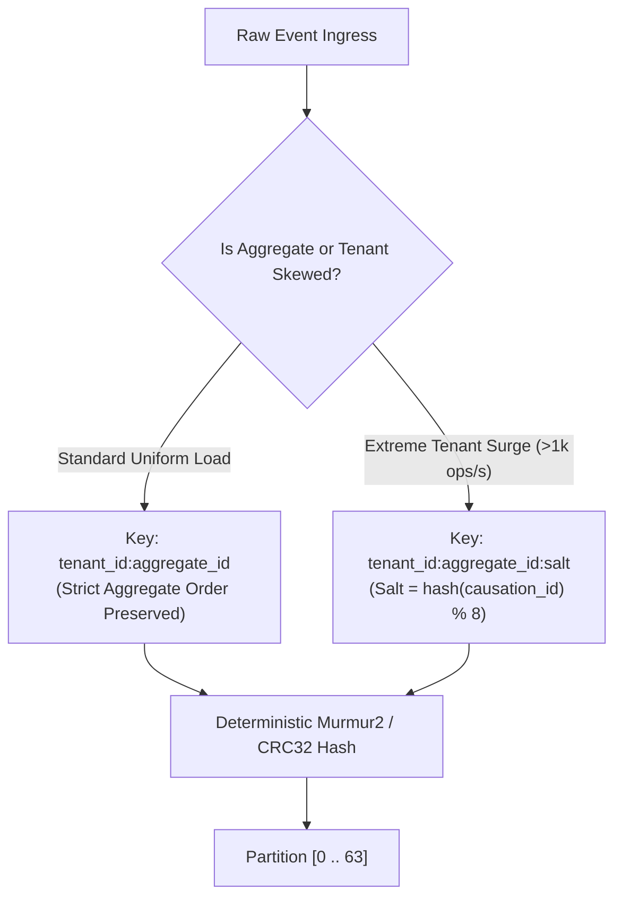

# Topic Topology & Partitioning Strategy Specification

## 1. Topic Naming Standard

All topics on the Event-Driven Platform MUST strictly adhere to the hierarchical, dot-delimited naming convention:

$$\mathbf{<domain>.<aggregate>.<event\_name>.<version>}$$

### Rules & Examples:
1. **Lowercase Only:** Topic names must be strictly lowercase alphanumeric with dots and underscores.
2. **Version Pinning:** Every topic MUST declare its major schema contract version suffix (`.v1`, `.v2`).
3. **No Mixed Enums or Multi-Action Names:** Generic topics like `order-updates` or `entity-mutations` are prohibited.

| Topic Class | Topic Name | Purpose | Partition Key |
|---|---|---|---|
| **Tier-0 Domain Event** | `orders.order.placed.v1` | Public business fact: customer submitted order | `tenant_id:order_id` |
| **Tier-0 Domain Event** | `payments.payment.captured.v1` | Public business fact: funds captured | `tenant_id:order_id` |
| **Tier-1 State Snapshot** | `customers.customer.profile.v1` | Compacted state topic for customer projections | `tenant_id:customer_id` |
| **Command Topic** | `shipping.fulfillment.dispatch.cmd.v1` | Asynchronous work dispatch to a single consumer group | `tenant_id:shipment_id` |
| **Retry Stream (Backoff)** | `orders.order.placed.retry.10s.v1` | Exponential backoff delay stage for retry processing | `tenant_id:order_id` |
| **Dead-Letter Quarantine** | `orders.order.placed.dlq.v1` | Quarantine for fatal errors and unparseable payloads | `tenant_id:order_id` |

---

## 2. Broker-Level Configuration & Invariants

| Configuration Key | Value | Invariant Rationale |
|---|---|---|
| `replication.factor` | `3` | Guarantees tolerance against simultaneous broker rack failure. |
| `min.insync.replicas` | `2` | Guarantees RPO = 0 when `acks=all` is set by outbox producers. A single broker failure allows writes; two broker failures block writes rather than silently dropping data. |
| `unclean.leader.election.enable` | `false` | Strictly prevents out-of-sync replicas from becoming partition leader, preventing silent message loss. |
| `compression.type` | `zstd` (or `snappy`) | Reduces network transit and NVMe footprint by $60\%$ without high CPU overhead. |
| `message.max.bytes` | `1048576` ($1$ MB) | Prevents large payload abuse. Jumbo payloads ($>1$ MB) must use the Claim-Check pattern (store payload in S3/GCS; emit pointer event). |

---

## 3. Partition Allocation & Hot-Key Mitigation

### Partition Count Determination

$$\text{Partitions} = \max\left(\frac{\text{Target Throughput}}{\text{Single Partition Throughput}}, \text{Max Downstream Consumers}\right) \times \text{Skew Headroom}$$

- For Tier-0 high-throughput topics ($50,000$ events/s peak):
  - Target per-partition throughput: $1,000\text{--}2,500$ events/s.
  - Skew Headroom: $2.5\times$.
  - **Allocated Partitions:** **64 partitions** (powers of two ensure uniform hashing across broker nodes).
- For Tier-1 low-throughput operational topics ($< 1,000$ events/s):
  - **Allocated Partitions:** **16 partitions**.

### Hot-Key Mitigation (Compound Keys & Salt Hashing)

When an enterprise tenant generates $100\times$ baseline volume, naive `tenant_id` partitioning collapses traffic onto a single partition, creating a catastrophic lag bottleneck.

1. **Standard Compound Partition Key:** Always partition by `tenant_id:aggregate_id`. This guarantees strict per-aggregate ordering while spreading different aggregates across the partition ring.
2. **Scatter-Gather Salting:** For global single-account events (e.g. flash sales, company-wide broadcasts) where strict aggregate ordering is not required: append a deterministic salt `hash(external_id) % 8` to fan out writes across 8 distinct partitions.

---

## 4. Retention & Compaction Policies

### Delete Policy (Event / Delta Streams)
- **Topics:** `orders.*`, `payments.*`, `audit.*`
- `cleanup.policy=delete`
- `retention.ms=604800000` (7 days hot storage)
- `segment.bytes=536870912` (512 MB per segment for balanced compaction / deletion index efficiency)

### Compact Policy (State / Snapshot Streams)
- **Topics:** `*.profile.*`, `*.catalog.*`, `*.inventory.levels.*`
- `cleanup.policy=compact`
- `min.cleanable.dirty.ratio=0.20` (initiates compaction when $20\%$ of the log segment contains superseded keys)
- `delete.retention.ms=86400000` (24-hour tombstone retention: consumers have 24 hours to observe record deletions before permanent segment erasure)

