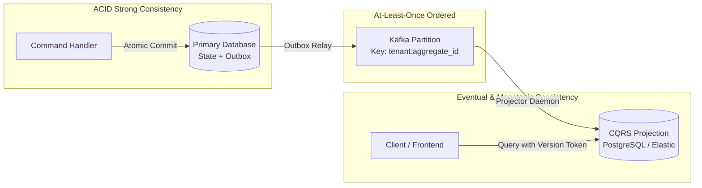

# Consistency Contract & Read Model Guarantees

## 1. Overview & Consistency Taxonomy

In an asynchronous event-driven architecture, distributed read models (CQRS projections, search indexes, cache stores) are decoupled from the write-side source of truth. This document formally specifies what downstream consumers, API clients, and end users may assume regarding data consistency, staleness bounds, and causal ordering.

---

## 2. Read Guarantees for Clients

### Contract 1: Monotonic Read Consistency (No State Regressions)
- **Guarantee:** If a client observes aggregate version $V_n$ at time $T$, subsequent reads by that client will NEVER observe $V_{n-k}$ ($k > 0$).
- **Enforcement:** Projections record the highest applied `aggregate_version` per entity. Projections ignore superseded events where `event.aggregate_version <= projection.current_version`.

### Contract 2: Bounded Staleness
- **Nominal Staleness Bound:** Under non-degraded operating conditions, read projections reflect write-side commits within **$200$ milliseconds** at $p99$.
- **Degraded Staleness Indicator:** When downstream projector lag exceeds $5,000$ milliseconds, the read API response MUST return the header:
  `X-Data-Freshness: STALE` alongside `X-Lag-Milliseconds: <lag>`.

### Contract 3: Read-Your-Writes Guarantee (Session Consistency)
- **Problem:** When a user submits an order, immediate redirect to the order details page must not display a 404 "Order Not Found" due to projection lag.
- **Protocol:**
  1. The write command response returns the newly committed `aggregate_version` in the response header:
     `X-Consistency-Version: 4`
  2. The client's subsequent read query passes this token in the request header:
     `If-Version-At-Least: 4`
  3. The projection API evaluates the version:
     - **Fast Path:** Projection version $\ge 4 \rightarrow$ Return projected data immediately.
     - **Wait Path:** Projection version $< 4 \rightarrow$ Subscribe to projection update via long-polling / Redis pub-sub (timeout $500\text{ ms}$).
     - **Fallback Path:** If timeout elapses without projection catch-up $\rightarrow$ Route query directly to the primary transactional database read-replica.

---

## 3. Causal Consistency & Gapless Version Enforcement

### Gapless Invariant ($v_n = v_{n-1} + 1$)
- Domain events published by an aggregate root strictly increment their `aggregate_version` by exactly 1.
- If a projection engine receives version $v_4$ while its local state is at $v_2$:
  1. **Action:** The consumer recognizes a **sequence gap** (missing version $v_3$).
  2. **Buffer:** Version $v_4$ is stashed into an in-memory or Redis reorder buffer.
  3. **Deadline:** A $30$-second catch-up window is granted for $v_3$ to arrive.
  4. **Quarantine:** If $v_3$ does not arrive within $30$ seconds, the aggregate is quarantined to prevent silent state divergence, and a P1 alert is fired.

---

## 4. Reconciliation & Drift Detection Engine

Due to at-least-once delivery, network retries, and schema evolution upcasters, read models can theoretically drift from the event log.

The platform executes a continuous **Reconciliation Engine**:
1. **Merkle Tree / Hash Comparison:** Nightly batch workers compute cryptographically signed SHA-256 state hashes across aggregates in the primary DB vs read projection stores.
2. **Drift Remediation:** If a hash mismatch is detected, the projection store for that specific aggregate is automatically wiped and rebuilt by replaying events from version $1$ to current from the immutable outbox archive.
