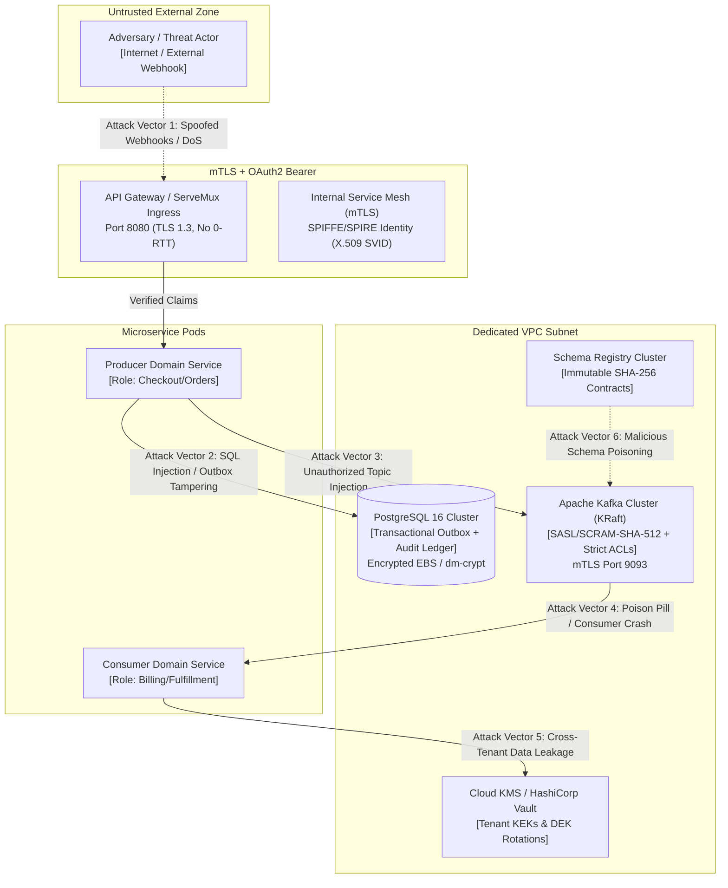
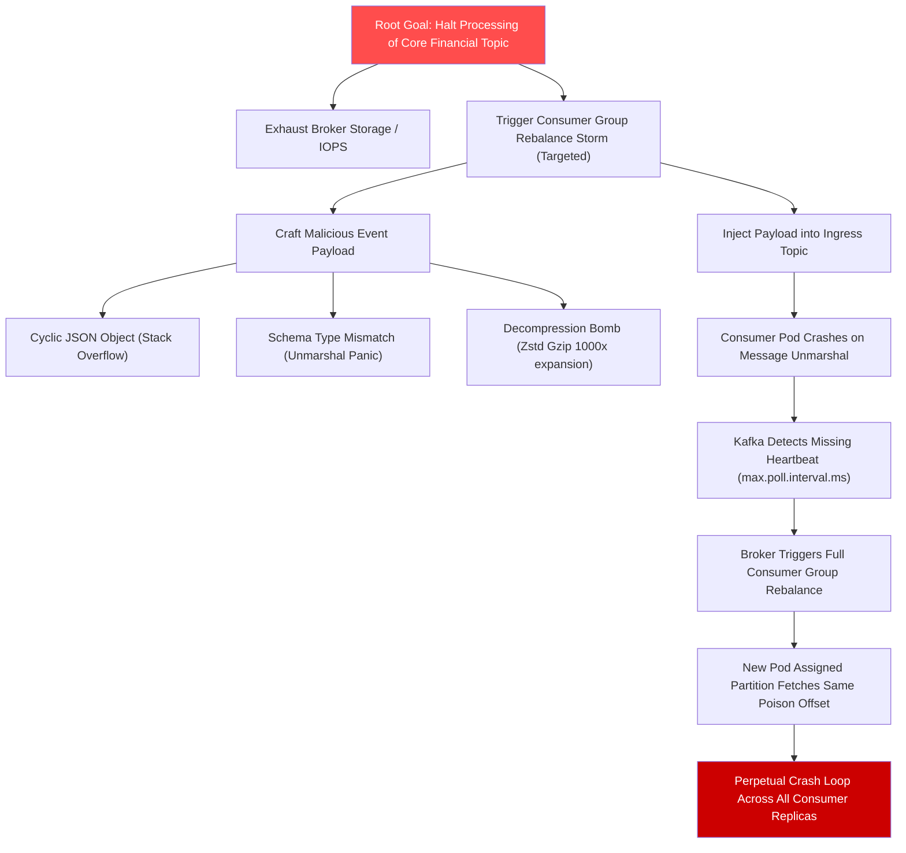
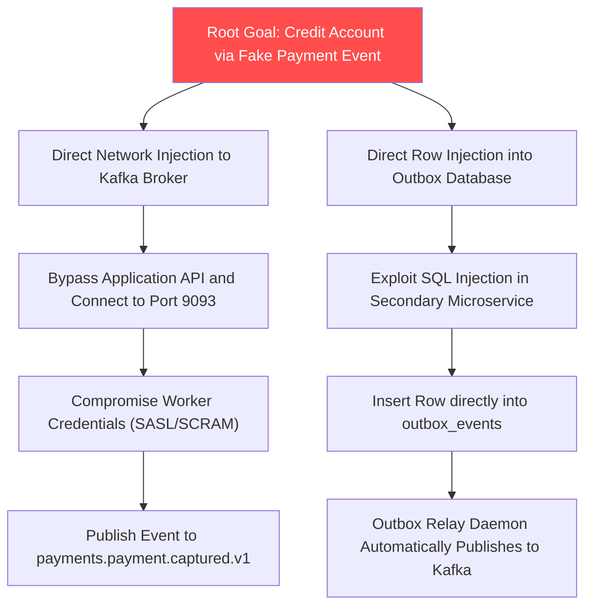
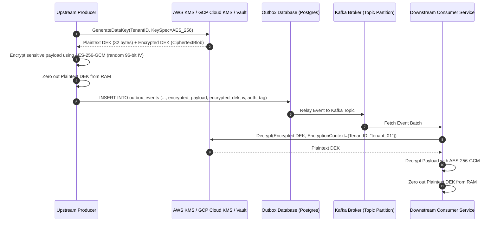
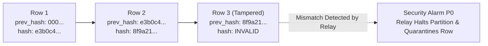

# Threat Model & STRIDE-DREAD Security Architecture — Event-Driven Platform

## 1. System Trust Boundaries & Adversarial Attack Surface

The Event-Driven Platform (EDP) operates across multiple distinct trust boundaries. An adversary may attack the platform from external network ingress, compromised microservice pods inside the Kubernetes cluster, corrupted database records, or intercepted broker network sockets.



---

## 2. Comprehensive STRIDE & DREAD Threat Scoring Matrix

Each identified threat vector is evaluated using the industry-standard **DREAD** framework:
- **D**amage Potential (0–10)
- **R**eproducibility (0–10)
- **E**xploitability (0–10)
- **A**ffected Users (0–10)
- **D**iscoverability (0–10)

$$\mathbf{\text{Risk Score}} = \frac{D + R + E + A + D}{5}$$

| STRIDE Category | Threat ID & Attack Scenario | D | R | E | A | D | Score | Risk Level | Architectural Countermeasure |
|---|---|---|---|---|---|---|---|---|---|
| **Spoofing** | **TH-01: Rogue Producer Event Forgery**<br/>Compromised non-payment service injects `payments.payment.captured.v1` directly into Kafka to credit fraudulent balances. | 9 | 8 | 6 | 9 | 7 | **7.8** | **CRITICAL** | **AZ-04 Single-Writer Policy:** Kafka ACLs bind write permissions for each topic exclusively to the certified SPIFFE principal of the owning domain service. Schema Registry rejects unauthorized subject emissions. |
| **Tampering** | **TH-02: Outbox Database Row Alteration**<br/>Insider or compromised DB user alters `payload` or `tenant_id` in `outbox_events` table prior to relay polling. | 9 | 7 | 4 | 8 | 5 | **6.6** | **HIGH** | **PostgreSQL Immutability Triggers & Hash-Chaining:** `trg_prevent_outbox_mutation` enforces append-only semantics. Merkle hash chaining across `(prev_hash, payload, event_id)` detects unauthorized row mutations. |
| **Repudiation** | **TH-03: Producer Denies Publication / Consumer Denies Receipt**<br/>Disputed transaction during financial audit; sender claims message was forged by broker; receiver claims it was never delivered. | 7 | 8 | 6 | 7 | 6 | **6.8** | **HIGH** | **Cryptographic Audit Ledger & Span Lineage:** Every outbox enqueue generates a cryptographically signed HMAC audit row with deterministic `(event_id, correlation_id, causation_id, principal_id, timestamp_utc)`. Consumer commits record offset ACK in PostgreSQL before advancing Kafka cursor. |
| **Information Disclosure** | **TH-04: PII / Credit Card Leakage in OpenTelemetry & Logs**<br/>Plaintext PAN, social security numbers, or passwords travel across trace attributes or unencrypted broker partitions. | 10 | 9 | 7 | 9 | 8 | **8.6** | **CRITICAL** | **Field-Level Envelope Encryption & Redaction:** Sensitive attributes are encrypted via AES-256-GCM before outbox write. Domain tracing rules automatically strip banned keys (`password`, `token`, `secret`, `ssn`, `card`, `api_key`) from OTel span attributes. |
| **Denial of Service** | **TH-05: Poison Pill Deserialization Bomb**<br/>Attacker publishes deeply nested or cyclic JSON/Protobuf payload that triggers fatal panic or $O(N^2)$ CPU exhaustion in consumer pods, causing perpetual consumer group rebalance loops. | 8 | 10 | 8 | 9 | 8 | **8.6** | **CRITICAL** | **Dead-Letter Quarantine (DLQ) & Sandboxed Parsing:** JSON parser enforces strict recursion depth ($\le 10$) and byte limit ($1\text{ MB}$). Unhandled decoding errors immediately bypass retry loops and isolate to dead-letter quarantine without halting the partition. |
| **Denial of Service** | **TH-06: Hot-Partition Starvation Flood**<br/>Single malicious tenant floods events under one partition key, causing broker memory pressure and starving other tenants sharing the partition. | 7 | 9 | 8 | 8 | 7 | **7.8** | **HIGH** | **Deterministic Scatter-Gather Salting:** High-velocity topics enforce scatter-gather salting (`hash(external_id) % 8`). Broker enforces byte-rate and connection quotas per tenant client ID (`quota.producer_byte_rate = 5MB/s`). |
| **Elevation of Privilege** | **TH-07: Cross-Tenant Egress & Side-Channel Snooping**<br/>Tenant B subscribes to a shared topic and attempts to consume Tenant A's private integration events. | 9 | 8 | 5 | 8 | 6 | **7.2** | **HIGH** | **Tenant-Level Cryptographic Isolation:** Shared topics carry payloads encrypted under tenant-specific Data Encryption Keys (DEKs). Tenant B lacks KMS decrypt permissions for Tenant A's Key Encryption Key (KEK); intercepted records remain undecryptable noise. |

---

## 3. Attack Trees & Kill-Chain Analysis

### Attack Tree 1: Poison Pill Partition Denial-of-Service (TH-05)



#### Implemented Defensive Countermeasure:
1. **Bounded Decompression:** Decompression buffers allocate a maximum of $2.5\text{ MB}$; exceeding this aborts with `ErrDecompressionBombDetected`.
2. **Panic Recovery Interceptor:** Consumer worker dispatch wraps every event handler in a Go `recover()` block. Any panic captures stack trace, writes an error report to `dead_letter_quarantine_ledger`, commits the offset, and isolates the message to `.dlq.v1`.
3. **Partition Liveness Preserved:** The partition offset advances immediately; other valid events in the batch proceed without interruption.

---

### Attack Tree 2: Unauthorized Event Publication / Financial Ledger Forgery (TH-01)



#### Implemented Defensive Countermeasure:
1. **AZ-04 Single-Writer Kafka ACLs:** Kafka brokers enforce mutual TLS (mTLS) with SPIFFE X.509 certificates. Topic `payments.payment.captured.v1` has a strict ACL rule:
   `Principal: User:spiffe://cluster.local/ns/prod/sa/payment-service -> ALLOW WRITE Topic:payments.payment.captured.v1`. All other services (e.g. `notification-service`, `shipping-service`) receive immediate `TOPIC_AUTHORIZATION_FAILED`.
2. **Database Origin Verification:** The outbox relay daemon cryptographically verifies the HMAC signature of the outbox record using a private enclave key shared only with the authorized payment command handler. Unsigned rows inserted via SQL injection are quarantined with `OUTBOX_SIGNATURE_MISMATCH`.

---

## 4. Cryptographic Architecture: Envelope Encryption & Shredding

The platform enforces **Envelope Encryption** to ensure that data at rest in PostgreSQL, data in transit across Kafka, and historical log segments in cold storage (S3) cannot be decrypted if storage media or broker logs are compromised.



### Cryptographic Invariants & Implementation Constraints
1. **Cipher Suite:** `AES-256-GCM` (Galois/Counter Mode) with 128-bit authentication tag and a unique, cryptographically secure 96-bit initialization vector (`IV`) per event.
2. **No IV Reuse:** The 96-bit IV is generated using `crypto/rand`. Reusing an IV with the same DEK destroys GCM authentication; our domain rules assert IV uniqueness.
3. **KMS Rate-Limiting Protection:** Consumers maintain an in-memory, thread-safe LRU cache of decrypted DEKs bounded by a strict **15-minute TTL**. This reduces KMS API calls by $>99\%$ while maintaining timely revocation enforcement.
4. **Crypto-Shredding Proof (GDPR / CCPA Article 17):**
   - When a tenant requests full data erasure or a subject exercises the "Right to be Forgotten", the platform destroys the corresponding Tenant KEK or Subject Key in Cloud KMS.
   - Without the 256-bit key, AES-256-GCM ciphertext is computationally indistinguishable from random noise ($2^{256}$ brute-force search space).
   - This achieves legally certified, irreversible data erasure across immutable append-only Kafka logs, PostgreSQL outbox tables, and historical S3 segment archives without modifying broker log offsets or breaking stream consumers.

---

## 5. Schema Poisoning & Registry Defenses

An adversary attempting to disrupt system stability may attempt to poison the centralized Schema Registry by registering malformed, backwards-incompatible, or maliciously crafted schema definitions.

### Registry Defense Enforcement Rules
1. **Transitive Compatibility Invariant:**
   - Any schema registered under an existing subject MUST satisfy `BACKWARD_TRANSITIVE` compatibility (for private topics) or `FULL_TRANSITIVE` compatibility (for public integration topics).
   - The registry verifies that all existing active consumers compiled against any historical version $v_1 \dots v_{current}$ can successfully unmarshal payloads encoded under the new candidate schema $v_{next}$.
2. **Deterministic Fingerprint Matching:**
   - Schemas are canonicalized and fingerprinted using SHA-256.
   - If a candidate schema matches an existing fingerprint under that subject, the registry returns the existing schema ID idempotently without incrementing versions.
3. **Restricted Admin Modification:**
   - Soft-deletion and hard-deletion of schema versions are restricted to the `platform-security-admin` role via RBAC.
   - Schemas in `PRODUCTION` status cannot be hard-deleted while consumer registrations exist.

---

## 6. Cryptographic Hash-Chaining & Database Tamper Alarms

To defeat internal threat actors with direct SQL read/write credentials on the underlying PostgreSQL cluster, the outbox ledger implements **Merkle Hash Chaining**:

$$\mathbf{\text{RowHash}}_n = \text{HMAC-SHA256}\left(K_{\text{platform}}, \mathbf{\text{RowHash}}_{n-1} \parallel \text{event\_id} \parallel \text{tenant\_id} \parallel \text{payload} \parallel \text{timestamp}\right)$$



1. **Relay Verification:** The Outbox Relay Daemon recomputes $\text{RowHash}_n$ using the secret platform key $K_{\text{platform}}$ before broadcasting to Kafka.
2. **Tamper Reaction:** If an attacker modifies the payload or metadata directly via SQL, the hash validation fails:
   - The relay immediately pauses publication for that aggregate partition.
   - A critical security event `security.tamper.detected.v1` is dispatched to the Security Operations Center (SOC).
   - The corrupted row is flagged as `TAMPERED` and isolated from the active stream.

---

## 7. Network Wire Security & TLS 1.3 Strict Invariants

### Wire Protocol Constraints
1. **TLS 1.3 Only:** All external ingress and inter-pod communications require TLS 1.3. Deprecated ciphers (TLS 1.0, 1.1, 1.2) are disabled at the ingress gateway.
2. **Permitted Cipher Suites:**
   - `TLS_AES_256_GCM_SHA384`
   - `TLS_CHACHA20_POLY1305_SHA256`
3. **Replay Defense (0-RTT Prohibited):**
   - TLS 1.3 0-RTT (Early Data) is strictly **disabled** (`early_data = false`).
   - *Rationale:* 0-RTT packets lack forward secrecy and can be replayed verbatim by network adversaries before connection establishment, creating duplicate write attacks on financial command APIs.

### Broker mTLS & SASL Configuration Blueprint

```properties
# Kafka Broker Security Configuration (server.properties)
listeners=INTERNAL://0.0.0.0:9092,EXTERNAL://0.0.0.0:9093
listener.security.protocol.map=INTERNAL:SSL,EXTERNAL:SASL_SSL

# Strict mTLS Verification
ssl.client.auth=required
ssl.truststore.type=PKCS12
ssl.keystore.type=PKCS12
ssl.endpoint.identification.algorithm=HTTPS

# SASL Authentication
sasl.mechanism.inter.broker.protocol=SCRAM-SHA-512
sasl.enabled.mechanisms=SCRAM-SHA-512

# Authorizer & Default Deny
authorizer.class.name=org.apache.kafka.metadata.authorizer.StandardAuthorizer
allow.everyone.if.no.acl.found=false
super.users=User:spiffe://cluster.local/ns/platform/sa/kafka-admin
```

---

## 8. Declarative Kafka StandardAuthorizer ACL Policies

The platform adheres to the **Principle of Least Privilege (PoLP)**. By setting `allow.everyone.if.no.acl.found=false`, any service without an explicit ACL entry receives an automatic `ACCESS_DENIED`.

### Concrete Declarative ACL Rules

```yaml
# Declarative Kafka ACL Policy
version: "1.0"
policies:
  # Rule 1: Order Service - Sole Publisher of Order Events
  - principal: "User:spiffe://cluster.local/ns/prod/sa/order-service"
    resource_type: "Topic"
    resource_name: "orders.order."
    pattern_type: "PREFIXED"
    operation: "Write"
    permission: "ALLOW"

  # Rule 2: Payment Service - Sole Publisher of Payment Events
  - principal: "User:spiffe://cluster.local/ns/prod/sa/payment-service"
    resource_type: "Topic"
    resource_name: "payments.payment."
    pattern_type: "PREFIXED"
    operation: "Write"
    permission: "ALLOW"

  # Rule 3: Billing Consumer - Read Access to Order Events
  - principal: "User:spiffe://cluster.local/ns/prod/sa/billing-service"
    resource_type: "Topic"
    resource_name: "orders.order."
    pattern_type: "PREFIXED"
    operation: "Read"
    permission: "ALLOW"

  # Rule 4: Consumer Group Authorization
  - principal: "User:spiffe://cluster.local/ns/prod/sa/billing-service"
    resource_type: "Group"
    resource_name: "cg-billing-"
    pattern_type: "PREFIXED"
    operation: "Read"
    permission: "ALLOW"

  # Rule 5: Explicit Global Deny for Wildcard Writers
  - principal: "User:*"
    resource_type: "Topic"
    resource_name: "*"
    pattern_type: "LITERAL"
    operation: "Write"
    permission: "DENY"
```

---

## 9. Supply Chain & Binary Hardening (SLSA Level 3)

1. **Deterministic Builds:** All Go binaries are compiled using `-trimpath -buildmode=pie -ldflags="-s -w"` to strip internal host paths, enable Full ASLR (Address Space Layout Randomization), and produce bit-for-bit reproducible binaries.
2. **Container Image Signing:** Container images produced in CI are cryptographically signed using **Sigstore / Cosign** with keyless OIDC tokens tied to the GitHub Actions workflow identity.
3. **Admission Controller Verification:** The Kubernetes cluster executes a validating webhook (`Kyverno` / `Cosign Admission Controller`) that rejects any pod deployment lacking a valid Cosign signature verified against the platform public root.
4. **Automated SBOM Generation:** Every production build generates a CycloneDX Software Bill of Materials (SBOM) scanned via `trivy` and `osv-scanner` for zero critical CVEs prior to artifact release.

---

## 10. Game Day Penetration Testing & Adversarial Drills

| Drill Code | Attack Scenario | Simulated Action | Expected System Defense | Pass Criteria |
|---|---|---|---|---|
| **DRILL-01** | **Poison Pill Ingestion** | Inject 1,000 malformed JSON events with circular references into `orders.order.placed.v1`. | Panic recovery wraps unmarshaler, quarantines records to `.dlq.v1`, and commits offset. | Zero consumer pod restarts; partition lag remains $< 5\text{ seconds}$ for subsequent valid messages. |
| **DRILL-02** | **Broker Disk Dump Extraction** | Physical extraction of raw Kafka partition segment `.log` files from broker NVMe disk. | Attacker attempts to parse credit card numbers and addresses from raw disk bytes. | All PII fields are unreadable `AES-256-GCM` ciphertext; zero plaintext PAN or addresses extracted. |
| **DRILL-03** | **Rogue Writer Hijacking** | Pod with `inventory-service` credentials attempts to publish to `payments.payment.captured.v1`. | Kafka broker ACL rejects produce request with `TOPIC_AUTHORIZATION_FAILED`. | Event is rejected; security audit event generated; zero corrupt rows committed to stream. |
| **DRILL-04** | **Direct Database Tampering** | Attacker issues direct SQL `UPDATE outbox_events SET payload = '...' WHERE id = '...'`. | PostgreSQL trigger `trg_prevent_outbox_mutation` fires exception; Merkle hash recheck fails on relay. | Database update is rejected with SQLSTATE `P0001`; relay raises critical alarm if trigger bypassed. |
| **DRILL-05** | **GDPR Erasure Verification** | Tenant executes erasure request; Subject KMS key destroyed in Cloud KMS. | Downstream consumer replays topic from offset 0 and attempts to process historical events. | KMS returns `KeyNotFoundException`; consumer decrypt fails gracefully; zero PII reconstructed. |
