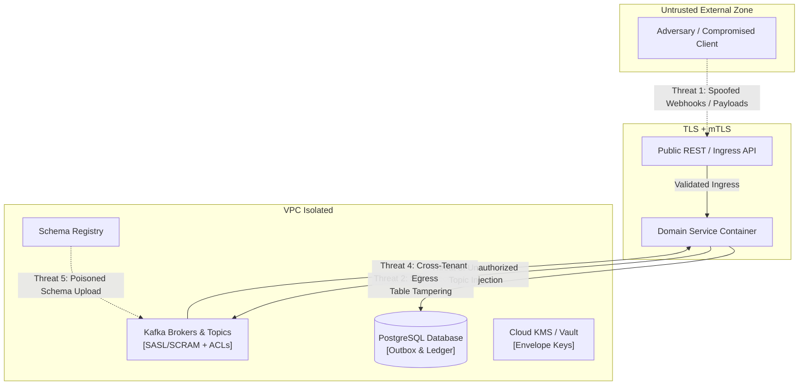
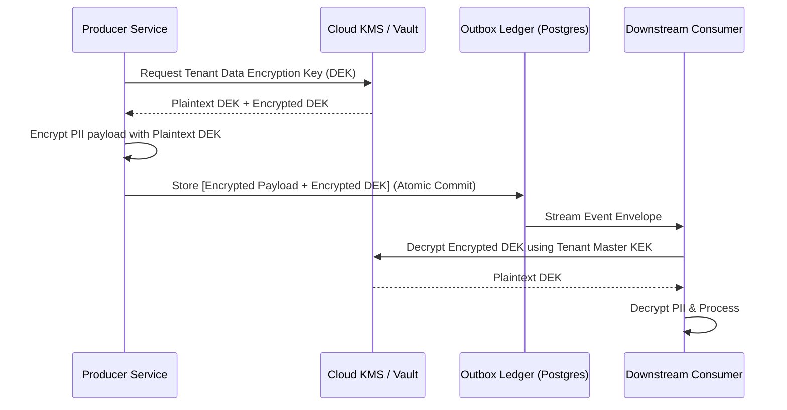

# Threat Model & STRIDE Security Analysis — Event-Driven Platform

## 1. Trust Boundaries & Attack Surface

The Event-Driven Platform spans multiple security domains: external clients, multi-tenant application services, internal relational databases, Kafka message brokers, and downstream projection consumers.

---

## 2. STRIDE Threat Analysis & Mitigation Matrix

| Threat Class | Specific Threat Scenario | Business / Operational Impact | Platform Mitigation & Countermeasure |
|---|---|---|---|
| **Spoofing** | Rogue service publishes false domain events (e.g. `payments.payment.captured.v1` emitted by unverified worker). | **CORRUPT / LOSS:** Unauthorized money movement or fraud. | **Single-Writer Invariant (AZ-04):** Kafka ACLs and Schema Registry RBAC enforce that only the certified owning service identity may publish to that topic. Ingress validates mTLS service principals. |
| **Tampering** | Man-in-the-middle or insider modifies event payload in transit or alters outbox rows in DB. | **CORRUPT:** Inconsistent read states and forged financial records. | 1. End-to-end TLS 1.3 on all transport hops. 2. PostgreSQL immutability triggers (`trg_prevent_audit_mutation`) reject `UPDATE` or `DELETE` on published ledger tables. 3. Cryptographic payload HMAC/signatures verified on ingress. |
| **Repudiation** | Upstream producer claims it never emitted an event; downstream claims it never received it. | **COMPLIANCE / LEGAL:** Audit failure in financial reconciliation. | 1. **Immutable Audit Ledger:** Every outbox record and consumer ACK records `(event_id, correlation_id, causation_id, principal_id, timestamp_utc)`. 2. W3C distributed trace spans link producer span directly to consumer execution span. |
| **Information Disclosure** | PII, credit card numbers, or passwords leak into Kafka logs, OpenTelemetry traces, or S3 backups. | **COMPLIANCE / PENALTY:** GDPR/CCPA violations; PCI-DSS breach. | 1. **Field-Level Envelope Encryption:** PII fields encrypted with tenant-specific DEKs before outbox insertion. 2. **Header Sanitization:** OTel trace attributes automatically strip sensitive keys (`password`, `token`, `ssn`, `card`). 3. **Crypto-Shredding:** Key deletion renders logs permanently unreadable. |
| **Denial of Service** | Malicious tenant floods topics with millions of dummy events or submits poison pill payloads. | **OUTAGE / DEGRADE:** Consumer group rebalance storms, consumer crashes, queue starvation. | 1. **Dead-Letter Quarantine (DLQ):** Poison pills bypass head-of-line blocking after bounded retries. 2. **Backpressure Rate Limiting:** Watermark-based throttling on ingress. 3. **Tenant Quotas:** Broker-level byte-rate throttling per client ID. |
| **Elevation of Privilege** | Tenant A queries or consumes events belonging to Tenant B across shared Kafka topics. | **SECURITY / BREACH:** Confidential business data leaked across tenants. | 1. **Multi-Tenant Topic Segregation / Envelope Tagging:** Every event envelope carries an immutable `tenant_id`. 2. **Consumer Filter Interceptors:** Enforce tenant isolation in memory before dispatching to business handlers. 3. Dedicated encryption keys per tenant prevent unauthorized decryption even if broker topic is intercepted. |

---

## 3. Schema Poisoning & Registry Defense

An attacker attempting to break downstream consumer systems could attempt to register an incompatible or malformed schema (e.g., deleting required fields or introducing circular type references).

**Registry Safeguards:**
1. **Transitive Compatibility Enforcement:** The Schema Registry rejects any schema change that violates `BACKWARD_TRANSITIVE` or `FULL_TRANSITIVE` compatibility rules against all previous historical versions.
2. **Deterministic Hash Checking:** Schemas are indexed by SHA-256 fingerprint; duplicate definitions reuse existing IDs without creating version drift.
3. **CI/CD Pre-Flight Gate:** PR templates require schema validation via `schema-registry-cli` before code merge.

---

## 4. Cryptographic Key Management Lifecycle

- **Crypto-Shredding Protocol:** When a GDPR/CCPA erasure request arrives, the Tenant/Subject Master Key is destroyed in KMS. Historical event logs on Kafka and cold S3 storage remain intact, but the encrypted PII becomes cryptographically unrecoverable random noise, satisfying legal erasure without breaking Kafka offset continuity or ledger integrity.
