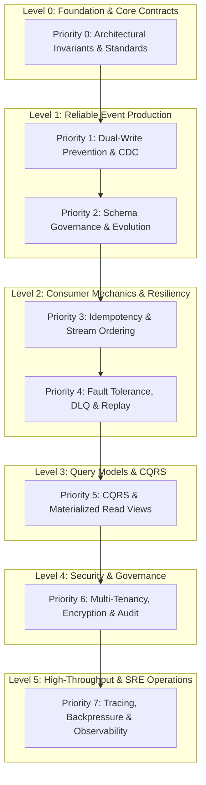

# Comprehensive Event-Driven Platform (EDP) Roadmap & Architecture Master Guide

> A complete, prioritized curriculum and engineering reference for mastering distributed event-driven systems, CQRS, event sourcing, transactional outbox, CDC, Kafka topologies, and resilient microservices.

---

## 🧭 Visual Learning Progression



---

## 🎯 Prioritized Curriculum & Deep-Dive Reference

---

### 🟢 Priority 0: Architectural Foundations, Contracts & Runtime Prerequisites

Understand the foundational platform rules, delivery semantics, error reporting standards, and local multi-service container environment before writing or modifying services.

#### Core Concepts to Master
1. **System-Wide Invariants**:
   * **At-Least-Once Delivery**: Network partitions mean events can be delivered multiple times; exactly-once is achieved purely at the consumer layer.
   * **Monotonic Ordering**: RFC 9562 UUIDv7 IDs ensure lexicographical time-ordering without centralized sequencer bottlenecks.
   * **Single-Writer Principle**: Only one service owns mutations and outbox entries for a given aggregate type.
   * **Payload Numerical Fidelity**: Monetary amounts are strictly formatted as minor units (`int64` cents) or exact strings—floating-point representation is forbidden.
2. **API Error Semantics (RFC 7807)**:
   * Structured problem details, machine-readable validation error codes, and persistence honesty.
3. **Local Toolchain & Runtime Isolation**:
   * Port mapping strategies (`15432` for Postgres, KRaft single-node mode, Apicurio in-memory).

#### Key Specifications & ADRs
| Document / ADR | Path | Key Takeaways |
|---|---|---|
| **System Requirements** | [`docs/00-requirements.md`](file:///home/btpl-lap-22/live/System-Architect/event-driven-platform/docs/00-requirements.md) | Latency limits, throughput targets, durability bounds |
| **C4 System Context & Architecture** | [`docs/01-c4.md`](file:///home/btpl-lap-22/live/System-Architect/event-driven-platform/docs/01-c4.md) | Component boundary topologies and subsystem interactions |
| **Event Catalog** | [`docs/02-event-catalog.md`](file:///home/btpl-lap-22/live/System-Architect/event-driven-platform/docs/02-event-catalog.md) | Domain event definitions, routing topics, and payload schemas |
| **Topic Design** | [`docs/03-topic-design.md`](file:///home/btpl-lap-22/live/System-Architect/event-driven-platform/docs/03-topic-design.md) | Partition allocation, cleanup policies, and compression |
| **Consistency Contract** | [`docs/04-consistency-contract.md`](file:///home/btpl-lap-22/live/System-Architect/event-driven-platform/docs/04-consistency-contract.md) | Bounded staleness, eventual consistency SLA, isolation levels |
| **Capacity Sizing** | [`docs/05-capacity-model.md`](file:///home/btpl-lap-22/live/System-Architect/event-driven-platform/docs/05-capacity-model.md) | Bandwidth, storage retention, CPU sizing formulas |
| **Threat Model** | [`docs/06-threat-model.md`](file:///home/btpl-lap-22/live/System-Architect/event-driven-platform/docs/06-threat-model.md) | STRIDE analysis, defense-in-depth, security mitigations |
| **ADR-0001: Local Toolchain** | [`docs/adr/ADR-0001-local-debug-toolchain-and-port-isolation.md`](file:///home/btpl-lap-22/live/System-Architect/event-driven-platform/docs/adr/ADR-0001-local-debug-toolchain-and-port-isolation.md) | Deterministic dev setup and avoiding local port collisions |
| **ADR-0002: API Errors & Honesty** | [`docs/adr/ADR-0002-api-error-semantics-validation-and-persistence-honesty.md`](file:///home/btpl-lap-22/live/System-Architect/event-driven-platform/docs/adr/ADR-0002-api-error-semantics-validation-and-persistence-honesty.md) | RFC 7807 problem details, transaction honest responses |
| **ADR-0003: Deployment Gotchas** | [`docs/adr/ADR-0003-runtime-prerequisites-and-deployment-gotchas.md`](file:///home/btpl-lap-22/live/System-Architect/event-driven-platform/docs/adr/ADR-0003-runtime-prerequisites-and-deployment-gotchas.md) | Linux AppArmor, `no-new-privileges`, Docker KRaft fixes |

---

### 🟡 Priority 1: Reliable Event Production & Change Data Capture (CDC)

Solve the dual-write problem: ensuring business database transactions and broker publishing succeed or fail together atomically.

#### Core Concepts to Master
1. **Transactional Outbox Pattern**:
   * Atomic local write: Business mutation and `outbox_events` record written in **one single SQL transaction**.
   * Poller relay worker with pessimistic locking (`FOR UPDATE SKIP LOCKED`) and leader fencing.
2. **Debezium CDC (Change Data Capture)**:
   * Logical decoding of Postgres Write-Ahead Log (`pgoutput` plugin).
   * Streaming outbox changes directly into Kafka with zero application polling overhead.
3. **Domain Event Structure**:
   * CloudEvents v1.0 standard envelope: `id`, `source`, `type`, `time`, `datacontenttype`, `tenant_id`, and `data`.

#### Deep-Dive Feature References
| Subsystem | ADR & Architecture Specs | Implementation & Migrations |
|---|---|---|
| **Transactional Outbox** | • [`ADR`](file:///home/btpl-lap-22/live/System-Architect/event-driven-platform/docs/features/transactional-outbox/adr.md)<br>• [`Business Logic`](file:///home/btpl-lap-22/live/System-Architect/event-driven-platform/docs/features/transactional-outbox/business-logic.md)<br>• [`Failure Cases`](file:///home/btpl-lap-22/live/System-Architect/event-driven-platform/docs/features/transactional-outbox/failure-cases.md)<br>• [`Diagrams`](file:///home/btpl-lap-22/live/System-Architect/event-driven-platform/docs/features/transactional-outbox/diagrams.md) | • Code: `src/features/transactional-outbox/`<br>• Migration: `database/migrations/sql/0001_create_transactional_outbox_table.sql` |
| **CDC Integration** | • [`ADR`](file:///home/btpl-lap-22/live/System-Architect/event-driven-platform/docs/features/cdc-integration/adr.md)<br>• [`Business Logic`](file:///home/btpl-lap-22/live/System-Architect/event-driven-platform/docs/features/cdc-integration/business-logic.md)<br>• [`Failure Cases`](file:///home/btpl-lap-22/live/System-Architect/event-driven-platform/docs/features/cdc-integration/failure-cases.md)<br>• [`Diagrams`](file:///home/btpl-lap-22/live/System-Architect/event-driven-platform/docs/features/cdc-integration/diagrams.md) | • Code: `src/features/cdc-integration/`<br>• Migration: `database/migrations/sql/0013_create_cdc_integration_tables.sql` |
| **Domain Event Design** | • [`ADR`](file:///home/btpl-lap-22/live/System-Architect/event-driven-platform/docs/features/domain-event-design/adr.md)<br>• [`Business Logic`](file:///home/btpl-lap-22/live/System-Architect/event-driven-platform/docs/features/domain-event-design/business-logic.md)<br>• [`Failure Cases`](file:///home/btpl-lap-22/live/System-Architect/event-driven-platform/docs/features/domain-event-design/failure-cases.md)<br>• [`Diagrams`](file:///home/btpl-lap-22/live/System-Architect/event-driven-platform/docs/features/domain-event-design/diagrams.md) | • Code: `src/features/domain-event-design/`<br>• Migration: `database/migrations/sql/0023_create_domain_event_design_tables.sql` |
| **Event Communication** | • [`ADR`](file:///home/btpl-lap-22/live/System-Architect/event-driven-platform/docs/features/event-driven-communication/adr.md)<br>• [`Business Logic`](file:///home/btpl-lap-22/live/System-Architect/event-driven-platform/docs/features/event-driven-communication/business-logic.md)<br>• [`Failure Cases`](file:///home/btpl-lap-22/live/System-Architect/event-driven-platform/docs/features/event-driven-communication/failure-cases.md)<br>• [`Diagrams`](file:///home/btpl-lap-22/live/System-Architect/event-driven-platform/docs/features/event-driven-communication/diagrams.md) | • Code: `src/features/event-driven-communication/`<br>• Migration: `database/migrations/sql/0025_create_event_driven_communication_tables.sql` |

---

### 🟡 Priority 2: Schema Governance & Safe Evolution

Ensure that distributed microservices can update schema contracts over time without breaking in-flight consumers or producing deserialization failures.

#### Core Concepts to Master
1. **Schema Registry Integration**:
   * Local in-memory caching of schema artifacts with fingerprint / hash validation.
   * Apicurio Registry REST integration for artifact management.
2. **Compatibility Modes**:
   * **Backward Compatibility**: New schema can read events written by older schema.
   * **Forward Compatibility**: Older schema can read events written by newer schema.
   * **Full Compatibility**: Both forward and backward compatible.
3. **Payload Migration Patterns**:
   * Upcasting: Transforming old event schemas in-memory to newest domain model versions.

#### Deep-Dive Feature References
| Subsystem | ADR & Architecture Specs | Implementation & Migrations |
|---|---|---|
| **Event Schema Registry** | • [`ADR`](file:///home/btpl-lap-22/live/System-Architect/event-driven-platform/docs/features/event-schema-registry/adr.md)<br>• [`Business Logic`](file:///home/btpl-lap-22/live/System-Architect/event-driven-platform/docs/features/event-schema-registry/business-logic.md)<br>• [`Failure Cases`](file:///home/btpl-lap-22/live/System-Architect/event-driven-platform/docs/features/event-schema-registry/failure-cases.md)<br>• [`Diagrams`](file:///home/btpl-lap-22/live/System-Architect/event-driven-platform/docs/features/event-schema-registry/diagrams.md) | • Code: `src/features/event-schema-registry/`<br>• Schemas: `messaging/schemas/` |
| **Schema Evolution** | • [`ADR`](file:///home/btpl-lap-22/live/System-Architect/event-driven-platform/docs/features/schema-evolution/adr.md)<br>• [`Business Logic`](file:///home/btpl-lap-22/live/System-Architect/event-driven-platform/docs/features/schema-evolution/business-logic.md)<br>• [`Failure Cases`](file:///home/btpl-lap-22/live/System-Architect/event-driven-platform/docs/features/schema-evolution/failure-cases.md)<br>• [`Diagrams`](file:///home/btpl-lap-22/live/System-Architect/event-driven-platform/docs/features/schema-evolution/diagrams.md) | • Code: `src/features/schema-evolution/`<br>• Migration: `database/migrations/sql/0020_create_schema_evolution_tables.sql` |
| **Event Versioning** | • [`ADR`](file:///home/btpl-lap-22/live/System-Architect/event-driven-platform/docs/features/event-versioning/adr.md)<br>• [`Business Logic`](file:///home/btpl-lap-22/live/System-Architect/event-driven-platform/docs/features/event-versioning/business-logic.md)<br>• [`Failure Cases`](file:///home/btpl-lap-22/live/System-Architect/event-driven-platform/docs/features/event-versioning/failure-cases.md)<br>• [`Diagrams`](file:///home/btpl-lap-22/live/System-Architect/event-driven-platform/docs/features/event-versioning/diagrams.md) | • Code: `src/features/event-versioning/`<br>• Migration: `database/migrations/sql/0005_create_event_versioning_tables.sql` |

---

### 🟠 Priority 3: Consumer Architecture & In-Order Processing

Learn how distributed workers consume Kafka topics reliably, prevent duplicate processing, and maintain strict chronological order per aggregate.

#### Core Concepts to Master
1. **Idempotent Consumers**:
   * Deduplication records stored with TTL / retention windows.
   * Atomic check-and-insert before executing side-effects.
2. **Strict Aggregate Ordering**:
   * Message partitioning keyed by `aggregate_id`.
   * Per-aggregate version fencing: `expected_version = previous_version + 1`.
3. **Partitioning Strategies**:
   * Hash partitioning vs composite keys to prevent partition skew and hot spots.
4. **Offset Management & Consumer Groups**:
   * Manual commit vs auto-commit tradeoffs; handling Kafka rebalances without dropping state.

#### Deep-Dive Feature References
| Subsystem | ADR & Architecture Specs | Implementation & Migrations |
|---|---|---|
| **Idempotent Consumers** | • [`ADR`](file:///home/btpl-lap-22/live/System-Architect/event-driven-platform/docs/features/idempotent-consumers/adr.md)<br>• [`Business Logic`](file:///home/btpl-lap-22/live/System-Architect/event-driven-platform/docs/features/idempotent-consumers/business-logic.md)<br>• [`Failure Cases`](file:///home/btpl-lap-22/live/System-Architect/event-driven-platform/docs/features/idempotent-consumers/failure-cases.md)<br>• [`Diagrams`](file:///home/btpl-lap-22/live/System-Architect/event-driven-platform/docs/features/idempotent-consumers/diagrams.md) | • Code: `src/features/idempotent-consumers/`<br>• Migration: `database/migrations/sql/0002_create_idempotent_consumer_tables.sql` |
| **Ordering Protection** | • [`ADR`](file:///home/btpl-lap-22/live/System-Architect/event-driven-platform/docs/features/event-ordering-protection/adr.md)<br>• [`Business Logic`](file:///home/btpl-lap-22/live/System-Architect/event-driven-platform/docs/features/event-ordering-protection/business-logic.md)<br>• [`Failure Cases`](file:///home/btpl-lap-22/live/System-Architect/event-driven-platform/docs/features/event-ordering-protection/failure-cases.md)<br>• [`Diagrams`](file:///home/btpl-lap-22/live/System-Architect/event-driven-platform/docs/features/event-ordering-protection/diagrams.md) | • Code: `src/features/event-ordering-protection/`<br>• Migration: `database/migrations/sql/0006_create_event_ordering_tables.sql` |
| **Partitioning Strategy** | • [`ADR`](file:///home/btpl-lap-22/live/System-Architect/event-driven-platform/docs/features/partitioning-strategy/adr.md)<br>• [`Business Logic`](file:///home/btpl-lap-22/live/System-Architect/event-driven-platform/docs/features/partitioning-strategy/business-logic.md)<br>• [`Failure Cases`](file:///home/btpl-lap-22/live/System-Architect/event-driven-platform/docs/features/partitioning-strategy/failure-cases.md)<br>• [`Diagrams`](file:///home/btpl-lap-22/live/System-Architect/event-driven-platform/docs/features/partitioning-strategy/diagrams.md) | • Code: `src/features/partitioning-strategy/`<br>• Migration: `database/migrations/sql/0014_create_partitioning_strategy_tables.sql` |
| **Consumer Groups** | • [`ADR`](file:///home/btpl-lap-22/live/System-Architect/event-driven-platform/docs/features/consumer-groups/adr.md)<br>• [`Business Logic`](file:///home/btpl-lap-22/live/System-Architect/event-driven-platform/docs/features/consumer-groups/business-logic.md)<br>• [`Failure Cases`](file:///home/btpl-lap-22/live/System-Architect/event-driven-platform/docs/features/consumer-groups/failure-cases.md)<br>• [`Diagrams`](file:///home/btpl-lap-22/live/System-Architect/event-driven-platform/docs/features/consumer-groups/diagrams.md) | • Code: `src/features/consumer-groups/`<br>• Migration: `database/migrations/sql/0008_create_consumer_group_tables.sql` |
| **Offset Management** | • [`ADR`](file:///home/btpl-lap-22/live/System-Architect/event-driven-platform/docs/features/offset-management/adr.md)<br>• [`Business Logic`](file:///home/btpl-lap-22/live/System-Architect/event-driven-platform/docs/features/offset-management/business-logic.md)<br>• [`Failure Cases`](file:///home/btpl-lap-22/live/System-Architect/event-driven-platform/docs/features/offset-management/failure-cases.md)<br>• [`Diagrams`](file:///home/btpl-lap-22/live/System-Architect/event-driven-platform/docs/features/offset-management/diagrams.md) | • Code: `src/features/offset-management/`<br>• Migration: `database/migrations/sql/0009_create_offset_management_tables.sql` |

---

### 🟠 Priority 4: Error Handling, Dead Letters & Historical Replay

Build resilient, self-healing systems that isolate poison messages and recover from transient failures without operator intervention.

#### Core Concepts to Master
1. **Non-Blocking Retry Queues**:
   * Staggered exponential delays via multiple topics (`orders.retry-15s`, `orders.retry-60s`).
   * Preventing downstream head-of-line blocking on transient HTTP/DB timeouts.
2. **Dead Letter Quarantine (DLQ)**:
   * Isolating poison pills with rich diagnostics (stack trace, attempt count, headers).
   * Rest API for inspecting, modifying, and replaying quarantined records.
3. **Replay Subsystem**:
   * Resetting offsets to point-in-time or snapshot boundaries for recovery or data backfills.

#### Deep-Dive Feature References
| Subsystem | ADR & Architecture Specs | Implementation & Migrations |
|---|---|---|
| **Retry Topics** | • [`ADR`](file:///home/btpl-lap-22/live/System-Architect/event-driven-platform/docs/features/retry-topics/adr.md)<br>• [`Business Logic`](file:///home/btpl-lap-22/live/System-Architect/event-driven-platform/docs/features/retry-topics/business-logic.md)<br>• [`Failure Cases`](file:///home/btpl-lap-22/live/System-Architect/event-driven-platform/docs/features/retry-topics/failure-cases.md)<br>• [`Diagrams`](file:///home/btpl-lap-22/live/System-Architect/event-driven-platform/docs/features/retry-topics/diagrams.md) | • Code: `src/features/retry-topics/`<br>• Migration: `database/migrations/sql/0007_create_retry_topics_tables.sql` |
| **Dead Letter Handling** | • [`ADR`](file:///home/btpl-lap-22/live/System-Architect/event-driven-platform/docs/features/dead-letter-handling/adr.md)<br>• [`Business Logic`](file:///home/btpl-lap-22/live/System-Architect/event-driven-platform/docs/features/dead-letter-handling/business-logic.md)<br>• [`Failure Cases`](file:///home/btpl-lap-22/live/System-Architect/event-driven-platform/docs/features/dead-letter-handling/failure-cases.md)<br>• [`Diagrams`](file:///home/btpl-lap-22/live/System-Architect/event-driven-platform/docs/features/dead-letter-handling/diagrams.md) | • Code: `src/features/dead-letter-handling/`<br>• Migration: `database/migrations/sql/0004_create_dead_letter_v3_subsystem.sql` |
| **Replay Mechanism** | • [`ADR`](file:///home/btpl-lap-22/live/System-Architect/event-driven-platform/docs/features/replay-mechanism/adr.md)<br>• [`Business Logic`](file:///home/btpl-lap-22/live/System-Architect/event-driven-platform/docs/features/replay-mechanism/business-logic.md)<br>• [`Failure Cases`](file:///home/btpl-lap-22/live/System-Architect/event-driven-platform/docs/features/replay-mechanism/failure-cases.md)<br>• [`Diagrams`](file:///home/btpl-lap-22/live/System-Architect/event-driven-platform/docs/features/replay-mechanism/diagrams.md) | • Code: `src/features/replay-mechanism/`<br>• Migration: `database/migrations/sql/0011_create_replay_mechanism_tables.sql` |

---

### 🔵 Priority 5: CQRS & Materialized Read Projections

Master asynchronous query view projection, cache rebuilding, and eventual consistency lag mitigation.

#### Core Concepts to Master
1. **CQRS (Command Query Responsibility Segregation)**:
   * Write side: Optimized for validation, concurrency control, and transactional outbox.
   * Read side: Denormalized, query-specific views updated asynchronously from Kafka events.
2. **Materialized Views**:
   * Projection workers maintaining relational tables with zero locking on write path.
   * Blue-green view rebuilds with zero downtime during projection refactors.
3. **Eventual Consistency Tracking**:
   * Measuring replication lag between command timestamp and read-model update.
   * Read-your-own-writes consistency mechanisms.

#### Deep-Dive Feature References
| Subsystem | ADR & Architecture Specs | Implementation & Migrations |
|---|---|---|
| **CQRS** | • [`ADR`](file:///home/btpl-lap-22/live/System-Architect/event-driven-platform/docs/features/cqrs/adr.md)<br>• [`Business Logic`](file:///home/btpl-lap-22/live/System-Architect/event-driven-platform/docs/features/cqrs/business-logic.md)<br>• [`Failure Cases`](file:///home/btpl-lap-22/live/System-Architect/event-driven-platform/docs/features/cqrs/failure-cases.md)<br>• [`Diagrams`](file:///home/btpl-lap-22/live/System-Architect/event-driven-platform/docs/features/cqrs/diagrams.md) | • Code: `src/features/cqrs/`<br>• Migration: `database/migrations/sql/0019_create_cqrs_tables.sql` |
| **Materialized Views** | • [`ADR`](file:///home/btpl-lap-22/live/System-Architect/event-driven-platform/docs/features/materialized-views/adr.md)<br>• [`Business Logic`](file:///home/btpl-lap-22/live/System-Architect/event-driven-platform/docs/features/materialized-views/business-logic.md)<br>• [`Failure Cases`](file:///home/btpl-lap-22/live/System-Architect/event-driven-platform/docs/features/materialized-views/failure-cases.md)<br>• [`Diagrams`](file:///home/btpl-lap-22/live/System-Architect/event-driven-platform/docs/features/materialized-views/diagrams.md) | • Code: `src/features/materialized-views/`<br>• Migrations: `database/migrations/sql/0015_create_materialized_view_tables.sql`, `0016_...` |
| **Consistency Monitoring** | • [`ADR`](file:///home/btpl-lap-22/live/System-Architect/event-driven-platform/docs/features/eventual-consistency-monitoring/adr.md)<br>• [`Business Logic`](file:///home/btpl-lap-22/live/System-Architect/event-driven-platform/docs/features/eventual-consistency-monitoring/business-logic.md)<br>• [`Failure Cases`](file:///home/btpl-lap-22/live/System-Architect/event-driven-platform/docs/features/eventual-consistency-monitoring/failure-cases.md)<br>• [`Diagrams`](file:///home/btpl-lap-22/live/System-Architect/event-driven-platform/docs/features/eventual-consistency-monitoring/diagrams.md) | • Code: `src/features/eventual-consistency-monitoring/`<br>• Migration: `database/migrations/sql/0018_create_eventual_consistency_monitoring_tables.sql` |

---

### 🟣 Priority 6: Multi-Tenancy, Security & Governance

Enforce enterprise-grade security, data privacy, and strict tenant boundaries on shared event streams.

#### Core Concepts to Master
1. **Multi-Tenant Isolation**:
   * PostgreSQL Row-Level Security (RLS) policies scoped strictly per `tenant_id`.
   * Tenant-scoped Kafka topic routing vs multi-tenant envelope partitioning.
2. **Event Authorization**:
   * Role-based and attribute-based access control (RBAC/ABAC) on event read/write APIs.
3. **Payload Field & Envelope Encryption**:
   * AES-GCM envelope encryption for sensitive payload fields (PII, tokens, financial details).
   * Key rotation and cryptographic shredding (GDPR right-to-be-forgotten).
4. **Tamper-Evident Audit Trail**:
   * Cryptographic hash chaining (`sha256(prev_hash + event_data)`) ensuring non-repudiation.

#### Deep-Dive Feature References
| Subsystem | ADR & Architecture Specs | Implementation & Migrations |
|---|---|---|
| **Multi-Tenant Isolation** | • [`ADR`](file:///home/btpl-lap-22/live/System-Architect/event-driven-platform/docs/features/multi-tenant-event-isolation/adr.md)<br>• [`Business Logic`](file:///home/btpl-lap-22/live/System-Architect/event-driven-platform/docs/features/multi-tenant-event-isolation/business-logic.md)<br>• [`Failure Cases`](file:///home/btpl-lap-22/live/System-Architect/event-driven-platform/docs/features/multi-tenant-event-isolation/failure-cases.md)<br>• [`Diagrams`](file:///home/btpl-lap-22/live/System-Architect/event-driven-platform/docs/features/multi-tenant-event-isolation/diagrams.md) | • Code: `src/features/multi-tenant-event-isolation/`<br>• Migration: `database/migrations/sql/0012_create_multi_tenant_isolation_tables.sql` |
| **Event Authorization** | • [`ADR`](file:///home/btpl-lap-22/live/System-Architect/event-driven-platform/docs/features/event-authorization/adr.md)<br>• [`Business Logic`](file:///home/btpl-lap-22/live/System-Architect/event-driven-platform/docs/features/event-authorization/business-logic.md)<br>• [`Failure Cases`](file:///home/btpl-lap-22/live/System-Architect/event-driven-platform/docs/features/event-authorization/failure-cases.md)<br>• [`Diagrams`](file:///home/btpl-lap-22/live/System-Architect/event-driven-platform/docs/features/event-authorization/diagrams.md) | • Code: `src/features/event-authorization/`<br>• Migration: `database/migrations/sql/0024_create_event_authorization_tables.sql` |
| **Payload Encryption** | • [`ADR`](file:///home/btpl-lap-22/live/System-Architect/event-driven-platform/docs/features/encryption/adr.md)<br>• [`Business Logic`](file:///home/btpl-lap-22/live/System-Architect/event-driven-platform/docs/features/encryption/business-logic.md)<br>• [`Failure Cases`](file:///home/btpl-lap-22/live/System-Architect/event-driven-platform/docs/features/encryption/failure-cases.md)<br>• [`Diagrams`](file:///home/btpl-lap-22/live/System-Architect/event-driven-platform/docs/features/encryption/diagrams.md) | • Code: `src/features/encryption/`<br>• Migration: `database/migrations/sql/0022_create_encryption_tables.sql` |
| **Audit Trail** | • [`ADR`](file:///home/btpl-lap-22/live/System-Architect/event-driven-platform/docs/features/audit-trail/adr.md)<br>• [`Business Logic`](file:///home/btpl-lap-22/live/System-Architect/event-driven-platform/docs/features/audit-trail/business-logic.md)<br>• [`Failure Cases`](file:///home/btpl-lap-22/live/System-Architect/event-driven-platform/docs/features/audit-trail/failure-cases.md)<br>• [`Diagrams`](file:///home/btpl-lap-22/live/System-Architect/event-driven-platform/docs/features/audit-trail/diagrams.md) | • Code: `src/features/audit-trail/`<br>• Migration: `database/migrations/sql/0021_create_audit_trail_tables.sql` |

---

### 🔴 Priority 7: High-Throughput Flow Control, Distributed Telemetry & SRE

Learn how to maintain SLA visibility and prevent cascading failures under heavy load.

#### Core Concepts to Master
1. **W3C Distributed Tracing**:
   * Injecting and extracting traceparent context across HTTP calls, database outbox, Kafka headers, and consumer processing.
2. **Backpressure & Flow Control**:
   * Dynamic polling pause/resume when downstream buffers or database connection pools reach high watermark.
3. **Event Operations & Metrics**:
   * Lag monitoring, throughput saturation alarms, and cluster operational dashboard.

#### Deep-Dive Feature References
| Subsystem | ADR & Architecture Specs | Implementation & Migrations |
|---|---|---|
| **Distributed Tracing** | • [`ADR`](file:///home/btpl-lap-22/live/System-Architect/event-driven-platform/docs/features/distributed-tracing/adr.md)<br>• [`Durable Observability ADR`](file:///home/btpl-lap-22/live/System-Architect/event-driven-platform/docs/features/distributed-tracing/adr-durable-observability.md)<br>• [`Business Logic`](file:///home/btpl-lap-22/live/System-Architect/event-driven-platform/docs/features/distributed-tracing/business-logic.md)<br>• [`Failure Cases`](file:///home/btpl-lap-22/live/System-Architect/event-driven-platform/docs/features/distributed-tracing/failure-cases.md)<br>• [`Diagrams`](file:///home/btpl-lap-22/live/System-Architect/event-driven-platform/docs/features/distributed-tracing/diagrams.md) | • Code: `src/features/distributed-tracing/`<br>• Migration: `database/migrations/sql/0027_create_distributed_tracing_tables.sql` |
| **Backpressure Control** | • [`ADR`](file:///home/btpl-lap-22/live/System-Architect/event-driven-platform/docs/features/backpressure/adr.md)<br>• [`Business Logic`](file:///home/btpl-lap-22/live/System-Architect/event-driven-platform/docs/features/backpressure/business-logic.md)<br>• [`Failure Cases`](file:///home/btpl-lap-22/live/System-Architect/event-driven-platform/docs/features/backpressure/failure-cases.md)<br>• [`Diagrams`](file:///home/btpl-lap-22/live/System-Architect/event-driven-platform/docs/features/backpressure/diagrams.md) | • Code: `src/features/backpressure/`<br>• Migration: `database/migrations/sql/0010_create_backpressure_tables.sql` |
| **Operations Dashboard** | • [`ADR`](file:///home/btpl-lap-22/live/System-Architect/event-driven-platform/docs/features/event-operations-dashboard/adr.md)<br>• [`Business Logic`](file:///home/btpl-lap-22/live/System-Architect/event-driven-platform/docs/features/event-operations-dashboard/business-logic.md)<br>• [`Failure Cases`](file:///home/btpl-lap-22/live/System-Architect/event-driven-platform/docs/features/event-operations-dashboard/failure-cases.md)<br>• [`Diagrams`](file:///home/btpl-lap-22/live/System-Architect/event-driven-platform/docs/features/event-operations-dashboard/diagrams.md) | • Code: `src/features/event-operations-dashboard/`<br>• Migration: `database/migrations/sql/0026_create_event_operations_dashboard_tables.sql` |

---

## 🛠️ Step-by-Step Practical Exercises

To internalize these concepts, run through these hands-on steps:

1. **Spin up the stack**:
   ```bash
   scripts/run/quickstart.sh
   ```
2. **Execute a smoke test**:
   ```bash
   scripts/test/smoke.sh
   ```
3. **Observe the Outbox Ingestion**:
   * Inspect the `outbox_events` table in PostgreSQL (`127.0.0.1:15432`, db: `event_store`).
   * Trace an event as Debezium CDC captures the WAL log and forwards it to Kafka.
4. **Trigger a Dead Letter Queue (DLQ) Scenario**:
   * Produce a malformed event or induce an unrecoverable business exception in a consumer to inspect how it is quarantined in `dead_letter_records`.
5. **Inspect Metrics**:
   * Open Prometheus at `http://127.0.0.1:9090` and explore latency, lag, and throughput metrics exported from `http://127.0.0.1:8081/metrics`.
