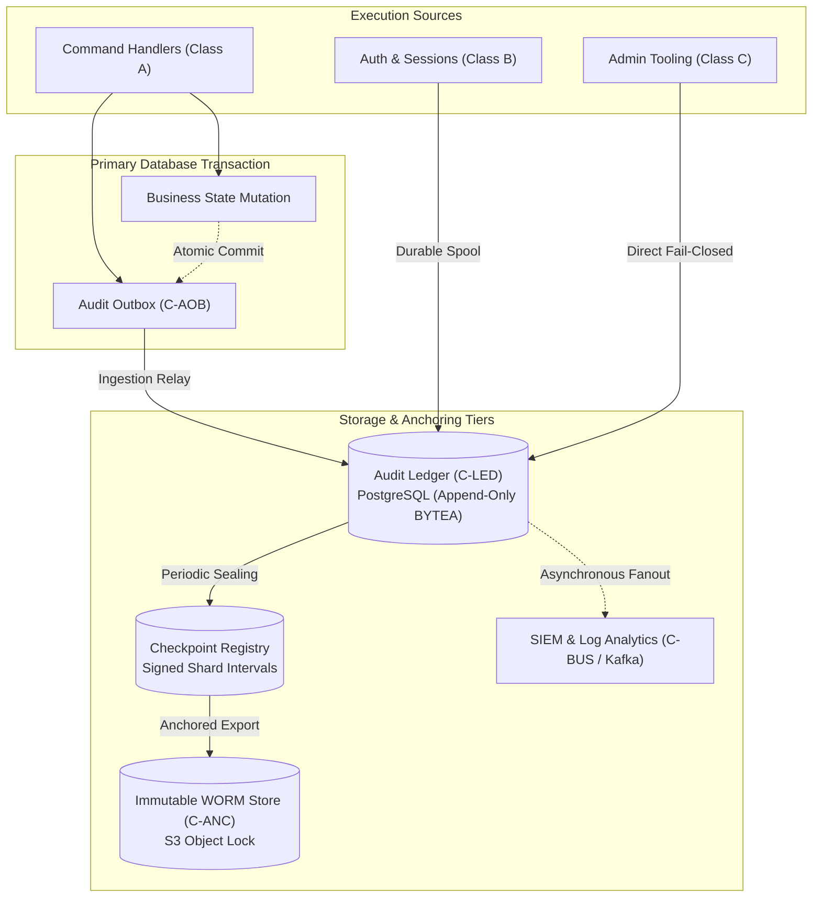
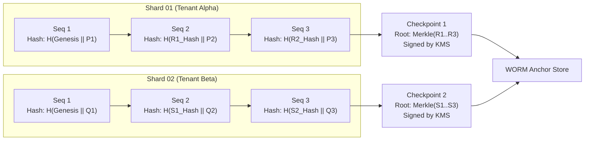
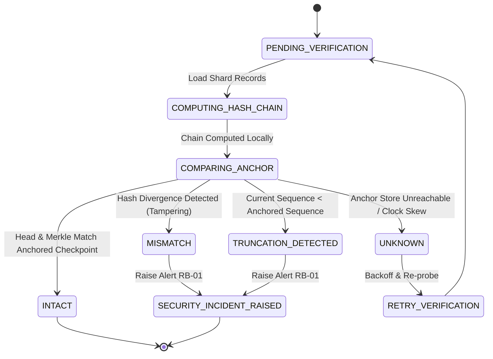
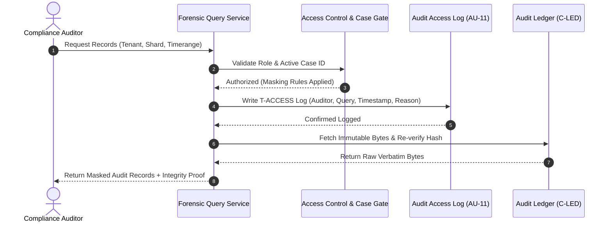

# Audit Trail Architecture Diagrams

## 1. System Topology & Capture Pipeline

## 2. Sharded Cryptographic Hash Chain Structure

## 3. Cryptographic Verification State Machine

## 4. Query-Audit & Forensics Flow (AU-11)

