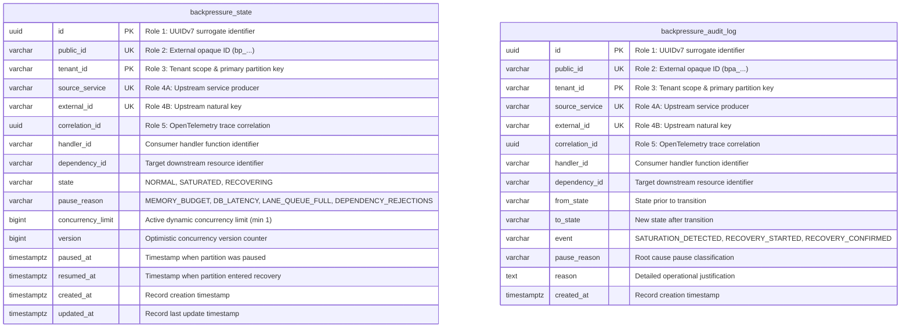
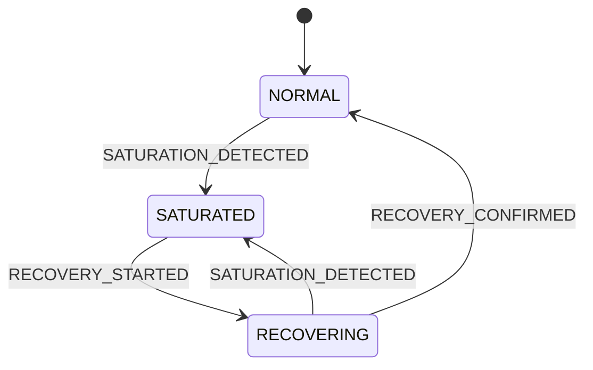
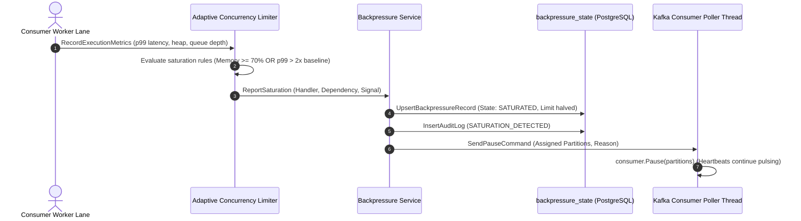
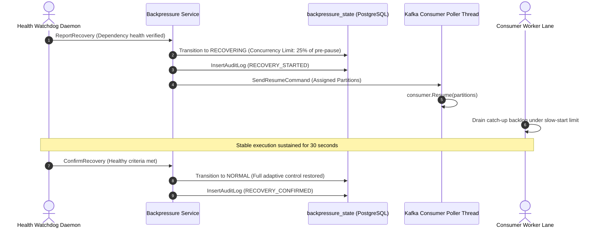

# Architectural Decision Record: Adaptive Backpressure Control & Partition Throttling Engine (WP-8)

## 1. Title & Metadata
* **Status**: APPROVED
* **Date**: 2026-11-05
* **Decision Makers**: Platform Architecture Guild, Chief Distributed Systems Architect
* **Governing Specification**: [Backpressure Production System Design Tree (v2)](file:///home/btpl-lap-22/live/System-Architect/event-driven-platform/docs/features/backpressure/business-logic.md)

---

## 2. Context & Problem Statement
In high-throughput event-driven microservices architectures, consumer processing velocity is non-deterministic. When downstream storage engines (PostgreSQL, OpenSearch), external partner APIs, or cache tiers experience latency spikes, lock contention, or temporary outages, naive consumer consumption produces catastrophic failure modes:

1. **Unbounded In-Memory Buffering & Out-of-Memory (OOM) Crashes (F6.1, F6.2)**: Default consumer worker implementations buffer unacknowledged messages in application memory. When processing slows down while Kafka broker polling continues unabated, internal heaps saturate, triggering JVM/Go Garbage Collection death spirals and unrecoverable container OOM kills.
2. **Autoscaler Positive Feedback Collapse (F10.1)**: When a shared downstream database experiences latency under contention, consumer lag accumulates. Standard Kubernetes Event-driven Autoscaling (KEDA) triggers consumer pod scale-outs. The increased replica count opens more connection pool slots against PostgreSQL, intensifying lock contention and driving latency exponentially higher until full database outage occurs (retrograde scaling).
3. **Partition Starvation from Global Halts (F3.4)**: Throttling an entire consumer process because of a single hot-key or a specific slow downstream dependency halts processing for hundreds of unrelated healthy aggregates and topics. Backpressure must be granularly scoped to the exact saturated dependency and handler.
4. **Resumption Thundering Herds (F4.2)**: When saturated dependencies recover, resuming consumption at full pre-pause concurrency immediately re-saturates the downstream service, causing oscillatory pause/resume flapping and connection thrashing.
5. **Causal Violation from Naive Shedding (F9.1, F9.2)**: Dropping or coalescing events without respect to their causal ordering class corrupts financial balances and delta-driven state machines.

---

## 3. Decision Drivers & Architecture Invariants (BP-01 to BP-12)

* **BP-01: Memory Bounded by Bytes, Not Counts [Certain]**: All fetch queues, worker lane channels, and in-flight batches are capped by explicit byte budgets (`LiveHeapBytes` vs. `MemoryLimitBytes`). Count-based limits are strictly prohibited.
* **BP-02: Scoped Backpressure [Certain]**: Throttling decisions are strictly scoped to the tuple `(tenant_id, handler_id, dependency_id)`. Unrelated handlers sharing the same consumer group or process continue execution unimpeded.
* **BP-03: Reasoned, Owned Pauses with Max Duration [Certain]**: Every partition pause carries an explicit typed reason (`PauseReasonMemoryBudget`, `PauseReasonDBLatency`, `PauseReasonQueueFull`, `PauseReasonRejections`) and an escalation timer (Warning at 2 min, Page at 10 min, Incident at 25% retention headroom). Reasonless pauses are rejected.
* **BP-04: Gradual Resume via Slow Start Ramp [Certain]**: When a paused handler resumes after dependency recovery, concurrency limit initializes at 25% of its pre-pause watermark (`ResumeRampFraction = 0.25`) with a floor of 1. It scales additively only as downstream latency gradients stabilize.
* **BP-05: Autoscaling Suppressed Under Dependency Saturation [Certain]**: KEDA and Horizontal Pod Autoscalers (HPA) query the backpressure engine before evaluating lag. If consumer lag is induced by downstream dependency saturation (`State == SATURATED`), scale-out decisions are frozen to prevent database collapse.
* **BP-06: Connection Pool Budget Cap [Certain]**: Total aggregate connection footprint across all scaled consumer pods is capped: Replicas * PoolSize <= AllottedMaxConnections.
* **BP-07: Kafka Log Retention Bounded [Certain]**: Consumer lag is monitored against remaining Kafka disk retention time. Saturated partitions approaching retention thresholds escalate to P1 data loss hazard alerts.
* **BP-08: Pressure Never Lands Silently on WAL [Certain]**: Relay CDC pollers and transactional outbox engines monitor replication slot lag. Downstream consumer throttling triggers proactive alerts before PostgreSQL WAL growth exhausts host disk space.
* **BP-09: Ordering-Class-Aware Shedding & Coalescing [Certain]**: 
  - `O-STRICT`: Strictly forbidden from being shed or coalesced; must catch up sequentially.
  - `O-STATE`: Allowed to coalesce intermediate versions in memory during catch-up, applying only the latest state version.
  - `O-NONE`: Telemetry and analytics events allowed to sample or shed with explicit counter emissions.
* **BP-10: Physical Priority Isolation [Certain]**: Tier-0 (transactional financial mutations) and Tier-2 (telemetry, background audits) never share database connection pools, Kafka partitions, or worker lanes.
* **BP-11: Poll Thread Separation [Certain]**: Kafka client calls (`Pause`, `Resume`, `Seek`, `Commit`) are strictly dispatched from the dedicated poller goroutine via command channels. Worker threads never directly invoke client methods.
* **BP-12: Observable Backpressure State [Certain]**: Backpressure status is stored as an authoritative, queryable state machine (`NORMAL`, `SATURATED`, `RECOVERING`) in PostgreSQL, accompanied by an append-only audit trail (`backpressure_audit_log`).

---

## 4. Backpressure Chain Hop Architecture (H1 to H9)

Every stage in the event streaming topology enforces a dedicated buffer, a boundary watermark, and a controlled fallback mechanism:

| Hop | Topology Component | Buffer Type | Saturated Failure Mode | Architectural Control Mechanism |
| :--- | :--- | :--- | :--- | :--- |
| **H1** | Edge API Gateway | HTTP request pipeline | Client latency spikes, 504 timeouts | Admission control, HTTP 429 with mandatory `Retry-After` |
| **H2** | Producer Service & DB | DB connection pool, row locks | Request thread starvation | Connection pooling limits, circuit breakers |
| **H3** | Outbox Table & WAL | PostgreSQL WAL + replication slots | Disk exhaustion, replication stall | Outbox relay poller health checks, slot lag alerts |
| **H4** | Outbox Relay Worker | In-memory batch queue | WAL expansion on source DB | CDC batch bounds, adaptive broker client throughput |
| **H5** | Kafka Brokers | Commit log on NVMe disk | Retention data loss, broker disk full | Broker byte quotas, tiered storage, retention alerts |
| **H6** | Consumer Prefetch Buffer | Client internal fetch queues | Process OOM crash loop | Per-partition fetch byte caps, dynamic partition pausing |
| **H7** | Consumer Worker Lanes | Bounded Go channels | Memory exhaustion, goroutine leak | Byte-budgeted lane channels, worker pool bulkheads |
| **H8** | Downstream Storage Sink | Postgres pool, OpenSearch index | Lock contention, connection rejection | Adaptive Concurrency Limiter (Layer A), partition pause (Layer B) |
| **H9** | Consumer Egress Outbox | Outbox table in sink database | Cascading downstream pressure | Backpressure propagation to upstream partition pauses |

---

## 5. Storage Gate Contract & Database Writing Rules

Complies strictly with [05-db-writing-rules.md](file:///home/btpl-lap-22/live/System-Architect/llm-obs-policies/rules/folder-structure/05-db-writing-rules.md) and [01-schema-migrations-and-code-guidelines.md](file:///home/btpl-lap-22/live/System-Architect/llm-obs-policies/rules/database/migrations/01-schema-migrations-and-code-guidelines.md).

### 5.1 The 5 Identifier Roles Mapping
1. **Role 1 (Surrogate PK)**: UUIDv7 generated internally (`id`). Immutable.
2. **Role 2 (Public ID)**: Regex-constrained external strings (`public_id` matching `^bp_[A-Za-z0-9]{26}$` for state and `^bpa_[A-Za-z0-9]{26}$` for audit logs).
3. **Role 3 (Tenant Scope)**: `tenant_id` leading composite primary keys and unique indices.
4. **Role 4 (Natural Upstream Key)**: Composite unique constraint on `(tenant_id, source_service, external_id)` with `btrim` validation.
5. **Role 5 (Correlation Trace)**: `correlation_id` UUID propagated from upstream OpenTelemetry trace context. Immutable.

### 5.2 Optimistic Concurrency & Audit Columns
- `backpressure_state` includes `version BIGINT NOT NULL DEFAULT 1` for optimistic locking, `created_at`, and `updated_at` (maintained via trigger).
- `backpressure_audit_log` is strictly append-only, with `UPDATE` and `DELETE` revoked from public roles and guarded by an immutable plpgsql trigger.

### 5.3 Entity-Relationship Diagram

---

## 6. State Machine & Execution Workflows

### 6.1 State Machine Lifecycle

### 6.2 Saturation Detection and Partition Pause Workflow

### 6.3 Gradual Recovery & Ramp Workflow

---

## 7. Operational Runbooks & Escalation Thresholds

* **RB-01: Persistent Downstream DB Slowdown**:
  1. Verify adaptive concurrency limiter has decreased worker concurrency to floor (1).
  2. Confirm scoped partition pause is active for affected `(handler, dependency)` tuple.
  3. Validate that KEDA / HPA scale-out triggers are frozen (`BP-05`).
  4. Escalate to database administration guild to investigate active locks and slow queries.
* **RB-02: Memory Pressure Warning**:
  1. Inspect `LiveHeapBytes` versus container soft memory limit.
  2. Reduce per-partition fetch byte cap on consumer clients.
  3. Force runtime GC trigger if live heap remains elevated above low watermark.
* **RB-03: Prolonged Partition Pause Escalation**:
  - `T > 2 min`: Automated WARN telemetry emitted to platform operations dashboard.
  - `T > 10 min`: PagerDuty alert dispatched to on-call distributed systems engineer.
  - `T > 25% retention headroom`: P1 critical incident opened; initiate emergency consumer lane migration or Tier-2 telemetry shedding.

---

## 8. Verification & Test Evidence
All business rules and invariants are verified by automated tests in `src/features/backpressure/tests/`:
* `TestRuleEvaluateSaturation_MemoryBudget`: Verifies live heap >= 70% triggers memory pause.
* `TestRuleEvaluateSaturation_RejectionCount`: Verifies downstream 429/rejections trigger concurrency reduction.
* `TestRuleEvaluateSaturation_LatencyGradient`: Verifies p99 > 2x baseline triggers database latency pause.
* `TestRuleComputeDecreasedConcurrency_Floor`: Enforces multiplicative decrement with floor of 1.
* `TestRuleComputeRampConcurrency_25Percent`: Enforces 25% slow-start ramp upon partition resumption.
* `TestRuleCanCoalesce_StateOnly`: Verifies that only `O-STATE` ordering classes permit coalescing.
* `TestRuleMustNeverShed_StrictOnly`: Verifies that `O-STRICT` records are never dropped or sampled.
* `TestMachineTransition_Lifecycle`: Verifies deterministic state transitions and rejects illegal jumps.

---

## Deep Failure-First Architectural Principles

### 1. Existential Purpose & The Catastrophe Prevented

In asynchronous distributed architectures, downstream consumers (databases, third-party APIs, legacy backends) process messages slower than upstream message brokers can deliver them. Without dynamic backpressure, memory buffers expand unboundedly until the JVM/Go runtime suffers catastrophic Out-Of-Memory (OOM) crashes, causing cascading system outages.

### 2. Internal Algorithmic Mechanics & State Invariants

Consumers monitor internal ring buffer saturation, worker pool concurrency, and downstream latency. When internal queue depth crosses high-water thresholds (e.g. 80%), the consumer halts Kafka polling by calling pause() on assigned partitions. When buffers drain below low-water marks (e.g. 30%), resume() is called. If saturated workers receive synchronous HTTP ingress, they immediately return HTTP 429 Too Many Requests or HTTP 503 with Retry-After headers.

### 3. Core Architectural Principles

* **Reactive Flow Control**: Consumers dictate the rate of data ingress based on real-time processing capacity, pulling work rather than passively absorbing unthrottled broker pushes.
* **Bounded Memory Guarantees**: All internal channels and worker buffers enforce rigid capacity caps; unbound allocations are strictly prohibited across all service boundaries.
* **Fail-Fast Cascading Protection**: When buffers saturate, non-essential background workloads and shedable traffic are rejected immediately to preserve core transaction throughput.
* **Dynamic Circuit Tripping**: Downstream latency degradation automatically triggers circuit breakers, giving struggling external dependencies time to recover without retry storms.

### 4. The Architect's Meta-Questions (Failure-First Evaluation)

1. **What happens to unconsumed messages when a consumer crashes under backpressure? (Because offsets are only committed post-execution, unacknowledged messages remain safely in the Kafka log for replay after recovery).**
2. **Why not simply use an unbounded memory queue to smooth out traffic spikes? (An unbounded queue converts an ephemeral network spike into fatal memory exhaustion; bounded queues force deliberate trade-offs between backpressure, shedding, or autoscaling).**
3. **How do we prevent consumer pause() from triggering a Kafka consumer group rebalance? (Heartbeat threads run independently of the message processing loop, maintaining liveness with the broker while polling is deliberately paused).**

---

## Authoritative References & Production Citations

* **[The Reactive Streams Specification v1.0.4](https://www.reactive-streams.org/)**
  - *Architectural Rationale & Implementation Grounding*: Universal standard providing a standard for asynchronous stream processing with non-blocking backpressure.
* **[Michael T. Nygard: Release It! Design and Deploy Production-Ready Software](https://pragprog.com/titles/mnee2/release-it-second-edition/)**
  - *Architectural Rationale & Implementation Grounding*: Definitive architectural treatise on Circuit Breaker, Bulkhead, and Backpressure patterns for enterprise resilience.
* **[Apache Kafka Consumer Flow Control (Pause & Resume Semantics)](https://kafka.apache.org/documentation/#consumerapi)**
  - *Architectural Rationale & Implementation Grounding*: Official documentation on using Kafka consumer pause() and resume() APIs to throttle batch polling during heavy processing loads.
* **[Netflix Tech Blog: Performance Under Load - Backpressure in Reactive Systems](https://netflixtechblog.com/)**
  - *Architectural Rationale & Implementation Grounding*: Production case study detailing how Netflix protects backend microservices using adaptive concurrency limits.

## Amendment 2026-11-07: Error classification, correlationId validation, and concurrency-limit restoration

### Problem observed
- `POST` saturation / recovery / confirm-recovery with a non-UUID `correlationId` returned 400 carrying raw `pq:` UUID-parse text from Postgres.
- Every service error on these routes was reported as 400 (and `GET` state errors as 404), regardless of cause, so a missing record on recovery, an illegal state transition, and a storage failure were indistinguishable.
- After `ConfirmRecovery` the record returned to `NORMAL` but `concurrency_limit` stayed at the ramp value (observed stuck at 1), permanently throttling the handler.

### Root cause
- RC2: `correlationId` format was enforced only by the Postgres UUID column type.
- RC1: handlers called `writeError(..., http.StatusBadRequest, ..., err.Error())` unconditionally; service errors were plain `fmt.Errorf` strings with no sentinels to classify.
- State bug: `ConfirmRecovery` copied the stored record and changed only `State` and `PauseReason`; the limit written during the 25% recovery ramp (`ComputeRampConcurrency`) or the multiplicative decrease was never restored.

### Decision / fix
- Handlers validate `correlationId` with `uuid.Parse` and return 400 `correlationId must be a valid UUID` before calling the service (saturation, recovery, confirm).
- New sentinels `contracts.ErrRecordNotFound` and `contracts.ErrSignalNotSaturated`; both repository adapters wrap not-found with `%w`. New `BackpressureHandler.writeServiceError` maps: `ApplicationError` keeps its own status; `ErrRecordNotFound` 404; `machines.ErrInvalidTransition` 409; `ErrSignalNotSaturated` and the `ErrMissing*` validation errors 400; anything else 500 with generic `internal backpressure error`.
- Limit restoration: `ConfirmRecovery` now sets `ConcurrencyLimit = rules.ComputeConfirmedConcurrency(existing.ConcurrencyLimit)`, which returns the baseline `rules.DefaultConcurrencyLimit` (10) when the current limit is below it and otherwise leaves the limit unchanged. `ReportSaturation` uses the same constant as the initial limit for new records.
- Limitation: the pre-pause limit is not stored anywhere, so restoration is to the fixed baseline of 10, not to the value in force before saturation. A handler that ran above 10 before pausing is restored to 10 if its ramp value was lower than 10 (and keeps the ramp value if that is already at or above 10).

### API-visible behavior change
- Non-UUID `correlationId`: raw-text 400 becomes clean 400.
- Unknown record on recovery/confirm/state: 404 (was 400 on write routes). **Status change** on `recovery` and `confirm-recovery` for unknown handler/dependency.
- Illegal transition: 409 (was 400). **Status change.**
- Non-saturating signal: remains 400.
- After confirm, `concurrencyLimit` is at least 10 instead of the ramp value.

### Verification
Re-tested live: non-UUID `correlationId` returns a clean 400. The limit restoration is covered by a unit assertion added to `tests/backpressure_test.go` (`confirmed.ConcurrencyLimit == rules.DefaultConcurrencyLimit`); it was not re-verified live. The 404/409 mappings are covered by code reading only (no HTTP-level test).

### Remaining gaps
- Pre-pause limit is not persisted (see limitation above).
- No HTTP-level test for the new status mappings.
