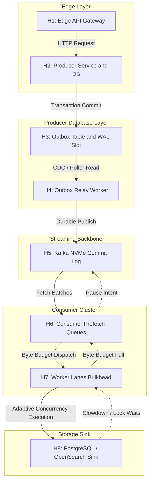
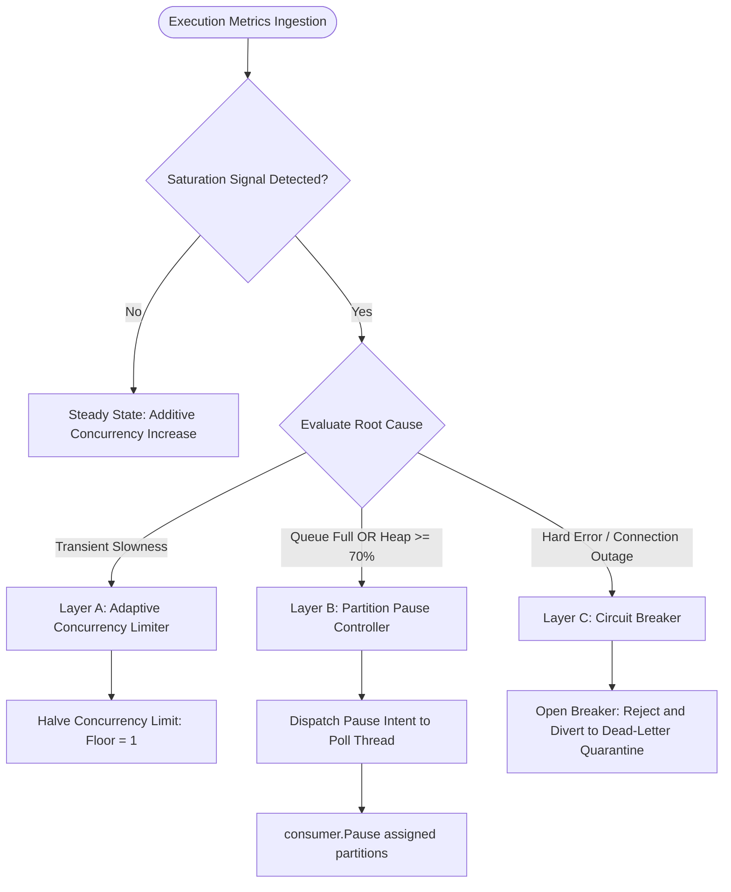
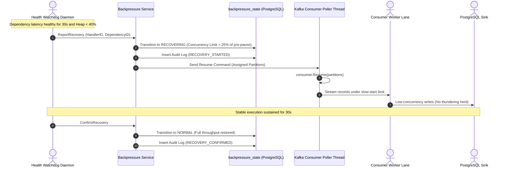
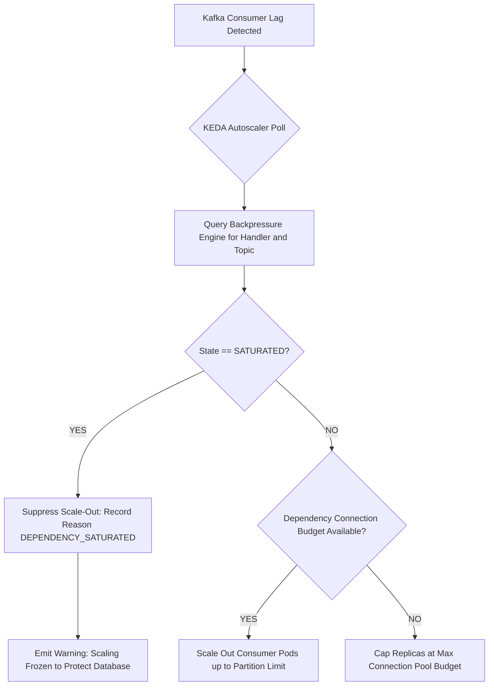
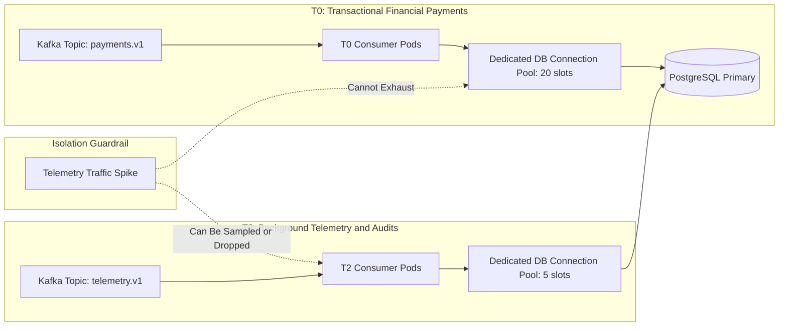

# Backpressure — Architecture Diagrams & Control Topology

## 1. End-to-End Backpressure Chain Map (Hops H1 to H9)

---

## 2. Multi-Tier Control Model (Layer A, Layer B, Layer C)

---

## 3. Slow-Start Gradual Recovery Ramp Workflow

---

## 4. Autoscaling Safety Interplay (BP-05 Enforcement)

---

## 5. Physical Bulkhead & Priority Isolation (BP-10)

