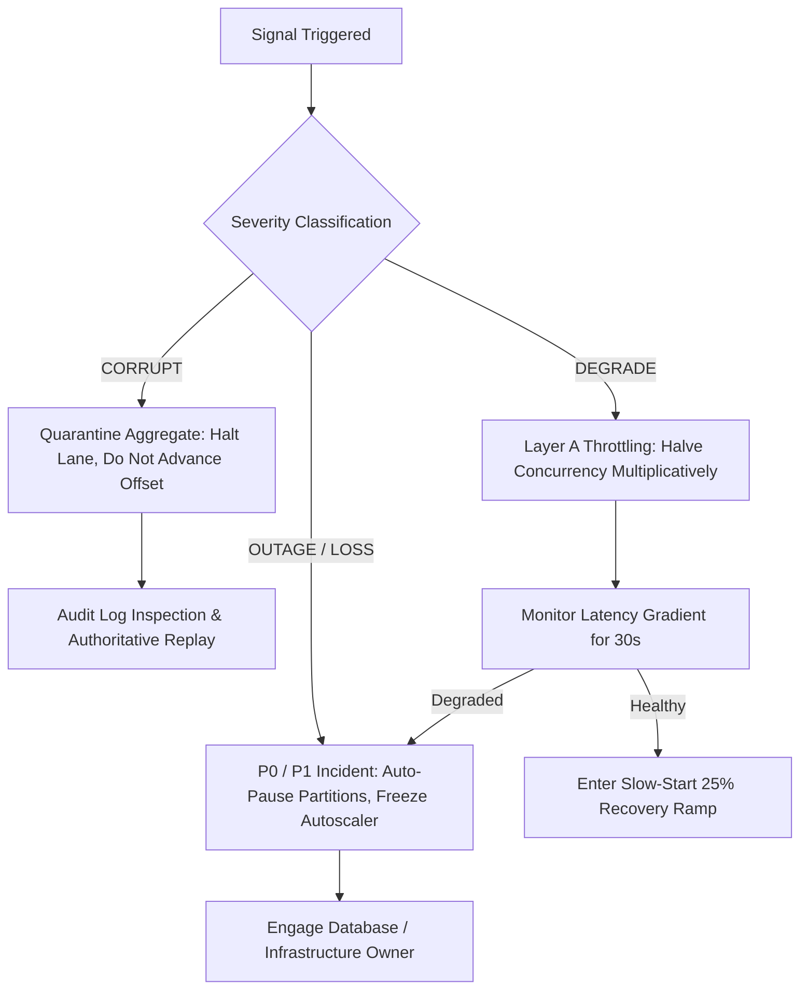

# Backpressure — Failure Taxonomy & Edge Case Catalog

## 1. Overview
This catalog details all critical failure modes, operational risks, and edge cases for **Backpressure & Partition Throttling (WP-8)**, derived from the [Backpressure Production System Design Tree (v2)](file:///home/btpl-lap-22/live/System-Architect/event-driven-platform/docs/features/backpressure/business-logic.md).

Every failure scenario is evaluated with severity classification:
* **OUTAGE**: Critical service disruption or database unavailability.
* **LOSS**: Irreversible event or state loss.
* **CORRUPT**: Silent divergence in aggregate state or ledger consistency.
* **DEGRADE**: Elevated latency or degraded throughput.
* **COMPLIANCE**: Breach of regulatory audit trail or retention constraints.

---

## 2. Comprehensive Failure Handling Matrix

| Code | Failure Scenario | Severity | System Impact | Immediate Handling & Mitigation | Long-Term Prevention |
| :--- | :--- | :--- | :--- | :--- | :--- |
| **FL-BP-01** | **Autoscaler Feedback Loop (F10.1)** | **OUTAGE** | Latency induces lag -> KEDA scales pods -> more DB connections opened -> deeper contention -> total DB freeze | Freeze autoscaler when `backpressure_state.state == 'SATURATED'`; cap aggregate connections across pods | Enforce Invariant BP-05: scaling never adds load to saturated dependencies; enforce connection budget rule (BP-06) |
| **FL-BP-02** | **RSS Misused as Recovery Signal (F3.2)** | **OUTAGE** | Go runtime/JVM retains freed memory pages; RSS stays high; consumer stalls permanently without resuming | Measure live heap bytes (`runtime.ReadMemStats.HeapAlloc`), never process RSS | Set `GOMEMLIMIT` / soft memory limits; enforce live-heap watermark checks (BP-01) |
| **FL-BP-03** | **Full-Speed Resume Oscillation (F4.2)** | **DEGRADE** | Resuming consumption at 100% pre-pause concurrency instantly re-saturates dependency, causing pause/resume flapping | Resume at 25% slow-start ramp (`ResumeRampFraction = 0.25`); clamp floor to 1 | Layer A additive increase with latency gradient checks; enforce 5s min pause duration |
| **FL-BP-04** | **Unbounded In-Memory Channels (F6.1)** | **OUTAGE** | Fetching large batches with varying record byte sizes exhausts container RAM; container OOM killed | Calculate byte size per record before buffering; reject count-based limits | Enforce Invariant BP-01: byte budgets on fetch, lane queues, and batches |
| **FL-BP-05** | **Pause Called from Worker Thread (F5.1)** | **CORRUPT** | Worker goroutines call `consumer.Pause()` concurrently, corrupting consumer client internal state | Dispatch pause/resume intents through Go channels to dedicated poll thread | Invariant BP-11: consumer client interactions restricted to poll thread |
| **FL-BP-06** | **Global Freeze on Hot-Key Contention (F3.4)** | **DEGRADE** | Single hot aggregate row throttles entire consumer group instance, starving healthy partitions | Throttle individual key worker lane rather than triggering partition pause | Route events into per-key lanes with localized queueing delay telemetry |
| **FL-BP-07** | **Coalescing Delta Stream Events (F9.1)** | **CORRUPT** | Skipping intermediate events on financial ledgers or delta streams corrupts downstream balance calculations | Reject coalescing unless `ordering == 'O-STATE'`; assert `MustNeverShed` on `O-STRICT` | Domain rule guard `CanCoalesce()` rejects non-state streams at schema validation |
| **FL-BP-08** | **Zombie Rebalance Flood (F5.3)** | **OUTAGE** | Saturated partition rebalanced to new pod; new consumer starts at full concurrency and floods dying DB | New pod queries centralized `backpressure_state` and starts at ramp floor (1) | Consult shared database state upon partition assignment |
| **FL-BP-09** | **Silent WAL Slot Growth (F11.1)** | **OUTAGE** | Downstream backpressure throttles Kafka relay poller; PostgreSQL WAL replication slot grows until NVMe disk fills | Fire proactive replication slot lag alerts before disk capacity reaches 80% | Enforce Invariant BP-08: relay quotas sized above peak; link slot lag metrics to BP dashboard |
| **FL-BP-10** | **T0 Saturated by T2 Traffic (F8.1)** | **OUTAGE** | Telemetry burst consumes all shared database connection pool slots, stalling payment transactions | Partition physical connection pools and consumer worker lanes per tier | Invariant BP-10: physical isolation; separate topics, pools, and pods for T0 and T2 |
| **FL-BP-11** | **Forgotten Paused Partitions (F5.4)** | **LOSS** | Partition paused and never resumed; consumer lag breaches Kafka broker retention window | SRE Watchdog queries `backpressure_state` and alerts at 2m (warn), 10m (page), and 25% retention (P1) | Enforce Invariant BP-03: reason, owner, and max duration on every pause |
| **FL-BP-12** | **Edge Client 429 Retry Storm (F12.1)** | **OUTAGE** | Gateway sheds traffic with HTTP 429; clients retry immediately in lockstep without backoff | Mandate `Retry-After` header on all 429 responses; enforce client jitter SDK | Token bucket rate limiting with exponential backoff and decorrelated jitter |

---

## 3. Severity Classification & Recovery Procedures

---

## 3. Amendment 2026-11-07: API and Recovery Failure Modes

| Code | Failure Scenario | Severity | System Impact | Immediate Handling & Mitigation | Long-Term Prevention |
| :--- | :--- | :--- | :--- | :--- | :--- |
| **FL-BP-A1** | **Concurrency limit stuck at ramp value after recovery** | **DEGRADE** | Handler stays throttled (observed limit 1) after state returns to NORMAL | `ConfirmRecovery` restores limit to at least `DefaultConcurrencyLimit` (10). Operator: verify `concurrency_limit` on `GET` state after confirm. | Persist the pre-pause limit (not yet stored; restoration is to the fixed baseline, not the prior value) |
| **FL-BP-A2** | **Non-UUID `correlationId`** | **DEGRADE** | Previously raw `pq:` text in a 400 | 400 `correlationId must be a valid UUID` before service call. Operator: fix caller. | Contract validation at the edge |
| **FL-BP-A3** | **Recovery/confirm/state for unknown handler+dependency** | **DEGRADE** | Previously 400 (write routes) with raw text | 404 `backpressure record not found`. Operator: report saturation first or correct ids. | Typed sentinel `ErrRecordNotFound` |
| **FL-BP-A4** | **Illegal state transition (e.g. confirm while SATURATED)** | **DEGRADE** | Previously 400 | 409 with transition message from the state machine. Operator: follow the lifecycle (recovery signal, then confirm). | Machine-enforced transitions |
| **FL-BP-A5** | **Saturation report whose signal is not saturated** | **DEGRADE** | No state change | 400 (`ErrSignalNotSaturated`) with recommendation text. | Callers evaluate thresholds before reporting |
| **FL-BP-A6** | **Unclassified storage error** | **OUTAGE** | Previously leaked as 400 with raw text | 500 generic `internal backpressure error`; details in logs only. | Alert on 5xx |
