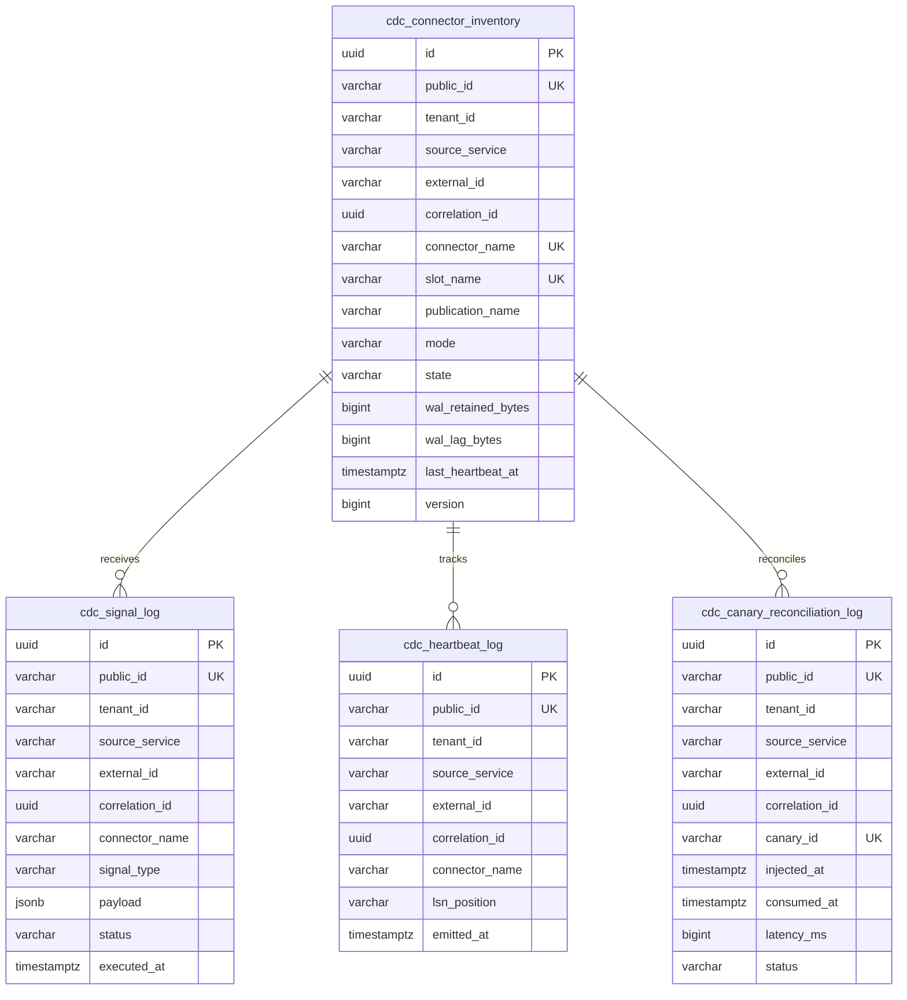

# Architectural Decision Record: Change Data Capture (CDC) Integration & Replication Guardrails (WP-11)

## 1. Title & Metadata
* **Status**: APPROVED
* **Date**: 2026-11-06
* **Decision Makers**: Platform Security Guild, Data Infrastructure Board, Chief Distributed Systems Architect
* **Governing Specification**: [CDC Integration Production System Design Tree (v2)](file:///home/btpl-lap-22/live/System-Architect/event-driven-platform/docs/features/cdc-integration/business-logic.md)

---

## 2. Context & Problem Statement
Integrating Change Data Capture (CDC) via PostgreSQL logical decoding (pgoutput) and Debezium into an event-driven platform introduces severe architectural failure modes if managed as a simple streaming pipeline:

1. **Unbounded WAL Retention & Primary Database Disk Exhaustion (CDC-11, OUTAGE)**: When a Debezium connector task crashes or consumers lag indefinitely, PostgreSQL replication slots retain Write-Ahead Log (WAL) segments indefinitely. Once the host filesystem fills to 100%, PostgreSQL terminates with a `PANIC` crash, shutting down the entire platform.
2. **Semantic Corruption via Outbox Snapshotting (CDC-01, CDC-03, CORRUPT)**: The transactional outbox pattern requires append-only streaming. Executing ad-hoc or incremental table snapshots against an active outbox table re-emits processed, deleted, or obsolete event rows out-of-order, bypassing domain versioning and causing duplicate business effects in downstream consumers.
3. **Replication Slot Loss on Primary Failover (CDC-07, LOSS)**: In PostgreSQL versions $\le 16$, logical replication slots are not replicated to physical standbys. Promoting a replica during ungraceful primary failover leaves the connector with a dead slot. Without deterministic LSN reconciliation against durable audit logs, subsequent streaming causes silent gaps or catastrophic re-reads.
4. **Schema Coupling & Semantic Leakage via Raw Table Capture (F2.1, CORRUPT)**: Exposing internal source database row changes (`M_RAWTABLE`) directly to other service domains couples independent microservices to internal physical database layouts. Altering column names, types, or table structures breaks external consumers without warning.
5. **Slot Inactivity Starvation on Low-Volume Tenants (CDC-02, CDC-05, DEGRADE)**: In an idle or multi-tenant database, long periods without transactions in the captured publication prevent PostgreSQL from advancing `confirmed_flush_lsn`. As other databases on the cluster write WAL, the inactive slot prevents WAL segment recycling, bloating storage despite zero domain activity.

---

## 3. Decision Drivers & Architecture Invariants (CDC-01 to CDC-12)

* **CDC-01: Snapshot $\neq$ History [Certain]**:
  Snapshots provide point-in-time state, not event history. Recovery runbooks never use snapshots to reconstruct lost outbox events; event replay is sourced exclusively from the durable outbox audit store (`C-AUD`).
* **CDC-02: Every Replication Slot is Owned, Monitored, and Accounted For [Certain]**:
  Replication slot creation is governed by an explicit inventory (`cdc_connector_inventory`). Orphaned or unmonitored slots are detected and paused before causing cluster-wide WAL retention.
* **CDC-03: No Implicit Snapshots [Certain]**:
  Snapshot modes must be explicitly configured per connector. Outbox mode (`M_OUTBOX`) enforces `snapshot.mode = no_data`. Raw table bootstrap snapshots are triggered exclusively via explicit control signals (`C-SIG`).
* **CDC-04: Publication Scope is Explicit [Certain]**:
  PostgreSQL publications must explicitly enumerate target tables. Wildcard publications (`FOR ALL TABLES` or `*`) are rejected by domain rules to prevent unintended exposure of internal schema or PII.
* **CDC-05: Zero Error Tolerance in the Pipeline [Certain]**:
  Connectors run with zero tolerance for serialization errors or unknown types. Malformed records halt the connector task rather than dropping data silently.
* **CDC-06: Raw CDC Carries Complete, Correct Row Images [Certain]**:
  Raw captured tables must declare `REPLICA IDENTITY FULL` when update/delete tracking requires before-and-after state. TOASTed columns and exact numerics (`DECIMAL` as string/bigint) are validated during provisioning.
* **CDC-07: Slot Survival Across Failover is Designed, Not Hoped For [Certain]**:
  PostgreSQL 17+ failover slots or external slot-synchronization daemons sync slot positions across physical replicas. Failover runbooks verify confirmed LSN positions before resuming connectors.
* **CDC-08: No Ghost Events [Certain]**:
  Logical decoding must be coordinated with physical standby replication confirmation to prevent emitting events for transactions subsequently rolled back during ungraceful failover.
* **CDC-09: Control Plane is Authenticated and Audited [Certain]**:
  Connect REST management endpoints are wrapped behind the CDC feature control plane with role-based access control, cryptographic verification, and audit logging.
* **CDC-10: Configuration is Code [Certain]**:
  Connector configurations are versioned in Git. Runtime connector drift detection continuously reconciles active Debezium tasks against target repository manifests.
* **CDC-11: WAL Alerting is Time-to-Disk-Full Based [Certain]**:
  Threshold alerts do not rely on static byte counts. The system projects time-to-exhaustion using dynamic WAL generation velocity:
  $$\text{threat\_hours} = \frac{\text{disk\_free\_bytes} - \text{disk\_reserve\_bytes}}{\text{wal\_growth\_rate\_bytes\_per\_sec} \times 3600}$$
  If $\text{threat\_hours} < 1.0$, the circuit breaker initiates an emergency connector pause.
* **CDC-12: End-to-End Delivery is Proven Continuously [Certain]**:
  A synthetic canary generator injects timestamped heartbeat events through the real outbox table and verifies consumption latency against a 5000ms SLA.

---

## 4. Key Architectural Decisions

### 4.1 Dual-Engine Segregation: Outbox vs Raw-Table

| Dimension | `M_OUTBOX` (Transactional Outbox) | `M_RAWTABLE` (Direct Source Capture) |
| :--- | :--- | :--- |
| **Primary Intent** | Domain event integration across service boundaries. | Homogeneous data movement (search sync, cache warming, DWH). |
| **Consumer Contract** | Immutable, semantic domain event schema (JSON Schema / Protobuf). | Source database table schema (Avro / Struct). |
| **Snapshot Policy** | Strictly forbidden (`ErrOutboxSnapshotForbidden`). | Ad-hoc / Incremental snapshots allowed via `C-SIG`. |
| **Routing Strategy** | Dynamic routing by `aggregate_id` to domain topics. | Direct 1:1 table-to-topic mapping (`<prefix>.<schema>.<table>`). |
| **Failure Recovery** | Replay from `C-AUD` audit ledger. | Trigger incremental snapshot chunking via signaling table. |

### 4.2 Replication Slot Protection & Idle Heartbeat Engine
To guarantee that low-traffic databases do not cause WAL segment retention:
1. The CDC service executes periodic heartbeat writes against `cdc_heartbeat_log`.
2. Debezium decodes the heartbeat transaction, allowing PostgreSQL's logical decoding engine to advance `confirmed_flush_lsn`.
3. WAL segments older than the confirmed LSN are safely freed by PostgreSQL checkpoints.

### 4.3 WAL Runaway Circuit Breaker
The platform implements an automated circuit breaker evaluating WAL generation rate against available disk headroom:
* **Ample Headroom ($\text{threat\_hours} \ge 4.0$)**: Normal streaming; metrics logged.
* **Warning State ($1.0 \le \text{threat\_hours} < 4.0$)**: PagerDuty alert dispatched to on-call platform engineers.
* **Tripped Emergency Pause ($\text{threat\_hours} < 1.0$)**: Connector transition to `PAUSED` state, releasing replication connection locks and halting WAL consumption to avoid catastrophic disk exhaustion.

---

## 5. Database Migration 0013 Schema

The physical persistence layer is codified in `0013_create_cdc_integration_tables.sql` and satisfies the 9-field migration header, 5 identifier roles, `btrim` check constraints, and immutability triggers:

---

## 6. REST API & OpenAPI 3.1 Parity

The CDC feature exposes 4 REST operations under `/api/v1/cdc`:
1. `POST /api/v1/cdc/connectors`: Register new CDC connector with slot name pattern validation and publication checks.
2. `POST /api/v1/cdc/signals`: Dispatch Debezium control and incremental snapshot signals.
3. `POST /api/v1/cdc/heartbeat`: Emit synthetic transaction to advance logical LSN on idle clusters.
4. `POST /api/v1/cdc/circuit-breaker/evaluate`: Ingest disk telemetry and evaluate emergency pause trip conditions.

---

## 7. Verification & Test Strategy
* **Tier 1 (Unit Rules)**: Validates invariants `CDC-01` to `CDC-12`, including regex slot naming (`^cdc_slot_[a-z0-9_]+$`), outbox snapshot rejection, and circuit breaker calculation.
* **Tier 2 (State Machine)**: Verifies valid connector lifecycle transitions (`UNREGISTERED` $\rightarrow$ `PROVISIONING` $\rightarrow$ `RUNNING` $\leftrightarrow$ `PAUSED` $\rightarrow$ `FAILED` $\rightarrow$ `DECOMMISSIONED`) and terminal state immutability.
* **Tier 3 (PostgreSQL Adapter)**: Verifies relational persistence, check constraints, and optimistic locking against live PostgreSQL.
* **Tier 4 (Canary Reconciliation)**: Simulates synthetic end-to-end event injection and verifies 5000ms SLA evaluation.

---

## Deep Failure-First Architectural Principles

### 1. Existential Purpose & The Catastrophe Prevented

Writing to a database and publishing to a message broker in the same application call (the 'Dual-Write Problem') is an anti-pattern. If the database commit succeeds but the network crashes before the broker publishes, data is lost; if the broker write succeeds but the database rolls back, phantom data enters downstream systems. Distributed 2-Phase Commit (2PC) is notoriously slow, fragile, and unsupported by modern cloud brokers.

### 2. Internal Algorithmic Mechanics & State Invariants

The application writes exclusively to its local PostgreSQL tables inside a standard ACID transaction. PostgreSQL's internal Write-Ahead Log (WAL) records the committed rows. A CDC daemon (Debezium via pgoutput logical decoding) streams changes directly from the database WAL, extracts row deltas (before/after states), and forwards them into Kafka partitions with absolute transactional fidelity and zero application code overhead.

### 3. Core Architectural Principles

* **Single Source of Truth**: The database WAL is the sole, authoritative source of state transitions; dual-writing across network boundaries is architecturally forbidden.
* **Zero Transactional Tax**: Business transactions commit at native relational database speed without waiting for broker ACKs or distributed consensus protocols.
* **Complete Intermediate State Capture**: Every intermediate state mutation and hard row deletion is captured linearly, eliminating the blind spots inherent in periodic table polling.
* **At-Least-Once Delivery Resilience**: WAL replication slots maintain continuous disk watermarks, acknowledging progress only after downstream brokers confirm message durability.

### 4. The Architect's Meta-Questions (Failure-First Evaluation)

1. **Why is CDC superior to database polling (SELECT * WHERE updated_at > last_poll)? (Polling misses interim updates (if a status changes from Pending -> Processing -> Completed between polls), imposes CPU lock overhead, and cannot capture hard DELETE operations).**
2. **What is the operational risk of a lingering replication slot? (If the CDC consumer stops reading, PostgreSQL retains WAL segments on disk indefinitely, eventually filling the entire host disk and bringing down the database).**
3. **How do we handle schema migrations in CDC? (We utilize Schema Registry synchronization and forward-compatible Avro schemas so WAL parsers never crash on newly introduced database columns).**

---

## Authoritative References & Production Citations

* **[Martin Kleppmann: Turning the Database Inside Out with Apache Samza / Kafka](https://www.youtube.com/watch?v=fU9hR3kiOK0)**
  - *Architectural Rationale & Implementation Grounding*: Foundational lecture articulating the paradigm shift from point-to-point writes to unified log-centric change data capture.
* **[Debezium Architecture & Operational Semantics](https://debezium.io/documentation/reference/stable/architecture.html)**
  - *Architectural Rationale & Implementation Grounding*: Comprehensive architectural documentation on PostgreSQL logical decoding, WAL streaming, and change event modeling.
* **[PostgreSQL Official Documentation: Logical Decoding & Replication Slots](https://www.postgresql.org/docs/current/logicaldecoding.html)**
  - *Architectural Rationale & Implementation Grounding*: Core architectural reference on output plugins, WAL stream reading, and fail-safe slot lifecycle management.
* **[Pat Helland: Immutability Changes Everything (CIDR 2015)](https://www.cidrdb.org/cidr2015/Papers/CIDR15_Paper16.pdf)**
  - *Architectural Rationale & Implementation Grounding*: Seminal paper demonstrating why append-only immutable logs and change streams are the true foundation of distributed state.

## Amendment 2026-11-07: Connector lookup route, error mapping, and signal correlation defaults

### Problem observed
- `GET /api/v1/cdc/connectors/{name}` returned 404 for every name, including connectors that had just been registered.
- `POST /api/v1/cdc/connectors` with a duplicate `slot_name` or connector name returned 500 containing raw `pq:` driver text.
- Signal and heartbeat requests sent without `X-Correlation-Id` failed downstream because no correlation id was generated.

### Root cause
- `cdc.handler.go: HandleGetConnector` derived the name with `strings.Split(path, "/")` and `pathParts[3]`. With the mounted route that element is the literal segment `connectors`, so the lookup key was always wrong (RC5: no HTTP-level test exercised the route).
- Handlers mapped errors with `strings.Contains(err.Error(), "validation"/"blank"/"already registered"/"not found")` (RC1). Any error whose text did not match fell through to 500.
- `cdc_postgres.adapter.go: RegisterConnector` wrapped every insert failure in `NewInternalError(fmt.Sprintf(... %v, err))`, so a unique violation (RC2) became a 500 with driver text.

### Decision / fix
- `HandleGetConnector` reads `r.PathValue("name")`.
- New `CDCHandler.writeServiceError` uses `errors.As` against `*ApplicationError` and returns its status, canonical code and message (validation 400, not found 404, conflict 409). Non-application errors return 500 with the generic message `internal cdc error`.
- `RegisterConnector` returns `database.MapDatabaseError(err)`, so unique violations become 409 with the generic integrity message (no constraint name, see `src/infra/database/error_mapper.go`).
- `HandleDispatchSignal` and `HandleHeartbeat` generate a UUIDv7 correlation id when the header is absent.

### API-visible behavior change
- `GET /cdc/connectors/{name}`: 404 for existing connectors becomes 200 (bug fix; clients that worked around it are unaffected).
- Duplicate connector or slot: 500 becomes 409.
- Error messages for non-application errors are now generic (`internal cdc error`) instead of the raw error text.
- Not breaking for correct clients.

### Verification
Re-tested live against the rebuilt image (`chiefj/event-driven-platform:fixes`): GET by name returns 200, duplicate slot_name and duplicate connector return 409. No new CDC unit test was added in this change and the handler routes have no HTTP-level test (unverified in CI).

### Remaining gaps
- CDC still runs on the mock Kafka Connect adapter; Debezium is not integrated, so a registered connector does not stream WAL changes.
- Handler behavior is covered only by manual live re-test, not an automated HTTP test.
