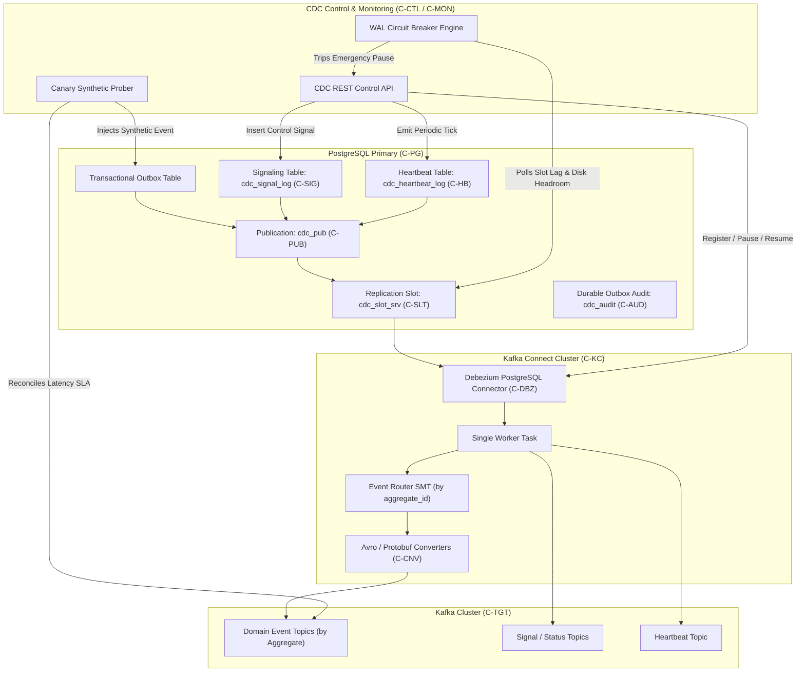
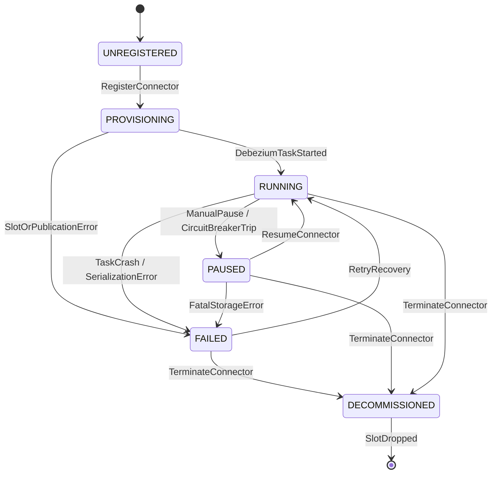
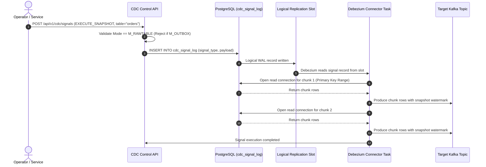
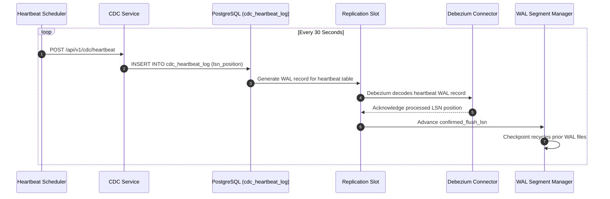
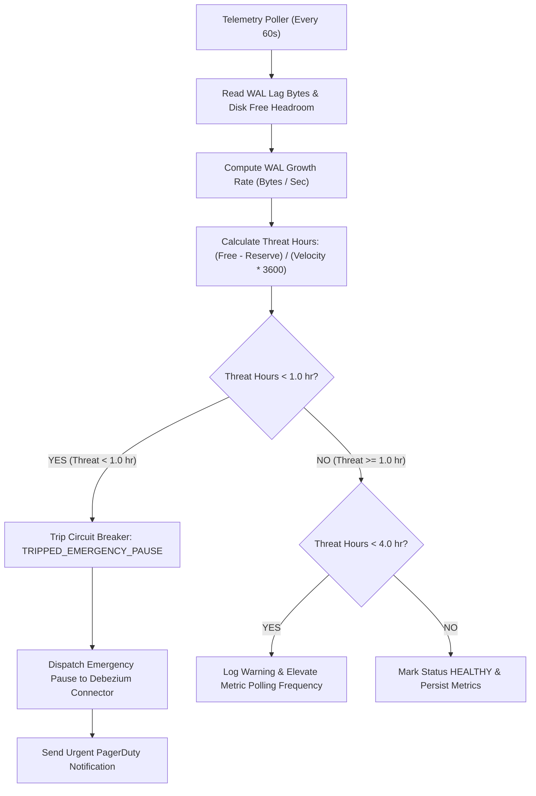

# CDC Integration — Architectural Diagrams

This document contains Mermaid diagrams illustrating the runtime components, state machines, and protocols governing Change Data Capture (CDC) integration.

---

## 1. High-Level Component Topology

---

## 2. Connector Lifecycle State Machine

---

## 3. Incremental Snapshot Signaling Protocol (C-SIG)

---

## 4. Idle Database Heartbeat & LSN Progression (C-HB)

---

## 5. WAL Runaway Circuit Breaker Evaluation Loop

