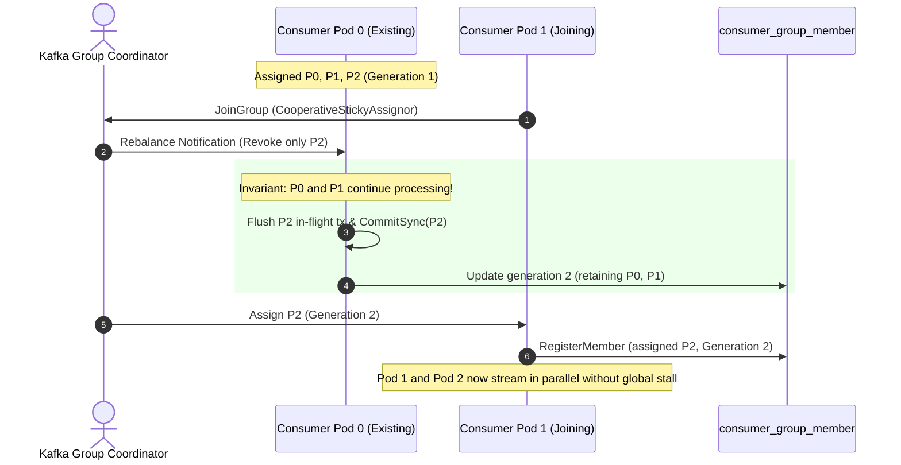
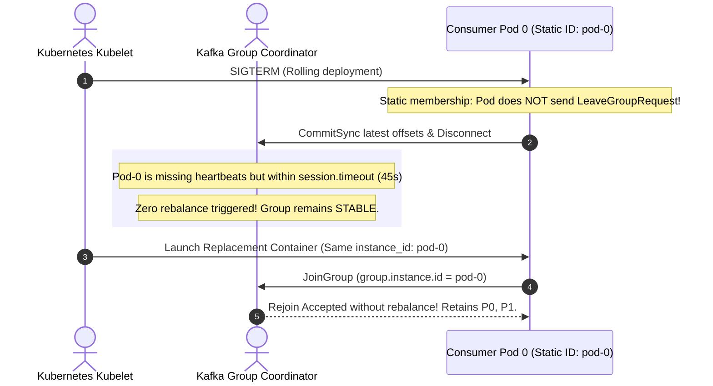

# Architectural Decision Record: Cooperative Consumer Groups & Static Membership (WP-6)

## 1. Title & Metadata
* **Status**: APPROVED
* **Date**: 2026-11-04
* **Decision Makers**: Platform Architecture Guild, Chief Distributed Systems Architect
* **Governing Specification**: [Consumer Groups Decision Tree](file:///home/btpl-lap-22/live/System-Architect/event-driven-platform/docs/features/consumer-groups/business-logic.md)

---

## 2. Context & Problem Statement
In high-throughput event-driven microservices running on Kubernetes, consumer instances frequently restart during rolling updates, node drains, and autoscaling.

Legacy Kafka consumer group configurations create severe outages:
1. **Stop-the-World Eager Rebalances**: Banned assignors (`RangeAssignor`, `RoundRobinAssignor`) revoke every partition across all live consumers when a single pod restarts, halting stream processing globally.
2. **Rebalance Storms from Ephemeral Identity**: Dynamic membership causes pods to leave and rejoin under randomized member IDs, triggering cascading rebalances.
3. **Split-Brain Concurrent Writes**: When a terminating pod experiences GC or drain pauses, it continues writing events after the Kafka coordinator has assigned its partitions to another pod.
4. **Poll Loop Deadlock**: Handlers executing slow processing exceed `max.poll.interval.ms` (300s), causing the coordinator to evict the consumer and trigger repeated rebalance loops.

---

## 3. Decision Drivers & Invariants
* **Mandatory Cooperative Rebalancing**: Only `org.apache.kafka.clients.consumer.CooperativeStickyAssignor` is permitted. Eager assignors are strictly banned. Unaffected partitions continue processing uninterrupted during member joins/leaves.
* **Static Membership (`group.instance.id`)**: Pod names (e.g. `orders-worker-0`) act as static member identifiers. Restarts within `session.timeout.ms` (45s) do not trigger rebalances.
* **Partition Generation Epoch Fencing**: Partition assignments carry a monotonic generation ID stored in PostgreSQL table `consumer_group_member`. Stale workers cannot commit writes.
* **Watchdog Execution Guard**: If batch processing duration reaches 80% of `max.poll.interval.ms` (240s), partition consumption pauses immediately to prevent broker eviction.
* **Batch Ingestion Limits**: `max.poll.records = 500` and `fetch.max.bytes = 50MB`.

---

## 4. Entity-Relationship Data Model & Database Writing Rules
Complies with [05-db-writing-rules.md](file:///home/btpl-lap-22/live/System-Architect/llm-obs-policies/rules/folder-structure/05-db-writing-rules.md):

---

## 5. Execution Sequence Diagrams

### 5.1 Cooperative Rebalance Protocol

### 5.2 Static Membership Pod Restart (Zero Rebalances)

