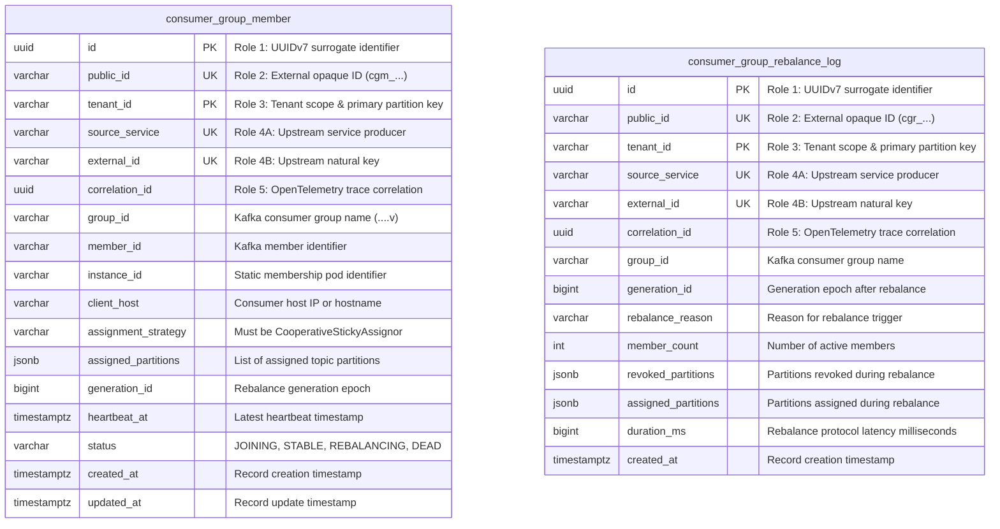
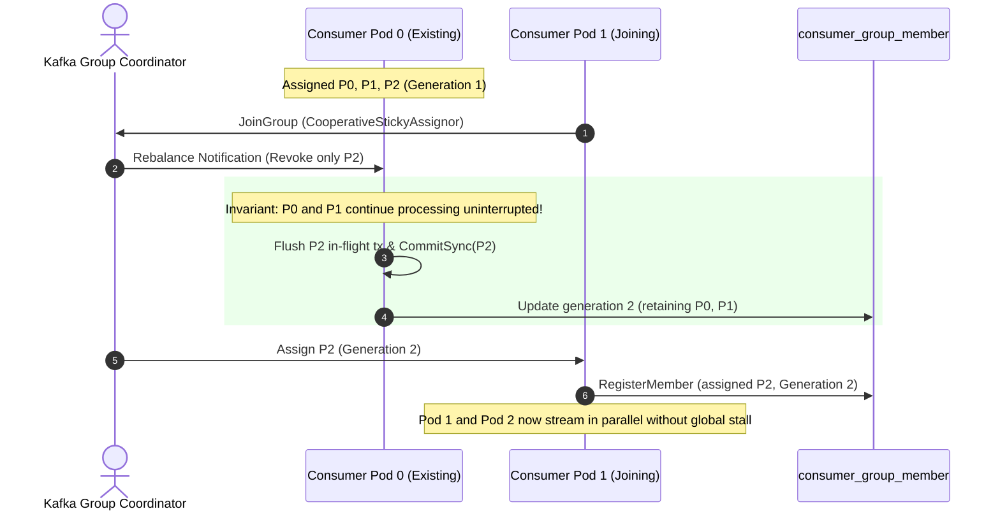
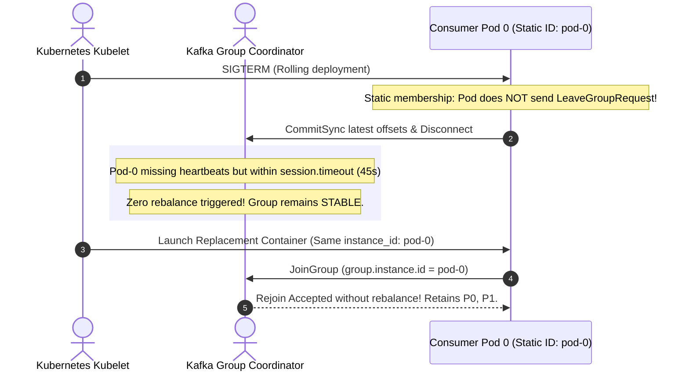
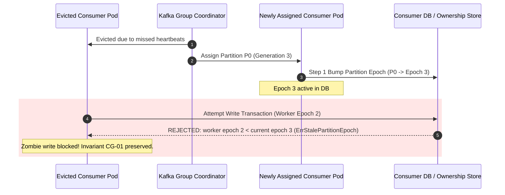

# Architectural Decision Record: Cooperative Consumer Groups, Membership Models & Execution Safety (WP-6)

## 1. Title & Metadata
* **Status**: APPROVED
* **Date**: 2026-11-04
* **Decision Makers**: Platform Architecture Guild, Chief Distributed Systems Architect
* **Governing Specification**: [Consumer Groups Decision Tree](file:///home/btpl-lap-22/live/System-Architect/event-driven-platform/docs/features/consumer-groups/business-logic.md)

---

## 2. Context & Problem Statement
In high-throughput event-driven microservices running on Kubernetes, consumer instances frequently restart during rolling updates, node drains, and autoscaling.

Legacy Kafka consumer group configurations create catastrophic failure modes:
1. **Stop-the-World Eager Rebalances**: Banned assignors (`RangeAssignor`, `RoundRobinAssignor`) revoke every partition across all live consumers when a single pod restarts, halting stream processing globally.
2. **Rebalance Storms from Ephemeral Identity**: Dynamic membership causes pods to leave and rejoin under randomized member IDs, triggering cascading rebalances.
3. **Split-Brain Concurrent Writes & Zombie Partitions**: When a terminating or slow consumer pod experiences GC, container throttling, or network partitions, it continues writing events after the Kafka coordinator has assigned its partitions to another pod.
4. **Poll Loop Starvation & Coordinator Eviction**: Handlers executing slow synchronous calls on the poll thread exceed `max.poll.interval.ms` (300s), causing the coordinator to evict the consumer and trigger repeated rebalance loops.
5. **Cross-Environment Hijacking**: Consumers configured with improper group names accidentally steal partitions across stages.
6. **Zombie Commits on Lost Partitions**: Evicted consumers issuing advisory commits overwrite progress made by the newly assigned legitimate consumer.

---

## 3. Decision Drivers & Architecture Invariants
* **Invariant CG-01 (Single Writer via Partition Epoch Fencing)**: Kafka partition ownership is necessary but insufficient. The consumer database (`consumer_group_member`) maintains a monotonic generation epoch per partition. Every state update verifies `worker_epoch >= partition_epoch`.
* **Invariant CG-02 & CG-03 (Authoritative Stored Offsets)**: Offsets advance only with durable business effects within the same transaction. Kafka commits are strictly advisory and used only for lag tooling visibility.
* **Invariant CG-04 (Lost Partitions Never Committed)**: When `onPartitionsLost` fires (due to heartbeat expiration or coordinator fence), all in-flight transactions must abort immediately and zero commits are attempted.
* **Invariant CG-05 (Poll Thread Decoupling)**: The poll thread strictly executes polling, backpressure pause/resume, and lane dispatch. Handlers run independently on key-hashed worker lanes.
* **Invariant CG-06 (Per-Key FIFO Preservation)**: Records are dispatched to worker lanes hashed by business aggregate key (not Kafka partition or round-robin).
* **Invariant CG-08 (Group Identity & Isolation)**: Group naming strictly validates against `<env>.<domain>.<service>.<handler>.v<n>`.
* **Invariant CG-09 (Membership Strategy Matching)**: StatefulSets with persistent ordinals use static membership (`group.instance.id`). Ephemeral Deployments use dynamic membership with graceful `LeaveGroup` execution.
* **Invariant CG-10 & §11.2 (Autoscaling Bounds & Storm Freeze)**: Horizontal autoscaling scales out at $\le 25\%$ per step with $\ge 5\text{ min}$ cooldowns. Scaling freezes immediately if rebalance storms exceed 3 rebalances in 10 minutes.
* **Invariant CG-12 (Assignment Protocol Ordering)**: Newly assigned partitions undergo epoch bump, stored offset seeking, held keys hydration, and breaker verification before dispatch begins.

---

## 4. Watchdog Escalation Ladder (§10.2)
To prevent coordinator evictions without resorting to premature hard crashes, a 4-tier escalation model is enforced:
1. **Tier 1 (Stall $> \text{Budget}$)**: `INTERRUPT_RECORD` — In-flight record execution is interrupted and classified as a message failure.
2. **Tier 2 (Stall $> 2 \times \text{Budget}$)**: `SELF_FENCE_PAUSE` — Stop dispatching, abort current lane transaction, pause partitions assigned to that lane.
3. **Tier 3 (Poll Thread Stall $> 50\% \text{ Max Poll Interval}$)**: `GRACEFUL_EXIT` — Initiate graceful shutdown sequence (§9.1).
4. **Tier 4 (Graceful Path Stalled $> 30\text{s}$)**: `HARD_EXIT` — Terminate process immediately to release locks and trigger coordinator reassignment.

---

## 5. Entity-Relationship Data Model & Database Writing Rules
Complies strictly with [05-db-writing-rules.md](file:///home/btpl-lap-22/live/System-Architect/llm-obs-policies/rules/folder-structure/05-db-writing-rules.md):

---

## 6. Execution Sequence Diagrams

### 6.1 Cooperative Rebalance Protocol (No Global Stall)

### 6.2 Static Membership Pod Restart (Zero Rebalance Storms)

### 6.3 Partition Epoch Fencing & Zombie Write Rejection

---

## 7. Consequences & Trade-offs
### Positive
* **Zero Stop-The-World Outages**: Cooperative rebalancing guarantees active partitions keep executing while moved partitions transition.
* **Elimination of Rolling Deploy Rebalance Churn**: Static membership prevents rebalances on routine single-pod restarts.
* **Mathematical Split-Brain Protection**: Epoch fencing in the database ensures slow workers cannot corrupt state after coordinator reassignments.
* **Predictable Crash Prevention**: Watchdog escalation ladder catches slow handlers long before coordinator eviction occurs.

### Negative & Mitigations
* **Partition Idle Window on Pod Crashes**: Static members that crash without restart leave partitions idle for `session.timeout.ms` (45–120s). *Mitigation*: Monitored via alert rule on partition stall $> 2 \times \text{session timeout}$.
* **Two-Round Cooperative Rebalances**: Cooperative protocol requires two sync rounds instead of one eager round. *Mitigation*: Unaffected partitions continue processing during both rounds, eliminating business downtime.
