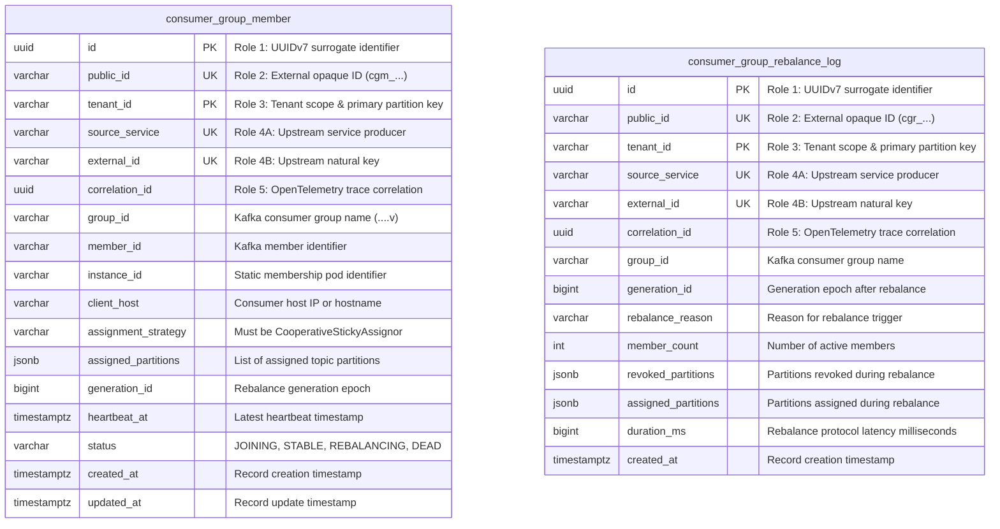
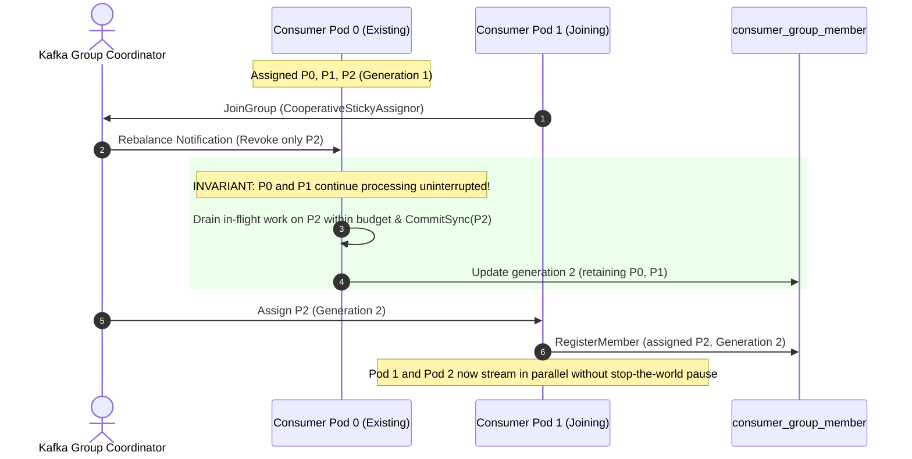
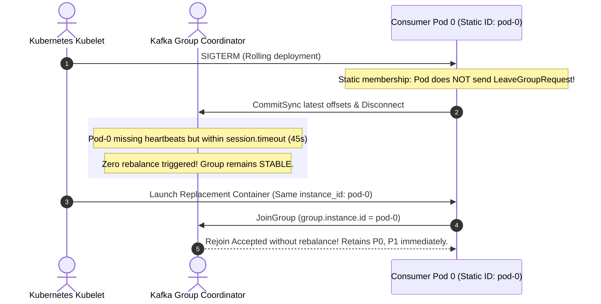
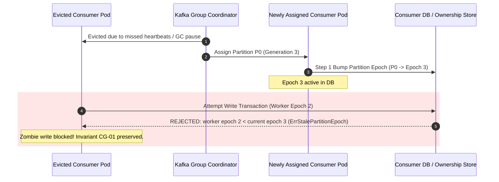

# Architectural Decision Record: Cooperative Consumer Groups, Membership Models & Execution Safety (WP-6)

## 1. Title & Metadata
* **Status**: APPROVED
* **Date**: 2026-11-04
* **Decision Makers**: Platform Architecture Guild, Chief Distributed Systems Architect
* **Governing Specification**: [Consumer Groups Decision Tree (v2)](file:///home/btpl-lap-22/live/System-Architect/event-driven-platform/docs/features/consumer-groups/business-logic.md)

---

## 2. Why This Feature Is Needed (The Reality of Running Kafka at Scale)
Most teams treat Kafka consumer groups as a black box: configure a `group.id`, start a loop calling `poll()`, and assume Kafka handles the rest. In production at scale, this naive model leads to catastrophic failure modes:

1. **Kafka Partition Assignment Is Advisory To Your Database**:
   Kafka coordinators determine *intent* to consume, but they have zero mechanism to prevent a partitioned or slow worker from executing database writes. If a consumer stalls for 46 seconds on a 45-second session timeout, the coordinator evicts it and reassigns partition $P_0$ to a new pod. If the old pod wakes up, both pods will write mutations to the database concurrently, causing silent data corruption and ledger divergence.
2. **The "Stop-the-World" Rebalance Cliff**:
   Default eager assignors (`RangeAssignor`, `RoundRobinAssignor`) revoke every single partition across the entire consumer cluster when a single pod restarts. In an enterprise system with 100 partitions and 20 pods undergoing a rolling deployment, an eager assignor causes 20 global processing freezes back-to-back, halting order processing and generating massive artificial message lag.
3. **The Ephemeral Pod Rebalance Storm**:
   In Kubernetes, pods get randomized names (e.g. `orders-svc-789cfd-x9z2`). Dynamic membership registers each restart as an entirely new member while leaving the old member in the group until its session timeout expires. A rolling update creates an avalanche of simultaneous join/sync phases that can crash Kafka brokers and starve live traffic.
4. **The Advisory Offset Mirage**:
   Offsets committed to Kafka's `__consumer_offsets` topic are committed asynchronously and decoupled from database transactions. If an application updates the database and crashes before the Kafka commit, it re-processes the event (tolerable via idempotency). However, if an application advances Kafka offsets before or out of order with downstream durable effects, events are permanently lost with zero trail.

---

## 3. Real-Life Production Edge Cases & Failure Scenarios

### Case 1: The Zombie Consumer & The Stop-the-World GC Pause (F8.3, F10.3)
* **The Incident**: A consumer handling financial settlement events experiences a 60-second JVM/Go runtime GC pause or Linux CFS container CPU throttling.
* **The Failure**: The Kafka coordinator notices missed heartbeats ($>45\text{s}$) and evicts Pod A. It triggers a rebalance and assigns partition 4 to Pod B. Pod B fetches event offset 1050 and begins mutating customer balances. Pod A's GC pause ends. Pod A is still inside its database transaction for event offset 1049, completely unaware that it was evicted.
* **The Outcome Without This ADR**: Pod A commits its stale state over Pod B's fresh calculations, creating irreconcilable balance discrepancy.
* **Our Hardened Solution**: **Invariant CG-01 (Single Writer via Partition Epoch Fencing)**. Partition assignments carry a monotonic `generation_id` stored in the database. When Pod B takes ownership of partition 4, it atomically increments the partition epoch in `consumer_group_member`. When Pod A attempts to commit its transaction, the database checks `WHERE worker_epoch >= partition_epoch`. The check fails with `ErrStalePartitionEpoch`, rolling back Pod A's transaction immediately.

### Case 2: The Cascading Rebalance Storm Under Load (F4.6, F11.1)
* **The Incident**: Black Friday traffic causes upstream processing latency to spike. A Kubernetes Horizontal Pod Autoscaler (HPA) sees rising CPU and aggressively scales out consumer pods from 10 to 30 replicas.
* **The Failure**: Each new pod joining triggers a rebalance. Under eager assignment, all 10 existing pods stop consuming. Because processing stopped, message lag spikes further. The HPA scales out more pods. Each scale-out cancels the ongoing rebalance and initiates a new one. The consumer group enters a perpetual rebalance storm where zero messages are processed for 45 minutes.
* **Our Hardened Solution**:
  1. Mandatory **Cooperative Sticky Assignment** (`CG-EagerBanned`): Only partitions being moved are revoked; all other partitions process without pausing.
  2. **Rebalance Storm Detector (`EvaluateRebalanceStorm`)**: If $>3$ rebalances occur in a 10-minute window, the autoscaler is frozen, and an alert is paged.
  3. **HPA Scaling Envelope (§11.2)**: Max replicas $\le$ partition count; scale-out capped at $\le 25\%$ per step with $\ge 5\text{ min}$ cooldowns.

### Case 3: The Slow Dependency Lockup & Coordinator Eviction (F5.2, F6.1)
* **The Incident**: A third-party fraud-check API begins timing out at 30 seconds per request instead of 200 milliseconds.
* **The Failure**: If consumption and execution run on the same thread, `poll()` is not called. After 300 seconds (`max.poll.interval.ms`), Kafka evicts the pod. The coordinator hands the slow partitions to another pod, which also blocks and gets evicted. One by one, every pod in the cluster is evicted in a rolling death spiral.
* **Our Hardened Solution**:
  1. **Thread Decoupling (`CG-05`)**: The poll thread **never** touches business logic. It dispatches records to an array of worker lanes and returns immediately to poll and heartbeat.
  2. **Watchdog Escalation Ladder (§10.2)**: A background monitor tracks lane execution time:
     - Lane stall $> \text{record budget (5s)} \implies$ `INTERRUPT_RECORD`.
     - Lane stall $> 2 \times \text{budget (10s)} \implies$ `SELF_FENCE_PAUSE` (pause partition fetch in Kafka, don't stall the poll thread).
     - Poll thread stall $> 150\text{s} \implies$ `GRACEFUL_EXIT`.
     - Graceful exit stuck $> 30\text{s} \implies$ `HARD_EXIT`.

### Case 4: Accidental Cross-Environment Partition Hijacking (F2.1)
* **The Incident**: A developer runs an integration test or staging pod pointing to the production Kafka cluster with copied configuration files using `group.id = order-processing`.
* **The Failure**: The staging pod joins the production consumer group and is assigned 30% of production partitions. Production orders are processed by test code and routed to staging test databases. Production customers never receive confirmations.
* **Our Hardened Solution**: **Invariant CG-08 (Group Identity & Isolation)**. All group names must match the regex `^[a-z0-9\-]+(\.[a-z0-9\-]+){3}\.v[0-9]+$` (`<env>.<domain>.<service>.<handler>.v<n>`). Production broker ACLs reject any consumer principal that does not match its environment namespace.

### Case 5: The "Lost Partition" Zombie Commit (CG-04, F4.5)
* **The Incident**: A consumer pod loses its network connection to the Kafka broker. The broker marks the consumer dead and reassigns its partitions to another pod. 20 seconds later, the local network heals. The old pod finishes processing a batch of records that were already in memory and executes `CommitSync()`.
* **The Failure**: The old pod's advisory commit overwrites the Kafka committed offset backwards, making lag monitoring report invalid metrics and causing duplicate processing across restarts.
* **Our Hardened Solution**: **Invariant CG-04 (Lost Partitions Never Committed)**. In Kafka clients, partition loss triggers `onPartitionsLost` (distinct from graceful `onPartitionsRevoked`). When `onPartitionsLost` fires:
  1. All active lane transactions for those partitions are immediately aborted.
  2. Local caches are wiped.
  3. `EvaluateLostPartitionDisallowCommit(true)` guarantees zero commits are dispatched to Kafka.

---

## 4. Architectural Invariants Matrix
| ID | Invariant Name | Production Enforcement Mechanism |
| :--- | :--- | :--- |
| **CG-01** | **Single Writer per Partition** | Database partition epoch incremented on assign; every worker tx checks `worker_epoch >= partition_epoch`. |
| **CG-02** | **Contiguous Stored Offsets** | Stored offsets committed in the exact same DB transaction as business mutations. |
| **CG-03** | **Advisory Kafka Commits** | Consumers seek to database stored offsets on assignment. Kafka commits are purely for lag tooling. |
| **CG-04** | **Lost Partitions Never Committed** | `onPartitionsLost` aborts in-flight work and explicitly drops all commits. |
| **CG-05** | **Poll Thread Decoupling** | Poll thread only polls, monitors watermarks, and dispatches to lanes. Handlers never run on poll thread. |
| **CG-06** | **Per-Key FIFO Lanes** | Records routed to worker lanes by hashing aggregate business keys (e.g. `order_id`). |
| **CG-07** | **Bounded Stall Detection** | Multi-tier watchdog detects stalls before coordinator timeout is reached. |
| **CG-08** | **Strict Group Naming** | Regexp validation `<env>.<domain>.<service>.<handler>.v<n>` preventing staging/prod mixups. |
| **CG-09** | **Membership Strategy Matching** | Static membership (`group.instance.id`) only on StatefulSets; dynamic membership on Deployments. |
| **CG-10** | **Autoscaling Stability** | Replicas $\le$ partition count; max scale step $\le 25\%$; freeze on $>3$ rebalances/10m. |
| **CG-11** | **Offsets Outlive Idle Periods** | Database offsets outlive Kafka `offsets.retention.minutes` (default 7 days). |
| **CG-12** | **Strict Assignment Protocol** | 6-step handshake: Epoch bump $\to$ Seek stored offset $\to$ Load held keys $\to$ Check circuit breaker $\to$ Resume retries $\to$ Dispatch. |

---

## 5. Entity-Relationship Data Model & Database Writing Rules
Complies strictly with [05-db-writing-rules.md](file:///home/btpl-lap-22/live/System-Architect/llm-obs-policies/rules/folder-structure/05-db-writing-rules.md):



---

## 6. Execution Sequence Diagrams

### 6.1 Cooperative Rebalance Protocol (Zero Global Pause)


### 6.2 Static Membership Pod Restart (Zero Rebalance Storms)


### 6.3 Partition Epoch Fencing & Zombie Write Rejection


---

## 7. Consequences & Trade-offs
### Positive
* **Deterministic Single-Writer Guarantee**: Eliminates split-brain writes during partitions and GC pauses.
* **Continuous Ingestion During Deployments**: Unmoved partitions suffer 0 ms interruption during rebalances.
* **Safe Rolling Restarts**: Static membership drops rebalance frequency by orders of magnitude in production.
* **Poison Record Isolation**: Watchdog detects hung handlers and pauses single partitions before coordinator eviction crashes the entire group.

### Negative & Mitigations
* **Partition Idle Period on Pod Crash**: Static members that crash hard (OOM/Kernel panic) leave partitions unconsumed until `session.timeout.ms` (45–120s) expires. *Mitigation*: Monitored via Prometheus alerts triggering manual rebalance CLI or container restarts.
* **Storage Overhead of Stored Offsets**: Maintaining offsets in the application database incurs write load. *Mitigation*: Offsets are piggybacked onto the existing business transaction, eliminating extra round-trips.

---

## Deep Failure-First Architectural Principles

### 1. Existential Purpose & The Catastrophe Prevented

A single consumer instance cannot process millions of events per second without scaling out horizontally. However, blindly launching parallel consumers across shared topics results in race conditions, corrupted out-of-order mutations, and duplicate processing. Consumer Groups solve this by dynamically partitioning topics among active group members.

### 2. Internal Algorithmic Mechanics & State Invariants

Kafka brokers designate a Group Coordinator. Consumers join via JoinGroup and SyncGroup heartbeats. The coordinator assigns each partition exclusively to a single consumer instance in the group. If an instance crashes or scales up, the group executes a cooperative rebalance. To prevent zombie instances from corrupting state during long pauses, broker protocols issue unique Generation IDs that fence off stale worker commits.

### 3. Core Architectural Principles & Systems Philosophy

#### Principle 1: Autonomous Partition Ownership & Dynamic Coordination
* **Design Philosophy & Epistemology**:
  Manual partition assignment in a distributed cluster does not survive machine failures and autoscaling events. The philosophy is Decentralized Autonomous Rebalancing: consumers continuously coordinate through an elected broker coordinator to dynamically divide partition ownership among active instances without requiring human intervention.
* **Threat Vector Defeated**: Unassigned partitions and silent data freezing when consumer instances crash or reboot in production clusters.
* **Storage & State Invariant**:
```text
Intersection(Partitions(Instance_A), Partitions(Instance_B)) == EMPTY
Union(Partitions(Instance_1...Instance_N)) == AllTopicPartitions
```
* **Implementation Mechanism**:
  Consumers join a shared group identified by `group.id`. The Kafka Group Coordinator elects a group leader among the consumer instances. The leader applies an assignment strategy (e.g., Cooperative Sticky Assignor) and transmits assignments back to the coordinator.
* **Non-Negotiable Trade-Off**: Rebalance latency overhead. During consumer group rebalances, partition consumption may experience brief transient pauses while ownership is renegotiated.

---

#### Principle 2: Cooperative Incremental Rebalancing
* **Design Philosophy & Epistemology**:
  Eager rebalancing (Stop-The-World) revokes all partition assignments across every consumer instance whenever a single node joins or leaves, causing global processing stalls. The philosophy is Incremental Ownership Migration: only the specific partitions being moved between nodes should be revoked, allowing 95% of consumer instances to continue uninterrupted.
* **Threat Vector Defeated**: Global throughput collapse and cascading rebalance storms caused by frequent autoscaling events revoking all partition assignments platform-wide.
* **Storage & State Invariant**:
```text
UnchangedPartitions continue processing during Rebalance(MovedPartitions)
```
* **Implementation Mechanism**:
  The consumer group utilizes the `CooperativeStickyAssignor`. When a node joins, the coordinator notifies nodes to surrender only the subset of partitions scheduled for migration. All other consumers maintain active read loops without interruption.
* **Non-Negotiable Trade-Off**: Requires two cooperative rebalance rounds to complete partition reassignment, slightly increasing the total time needed to stabilize the group.

---

#### Principle 3: Heartbeat Thread Isolation & Liveness Fencing
* **Design Philosophy & Epistemology**:
  Conflating business processing time with cluster liveness guarantees false-positive consumer evictions. If a consumer takes 30 seconds to execute a heavy database query, the broker must not assume the consumer has died. The philosophy is Isolated Liveness Heartbeating: separate cluster membership health from business task execution.
* **Threat Vector Defeated**: Rebalance storms and duplicate message processing caused by slow database queries triggering false-positive consumer group timeouts.
* **Storage & State Invariant**:
```text
HeartbeatInterval <= SessionTimeout / 3
MaxPollIntervalMs >= MaxDatabaseTransactionTime
```
* **Implementation Mechanism**:
  The Kafka client runs a dedicated background heartbeat thread that continually pings the group coordinator every 3 seconds (`heartbeat.interval.ms`), independent of the main processing thread. The coordinator evicts the consumer only if heartbeats cease entirely for `session.timeout.ms` (45s).
* **Non-Negotiable Trade-Off**: If a consumer thread deadlocks internally while its heartbeat thread continues running, the broker will not detect the freeze until `max.poll.interval.ms` expires.

---

#### Principle 4: Post-Processing Monotonic Offset Commits
* **Design Philosophy & Epistemology**:
  Committing an offset before downstream work is confirmed guarantees data loss during crashes; committing offsets out of order creates state divergence. The philosophy is Verified Monotonic Progress: offsets are committed strictly after the message payload has been successfully persisted in downstream databases, advancing monotonically.
* **Threat Vector Defeated**: Silent message loss caused by committing offsets before processing completes when consumer pods crash or restart unexpectedly.
* **Storage & State Invariant**:
```text
CommittedOffset <= LastSuccessfullyProcessedOffset
CommittedOffset[t+1] >= CommittedOffset[t]
```
* **Implementation Mechanism**:
  The consumer executes business logic and database writes. Upon successful transaction commit, the consumer marks the offset in a local commit queue. Synchronous or batched asynchronous offset commits are transmitted to Kafka only for verified records.
* **Non-Negotiable Trade-Off**: At-least-once duplicate delivery during crashes. If the consumer crashes between database commit and Kafka offset commit, the message will be reprocessed upon restart, requiring idempotent consumers.

### 4. The Architect's Meta-Questions (Failure-First Evaluation)

1. **Why is the Cooperative Sticky Assignor vastly superior to the legacy RoundRobin or Range assignors?**
   * *Answer*: Legacy assignors revoke all partitions from all consumers during any membership change, causing a global processing halt. The Cooperative Sticky Assignor migrates only the specific partitions being reassigned, allowing unaffected instances to continue processing without interruption.
2. **What happens if max.poll.interval.ms is set to 30 seconds but a database query takes 45 seconds?**
   * *Answer*: The consumer coordinator assumes the consumer instance has deadlocked, evicts it from the group, and reassigns its partitions to another node, causing duplicate processing and triggering a rebalance storm.
3. **How does partition count dictate the maximum horizontal scale of a consumer group?**
   * *Answer*: A single partition can only be read by one consumer instance within a group at any given time. If a topic has 12 partitions, adding a 13th consumer instance results in an idle node that processes zero messages.

---
## Authoritative References & Production Citations

* **[Kafka KIP-848: The Next Generation Consumer Rebalance Protocol](https://cwiki.apache.org/confluence/display/KAFKA/KIP-848)**
  - *Architectural Rationale & Implementation Grounding*: Apache Kafka architectural improvement proposal revolutionizing rebalance mechanics via broker-side coordination.
* **[Neha Narkhede, Gwen Shapira, Todd Palino: Kafka: The Definitive Guide](https://www.oreilly.com/library/view/kafka-the-definitive/9781491936153/)**
  - *Architectural Rationale & Implementation Grounding*: The canonical industry text on Kafka consumer group internals, coordinator heartbeats, and partition assignment strategies.
* **[Apache Kafka Protocol Specification: Group Membership & Coordination APIs](https://kafka.apache.org/protocol.html)**
  - *Architectural Rationale & Implementation Grounding*: Low-level wire protocol specification detailing JoinGroup, SyncGroup, Heartbeat, and OffsetCommit frame formats.
* **[Confluent: Cooperative Sticky Assignor in Apache Kafka](https://www.confluent.io/blog/cooperative-rebalancing-in-kafka-streams-consumer-ksqldb/)**
  - *Architectural Rationale & Implementation Grounding*: Deep technical dive into avoiding stop-the-world rebalances via incremental partition migration.

## Amendment 2026-11-07: Tenant scoping on list and typed error mapping

### Problem observed
`GET` list members without `tenant_id` returned 200 with `data: null`, hiding a client error. Register, heartbeat and rebalance-sync mapped every service failure to 400 with raw error text, and list failures to 500 with raw error text.

### Root cause
- RC1: handlers hard-coded the status per route instead of reading the service error type.
- RC2: tenant scoping was not validated at the edge; an empty tenant simply matched no rows.

### Decision / fix
- `ListMembers` returns 400 `tenant_id query parameter is required` when `tenant_id` is blank.
- New `ConsumerGroupsHandler.writeServiceError` uses `errors.As`: an `ApplicationError` keeps its status/code/message; any other error stays 400 `VALIDATION_FAILED` with the error text (preserving the previous behavior on write routes). `ListMembers` now uses the same helper, so its non-application failures change from 500 to 400 (see gaps).

### API-visible behavior change
- List without `tenant_id`: 200 `data:null` becomes 400. **Breaking** for callers relying on the empty result.
- Application errors (e.g. 404/409) on register/heartbeat/rebalance now surface with their own status instead of 400.

### Verification
Re-tested live: list without `tenant_id` returns 400. No new unit test; no HTTP-level test.

### Remaining gaps
- Non-application errors on write routes are still reported as 400 with raw text (open: should be a generic 500 for storage faults). `ListMembers` storage faults return a generic 500 `internal list error` (initially mapped to 400 by the shared helper; corrected the same day).
- `X-Tenant-Id` header is not accepted as an alternative for list (query parameter only).


## Amendment 2026-11-07 (second pass): write-route error classification

`writeServiceError` keeps `ApplicationError` status/message, maps known domain sentinels (matched with `errors.Is`) to 400 with their message, and returns a generic 500 for anything else. This closes failure case FL-CG-A3.

Verified live on the compose-deployed image (`chiefj/event-driven-platform:v2`) and by unit tests; see ADR-0002 "Closed in a second pass".
