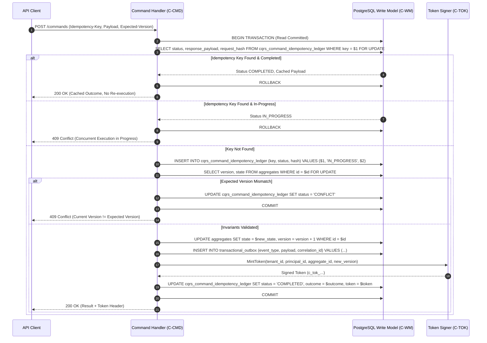

# CQRS Architecture & Runtime Diagrams (WP-15)

This document contains Mermaid diagrams illustrating the runtime architectures, command execution pipelines, query resolution protocols, token verification mechanisms, and concurrency control states of the CQRS subsystem per the [CQRS Production System Design Specification](file:///home/btpl-lap-22/live/System-Architect/event-driven-platform/docs/features/cqrs/business-logic.md).

---

## 1. End-to-End Command vs Query Pipeline Segregation

```mermaid
flowchart TD
    subgraph Client ["Client Layer"]
        CLI["API Consumer / Browser / Mobile"]
    end

    subgraph Gateway ["API Gateway (C-GW)"]
        ROUTE{"HTTP Method & Endpoint Class"}
    end

    subgraph CommandPath ["Write Pipeline (Command Bus)"]
        IDEMP{"Idempotency & Fingerprint Check"}
        AUTH_CMD["Fresh Authorization (C-AUTH)"]
        LOAD["Load Aggregate State (Row Lock)"]
        INV{"Validate Invariants & Expected Version"}
        TX["Atomic Commit:<br/>Aggregate Mutation + Outbox Event + Idempotency"]
        SIGN["Sign Consistency Token (HMAC-SHA256)"]
        OUT["Write Model (PostgreSQL Primary)"]
    end

    subgraph QueryPath ["Read Pipeline (Query Bus)"]
        AUTH_QRY["Read-Time Authorization Check"]
        TOK_RES{"Extract & Verify Consistency Token"}
        READ_VIEW["Read Authoritative Materialized View"]
        WAIT{"Version >= Token Min Version?"}
        PENDING["Return View with Status: PENDING"]
        SUCCESS["Return Consistent View Model"]
    end

    subgraph AsyncPipe ["Asynchronous Propagation Layer"]
        CDC["Transactional Outbox CDC Relay"]
        KAFKA["Kafka Event Broker"]
        PRJ["Materialized View Projector (WP-13)"]
    end

    CLI -->|POST /api/v1/commands/*| ROUTE
    CLI -->|GET /api/v1/queries/*| ROUTE

    ROUTE -->|Command Mutation| IDEMP
    IDEMP -->|New Key| AUTH_CMD
    IDEMP -->|Cached Completed| CLI
    AUTH_CMD --> LOAD
    LOAD --> INV
    INV -->|Passed| TX
    INV -->|Version Mismatch| CLI
    TX --> OUT
    TX --> SIGN
    SIGN --> CLI

    TX -.-> CDC
    CDC -.-> KAFKA
    KAFKA -.-> PRJ
    PRJ -.-> READ_VIEW

    ROUTE -->|Side-Effect-Free Query| AUTH_QRY
    AUTH_QRY --> TOK_RES
    TOK_RES -->|Token Present| READ_VIEW
    TOK_RES -->|No Token (Eventual)| READ_VIEW
    READ_VIEW --> WAIT
    WAIT -->|Satisfied| SUCCESS
    WAIT -->|Behind & Wait Budget Expired| PENDING
    SUCCESS --> CLI
    PENDING --> CLI
```

---

## 2. Command Pipeline Atomic Transaction Boundary (CQ-01, CQ-02)



---

## 3. Read-Your-Own-Writes Token Resolution Decision Tree (CQ-07, CQ-09)

```mermaid
flowchart TD
    START["Query Request Arrives with x-consistency-token"]
    SIG{"Verify Token HMAC Signature & Expiry"}
    
    START --> SIG
    SIG -->|Invalid / Forged / Expired| LOG_SEC["Ignore Token<br/>(Serve EVENTUAL + Increment Metric)"]
    SIG -->|Valid Signature| READ_V["Read Projection View Record"]

    READ_V --> CHK_VER{"Record Version >= Token Min Version?"}
    CHK_VER -->|Yes| RETURN_OK["Return HTTP 200 OK<br/>(State: CONSISTENT)"]
    
    CHK_VER -->|No| CHK_LAG{"Current View Lag > 5000ms?"}
    CHK_LAG -->|Yes (Prolonged Lag)| FAST_FAIL["Skip Wait<br/>(Fast-Fail to PENDING)"]
    
    CHK_LAG -->|No (Transient Catchup)| WAIT_BUDGET{"Acquire Async Waiter<br/>(Budget: 500ms)"}
    WAIT_BUDGET -->|Semaphore Saturated| FAST_FAIL
    WAIT_BUDGET -->|Notification Received (Caught Up)| RETURN_OK
    WAIT_BUDGET -->|Timeout Expired| FAST_FAIL

    FAST_FAIL --> RETURN_PENDING["Return HTTP 200 OK<br/>(Data Present + consistency_status: PENDING)"]
    LOG_SEC --> READ_V
```

---

## 4. Authoritative-Own Read (`C-AUTHR`) Circuit Protection (CQ-09, CQ-11)

```mermaid
flowchart LR
    subgraph Request ["Client Calling C-AUTHR"]
        REQ["GET /authoritative-own/orders/{id}<br/>(Must Match Principal Owner)"]
    end

    subgraph Protections ["Guard & Rate-Limit Rails"]
        RATE{"Rate Limit Budget?<br/>(Max 10 req/s/user)"}
        BREAKER{"Primary DB Latency Circuit Breaker"}
    end

    subgraph Execution ["Write-Side Retrieval & Normalization"]
        READ_WM["Read Primary Write Model Database<br/>(SELECT ... FROM orders)"]
        PROJ["Project via Shared View Serializer<br/>(Identical Schema to C-VIEW)"]
    end

    subgraph Fallbacks ["Degraded Fallback"]
        DEGRADE["Return 200 OK with Fallback Header<br/>or 429 Too Many Requests"]
    end

    REQ --> RATE
    RATE -->|Limit Exceeded| DEGRADE
    RATE -->|Allowed| BREAKER
    BREAKER -->|Breaker Open (Latency > 100ms)| DEGRADE
    BREAKER -->|Breaker Closed| READ_WM
    READ_WM --> PROJ
    PROJ --> REQ
```

