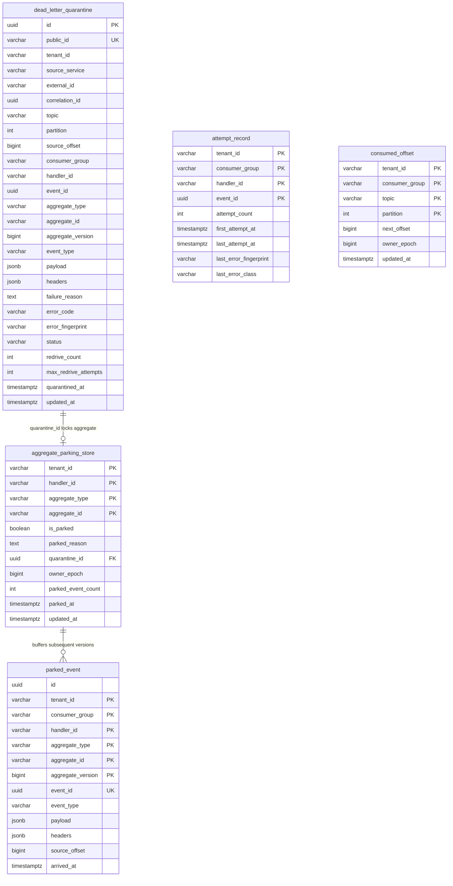
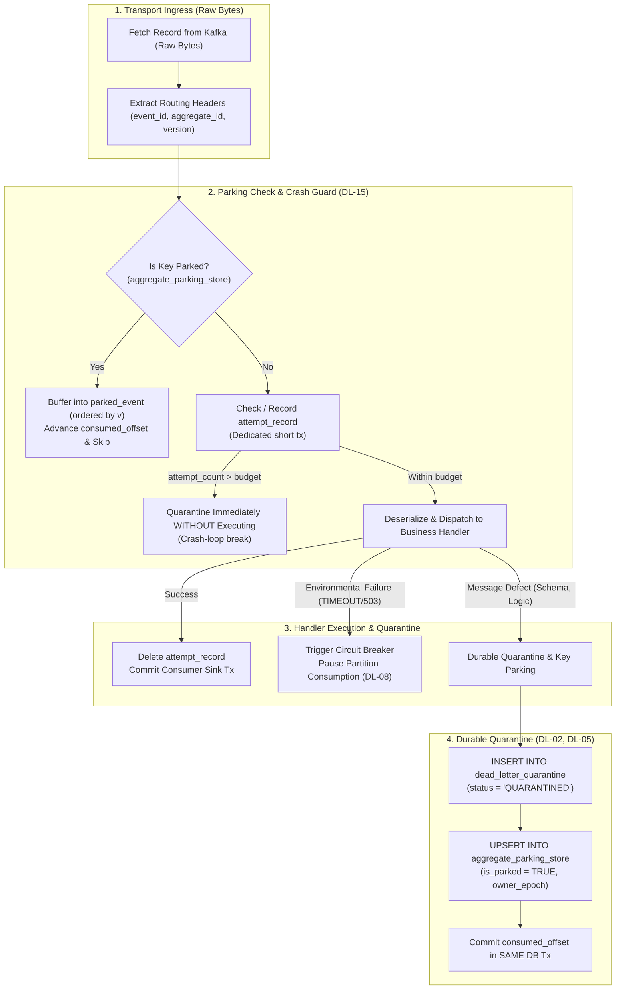
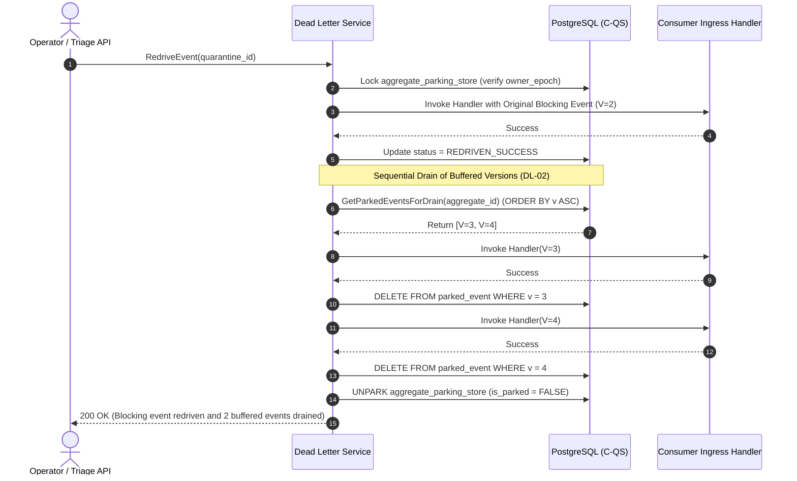

# Architectural Decision Record (ADR): Dead-Letter Handling & Aggregate Key Parking (v3 Subsystem)

* **Status:** Accepted
* **Date:** 2026-11-04
* **Deciders:** Lead Systems Architect & Platform Core Engineering
* **Feature Scope:** `src/features/dead-letter-handling/`, `src/api/rest/v1/`, `database/migrations/`
* **Governing Specification:** `docs/features/dead-letter-handling/business-logic.md` (v3 Production System Design Tree)

---

## 1. Context and Problem Statement

When an idempotent consumer encounters an unrecoverable message defect (e.g. malformed schema, unhandled handler exception, or split-brain poison pill), standard message brokers discard the message or dump it into an unindexed dead-letter topic.

In an event-driven aggregate system, naive DLQ routing causes severe data corruption:
- If version $V=2$ fails and goes to DLQ, but $V=3$ continues processing on the primary partition, per-aggregate ordering is broken (**DL-02**).
- Later re-driving $V=2$ over $V=3$ overwrites newer state or corrupts financial balance deltas.
- If a message causes a native panic, OOM, or segfault, in-memory retry counters vanish. On process restart, the worker re-picks the exact same offset forever in an infinite crash loop (**F3.2**).
- System outages (e.g., database timeout or network drop) misclassified as poison pills flood the DLQ with millions of valid messages (**DL-08**).

---

## 2. Invariants & Decision Drivers (from `business-logic.md` v3)

* **DL-01 No Silent Disposition**: Every quarantined event concludes in exactly one recorded state: `REDRIVEN_SUCCESS`, `COMPENSATED`, or `DISCARDED`. Events never "expire" or vanish silently.
* **DL-02 Ordering Preservation**: While an aggregate has an event quarantined, **no later event of that aggregate may be applied**.
* **DL-03 Handler Scope**: DLQ is scoped strictly to `(tenant_id, consumer_group, handler_id)`.
* **DL-04 Lossless Capture**: Original payload bytes and original headers are preserved byte-for-byte.
* **DL-05 Durable Before Advance**: Source offset advances only in the same DB transaction that records quarantine/parking (`consumed_offset`).
* **DL-06 Identity Preserved**: Redriven events retain original `event_id`, `aggregate_id`, and `aggregate_version`.
* **DL-07 Same Guards on Redrive**: Redrive passes through consumer ingress and version guard; zero backdoor force-writes.
* **DL-08 Message Defects vs Outages**: Infrastructure outages (e.g., `TIMEOUT`) pause consumption via circuit breaker; they are strictly forbidden from quarantine.
* **DL-11 Bounded Attempts Everywhere**: Maximum 3 automatic/manual redrives before human triage is required.
* **DL-13 Single Writer & Epoch Fencing**: Redrive and drains are executed only by the current partition owner verified by `owner_epoch`.
* **DL-15 Crash-Safe Poison Handling**: Attempt counter is recorded in `attempt_record` **before** execution. Over-budget at pickup is quarantined without execution.

---

## 3. Detailed Architectural Dialogue & Engineering Rationale

### 3.1 Why Key Parking Is Mandatory (DL-02 vs Head-of-Line Blocking)
**Engineer:** *Why can't we simply pause the Kafka partition when an event fails?*  
**Architect:** Pausing the partition stops all events across hundreds of unrelated customers who happen to share that partition. That turns an isolated message defect into a widespread platform outage (Severity: OUTAGE).  

**Engineer:** *Then why not just send the bad event to a DLQ topic and let the partition continue?*  
**Architect:** Because if version $V=2$ of Order #999 goes to DLQ, and the partition continues, the consumer immediately processes $V=3$ (e.g., `OrderCancelled`). If an operator fixes the bug tomorrow and re-drives $V=2$ (`OrderPaid`), the order transitions backwards from `Cancelled` to `Paid`. That is a critical data corruption bug (Severity: CORRUPT).  

**The Decision:** We implement **Durable Key Parking (`aggregate_parking_store`) and Ordered Event Buffering (`parked_event`)**. The partition advances so other customers are not blocked, but aggregate Order #999 is parked. Any subsequent event ($V=3, V=4$) for Order #999 is buffered in `parked_event`. Once $V=2$ is repaired and redriven, $V=3$ and $V=4$ drain in sequential version order.

---

### 3.2 Crash-Safe Poison Handling (DL-15 & F3.2)
**Engineer:** *Why do we need a separate `attempt_record` table before executing the handler?*  
**Architect:** If a poison message triggers an Out-Of-Memory (OOM) or Go runtime panic, the process dies before any `defer` or error handler can run. Because in-memory state is wiped, the container restarts, re-reads the exact same offset, and panics again—an infinite crash-loop restart storm.  

**The Decision:** Invariant **DL-15** enforces writing an `attempt_record` in a short dedicated transaction *before* dispatching to the business handler. On restart, the pre-check inspects `attempt_record`. If `attempt_count > budget`, it quarantines the event immediately without calling the handler, breaking the crash-loop.

---

## 4. Entity-Relationship Diagram (C-QS Schema)

---

## 5. Visual Architectural Diagrams

### 5.1 Record Processing Pipeline & Crash-Safe Gate (v3 Section 3)

---

### 5.2 Ordered Redrive & Sequential Drain Algorithm (v3 Section 10.1)

---

## 6. HTTP Delivery Endpoints (OpenAPI Contract)

Synchronized with `src/api/contracts/openapi/v1.yaml`:

1. `POST /api/v1/dlq/quarantine`: Ingests failed message, stores byte-for-byte fidelity, and atomically locks the aggregate key.
2. `POST /api/v1/dlq/redrive`: Bounded redrive passing through consumer ingress; drains all buffered `parked_event` records sequentially before unparking key.
3. `POST /api/v1/dlq/discard`: Human-authorized discard with audit reason; unparks key.
4. `GET /api/v1/dlq/quarantined`: Paginated triage endpoint filtering by `tenantId`, `handlerId`, and `status`.

---

## 7. PostgreSQL Storage Gate Constraint Registry

| Constraint Name | Description | PostgreSQL Type | Canonical Error Code |
|---|---|---|---|
| `pk_dead_letter_quarantine` | Composite primary key `(tenant_id, id)` | PRIMARY KEY | `CONFLICT` (409) |
| `dlq_public_id_uk` | Unique external opaque ID (`dlq_...`) | UNIQUE | `CONFLICT` (409) |
| `dlq_external_uk` | Natural dedupe `(tenant_id, source_service, external_id)` | UNIQUE | `CONFLICT` (409) |
| `pk_aggregate_parking_store` | Primary key `(tenant_id, handler_id, aggregate_type, aggregate_id)` | PRIMARY KEY | `CONFLICT` (409) |
| `pk_parked_event` | Composite primary key including `aggregate_version` | PRIMARY KEY | `CONFLICT` (409) |
| `pk_attempt_record` | Crash-safe pre-check key `(tenant_id, consumer_group, handler_id, event_id)` | PRIMARY KEY | `CONFLICT` (409) |
| `pk_consumed_offset` | Offset tracking `(tenant_id, consumer_group, topic, partition)` | PRIMARY KEY | `CONFLICT` (409) |
