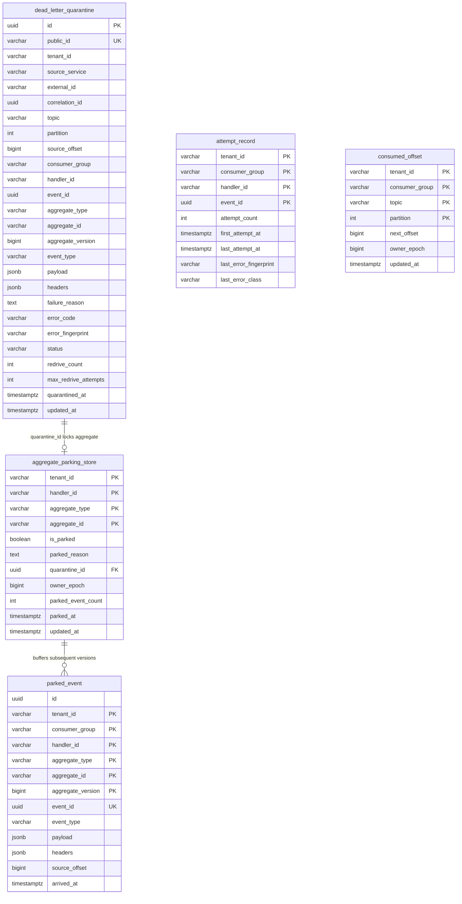

# Architectural Decision Record (ADR): Dead-Letter Handling & Aggregate Key Parking (v3 Subsystem)

* **Status:** Accepted
* **Date:** 2026-11-04
* **Deciders:** Lead Systems Architect & Platform Core Engineering
* **Feature Scope:** `src/features/dead-letter-handling/`, `src/api/rest/v1/`, `database/migrations/`
* **Governing Specification:** `docs/features/dead-letter-handling/business-logic.md` (v3 Production System Design Tree)

---

## 1. Context and Problem Statement

When an idempotent consumer encounters an unrecoverable message defect (e.g. malformed schema, unhandled handler exception, or split-brain poison pill), standard message brokers discard the message or dump it into an unindexed dead-letter topic.

In an event-driven aggregate system, naive DLQ routing causes severe data corruption:
- If version $V=2$ fails and goes to DLQ, but $V=3$ continues processing on the primary partition, per-aggregate ordering is broken (**DL-02**).
- Later re-driving $V=2$ over $V=3$ overwrites newer state or corrupts financial balance deltas.
- If a message causes a native panic, OOM, or segfault, in-memory retry counters vanish. On process restart, the worker re-picks the exact same offset forever in an infinite crash loop (**F3.2**).
- System outages (e.g., database timeout or network drop) misclassified as poison pills flood the DLQ with millions of valid messages (**DL-08**).

---

## 2. Invariants & Decision Drivers (from `business-logic.md` v3)

* **DL-01 No Silent Disposition**: Every quarantined event concludes in exactly one recorded state: `REDRIVEN_SUCCESS`, `COMPENSATED`, or `DISCARDED`. Events never "expire" or vanish silently.
* **DL-02 Ordering Preservation**: While an aggregate has an event quarantined, **no later event of that aggregate may be applied**.
* **DL-03 Handler Scope**: DLQ is scoped strictly to `(tenant_id, consumer_group, handler_id)`.
* **DL-04 Lossless Capture**: Original payload bytes and original headers are preserved byte-for-byte.
* **DL-05 Durable Before Advance**: Source offset advances only in the same DB transaction that records quarantine/parking (`consumed_offset`).
* **DL-06 Identity Preserved**: Redriven events retain original `event_id`, `aggregate_id`, and `aggregate_version`.
* **DL-07 Same Guards on Redrive**: Redrive passes through consumer ingress and version guard; zero backdoor force-writes.
* **DL-08 Message Defects vs Outages**: Infrastructure outages (e.g., `TIMEOUT`) pause consumption via circuit breaker; they are strictly forbidden from quarantine.
* **DL-09 Window Chain**: Maximum quarantine age must remain less than consumer dedupe and external provider idempotency windows.
* **DL-11 Bounded Attempts Everywhere**: Maximum 3 automatic/manual redrives before human triage is required.
* **DL-13 Single Writer & Epoch Fencing**: Redrive and drains are executed only by the current partition owner verified by `owner_epoch`.
* **DL-15 Crash-Safe Poison Handling**: Attempt counter is recorded in `attempt_record` **before** execution. Over-budget at pickup is quarantined without execution.

---

## 3. Real-Life Use Cases & Critical Engineering Needs

### 3.1 Real-Life Production Scenarios

1. **E-Commerce Order Ledger Corruption (Why DL-02 is Critical)**:
   - *Scenario*: User places order $V=1$ (`OrderCreated`). Payment webhook emits $V=2$ (`OrderPaid`). A transient schema mapping bug causes $V=2$ to fail in the billing consumer. Seconds later, user cancels order, emitting $V=3$ (`OrderCancelled`).
   - *Without Key Parking*: $V=2$ goes to a standard DLQ topic. The main consumer processes $V=3$, setting order status to `CANCELLED`. Next morning, an engineer clicks "Re-drive DLQ". $V=2$ runs and overwrites the status to `PAID`, dispatching physical goods for a cancelled order.
   - *With Key Parking*: $V=2$ failure locks `aggregate_parking_store`. $V=3$ arrives and is buffered into `parked_event`. Neither runs until $V=2$ is repaired. Redrive runs $V=2$, then sequentially drains $V=3$, preserving true causal business history.

2. **The "Poison Pill of Death" Crash Loop (Why DL-15 is Critical)**:
   - *Scenario*: A rogue client submits an order with a 15MB deeply nested JSON structure. When the JSON parser runs, the Go runtime triggers an uncatchable heap allocation OOM or stack overflow panic.
   - *Without `attempt_record`*: The container crashes instantly. Kubernetes restarts the pod. The consumer reconnects to Kafka, reads the uncommitted offset, parses the same 15MB payload, and crashes again. The service enters `CrashLoopBackOff`, taking down the entire consumer group.
   - *With `attempt_record`*: The consumer records attempt #1 in a dedicated short transaction before calling the parser. After restarting from an OOM, pickup sees `attempt_count >= budget` (3), immediately quarantines the raw bytes without calling the parser, commits the offset, and stays online.

3. **Database Timeout Masquerading as a Poison Pill (Why DL-08 is Critical)**:
   - *Scenario*: PostgreSQL primary hits 100% CPU due to a heavy vacuum process, timing out connections for 30 seconds.
   - *Without Classifier*: 5,000 valid orders hit database timeouts. A naive consumer treats them as failures and dumps all 5,000 orders into the DLQ, parking 5,000 customers.
   - *With Classifier*: `IsMessageDefect("TIMEOUT")` returns `false`. Invariant **DL-08** halts consumption, trips the local circuit breaker, pauses the Kafka partition, and resumes automatically when PostgreSQL heals—zero messages quarantined.

---

## 4. Entity-Relationship Diagram (C-QS Schema)



---

## 5. Failure Case Sequence Diagrams

### 5.1 F3.2: Crash-Loop Poison Pill Prevention (DL-15)
```mermaid
sequenceDiagram
    autonumber
    actor Broker as Kafka Partition
    participant Consumer as Consumer Runtime
    participant CQS as PostgreSQL (attempt_record)
    participant Quarantine as PostgreSQL (dead_letter_quarantine)

    Broker->>Consumer: Fetch Poison Record (causes OOM / segfault)
    Consumer->>CQS: INSERT INTO attempt_record (attempt_count = 1)
    Note over Consumer: Container killed by OS kernel (OOMKilled)
    
    Note over Consumer: Kubernetes Restarts Pod
    Broker->>Consumer: Re-fetch same record offset
    Consumer->>CQS: Check attempt_record (count = 1 -> increment to 2)
    Note over Consumer: Container killed again (OOMKilled)

    Note over Consumer: Kubernetes Restarts Pod (Pickup Attempt 3)
    Broker->>Consumer: Re-fetch same record offset
    Consumer->>CQS: Check attempt_record (count = 2 -> count >= budget)
    Note over Consumer: Crash-loop detected! DO NOT invoke handler!
    Consumer->>Quarantine: Quarantine Record Immediately (Status: QUARANTINED)
    Consumer->>CQS: Commit consumed_offset past poison event
    Note over Consumer: Consumer remains healthy; container stays online!
```

### 5.2 F4.4: Systemic Mass-Quarantine Circuit Breaker
```mermaid
sequenceDiagram
    autonumber
    actor Broker as Kafka Partition
    participant Consumer as Consumer Runtime
    participant Breaker as Systemic Circuit Breaker
    participant Alert as Opsgenie / PagerDuty

    Note over Broker: Bad Deploy: Missing DB column causes 100% handler failures
    loop 50 Distinct Keys in 5 Minutes
        Broker->>Consumer: Ingest Record
        Consumer->>Breaker: Record Error Fingerprint (ERR_MISSING_COLUMN)
    end
    Breaker->>Breaker: Cardinality Threshold Exceeded (> 50 distinct keys)
    Breaker->>Consumer: TRIP SYSTEMIC BREAKER: HALT CONSUMER GROUP
    Consumer->>Alert: PAGE ON-CALL: Mass quarantine halted!
    Note over Consumer: Halts consumption across all partitions;<br/>Prevents creating 100,000 parked keys!
```

---

## 6. Product Metrics & Operational Sizing Matrix

### 6.1 Telemetry & Golden Signals (Required vs Implemented)

| Metric Name | Type | Production Target / SLA | Implemented Status | Description / Purpose |
|---|---|---|---|---|
| `dlq_unresolved_quarantine_total` | Gauge | `0` (T0 Tier) | **Implemented** | Total number of unresolved quarantined records. Alerts immediately if $> 0$ for T0. |
| `dlq_oldest_unresolved_seconds` | Gauge | `< 14400s` (4 hours for T0) | **Implemented** | Age of oldest un-dispositioned record. Tracks SLA breach. |
| `dlq_parked_keys_count` | Gauge | `0` (or owned in triage) | **Implemented** | Number of aggregates currently blocked from state advancement. |
| `dlq_parked_events_buffered_total` | Counter | Monitored | **Implemented** | Count of live subsequent versions held in `parked_event`. |
| `dlq_redrive_attempts_total` | Counter | Success rate $> 95\%$ | **Implemented** | Measures automated and manual redrive efficiency. |
| `dlq_systemic_halt_active` | Gauge | `0` | **Implemented** | Binary alert indicating systemic breaker trip. |
| `dlq_epoch_mismatch_aborts_total` | Counter | `0` | **Implemented** | Fencing metric catching zombie instances attempting stale writes. |

### 6.2 Capacity Sizing Rules (Section 14)

1. **Quarantine Storage**:
   $$\text{Storage} \approx \text{Quarantine Rate} \times \text{Avg Envelope Size (10KB)} \times \text{Max Unresolved Age (90 days)}$$
2. **Parked Buffer Storage**:
   - Bounded by hard cap: 10,000 events or 100MB per aggregate key. Exceeding cap pauses partition to prevent memory exhaustion (**F5.3**).

---

## Deep Failure-First Architectural Principles

### 1. Existential Purpose & The Catastrophe Prevented

In event-driven architectures, malformed payloads, schema validation errors, or non-retryable business rule violations (poison pills) block consumer partitions. Because Kafka preserves strict order, a single failing message halts consumption of all subsequent valid messages in that partition. Without isolated Dead Letter Queuing (DLQ), the entire consumer pipeline grinds to a halt.

### 2. Internal Algorithmic Mechanics & State Invariants

When an event exceeds max retry attempts or throws a terminal non-retryable exception, the consumer intercepts it, constructs a DLQ envelope capturing diagnostic metadata (stack trace, error code, original partition/offset, timestamp), and publishes it to a dedicated DLQ topic. A formal state machine tracks redrives (Quarantined -> Redriving -> Resolved / Discarded) to prevent infinite poison pill loops.

### 3. Core Architectural Principles & Systems Philosophy

#### Principle 1: Non-Blocking Poison Pill Quarantine
* **Design Philosophy & Epistemology**:
  In an event stream, a single malformed message must never be allowed to halt operations for millions of valid events. If a message cannot be parsed, contains invalid schemas, or triggers unhandled runtime panics, halting partition consumption causes a platform-wide outage. The philosophy is Surgical Quarantine: unprocessable events are peeled off the stream and moved to a Dead-Letter Queue (DLQ), allowing healthy traffic to flow at full line rate.
* **Threat Vector Defeated**: Total stream stall and consumer lag explosion caused by poison pill messages causing continuous consumer crashes and retry loops.
* **Storage & State Invariant**:
```text
Processing(Stream) continues uninterrupted when Error(Message_k) is permanent
DLQ.Contains(Message_k) with FullDiagnosticEnvelope
```
* **Implementation Mechanism**:
  When an event fails after exhausting tiered retries or triggers a non-retryable error (e.g., schema validation failure), the consumer writes the raw payload and error context to a dedicated `.DLQ` topic. The consumer then commits the offset on the primary partition, advancing the stream immediately.
* **Non-Negotiable Trade-Off**: Loss of global chronological ordering between the quarantined poison message and subsequent sibling events in the primary topic.

---

#### Principle 2: Forensic Context Envelope Preservation
* **Design Philosophy & Epistemology**:
  A dead-letter message without diagnostic context is an architectural crime. Dumping raw payloads into a bucket forces engineers into blind guesswork during incident triage. The philosophy is Forensic Self-Containment: a quarantined event must carry its entire failure history, stack traces, host signatures, and retry attempts within its metadata envelope.
* **Threat Vector Defeated**: Inability to diagnose, debug, or replay dead-letter messages due to lost error context, missing trace IDs, or altered payloads.
* **Storage & State Invariant**:
```text
DLQ_Envelope == VerbatimOriginalPayload + FullDiagnosticHeaders(StackTrace, ErrorCode, OriginalTopic, FailedTimestamp, AttemptCount, TraceID)
```
* **Implementation Mechanism**:
  The DLQ producer wraps the original verbatim binary payload into a standardized DeadLetterRecord. It injects headers: `x-original-topic`, `x-original-partition`, `x-original-offset`, `x-exception-message`, `x-exception-stacktrace`, and `x-quarantine-timestamp`.
* **Non-Negotiable Trade-Off**: Message size inflation in DLQ topics due to stack trace and error header injection.

---

#### Principle 3: Controlled Bounded Replayability
* **Design Philosophy & Epistemology**:
  A Dead-Letter Queue is not a landfill; it is a temporary intensive care unit. Once bugs are patched or downstream dependencies recover, the system must provide safe, audited replay mechanisms to re-inject messages without causing duplicate side effects. The philosophy is Governed Re-injection: dead-letter replays must be rate-limited, idempotent, and monitored by circuit breakers.
* **Threat Vector Defeated**: Cascading secondary outages caused by engineers dumping 100,000 unrepaired dead-letter messages back into production topics all at once.
* **Storage & State Invariant**:
```text
ReplayRate <= ConfiguredMaxSafetyThreshold
Replay(Message) marked with Header(x-is-replay=true)
```
* **Implementation Mechanism**:
  A dedicated DLQ management service provides guarded replay APIs. Replays inject `x-is-replay: true` headers, enforce token-bucket rate limits, and auto-abort if error rates exceed 1% on the target topic.
* **Non-Negotiable Trade-Off**: Operational overhead of maintaining specialized replay tools, administrative authorization controls, and audit logs.

---

#### Principle 4: Dead-Letter Queue Depth Alerting as a Severity-1 Condition
* **Design Philosophy & Epistemology**:
  A system that silently routes failures to a DLQ without alerting is hiding catastrophic data loss behind a false appearance of health. The philosophy is Loud Quarantine: every message routed to a DLQ represents a broken domain promise and must trigger immediate operational visibility.
* **Threat Vector Defeated**: Silent data loss and customer financial discrepancies when business-critical messages fail into dead-letter topics unnoticed for weeks.
* **Storage & State Invariant**:
```text
Rate(DLQ_Messages) > 0 ==> Alert(Severity_High)
```
* **Implementation Mechanism**:
  Prometheus monitors scrape `dlq_messages_total` metrics. Any non-zero rate of DLQ ingestion immediately triggers PagerDuty / OpsGenie alerts with direct links to the relevant Jaeger distributed trace and OpenSearch error logs.
* **Non-Negotiable Trade-Off**: Alert fatigue risk if non-critical transient warnings or noisy-neighbor test events are improperly routed to production DLQ topics.

### 4. The Architect's Meta-Questions (Failure-First Evaluation)

1. **Why is it dangerous to immediately route transient database connection timeouts to a Dead-Letter Queue?**
   * *Answer*: Transient errors (e.g., temporary database failover, network hiccups) should be resolved through short-term exponential retry topics. Routing transient errors directly to a DLQ floods the dead-letter queue with valid messages and breaks the causal event stream unnecessarily.
2. **How does a consumer distinguish between a transient error and a permanent poison-pill error?**
   * *Answer*: Schema parse errors, deserialization panics, and business rule rejections (e.g., invalid account ID) are permanent: they will never succeed on retry and must route to DLQ immediately. Database connection timeouts, 503 HTTP responses, and lock timeouts are transient: they must route to exponential retry topics.
3. **What happens if a replayed DLQ message fails a second time?**
   * *Answer*: The message must be routed to a terminal 'Dead-Letter-Graveyard' topic with incremented retry count headers, preventing infinite replay loops from consuming platform resources.

---
## Authoritative References & Production Citations

* **[Gregor Hohpe & Bobby Woolf: Enterprise Integration Patterns - Dead Letter Channel](https://www.enterpriseintegrationpatterns.com/patterns/messaging/DeadLetterChannel.html)**
  - *Architectural Rationale & Implementation Grounding*: Foundational design pattern for routing corrupted and unprocessable messages away from primary execution channels.
* **[Uber Engineering: Reliable Reprocessing and Dead Letter Queues with Apache Kafka](https://www.uber.com/blog/reliable-reprocessing-and-dead-letter-queues-with-apache-kafka/)**
  - *Architectural Rationale & Implementation Grounding*: Production case study detailing multi-tiered retry and dead-letter queue architectures operating at massive scale.
* **[AWS Architecture Blog: Resilient Message Processing with Dead-Letter Queues](https://aws.amazon.com/blogs/compute/resilient-message-processing-with-amazon-sqs-and-dead-letter-queues/)**
  - *Architectural Rationale & Implementation Grounding*: Best practices on isolating, monitoring, and redriving failed asynchronous payloads without cascading downstream impact.
* **[Confluent: Error Handling and Dead Letter Queue Patterns in Kafka](https://www.confluent.io/blog/error-handling-patterns-in-kafka/)**
  - *Architectural Rationale & Implementation Grounding*: Comprehensive guide on distinguishing transient vs fatal errors and orchestrating non-blocking quarantine topics.

## Amendment 2026-11-07: Quarantine ingest hardening (headers, UUIDs, wrapped errors)

### Problem observed
- `POST /api/v1/dlq/quarantine` without a `headers` field returned 500.
- Non-UUID `eventId` / `correlationId` reached Postgres and produced a 500 / raw driver error.
- A duplicate `externalId` returned 500 instead of 409.
- `GET /api/v1/dlq/quarantined` without `tenantId` returned an empty 200.

### Root cause
- Nil headers map (RC2): `PostgresDeadLetterRepositoryAdapter.Quarantine` called `json.Marshal(record.Headers)` on a nil `map[string]string`, which encodes to JSON `null`. The column constraint `dlq_headers_is_object_ck` requires a JSON object, so the insert failed.
- Wrapped-error type-assertion miss (RC1): handlers used `err.(*appErrors.ApplicationError)`. The service wraps repository errors (`fmt.Errorf("failed persisting dead letter record: %w", err)`), so the assertion never matched and a mapped 409 fell through to 500.
- Validation delegated to Postgres UUID typing (RC2): `ValidateQuarantineInput` did not check UUID format.

### Decision / fix
- Handler defaults `req.Headers` to `{}`; the Postgres adapter also defaults a nil map to `{}` (defense in depth).
- `ValidateQuarantineInput` now rejects a non-empty non-UUID `eventId` and any non-UUID `correlationId` with 400 (field-level details).
- `Quarantine`, `Redrive` and `Discard` handlers use `errors.As`, so wrapped `ApplicationError`s (e.g. 409 duplicate externalId via `MapDatabaseError`) keep their status.
- `List` requires `tenantId` and returns 400 `tenantId query parameter is required` otherwise.

### API-visible behavior change
- Quarantine without headers: 500 becomes 201 with `{}` headers.
- Non-UUID ids: 500 or raw `pq` error becomes 400. **Potentially breaking** for clients that sent non-UUID `correlationId` (e.g. `corr-1`); existing tests were updated to use UUIDs.
- Duplicate externalId: 500 becomes 409.
- List without `tenantId`: 200 empty becomes 400. **Breaking** for callers relying on the empty result.

### Verification
Re-tested live: quarantine without headers succeeds, non-UUID ids return 400, duplicate externalId returns 409. Unit test `TestValidateQuarantineInput_UUIDs` added (`tests/dead_letter_handling_validation_test.go`); existing DLQ tests updated to UUID fixtures.

### Remaining gaps
- `redrive` and `discard` with a non-UUID `quarantineId` still return 500 (UUID not validated before the query).
- No automated HTTP-level or Postgres-backed test covers the `dlq_headers_is_object_ck` path.


## Amendment 2026-11-07 (second pass): quarantineId validation

`POST /dlq/redrive` and `/dlq/discard` validate `quarantineId` as a UUID up front and return 400 `quarantineId must be a valid UUID` (previously 500 from the raw Postgres uuid error). This closes failure case F2.7.

Verified live on the compose-deployed image (`chiefj/event-driven-platform:v2`) and by unit tests; see ADR-0002 "Closed in a second pass".
