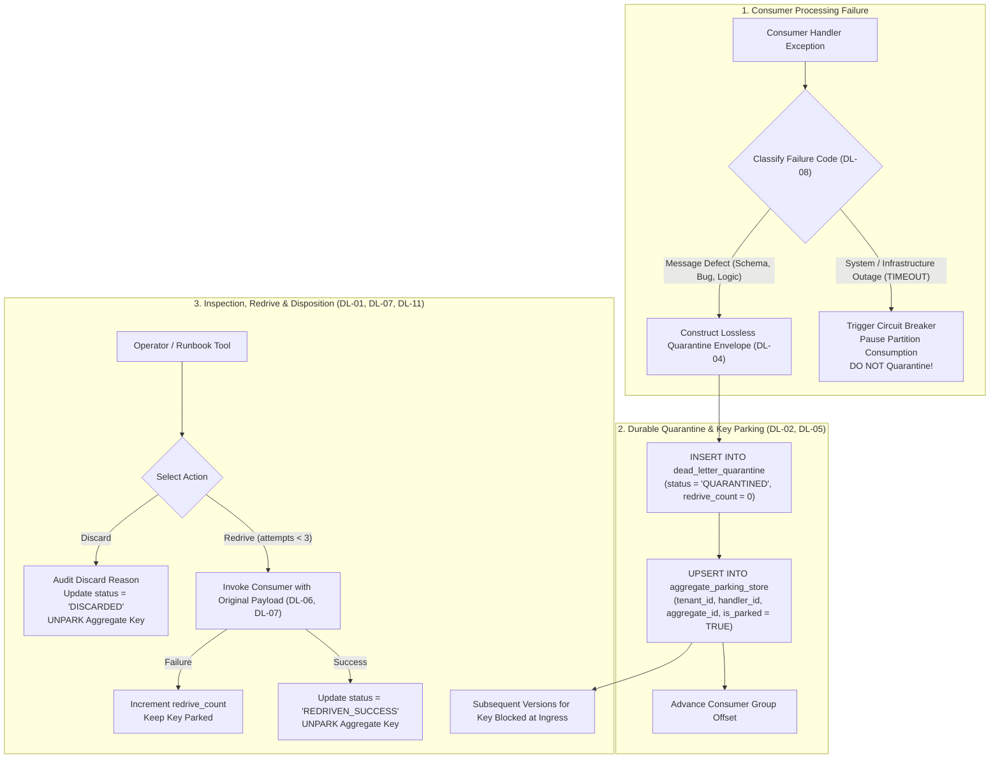
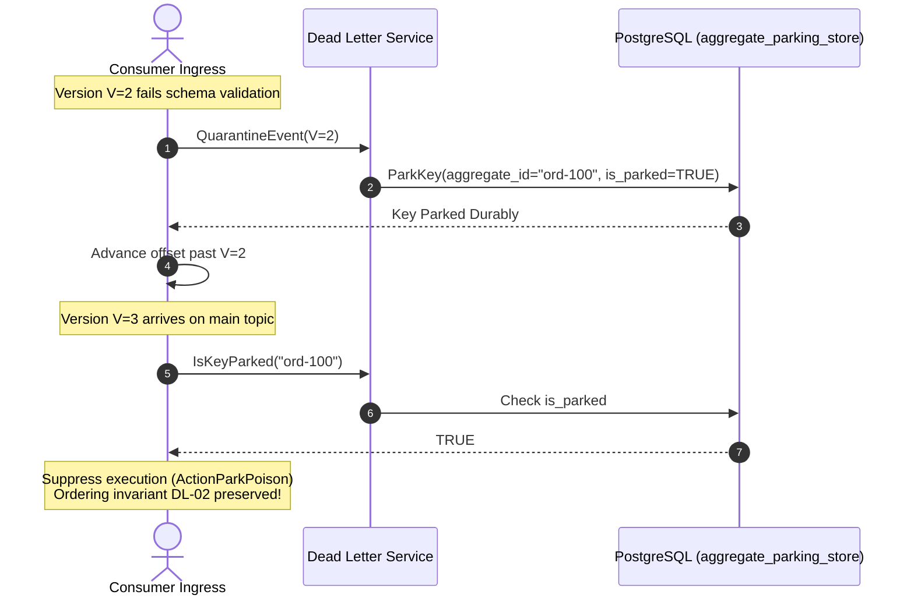
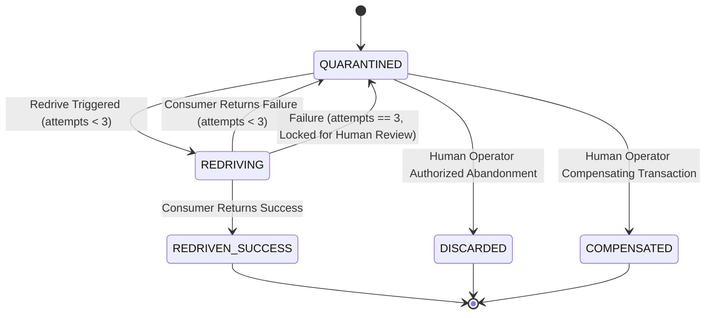

# Architectural Decision Record (ADR): Dead-Letter Handling & Aggregate Key Parking

* **Status:** Accepted
* **Date:** 2026-11-04
* **Deciders:** Lead Systems Architect & Platform Core Engineering
* **Feature Scope:** `src/features/dead-letter-handling/`, `src/api/rest/v1/`, `database/migrations/`
* **Governing Decision Tree:** `docs/features/dead-letter-handling/business-logic.md` (v2)

---

## 1. Context and Problem Statement

When an idempotent consumer encounters an unrecoverable message defect (e.g. malformed schema, unhandled handler exception, or split-brain poison pill), standard message brokers discard the message or dump it into an unindexed dead-letter topic.

In an event-driven aggregate system, naive DLQ routing causes severe data corruption:
- If version $V=2$ fails and goes to DLQ, but $V=3$ continues processing on the primary partition, per-aggregate ordering is broken.
- Later re-driving $V=2$ over $V=3$ overwrites newer state or corrupts financial balance deltas.
- System outages (e.g., database timeout or network drop) misclassified as poison pills flood the DLQ with millions of valid messages.

---

## 2. Invariants & Decision Drivers (from `business-logic.md` v2)

* **DL-01 No Silent Disposition**: Every quarantined event concludes in exactly one recorded state: `REDRIVEN_SUCCESS`, `COMPENSATED`, or `DISCARDED`. Events never "expire" or vanish silently.
* **DL-02 Ordering Preservation**: While an aggregate has an event quarantined, **no later event of that aggregate may be applied**.
* **DL-03 Handler Scope**: DLQ is scoped strictly to `(tenant_id, topic, consumer_group, handler_id)`.
* **DL-04 Lossless Capture**: Original payload bytes and original headers are preserved byte-for-byte.
* **DL-05 Commit Only After Durable Quarantine**: Source offset advances only after the quarantine write commits durably.
* **DL-06 Identity Preserved**: Redriven events retain original `event_id`, `aggregate_id`, and `aggregate_version`.
* **DL-07 Redrive Through Guards**: Redrive passes through consumer ingress and version guard; zero backdoor force-writes.
* **DL-08 Message Defects vs Outages**: Infrastructure outages (e.g., `TIMEOUT`) pause consumption via circuit breaker; they are strictly forbidden from quarantine.
* **DL-11 Bounded Redrives**: Maximum 3 automatic/manual redrives before human triage is required.

---

## 3. Detailed Architectural Dialogue & Engineering Rationale

### 3.1 Why Key Parking Is Mandatory (DL-02 vs Head-of-Line Blocking)
**Engineer:** *Why can't we simply pause the Kafka partition when an event fails?*  
**Architect:** Pausing the partition stops all events across hundreds of unrelated customers who happen to share that partition. That turns an isolated message defect into a widespread platform outage (Severity: OUTAGE).  

**Engineer:** *Then why not just send the bad event to a DLQ topic and let the partition continue?*  
**Architect:** Because if version $V=2$ of Order #999 goes to DLQ, and the partition continues, the consumer immediately processes $V=3$ (e.g., `OrderCancelled`). If an operator fixes the bug tomorrow and re-drives $V=2$ (`OrderPaid`), the order transitions backwards from `Cancelled` to `Paid`. That is a critical data corruption bug (Severity: CORRUPT).  

**The Decision:** We implement **Durable Key Parking (`aggregate_parking_store`)**. The partition advances so other customers are not blocked, but aggregate Order #999 is parked. Any subsequent event for Order #999 is suppressed at consumer ingress until the quarantined event is redriven or discarded.

---

### 3.2 Bounded Redrive & Terminal Disposition (DL-01 & DL-11)
**Engineer:** *Should the redrive worker keep retrying until the handler succeeds?*  
**Architect:** No. If the handler has an unpatched code bug, continuous retries create a hot spin loop and thrash the database.  

**The Decision:** Invariant **DL-11** enforces a hard cap of 3 redrive attempts (`max_redrive_attempts = 3`). On the 4th attempt, redrive is blocked, requiring an operator to inspect the failure fingerprint and either patch code or execute `POST /api/v1/dlq/discard` with an audited business justification.

---

## 4. Visual Architectural Diagrams

### 4.1 Quarantine & Key Parking Lifecycle

---

## 5. Invariant Sequences

### 5.1 Invariant DL-02: Ordering Preservation via Key Parking

### 5.2 Invariant DL-11: Bounded Redrive State Transition

---

## 6. HTTP Delivery Endpoints (OpenAPI Contract)

Synchronized with `src/api/contracts/openapi/v1.yaml`:

1. `POST /api/v1/dlq/quarantine`: Ingests failed message, stores byte-for-byte fidelity, and atomically locks the aggregate key.
2. `POST /api/v1/dlq/redrive`: Bounded redrive passing through consumer ingress; unparks key on success.
3. `POST /api/v1/dlq/discard`: Human-authorized discard with audit reason; unparks key.
4. `GET /api/v1/dlq/quarantined`: Paginated triage endpoint filtering by `tenantId`, `handlerId`, and `status`.

---

## 7. Storage Gate Constraint Registry

| Constraint Name | Description | PostgreSQL Type | Canonical Error Code |
|---|---|---|---|
| `pk_dead_letter_quarantine` | Composite primary key `(tenant_id, id)` | PRIMARY KEY | `CONFLICT` (409) |
| `dlq_public_id_uk` | Unique external opaque ID (`dlq_...`) | UNIQUE | `CONFLICT` (409) |
| `dlq_external_uk` | Natural dedupe `(tenant_id, source_service, external_id)` | UNIQUE | `CONFLICT` (409) |
| `dlq_public_id_ck` | Prefix check `^dlq_[0-9a-zA-Z]{26}$` | CHECK | `VALIDATION_FAILED` (400) |
| `dlq_failure_reason_ck`| Trimming constraint on failure reason | CHECK | `VALIDATION_FAILED` (400) |
| `dlq_status_ck` | Allowed states (`QUARANTINED`, `REDRIVING`, etc.) | CHECK | `VALIDATION_FAILED` (400) |
| `dlq_max_redrive_ck` | Enforces bounded attempts $\ge 1$ | CHECK | `VALIDATION_FAILED` (400) |
