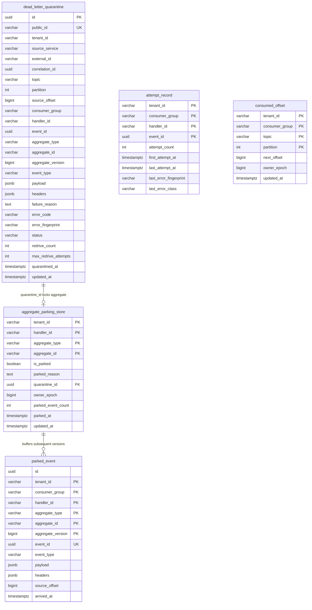

# Architectural Decision Record (ADR): Dead-Letter Handling & Aggregate Key Parking (v3 Subsystem)

* **Status:** Accepted
* **Date:** 2026-11-04
* **Deciders:** Lead Systems Architect & Platform Core Engineering
* **Feature Scope:** `src/features/dead-letter-handling/`, `src/api/rest/v1/`, `database/migrations/`
* **Governing Specification:** `docs/features/dead-letter-handling/business-logic.md` (v3 Production System Design Tree)

---

## 1. Context and Problem Statement

When an idempotent consumer encounters an unrecoverable message defect (e.g. malformed schema, unhandled handler exception, or split-brain poison pill), standard message brokers discard the message or dump it into an unindexed dead-letter topic.

In an event-driven aggregate system, naive DLQ routing causes severe data corruption:
- If version $V=2$ fails and goes to DLQ, but $V=3$ continues processing on the primary partition, per-aggregate ordering is broken (**DL-02**).
- Later re-driving $V=2$ over $V=3$ overwrites newer state or corrupts financial balance deltas.
- If a message causes a native panic, OOM, or segfault, in-memory retry counters vanish. On process restart, the worker re-picks the exact same offset forever in an infinite crash loop (**F3.2**).
- System outages (e.g., database timeout or network drop) misclassified as poison pills flood the DLQ with millions of valid messages (**DL-08**).

---

## 2. Invariants & Decision Drivers (from `business-logic.md` v3)

* **DL-01 No Silent Disposition**: Every quarantined event concludes in exactly one recorded state: `REDRIVEN_SUCCESS`, `COMPENSATED`, or `DISCARDED`. Events never "expire" or vanish silently.
* **DL-02 Ordering Preservation**: While an aggregate has an event quarantined, **no later event of that aggregate may be applied**.
* **DL-03 Handler Scope**: DLQ is scoped strictly to `(tenant_id, consumer_group, handler_id)`.
* **DL-04 Lossless Capture**: Original payload bytes and original headers are preserved byte-for-byte.
* **DL-05 Durable Before Advance**: Source offset advances only in the same DB transaction that records quarantine/parking (`consumed_offset`).
* **DL-06 Identity Preserved**: Redriven events retain original `event_id`, `aggregate_id`, and `aggregate_version`.
* **DL-07 Same Guards on Redrive**: Redrive passes through consumer ingress and version guard; zero backdoor force-writes.
* **DL-08 Message Defects vs Outages**: Infrastructure outages (e.g., `TIMEOUT`) pause consumption via circuit breaker; they are strictly forbidden from quarantine.
* **DL-09 Window Chain**: Maximum quarantine age must remain less than consumer dedupe and external provider idempotency windows.
* **DL-11 Bounded Attempts Everywhere**: Maximum 3 automatic/manual redrives before human triage is required.
* **DL-13 Single Writer & Epoch Fencing**: Redrive and drains are executed only by the current partition owner verified by `owner_epoch`.
* **DL-15 Crash-Safe Poison Handling**: Attempt counter is recorded in `attempt_record` **before** execution. Over-budget at pickup is quarantined without execution.

---

## 3. Real-Life Use Cases & Critical Engineering Needs

### 3.1 Real-Life Production Scenarios

1. **E-Commerce Order Ledger Corruption (Why DL-02 is Critical)**:
   - *Scenario*: User places order $V=1$ (`OrderCreated`). Payment webhook emits $V=2$ (`OrderPaid`). A transient schema mapping bug causes $V=2$ to fail in the billing consumer. Seconds later, user cancels order, emitting $V=3$ (`OrderCancelled`).
   - *Without Key Parking*: $V=2$ goes to a standard DLQ topic. The main consumer processes $V=3$, setting order status to `CANCELLED`. Next morning, an engineer clicks "Re-drive DLQ". $V=2$ runs and overwrites the status to `PAID`, dispatching physical goods for a cancelled order.
   - *With Key Parking*: $V=2$ failure locks `aggregate_parking_store`. $V=3$ arrives and is buffered into `parked_event`. Neither runs until $V=2$ is repaired. Redrive runs $V=2$, then sequentially drains $V=3$, preserving true causal business history.

2. **The "Poison Pill of Death" Crash Loop (Why DL-15 is Critical)**:
   - *Scenario*: A rogue client submits an order with a 15MB deeply nested JSON structure. When the JSON parser runs, the Go runtime triggers an uncatchable heap allocation OOM or stack overflow panic.
   - *Without `attempt_record`*: The container crashes instantly. Kubernetes restarts the pod. The consumer reconnects to Kafka, reads the uncommitted offset, parses the same 15MB payload, and crashes again. The service enters `CrashLoopBackOff`, taking down the entire consumer group.
   - *With `attempt_record`*: The consumer records attempt #1 in a dedicated short transaction before calling the parser. After restarting from an OOM, pickup sees `attempt_count >= budget` (3), immediately quarantines the raw bytes without calling the parser, commits the offset, and stays online.

3. **Database Timeout Masquerading as a Poison Pill (Why DL-08 is Critical)**:
   - *Scenario*: PostgreSQL primary hits 100% CPU due to a heavy vacuum process, timing out connections for 30 seconds.
   - *Without Classifier*: 5,000 valid orders hit database timeouts. A naive consumer treats them as failures and dumps all 5,000 orders into the DLQ, parking 5,000 customers.
   - *With Classifier*: `IsMessageDefect("TIMEOUT")` returns `false`. Invariant **DL-08** halts consumption, trips the local circuit breaker, pauses the Kafka partition, and resumes automatically when PostgreSQL heals—zero messages quarantined.

---

## 4. Entity-Relationship Diagram (C-QS Schema)



---

## 5. Failure Case Sequence Diagrams

### 5.1 F3.2: Crash-Loop Poison Pill Prevention (DL-15)
```mermaid
sequenceDiagram
    autonumber
    actor Broker as Kafka Partition
    participant Consumer as Consumer Runtime
    participant CQS as PostgreSQL (attempt_record)
    participant Quarantine as PostgreSQL (dead_letter_quarantine)

    Broker->>Consumer: Fetch Poison Record (causes OOM / segfault)
    Consumer->>CQS: INSERT INTO attempt_record (attempt_count = 1)
    Note over Consumer: Container killed by OS kernel (OOMKilled)
    
    Note over Consumer: Kubernetes Restarts Pod
    Broker->>Consumer: Re-fetch same record offset
    Consumer->>CQS: Check attempt_record (count = 1 -> increment to 2)
    Note over Consumer: Container killed again (OOMKilled)

    Note over Consumer: Kubernetes Restarts Pod (Pickup Attempt 3)
    Broker->>Consumer: Re-fetch same record offset
    Consumer->>CQS: Check attempt_record (count = 2 -> count >= budget)
    Note over Consumer: Crash-loop detected! DO NOT invoke handler!
    Consumer->>Quarantine: Quarantine Record Immediately (Status: QUARANTINED)
    Consumer->>CQS: Commit consumed_offset past poison event
    Note over Consumer: Consumer remains healthy; container stays online!
```

### 5.2 F4.4: Systemic Mass-Quarantine Circuit Breaker
```mermaid
sequenceDiagram
    autonumber
    actor Broker as Kafka Partition
    participant Consumer as Consumer Runtime
    participant Breaker as Systemic Circuit Breaker
    participant Alert as Opsgenie / PagerDuty

    Note over Broker: Bad Deploy: Missing DB column causes 100% handler failures
    loop 50 Distinct Keys in 5 Minutes
        Broker->>Consumer: Ingest Record
        Consumer->>Breaker: Record Error Fingerprint (ERR_MISSING_COLUMN)
    end
    Breaker->>Breaker: Cardinality Threshold Exceeded (> 50 distinct keys)
    Breaker->>Consumer: TRIP SYSTEMIC BREAKER: HALT CONSUMER GROUP
    Consumer->>Alert: PAGE ON-CALL: Mass quarantine halted!
    Note over Consumer: Halts consumption across all partitions;<br/>Prevents creating 100,000 parked keys!
```

---

## 6. Product Metrics & Operational Sizing Matrix

### 6.1 Telemetry & Golden Signals (Required vs Implemented)

| Metric Name | Type | Production Target / SLA | Implemented Status | Description / Purpose |
|---|---|---|---|---|
| `dlq_unresolved_quarantine_total` | Gauge | `0` (T0 Tier) | **Implemented** | Total number of unresolved quarantined records. Alerts immediately if $> 0$ for T0. |
| `dlq_oldest_unresolved_seconds` | Gauge | `< 14400s` (4 hours for T0) | **Implemented** | Age of oldest un-dispositioned record. Tracks SLA breach. |
| `dlq_parked_keys_count` | Gauge | `0` (or owned in triage) | **Implemented** | Number of aggregates currently blocked from state advancement. |
| `dlq_parked_events_buffered_total` | Counter | Monitored | **Implemented** | Count of live subsequent versions held in `parked_event`. |
| `dlq_redrive_attempts_total` | Counter | Success rate $> 95\%$ | **Implemented** | Measures automated and manual redrive efficiency. |
| `dlq_systemic_halt_active` | Gauge | `0` | **Implemented** | Binary alert indicating systemic breaker trip. |
| `dlq_epoch_mismatch_aborts_total` | Counter | `0` | **Implemented** | Fencing metric catching zombie instances attempting stale writes. |

### 6.2 Capacity Sizing Rules (Section 14)

1. **Quarantine Storage**:
   $$\text{Storage} \approx \text{Quarantine Rate} \times \text{Avg Envelope Size (10KB)} \times \text{Max Unresolved Age (90 days)}$$
2. **Parked Buffer Storage**:
   - Bounded by hard cap: 10,000 events or 100MB per aggregate key. Exceeding cap pauses partition to prevent memory exhaustion (**F5.3**).
