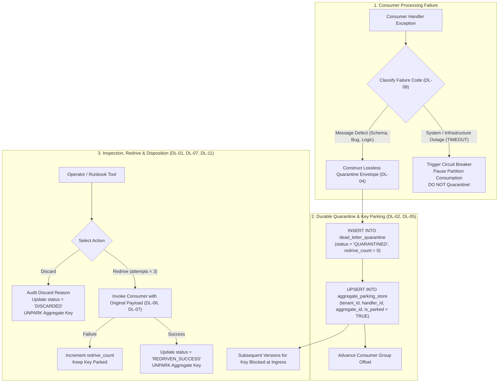
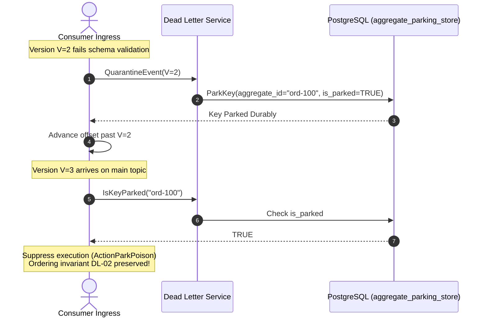
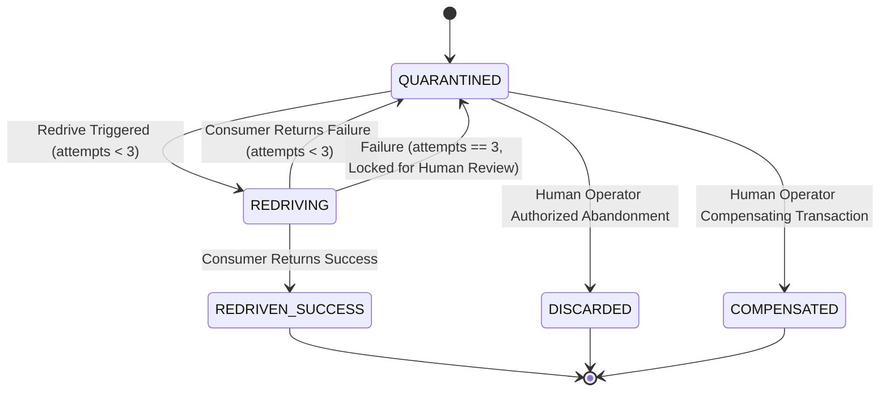

# Dead-Letter Handling Architectural Diagrams

---

## 1. Quarantine & Key Parking Lifecycle

---

## 2. Invariant DL-02: Key Parking Sequence

---

## 3. Invariant DL-11: Bounded Redrive State Transitions

