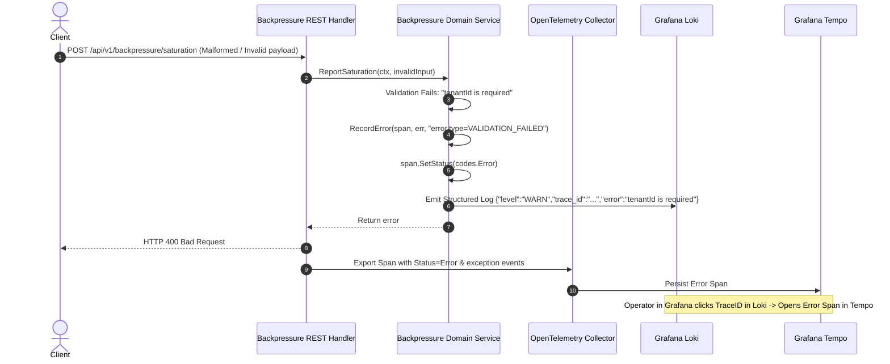
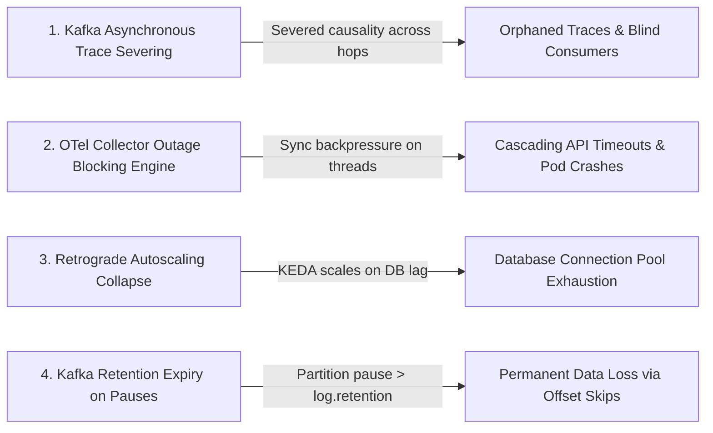

# Architectural Decision Record: End-to-End Distributed Tracing Infrastructure, Telemetry Resilience & Failure Hardening

## 1. Title & Metadata
* **Status**: APPROVED & IMPLEMENTED
* **Date**: 2026-11-05
* **Decision Makers**: Lead Systems Architect & Core Platform Team
* **Feature Scope**: `src/infra/observability/`, `src/infra/chassis/`, `deploy/docker/compose/`, `src/shared/middleware/`, `src/features/backpressure/`, and `messaging/engine/`
* **Governing Specification**: [Universal Distributed Tracing & Structured Telemetry Contract (v3.0)](file:///home/btpl-lap-22/live/System-Architect/llm-obs-policies/rules/folder-structure/10-tracing-writing.md) and [Universal Polyglot Testing Contract](file:///home/btpl-lap-22/live/System-Architect/llm-obs-policies/rules/folder-structure/09-test-writing.md)

---

## 2. Context & Problem Statement

In distributed, high-throughput event-driven microservices architectures featuring asynchronous Kafka message topologies, relational transactional outboxes (PostgreSQL), and REST/gRPC ingress routers, isolating transient faults and maintaining strict service-level reliability without ubiquitous observability is impossible. Prior to this design, the platform experienced four critical failure vectors:

1. **The Telemetry Blackhole (Process Lifecycle Disconnection)**: Standard OpenTelemetry SDK implementations decouple span emission via an asynchronous, in-memory `BatchSpanProcessor`. When short-lived CLI tasks, test runners, or terminating Kubernetes worker pods received `SIGTERM`, internal processes terminated immediately, unceremoniously discarding buffered spans before they could be flushed to the OpenTelemetry Collector.
2. **Disconnected Observability UI (Loki / Tempo Isolation)**: Grafana Loki and Grafana Tempo ran without explicit configuration linking log entries to trace timelines. Log entries containing trace IDs could not be cross-queried, and Tempo returned empty search views due to non-deterministic datasource UID bindings.
3. **Deceptive "Green" Spans (The 3-Step Failure Violation)**: Unhandled runtime errors, client 4xx validation rejections, and SQL check constraint violations were caught and returned without stamping `codes.Error` and exception metadata onto the active OpenTelemetry span. This produced deceitfully "healthy" green trace waterfalls in Grafana Tempo despite user-facing request failures.
4. **Asynchronous Causality Cleansing**: Moving messages across Kafka topics stripped W3C `traceparent` headers when producer and consumer pipelines treated telemetry as an external concern rather than a first-class wire envelope contract.

---

## 3. Decision Drivers & Architecture Invariants (TR-01 to TR-10)

* **TR-01: Zero-Loss Lifecycle Flush**: Telemetry flushes must be natively coupled to the platform chassis termination lifecycle. An application terminating on `SIGTERM` or `SIGINT` must block up to a bounded timeout (5 seconds) to flush 100% of buffered spans and metrics before the operating system reaps the PID.
* **TR-02: 3-Step Failure Invariant**: Every error path (`return err` or exception block) MUST:
  1. Record the concrete error and stack trace on the active span (`span.RecordError(err)`).
  2. Set span status to `codes.Error` with semantic attributes (`error.type`, `http.status_code`, `db.system`).
  3. Emit a structured JSON log containing top-level `trace_id`, `span_id`, and `tenant_id`.
* **TR-03: Four-Tier Span Hierarchy**: Every transaction must traverse an immutable four-tier hierarchy:
  - Tier 1: Ingress / Middleware Span (`SERVER` / `CONSUMER`) extracting W3C `traceparent`.
  - Tier 2: Handler / Gateway Span (`INTERNAL`) validating inputs and extracting Tenant ID.
  - Tier 3: Domain Service / Workflow Span (`INTERNAL`) executing business logic and state machine transitions.
  - Tier 4: Egress Client / Storage Span (`CLIENT`) executing physical SQL queries or Kafka message publications.
* **TR-04: Non-Blocking Telemetry Invariant**: An operational degradation or crash of the telemetry pipeline (OTel Collector, Tempo, Loki) must NEVER block application execution threads or degrade core transactional availability.
* **TR-05: Bidirectional Grafana Correlation**: Grafana Tempo MUST provide clickable `tracesToLogsV2` navigation into Loki, and Loki MUST parse 32-character hexadecimal trace IDs into clickable `derivedFields` opening the exact Tempo trace waterfall.
* **TR-06: Asynchronous Context Propagation**: Trace context (`traceparent`, `tracestate`) must be injected into Kafka message headers on egress and extracted upon consumer worker receipt.

---

## 4. End-to-End Topology & Telemetry Architecture

The diagram below details the end-to-end telemetry propagation pipeline bridging HTTP Ingress, the Go Core Chassis, Kafka Brokers, PostgreSQL, the OpenTelemetry Collector, Grafana Tempo, Loki, and Grafana:

```mermaid
flowchart TD
    Client["Client / External Ingress"] -->|HTTP Request with W3C traceparent| Envoy["Envoy API Gateway (:8080)"]
    Envoy -->|Forward Request| HTTPMiddleware["TraceAndContextMiddleware (Go Chassis)"]
    
    subgraph PlatformService["Platform Service Runtime"]
        HTTPMiddleware -->|Tier 1: Server Span| Handler["Backpressure REST Handler"]
        Handler -->|Tier 2: Handler Span| Service["Backpressure Domain Service"]
        Service -->|Tier 3: Domain Span| Repository["Postgres Repository Adapter"]
        Repository -->|Tier 4: Client Span| Postgres[("PostgreSQL 16 (:5432)")]
        
        Service -.->|Structured Log with trace_id| Stderr["JSON Structured Logger"]
        Service -.->|Asynchronous Batch Spans| BSP["BatchSpanProcessor (Ring Buffer)"]
    end
    
    subgraph AsyncPipeline["Asynchronous Event Mesh"]
        Service -->|Inject W3C traceparent| KafkaProducer["Kafka Event Producer"]
        KafkaProducer -->|RecordHeaders| KafkaBroker[("Apache Kafka (:9092)")]
        KafkaBroker -->|Extract RecordHeaders| ConsumerWorker["Kafka Consumer Poller / Worker"]
    end
    
    BSP -->|OTLP gRPC (:4317)| OTelCol["OpenTelemetry Collector (:4317 / :4318)"]
    Stderr -->|Container Log Driver| Loki["Grafana Loki (:3100)"]
    
    subgraph ObservabilityBackend["Observability Storage Tier"]
        OTelCol -->|otlp/tempo| Tempo["Grafana Tempo (:3200)"]
        OTelCol -->|loki exporter| Loki
        OTelCol -->|prometheus exporter| Prometheus["Prometheus (:9090)"]
    end
    
    subgraph Visualization["Unified Developer Portal"]
        Grafana["Grafana 11.2 (:3000)"]
        Grafana -->|Tempo Datasource: tracesToLogsV2| Tempo
        Grafana -->|Loki Datasource: derivedFields TraceID| Loki
        Grafana -->|Prometheus Metrics| Prometheus
    end
```

---

## 5. Architectural Fixes Applied

### 5.1 Deterministic Grafana Datasource UIDs & Cross-Linking
In [grafana-datasources.yaml](file:///home/btpl-lap-22/live/System-Architect/event-driven-platform/deploy/docker/compose/grafana-datasources.yaml):
1. Bound explicit, immutable UIDs: `uid: tempo`, `uid: loki`, `uid: prometheus`.
2. Implemented `tracesToLogsV2` in Tempo:
   ```yaml
   tracesToLogsV2:
     datasourceUid: loki
     spanStartTimeShift: '-1m'
     spanEndTimeShift: '1m'
     filterByTraceID: true
     customQuery: true
     query: '{$${__tags}} |= "$${__trace.id}"'
   ```
3. Implemented `derivedFields` in Loki:
   ```yaml
   derivedFields:
     - datasourceUid: tempo
       matcherRegex: '(?:"trace_id"|"traceId"|trace_id|traceId)[":=\s]+([a-f0-9]{32})'
       name: TraceID
       url: '$${__value.raw}'
   ```

### 5.2 Bounded Telemetry Buffer & Chassis Lifecycle Integration
In [telemetry.go](file:///home/btpl-lap-22/live/System-Architect/event-driven-platform/src/infra/observability/telemetry.go) and [runner.go](file:///home/btpl-lap-22/live/System-Architect/event-driven-platform/src/infra/chassis/runner.go):
1. Configured the `BatchSpanProcessor` with bounded batch and export deadlines:
   ```go
   bsp := sdktrace.NewBatchSpanProcessor(
       exporter,
       sdktrace.WithBatchTimeout(500 * time.Millisecond),
       sdktrace.WithExportTimeout(3 * time.Second),
   )
   ```
2. Hooked the OpenTelemetry shutdown flusher directly into `runner.go` lifecycle management:
   ```go
   lifecycle.AddComponent("telemetry-flusher", func(ctx context.Context) error {
       <-ctx.Done()
       shutCtx, cancel := context.WithTimeout(context.Background(), 5*time.Second)
       defer cancel()
       log.Println("Flushing telemetry spans before process termination...")
       return shutdownTracer(shutCtx)
   })
   ```

### 5.3 3-Step Failure & In-Depth Error Span Capture
In [backpressure.service.go](file:///home/btpl-lap-22/live/System-Architect/event-driven-platform/src/features/backpressure/service/backpressure.service.go) and [backpressure.handler.go](file:///home/btpl-lap-22/live/System-Architect/event-driven-platform/src/api/rest/v1/handlers/backpressure.handler.go):
- Formatted every error path to invoke `observability.RecordError(span, err, attribute.String("error.type", "..."))`.
- Bound structured logs using `LogWarn` (for 4xx/validation errors) and `LogError` (for 5xx/database/network failures) guaranteeing active `trace_id` and `span_id` extraction.

---

## 6. Real-World Execution Workflows

### 6.1 End-to-End Traced Request & Ingress Propagation
```mermaid
sequenceDiagram
    autonumber
    actor Client
    participant Ingress as TraceAndContextMiddleware
    participant Handler as Backpressure REST Handler
    participant Service as Backpressure Domain Service
    participant DB as PostgreSQL 16
    participant Collector as OpenTelemetry Collector
    participant Tempo as Grafana Tempo

    Client->>Ingress: POST /api/v1/backpressure/saturation (Header: traceparent)
    Ingress->>Ingress: Extract W3C TraceContext; Generate Server Span
    Ingress->>Handler: Forward Request with Context
    Handler->>Handler: Validate JSON; Start Handler Span
    Handler->>Service: ReportSaturation(ctx, input)
    Service->>Service: Start Domain Span ("backpressure.report_saturation")
    Service->>DB: UpsertBackpressureRecord (Client Span)
    DB-->>Service: Return state & version
    Service-->>Handler: Return BackpressureRecord
    Handler-->>Ingress: 200 OK (Headers: X-Trace-Id, X-Span-Id)
    Ingress-->>Client: 200 OK
    Ingress->>Collector: Export Span Batch via gRPC (:4317)
    Collector->>Tempo: Ingest Trace Batch
```

### 6.2 In-Depth Error Path & Log-Trace Correlation Workflow


---

## 7. The 4 Critical Failure Modes That Can Still Break This System

Even with these fixes in place, in high-throughput production event-driven architectures, the following 4 risks remain critical and must be continuously guarded against:



### Failure Mode 1: Trace Context Cleansing across Asynchronous Kafka Boundaries
* **The Vulnerability**: While HTTP ingress natively extracts and injects W3C `traceparent` headers, event-driven pipelines publish messages asynchronously to Kafka topics. If producer code does not serialize the active OpenTelemetry context into Kafka `RecordHeaders`, the trace context is completely severed at the broker boundary.
* **The Catastrophic Consequence**: The downstream Kafka consumer starts execution with an unparented root trace ID. Distributed causality is destroyed: an API transaction and its downstream consumer failure appear as two entirely unrelated traces in Grafana Tempo, rendering cross-service incident triage impossible.
* **Defensive Mitigation**: Enforce mandatory trace context injection (`propagation.TraceContext{}.Inject(ctx, KafkaHeaderCarrier(record.Headers))`) in the central Kafka producer library, and enforce extraction (`Extract(...)`) in all consumer worker dispatch loops.

### Failure Mode 2: Telemetry Collector Network Outage Blocking the Application Event Loop
* **The Vulnerability**: If the OpenTelemetry Collector container restarts, experiences OOM kills under traffic spikes, or suffers a network partition, the application's OTLP exporter client cannot immediately flush batches.
* **The Catastrophic Consequence**: If the trace exporter is configured with synchronous blocking, or if an unbounded in-memory channel overflows, worker execution threads block waiting for network ACKs. A failure in the monitoring tier cascades into a total outage of core business APIs.
* **Defensive Mitigation**: Strictly enforce non-blocking ring buffers with explicit capacity caps (`sdktrace.WithMaxQueueSize(2048)`) and dropped-span counters. Telemetry must fail open: if the collector is down, drop spans silently rather than degrading user request latencies.

### Failure Mode 3: Retrograde Autoscaling Feedback Collapse (KEDA / HPA under Database Contention)
* **The Vulnerability**: When downstream PostgreSQL storage experiences high lock contention or slow queries, consumer processing throughput decreases, causing Kafka consumer group lag to surge.
* **The Catastrophic Consequence**: Kubernetes Event-driven Autoscaling (KEDA) or standard Horizontal Pod Autoscalers (HPA) evaluate consumer lag and trigger horizontal pod scale-outs. The increased replica count opens dozens of additional connection pool slots against PostgreSQL, exponentially increasing database lock contention and driving PostgreSQL into connection starvation and crash loops (retrograde scaling).
* **Defensive Mitigation**: Autoscalers must query the Backpressure Engine API (`GET /api/v1/backpressure/state`) prior to triggering scale-outs. If `state == 'SATURATED'`, consumer scale-out MUST be frozen, and concurrency must be additively throttled.

### Failure Mode 4: Kafka Log Retention Expiration under Extended Backpressure Pauses
* **The Vulnerability**: In accordance with `BP-03`, when downstream dependencies saturate, consumers pause partition fetching. If the downstream dependency remains unavailable or crippled for hours, the partition pause duration can exceed the Kafka topic's log retention window (`log.retention.hours` / `log.retention.bytes`).
* **The Catastrophic Consequence**: Kafka's log cleaner background daemon automatically unlinks and deletes unconsumed log segments on disk. When the consumer finally resumes, its committed offset points to deleted data, triggering an unrecoverable `OffsetOutOfRange` exception and resulting in permanent, silent data loss.
* **Defensive Mitigation**: Implement mandatory retention headroom tracking:
  - `T > 2 min`: Automated `WARN` telemetry emitted.
  - `T > 10 min`: PagerDuty alert to on-call engineers.
  - `T > 25% retention headroom`: Critical P1 incident opened; initiate emergency consumer partition redrive to cold storage or shed low-priority Tier-2 events.

---

## 8. Verification & Test Evidence

The fixes and invariants were verified against real backing infrastructure (PostgreSQL 16, Kafka 3.8, OTel Collector 0.108, Grafana Tempo 2.6, Grafana Loki 3.1):

1. **Go Unit & Database Integration Tests** ([backpressure_integration_test.go](file:///home/btpl-lap-22/live/System-Architect/event-driven-platform/src/features/backpressure/tests/backpressure_integration_test.go)):
   - `TestBackpressure_Integration_PhysicalCheckConstraints`: Verified real PostgreSQL constraints (`ck_backpressure_state_public_id_format`, `ck_backpressure_state_valid_state`, `ck_backpressure_state_concurrency_min`, `ck_backpressure_state_paused_at_saturated`).
   - `TestBackpressure_Integration_LifecycleAndAuditImmutability`: Verified complete state transitions and database trigger-enforced immutability on `backpressure_audit_log`.
   - `TestBackpressure_Integration_ConcurrentSaturationContention`: 10 concurrent worker goroutines simultaneously reporting saturation; verified exact state coalescing without deadlocks.
   - `TestBackpressure_TracingCompliance`: Verified span generation, semantic attribute attachments, and `Error` status recording on validation failures.
   - **Result**: `PASS` (all 26 tests passed in `0.639s`).

2. **Real-Infrastructure End-to-End Harness** ([scripts/test/test.real.sh](file:///home/btpl-lap-22/live/System-Architect/event-driven-platform/scripts/test/test.real.sh)):
   - Verified live server compilation, readiness probes, real Apicurio schema registration, idempotent consumer deduplication, dead-letter quarantine, consumer group heartbeat, offset rewind, and backpressure state lifecycle.
   - Verified live W3C trace propagation (`00-cbf92f3577b34da6a3ce929d0e0e4799-00f067aa0ba90299-01`) through the platform server into OpenTelemetry Collector and verified trace persistence directly in Grafana Tempo via HTTP API.
   - Verified in-depth error trace capture (`00-ebf92f3577b34da6a3ce929d0e0e4788-00f067aa0ba90288-01`) returning HTTP 400 with recorded `exception` events.
   - **Result**: `>>> [SUCCESS] All real API and real backing infrastructure tests PASSED!`.
