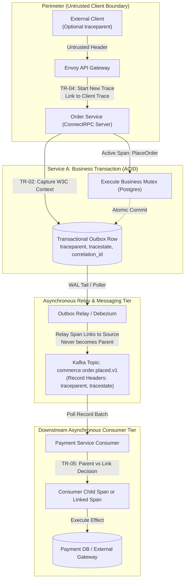
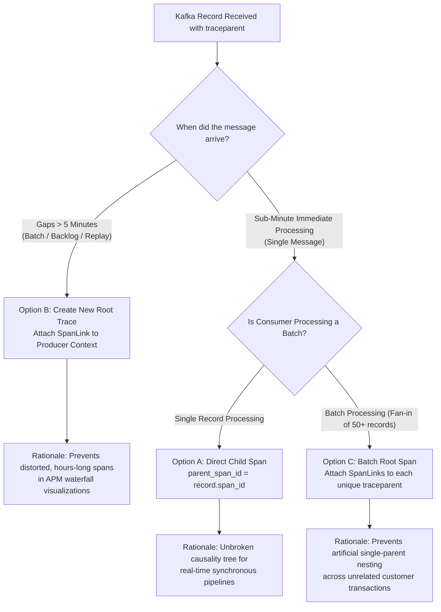
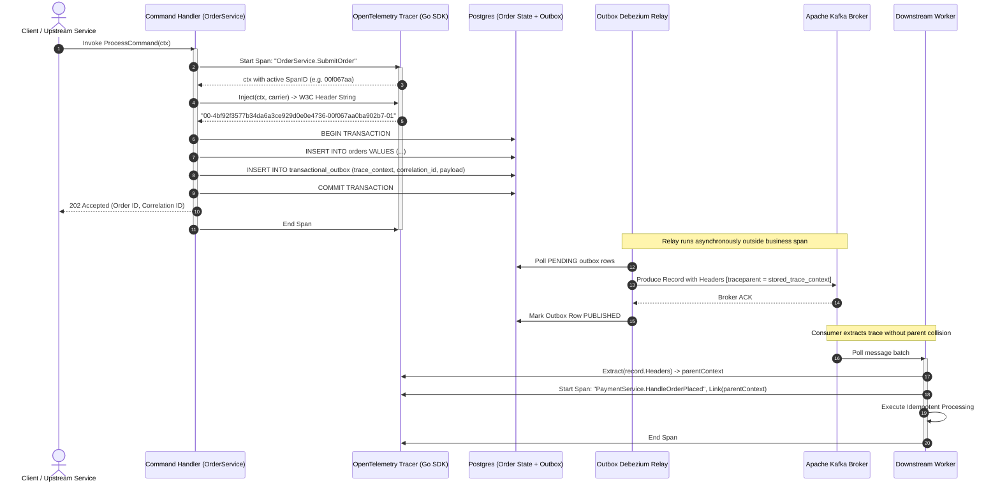

# Distributed Tracing — Architecture & Context Propagation Diagrams

This document contains Mermaid diagrams illustrating end-to-end W3C trace context propagation, parent vs. link decisions across asynchronous messaging boundaries, OpenTelemetry collector pipeline topologies, and outbox context capture.

---

## 1. End-to-End Context Propagation Topology (Edge to Consumer)



---

## 2. Asynchronous Boundary: Parent vs. Link Decision Flow (§3.6)



---

## 3. OpenTelemetry Collector Pipeline & Tail Sampling Topology (§7)

```mermaid
flowchart LR
    subgraph HostAgents ["Node-Local DaemonSets"]
        APP1["App Pod A (Go)"] -->|OTLP / gRPC :4317| AGENT["OTel Collector Agent (Host-Local)"]
        APP2["App Pod B (Kotlin)"] -->|OTLP / gRPC :4317| AGENT
        AGENT -->|Memory Limiter + Redaction Filter| ROUTER["Trace-ID Aware Hash Load Balancer"]
    end

    subgraph GatewayCluster ["Collector Gateway Tier (Tail Sampling Cluster)"]
        ROUTER -->|Hash(TraceID) % N| GW1["Gateway Collector 1"]
        ROUTER -->|Hash(TraceID) % N| GW2["Gateway Collector 2"]
        
        GW1 --> METRICS1["TR-08: Pre-Sampling SpanMetrics Processor<br/>(Unsampled Rate, Error, Duration)"]
        METRICS1 --> SAMPLER1["TR-07: Tail-Sampling Processor<br/>(Keeps 100% Errors, 100% P99, 1% Healthy)"]
        
        GW2 --> METRICS2["TR-08: Pre-Sampling SpanMetrics Processor"]
        METRICS2 --> SAMPLER2["TR-07: Tail-Sampling Processor"]
    end

    subgraph Sinks ["Storage & Observability Backends"]
        METRICS1 -->|Prometheus Remote Write| PROM[("Prometheus / Mimir")]
        METRICS2 --> PROM
        SAMPLER1 -->|OTLP Export| TEMPO[("Grafana Tempo / Trace Storage")]
        SAMPLER2 --> TEMPO
    end
```

---

## 4. In-Transaction Outbox Capture & Relay Span Linking Sequence Flow




---

## 3. OpenTelemetry Collector Pipeline & Tail Sampling Topology (§7)

```mermaid
flowchart LR
    subgraph HostAgents ["Node-Local DaemonSets"]
        APP1["App Pod A (Go)"] -->|OTLP / gRPC :4317| AGENT["OTel Collector Agent (Host-Local)"]
        APP2["App Pod B (Kotlin)"] -->|OTLP / gRPC :4317| AGENT
        AGENT -->|Memory Limiter + Redaction Filter| ROUTER["Trace-ID Aware Hash Load Balancer"]
    end

    subgraph GatewayCluster ["Collector Gateway Tier (Tail Sampling Cluster)"]
        ROUTER -->|Hash(TraceID) % N| GW1["Gateway Collector 1"]
        ROUTER -->|Hash(TraceID) % N| GW2["Gateway Collector 2"]
        
        GW1 --> METRICS1["TR-08: Pre-Sampling SpanMetrics Processor<br/>(Unsampled Rate, Error, Duration)"]
        METRICS1 --> SAMPLER1["TR-07: Tail-Sampling Processor<br/>(Keeps 100% Errors, 100% P99, 1% Healthy)"]
        
        GW2 --> METRICS2["TR-08: Pre-Sampling SpanMetrics Processor"]
        METRICS2 --> SAMPLER2["TR-07: Tail-Sampling Processor"]
    end

    subgraph Sinks ["Storage & Observability Backends"]
        METRICS1 -->|Prometheus Remote Write| PROM[("Prometheus / Mimir")]
        METRICS2 --> PROM
        SAMPLER1 -->|OTLP Export| TEMPO[("Grafana Tempo / Trace Storage")]
        SAMPLER2 --> TEMPO
    end
```

---

## 4. In-Transaction Outbox Capture & Relay Span Linking Sequence Flow

