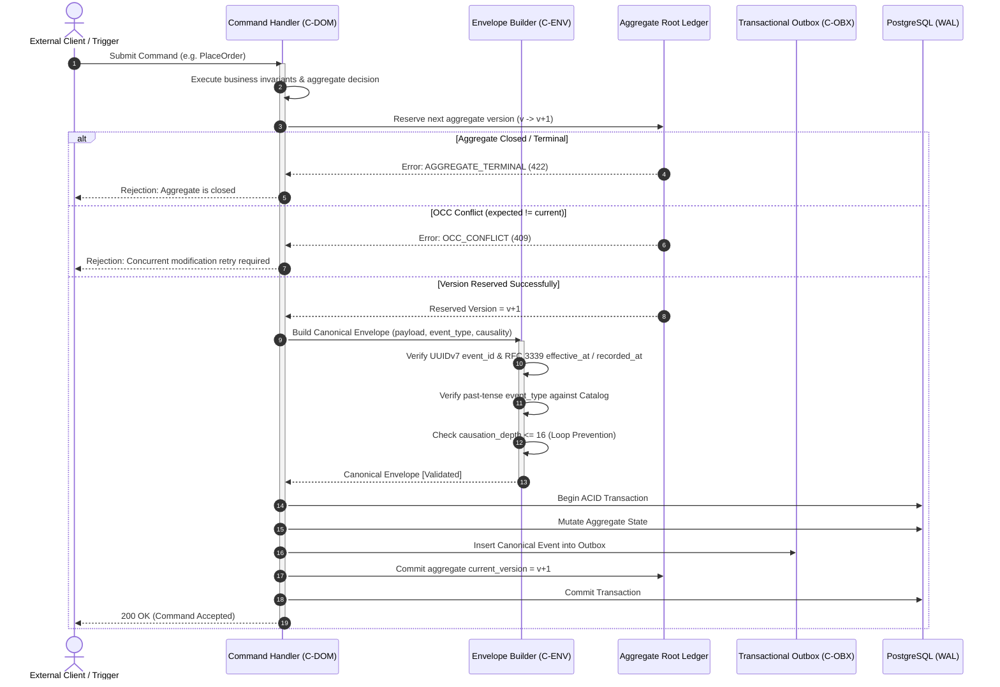
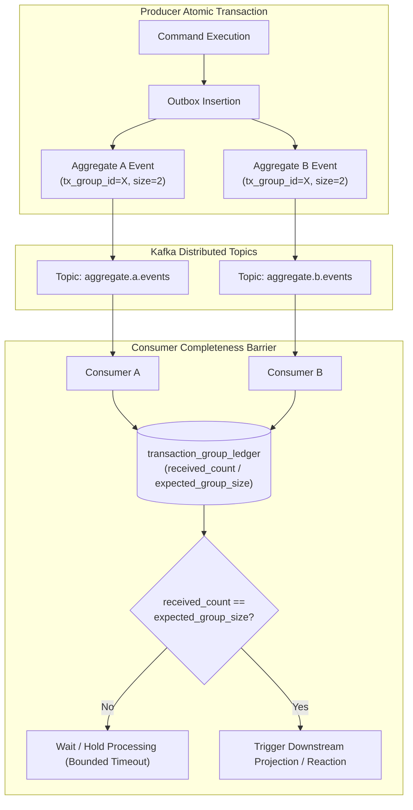
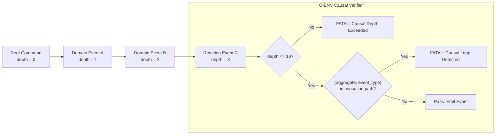
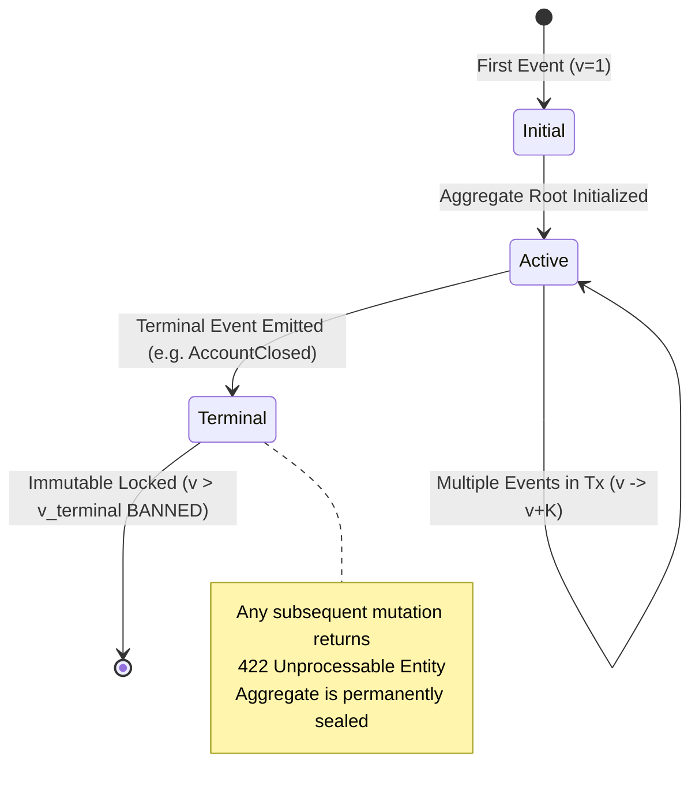

# Domain Event Design — Architecture & Lifecycle Diagrams

This document contains Mermaid architecture diagrams illustrating the domain event lifecycle, envelope validation, causality tracking, and aggregate version reservation.

---

## 1. Domain Event Lifecycle & In-Transaction Validation Flow

---

## 2. Multi-Aggregate Transaction Group Barrier

---

## 3. Causal Chain Verification & Loop Detection

---

## 4. Aggregate Root Lifecycle State Machine

