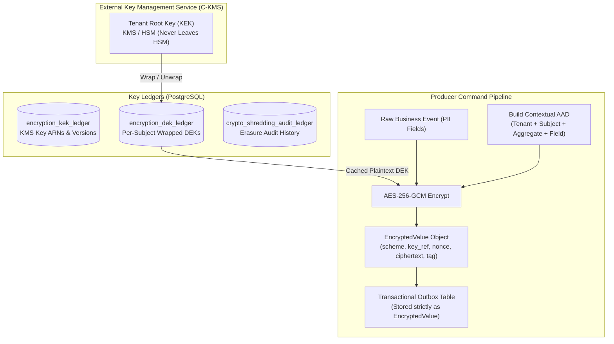
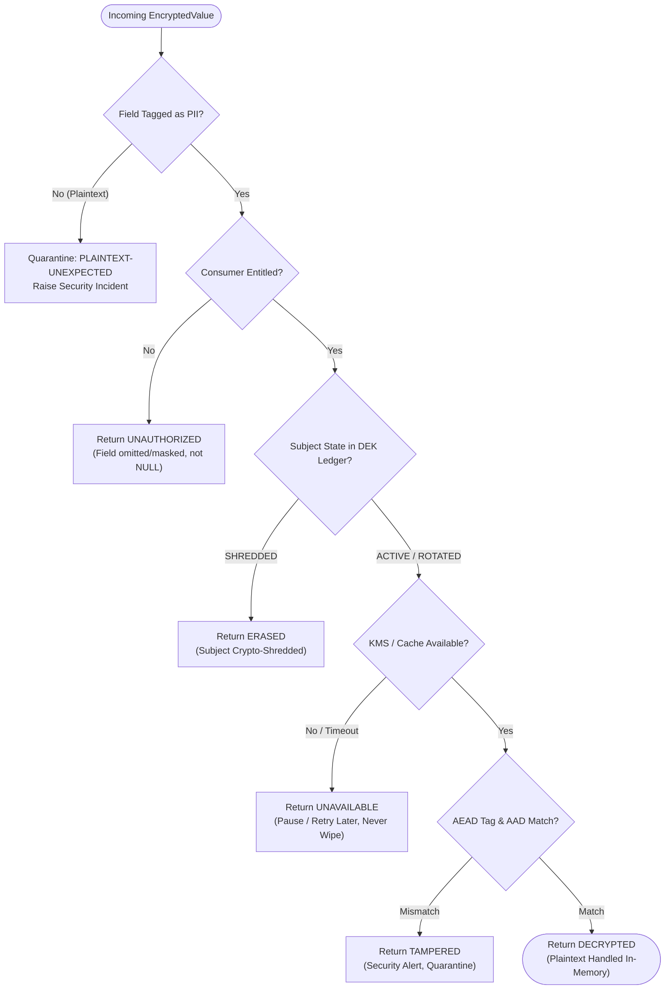
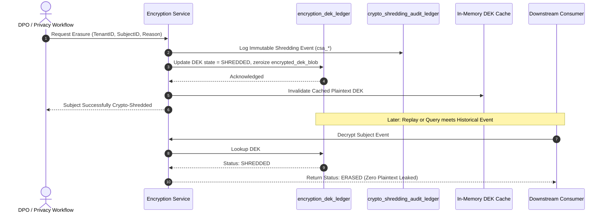

# Encryption Architecture Diagrams

## 1. Envelope Encryption Hierarchy & Outbox Flow



## 2. Authenticated Additional Data (AAD) Construction

```mermaid
flowchart LR
    subgraph AAD_Components["Context Elements"]
        T["Tenant ID"]
        S["Subject ID"]
        A["Aggregate ID"]
        F["Field Path (e.g. user.contact.phone)"]
        V["Schema Version"]
        K["Key Reference"]
    end

    subgraph BoundCiphertext["Cryptographic Binding"]
        AAD_STR["Canonical Byte String\n(Deterministic Delimiter)"]
        AES["AES-256-GCM AEAD Engine"]
        CIPHER["Encrypted Payload + Auth Tag"]
    end

    T --> AAD_STR
    S --> AAD_STR
    A --> AAD_STR
    F --> AAD_STR
    V --> AAD_STR
    K --> AAD_STR

    AAD_STR -->|Associated Data (AAD)| AES
    AES --> CIPHER
```

## 3. Decryption Outcome Decision Machine (EN-05)



## 4. Crypto-Shredding Subject Erasure Flow


