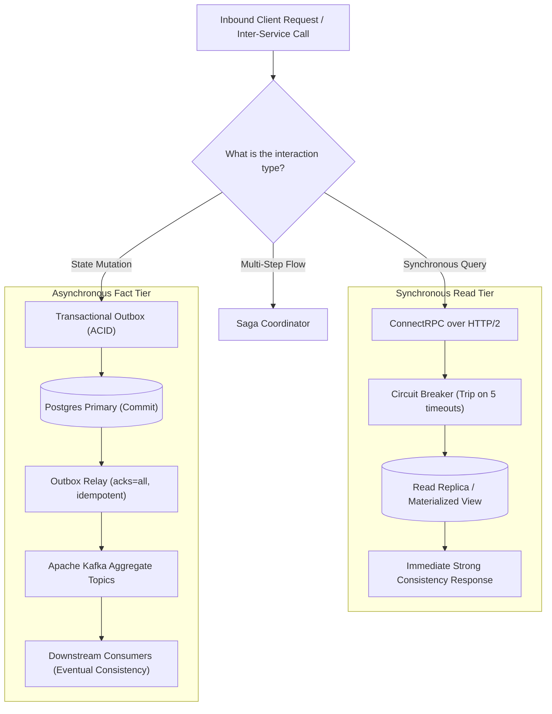
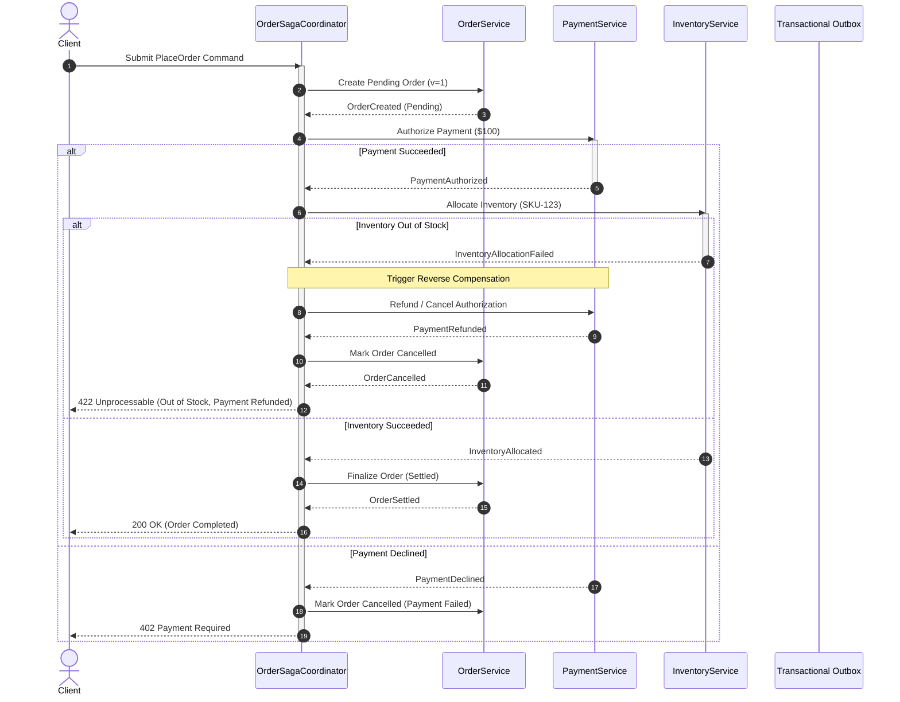
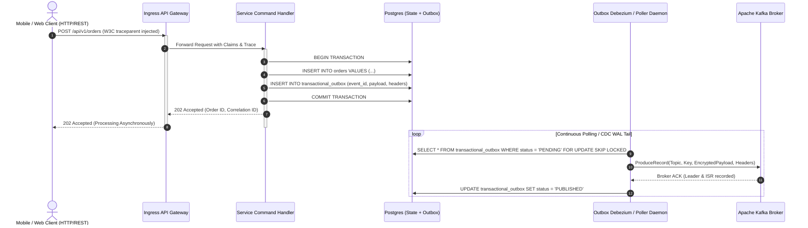
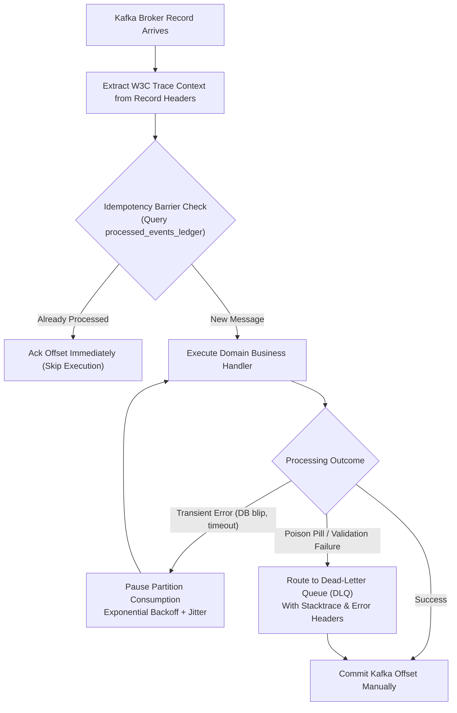

# Event-Driven Communication — Architecture & Interaction Diagrams

This document contains Mermaid diagrams illustrating inter-service communication selection, protocol translation, saga choreography/orchestration, and consumer resilience pipelines.

---

## 1. Pattern Selection: Synchronous Read vs Asynchronous Mutation

---

## 2. Distributed Saga Orchestration & Reverse Compensation Flow

---

## 3. Protocol Ingress Translation & Outbox Relay Flow

---

## 4. Asynchronous Consumer Pipeline & Error Triage

