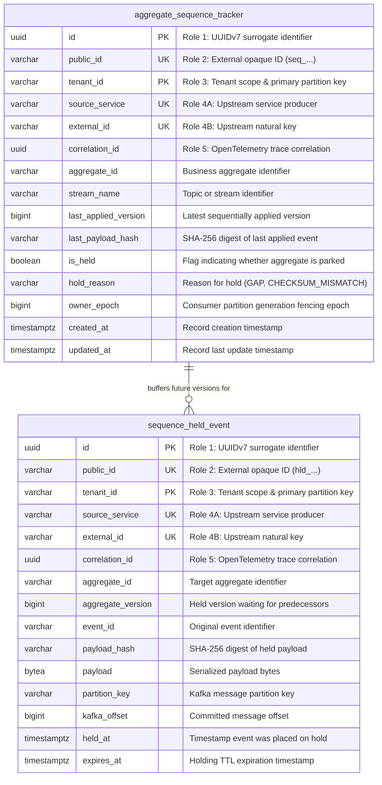
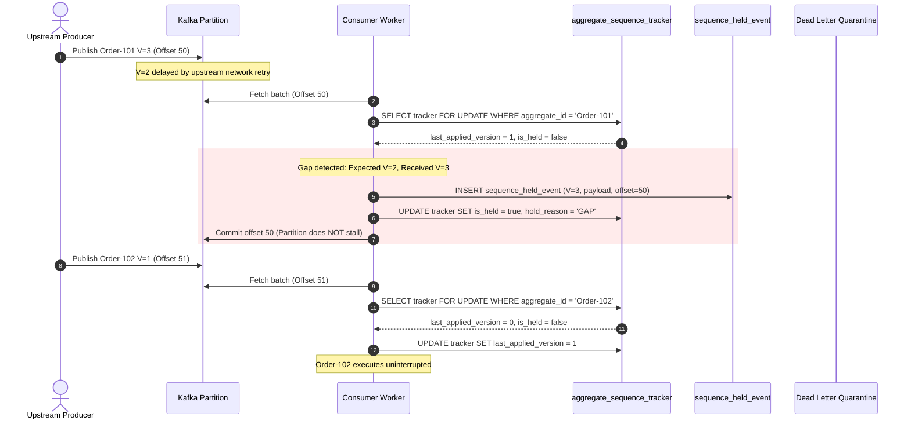
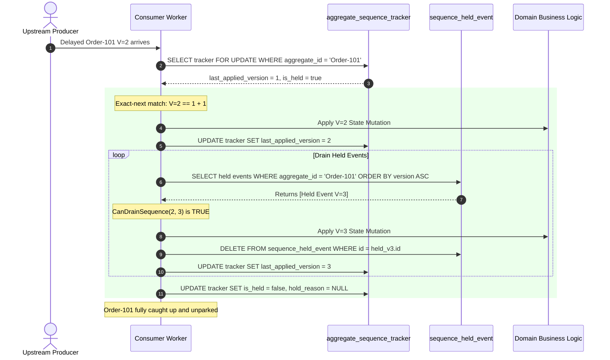
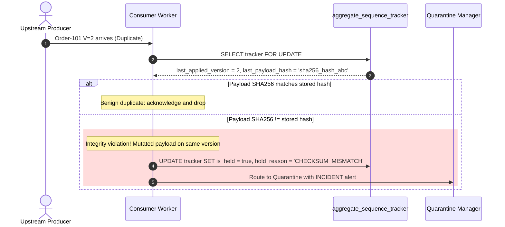

# Architectural Decision Record: Event Ordering Protection Engine (WP-4)

## 1. Title & Metadata
* **Status**: APPROVED
* **Date**: 2026-11-04
* **Decision Makers**: Platform Architecture Guild, Chief Distributed Systems Architect
* **Governing Specification**: [Event Ordering Protection Decision Tree (v2)](file:///home/btpl-lap-22/live/System-Architect/event-driven-platform/docs/features/event-ordering-protection/business-logic.md)

---

## 2. Context & Problem Statement
In distributed event-driven and event-sourced topologies operating across cloud infrastructure, event streams are vulnerable to causal disruptions. Upstream multi-threaded pollers, out-of-order network retries, Kafka partition rebalances, and database transaction timing skews break sequential guarantees.

When an event stream delivers version $V=3$ before $V=2$:
1. **Silent State Corruption (OR-05 / OR-06)**: Blindly executing delta mutations out-of-order computes corrupt aggregate balances and illegal state transitions. Applying $V=2$ after $V=3$ can silently revert business intent or produce invalid financial records.
2. **Partition Starvation vs. Head-of-Line Blocking (OR-08)**: Naive ordering engines halt the entire Kafka consumer partition when an out-of-order message is encountered. Because hundreds of unrelated aggregates share that partition, stopping consumer progress freezes healthy tenants, transforming a local gap into a systemic cascading platform outage.
3. **Ghost Sequence Gaps from Non-Transactional ID Sequences (F3.2)**: Relying on database `SEQUENCE` objects or monotonic auto-increments causes permanent unfillable gaps when transactions roll back or sequence blocks are evicted from cache. Downstream consumers stall permanently waiting for an event version that was never committed.
4. **Zombie Consumers & Split-Brain Writes (OR-10)**: During partition rebalances, a slow consumer thread executing a long garbage collection pause may wake up and commit state updates after a newly assigned consumer has already taken over partition processing, causing out-of-order state mutations and duplicate processing.
5. **Payload Mutation on Re-delivery (OR-06)**: Transport-level deduplication that matches only `event_id` or `version` ignores payload corruption or malicious payload tampering during retry storms.

---

## 3. Decision Drivers & Invariants (OR-01 to OR-13)

* **OR-01: Gapless Per-Aggregate Sequence at Source**: Versions $V=1, 2, 3 \dots$ must be gapless per aggregate instance. Versions are assigned via conditional update on the aggregate row (`SET version = expected + 1 WHERE version = expected`) within the business database transaction. Database sequence objects are strictly prohibited.
* **OR-02: Commit Order Equals Version Order**: Row locks acquired during aggregate mutation are held until the database transaction commits, guaranteeing that version $N+1$ cannot commit before version $N$.
* **OR-03: Single Ordered Stream per Aggregate**: All events for a specific aggregate instance must route to the exact same Kafka topic with message key equal to `aggregate_id`. Partition count alterations must use keyed migration envelopes.
* **OR-04: Non-Overflowing 64-Bit Versions**: Sequence numbers are strictly typed as signed 64-bit integers (`BIGINT`) end-to-end to prevent integer overflow truncation.
* **OR-05: Exact-Next Version Application**: A consumer worker applies event $E$ if and only if $E.version == last\_applied\_version + 1$. Every other relationship is classified and rejected, skipped, or held.
* **OR-06: Same Version Implies Same Content**: Every applied event persists its SHA-256 payload digest alongside `last_applied_version`. An incoming event with $E.version \le last\_applied\_version$ must have an identical SHA-256 hash (idempotent skip). Any hash divergence is treated as a critical data integrity incident.
* **OR-07: Durable Held Events**: Events that arrive ahead of sequence ($E.version > last\_applied\_version + 1$) are durably persisted to PostgreSQL table `sequence_held_event` within the same transaction that advances the Kafka consumer offset. In-memory buffering is prohibited to eliminate message loss across container restarts.
* **OR-08: Park the Key, Not the Partition**: When an aggregate encounters a gap, only that specific `aggregate_id` is marked `is_held = true`. The consumer immediately commits the Kafka offset and continues consuming subsequent messages for other healthy aggregates on that partition.
* **OR-09: Gap Resolution Never Fabricates**: Gaps can only be filled by the original missing event (via producer re-emit API) or by an authoritative versioned snapshot from the producer. Fabricating synthetic no-op events without audit provenance is prohibited.
* **OR-10: Single Writer per Key via Epoch Fencing**: Every state modification verifies that the consumer's `owner_epoch` matches or exceeds the stored partition epoch. Writes from stale epochs are rejected with conflict errors.
* **OR-11: Explicit Bootstrap**: The first-seen event for an aggregate must have $V=1$, unless the consumer explicitly bootstraps state using an authoritative snapshot up to version $N$.
* **OR-12: Aggregate Scope Only**: Ordering guarantees apply strictly within individual aggregate boundaries. Cross-aggregate ordering is neither guaranteed nor assumed.
* **OR-13: Zero Gap Rate SLO**: Any confirmed sequence gap exceeding the holding TTL triggers immediate operator escalation and automated re-emit requests.

---

## 4. Ordering Break Map (H1 to H8)

The architecture isolates and mitigates every point in the pipeline where ordering guarantees can break:

| Hop Code | Pipeline Stage | Vulnerability | Engineering Mitigation |
| :--- | :--- | :--- | :--- |
| **H1** | Producer Sequence Assignment | Race conditions or non-transactional sequence generation | Conditional update on aggregate row in business transaction; no DB sequence objects |
| **H2** | Producer Transaction Commit | Transaction $N+1$ committing before transaction $N$ | Aggregate row lock held through transaction commit |
| **H3** | Outbox Storage | Selective filtering or skipping of internal events | Zero filtering on aggregate stream outbox; every internal event published with stream flag |
| **H4** | Outbox Relay / CDC | Multi-worker poller races or checkpoint loss | Key-hashed worker lanes (`hash(aggregate_id) % workers`); status-based cursor polling |
| **H5** | Kafka Transport | Unclean leader election, retries across producer sessions | Idempotent producer enabled (`enable.idempotence=true`, `acks=all`, `max.in.flight=5`); topic partition count frozen |
| **H6** | Consumer Ingestion | Multi-threaded thread pool reordering within partition | Key-hashed worker lanes; transactional consumer DB offset tracking |
| **H7** | Consumer Sequence Validation | Accepting $V \ge last + 1$ instead of strict equality | Domain Rule validation: exact-next check ($V == last + 1$) only |
| **H8** | Topology & Resharding | Resizing partitions or re-routing topics | Never resize active ordered topics; execute stream migration cutover per [EV-09] |

---

## 5. Entity-Relationship Data Model & Database Writing Rules

The storage gate complies with [05-db-writing-rules.md](file:///home/btpl-lap-22/live/System-Architect/llm-obs-policies/rules/folder-structure/05-db-writing-rules.md), enforcing the mandatory 5-role identifiers and immutability triggers.

### 5.1 The 5 Identifier Roles Mapping
1. **Role 1 (Surrogate PK)**: UUIDv7 generated internally (`id`).
2. **Role 2 (Public ID)**: Regex-constrained external strings (`public_id` matching `^seq_[0-9a-zA-Z]{26}$` for trackers and `^hld_[0-9a-zA-Z]{26}$` for held records).
3. **Role 3 (Tenant Scope)**: `tenant_id` leading compound primary keys.
4. **Role 4 (Natural Business Key)**: Composite unique constraint on `(tenant_id, source_service, external_id)`.
5. **Role 5 (Correlation Trace)**: `correlation_id` UUID propagated from upstream OpenTelemetry trace context.

### 5.2 Entity-Relationship Diagram



---

## 6. System Execution Architecture & Sequence Diagrams

### 6.1 Out-of-Order Gap Detection & Per-Key Parking (OR-07, OR-08)
When version $V=3$ arrives before $V=2$, only aggregate `Order-101` is parked in `aggregate_sequence_tracker`. Subsequent events for healthy aggregates (e.g. `Order-102`) process without delay.



### 6.2 Sequential Drain & Auto-Unparking Workflow
When the delayed missing event $V=2$ finally arrives, it is applied directly to the aggregate, which then triggers a Hoare loop draining all consecutive held versions ($V=3, V=4 \dots$) from storage.



### 6.3 Duplicate vs. Integrity Violation Handling (OR-06)
Redelivered events with identical SHA-256 hashes are acknowledged and skipped. If an incoming duplicate has a different SHA-256 hash, execution immediately halts, the aggregate is quarantined, and a security alert is emitted.



---

## 7. Real-World Failure Handling & Edge Case Analysis

### 7.1 Matrix of Failure Modes

| Scenario Code | Root Cause | Impact | Detection | Autonomous Recovery Action |
| :--- | :--- | :--- | :--- | :--- |
| **FL-ORD-01** | Duplicate event arrival with identical SHA-256 | Redelivery on producer retry | `version <= last_applied && hash == stored_hash` | Idempotent skip; log trace; commit offset. Zero business mutation. |
| **FL-ORD-02** | Duplicate event with conflicting SHA-256 digest | Upstream code bug mutating historical payloads or MITM tampering | `version <= last_applied && hash != stored_hash` | Immediately park key (`is_held = true, reason = CHECKSUM_MISMATCH`), route to quarantine DLQ, alert security guild. |
| **FL-ORD-03** | Gap detected ($V > last\_applied + 1$) | Producer multi-thread outbox race, packet drop, or rebalance | `version > last_applied + 1` | Persist in `sequence_held_event`, mark tracker `is_held = true, reason = GAP`, advance Kafka offset without stopping partition. |
| **FL-ORD-04** | Holding TTL expiration | Missing predecessor permanently lost at source | `now() > expires_at` on held event | Trigger automated request to Producer Re-emit API. If unresolvable within SLA, request authoritative snapshot resync. |
| **FL-ORD-05** | Zombie consumer thread post-rebalance | Stale consumer commits out-of-order write to store | `incoming.owner_epoch < tracker.owner_epoch` | Reject write with epoch fence conflict error. Zombie worker terminates transaction. |
| **FL-ORD-06** | Consumer crash during cascade drain | Partial application of held queue | Crash recovery during transaction commit | PostgreSQL transaction rollback restores held events. On restart, drain loop safely resumes from last committed version. |
| **FL-ORD-07** | Partial drain cascade | Interleaved future events buffered (e.g. $V=3, V=5$ held, $V=2$ arrives) | CanDrainSequence fails on second item ($5 \ne 3 + 1$) | Apply $V=2$ and $V=3$; stop drain loop; remain `is_held = true, reason = GAP`. |
| **FL-ORD-08** | Ghost gap from DB sequence usage | Rollbacks at producer burn numbers | Producer re-emit confirms version was never written | Alert on non-recoverable sequence gap; trigger snapshot resync. |
| **FL-ORD-09** | Truncated topic bootstrap | New consumer deployed on stream where $V=1$ was aged out | First-seen event has $V > 1$ with clean tracker | Reject immediate apply; trigger `SNAPSHOT_BOOTSTRAP` routine from snapshot store. |
| **FL-ORD-10** | Held buffer overflow | Massive burst of out-of-order events exceeding quota | Count of held records exceeds buffer capacity (e.g. $> 100$) | Reject additional holds; route excess to cold storage dead-letter quarantine. |

### 7.2 Epoch Fencing Against Zombie Consumers
When a Kafka rebalance occurs, consumer instance $C_1$ may pause (e.g. Stop-The-World GC). The coordinator revokes partition ownership and assigns it to $C_2$, incrementing the partition epoch from $E=4$ to $E=5$.
When $C_1$ awakens, its write to `aggregate_sequence_tracker` contains `owner_epoch = 4`. The database update executes:
```sql
UPDATE aggregate_sequence_tracker 
SET last_applied_version = $new_version, owner_epoch = $incoming_epoch 
WHERE tenant_id = $tenant_id AND aggregate_id = $aggregate_id AND owner_epoch <= $incoming_epoch;
```
Because $C_2$ already bumped `owner_epoch = 5`, $C_1$'s update modifies zero rows, triggering a transaction rollback and aborting the stale write.

---

## 8. OpenTelemetry Tracing & Observability Architecture

Every sequence transition and hold decision exports standard OpenTelemetry span attributes:

| Metric / Span Attribute | Type | Description |
| :--- | :--- | :--- |
| `event.ordering.action` | Span Attribute | `APPLIED`, `SKIPPED_DUPLICATE`, `HELD_GAP`, `DRAINED`, `HOLD_CHECKSUM_MISMATCH` |
| `event.aggregate.id` | Span Attribute | Unique identifier of the business aggregate |
| `event.aggregate.version` | Span Attribute | Monotonic sequence number of the processed event |
| `event.aggregate.expected_version` | Span Attribute | Expected next version ($last\_applied + 1$) |
| `event.partition.epoch` | Span Attribute | Fencing epoch of the consumer worker |
| `event_ordering_held_keys_gauge` | Metric Gauge | Number of currently parked aggregates per tenant and stream |
| `event_ordering_gap_duration_seconds` | Metric Histogram | Duration between when an aggregate was parked and when missing events arrived |
| `event_ordering_checksum_mismatch_total` | Metric Counter | Total number of integrity violations detected (Alert threshold: $> 0$) |

Trace context propagation is preserved end-to-end:
```
Producer Span [traceparent: 00-4bf92f3577b34da6a3ce929d0e0e4736-00f067aa0ba902b7-01]
  └── Relay Span
        └── Kafka Record Header
              └── Consumer Worker Span
                    ├── Store Held Event Span (if gap detected)
                    └── Evaluate Sequence Span [correlation_id preserved]
```

---

## 9. Verification & Test Plan

1. **Exact-Next Application**: Event $V=1$ applies; $V=2$ applies; aggregate sequence reaches $2$.
2. **Duplicate Idempotency**: Event $V=2$ re-delivered with identical SHA-256 payload digest returns `SKIPPED_DUPLICATE`; state unchanged.
3. **Payload Tampering Detection**: Event $V=2$ re-delivered with modified payload bytes transitions aggregate to `is_held = true`, sets reason to `CHECKSUM_MISMATCH`, and rejects mutation.
4. **Out-of-Order Gap Parking**: When aggregate is at $V=1$, incoming $V=3$ is persisted to `sequence_held_event`; tracker transitions to `is_held = true, reason = GAP`.
5. **Sequential Auto-Drain**: While parked at $V=1$ with held $V=3$, incoming $V=2$ applies immediately, drains held $V=3$, advances sequence to $3$, and unparks aggregate.
6. **Multi-Version Drain**: Aggregate at $V=1$ with held $V=3, V=4, V=5$. Arrival of $V=2$ sequentially applies $V=2 \to V=3 \to V=4 \to V=5$, emptying held store.
7. **Epoch Fencing Enforcement**: Consumer with stale `owner_epoch` receives conflict error when attempting to evaluate or drain sequences.

---

## Deep Failure-First Architectural Principles

### 1. Existential Purpose & The Catastrophe Prevented

In business operations, order of execution is sacred: an account cannot be debited before it is credited; an order cannot be shipped before it is paid. In distributed systems with multiple partitions, concurrent workers, and network retries, messages arrive out-of-order. Applying events out-of-order results in negative balances, missing customer records, and permanent state corruption.

### 2. Internal Algorithmic Mechanics & State Invariants

The platform enforces a two-stage ordering gate: (1) Publisher Routing Gate hashes aggregate entity keys (e.g. order_id) using Murmur2 to ensure all events for that entity land on the exact same partition. (2) Consumer Sequence Gate verifies the incoming aggregate version against local state: v = last_version + 1 is applied; v <= last_version is dropped as stale; v > last_version + 1 is held as a Gap, halting processing on that key to protect consistency.

### 3. Core Architectural Principles & Systems Philosophy

#### Principle 1: Causal Ordering over Global Ordering
* **Design Philosophy & Epistemology**:
  Demanding total global order across millions of independent entities in a distributed system is physically impossible without a single global bottleneck that destroys scalability. The philosophy is Causal Entity Scoping: global ordering is a myth; entity-level causal ordering is absolute. Events for Account A must be strictly ordered; events between Account A and Account B are independent and can proceed concurrently.
* **Threat Vector Defeated**: Throughput collapse caused by trying to enforce a single global sequence across independent, unrelated business entities.
* **Storage & State Invariant**:
```text
Order(Events for Aggregate_A) is Strict
Order(Aggregate_A, Aggregate_B) is Indeterminate and Concurrent
```
* **Implementation Mechanism**:
  Producers use the entity's aggregate identifier (e.g., `account_id`) as the Kafka message key. Kafka's Murmur2 partitioner hashes identical keys to the exact same partition, ensuring strict single-partition FIFO ordering per entity while distributing load across hundreds of partitions.
* **Non-Negotiable Trade-Off**: Key skew risk. If a single account generates 80% of platform traffic, its assigned partition becomes a bottleneck, degrading throughput for other entities on that partition.

---

#### Principle 2: Monotonic Sequence Guarding & Gap Detection
* **Design Philosophy & Epistemology**:
  Networks drop, duplicate, and reorder packets. Assuming that reading from Kafka guarantees that the consumer processes events in order is dangerous: multi-threaded consumer pools can reorder events in memory. The philosophy is Invariant Verification at State Application: the consumer must reject any event that attempts to skip or rewind the causal timeline.
* **Threat Vector Defeated**: Downstream state corruption where an OrderCancelled event is processed before an OrderCreated event due to consumer thread pool reordering.
* **Storage & State Invariant**:
```text
IncomingEvent.Version == CurrentState.Version + 1
If IncomingEvent.Version <= CurrentState.Version ==> Discard as Stale Duplicate
If IncomingEvent.Version > CurrentState.Version + 1 ==> Quarantine as Gap Hole
```
* **Implementation Mechanism**:
  Every event carries an integer `aggregate_version` incremented by 1. The consumer executes atomic conditional updates: `UPDATE aggregates SET state = $1, version = version + 1 WHERE id = $2 AND version = $3`. If version matches, state advances. If a gap is detected ($V > V_{\text{current}} + 1$), the event is held in a local delay buffer awaiting the missing predecessor.
* **Non-Negotiable Trade-Off**: Memory buffer overhead and complexity of managing out-of-order gap buffers on consumer instances.

---

#### Principle 3: Immutable Partition Count Invariant
* **Design Philosophy & Epistemology**:
  Changing the partition count of an active Kafka topic silently breaks key-to-partition affinity. When partition count changes from 10 to 20, Murmur2(Key) % 10 != Murmur2(Key) % 20. Future events for Account A route to a new partition while old events remain unconsumed on the old partition, permanently shattering causal ordering. The philosophy is Partition Topology Immutability: partition counts on stateful topics must never be altered dynamically.
* **Threat Vector Defeated**: Permanent ordering corruption where events for the same customer are split across two partitions and consumed out of order simultaneously.
* **Storage & State Invariant**:
```text
PartitionCount(Topic) == Constant across entire lifecycle
Topology changes require Blue/Green Topic Migration
```
* **Implementation Mechanism**:
  Topic management automation blocks dynamic partition expansion on keyed topics. Scaling partition counts requires provisioning a new topic (Topic_v2) with the higher partition count and running a controlled blue/green data migration.
* **Non-Negotiable Trade-Off**: Upfront capacity planning requirement. Topics must be over-partitioned initially (e.g., 30 or 60 partitions) to accommodate multi-year growth.

---

#### Principle 4: Single-Writer Aggregate Sovereignty
* **Design Philosophy & Epistemology**:
  If two different microservices write mutations to the same aggregate root concurrently, version sequencing collapses into conflict. The philosophy is Single-Writer Ownership: an aggregate type is owned by exactly one sovereign service. All mutations to that aggregate must flow through that single service's transaction boundary.
* **Threat Vector Defeated**: Split-brain version collisions and lost updates caused by multiple microservices concurrently generating conflicting event streams for the same entity.
* **Storage & State Invariant**:
```text
Writer(AggregateType) == ExactlyOneServicePrincipal
Direct writes from secondary services rejected at API / Ingress gateways
```
* **Implementation Mechanism**:
  API gateways and message headers enforce `source_service` validation. Only the designated authoritative domain service holds the database write credentials to append events for that aggregate type.
* **Non-Negotiable Trade-Off**: Microservice interaction overhead. Secondary services cannot directly mutate foreign aggregates; they must emit domain requests or commands to the owning service.

### 4. The Architect's Meta-Questions (Failure-First Evaluation)

1. **Why is increasing the partition count on an active Kafka topic a fatal mistake for ordering?**
   * *Answer*: Kafka hashes message keys modulo the partition count. If the partition count changes, the hash calculation routes existing keys to different partitions. A consumer reading the new partition will process new events before an older consumer finishes reading historical events from the old partition, destroying causal order.
2. **How does a consumer handle a gap where it expects version 4 but receives version 5?**
   * *Answer*: The consumer must not process version 5, as doing so mutates state without the causal context of version 4. It buffers version 5 in a temporary holding queue and pauses partition consumption (or uses a retry topic) until version 4 is consumed.
3. **Can multi-threaded consumer applications maintain per-key ordering?**
   * *Answer*: Yes, but only if the consumer uses a keyed dispatcher ring-buffer. Messages from the single partition poll loop must be routed to worker threads based on `Hash(message.key) % worker_thread_count`, ensuring all events for a given key execute sequentially on the same thread.

---
## Authoritative References & Production Citations

* **[Leslie Lamport: Time, Clocks, and the Ordering of Events in a Distributed System (ACM 1978)](https://lamport.azurewebsites.net/pubs/time-clocks.pdf)**
  - *Architectural Rationale & Implementation Grounding*: The fundamental computer science paper establishing logical clocks, total ordering, and causal relationships in distributed environments.
* **[Martin Kleppmann: Designing Data-Intensive Applications (Chapter 11: Stream Processing)](https://dataintensive.net/)**
  - *Architectural Rationale & Implementation Grounding*: In-depth analysis of log-based messaging systems, partition-level ordering guarantees, and out-of-order mitigation.
* **[Apache Kafka Partitioning Architecture & Murmur2 Hash Function](https://kafka.apache.org/documentation/#intro_concepts_and_architecture)**
  - *Architectural Rationale & Implementation Grounding*: Technical reference on Kafka's deterministic partition key hashing and intra-partition append guarantees.
* **[Confluent: Guarantees, Redundancy, and Scale in Apache Kafka](https://www.confluent.io/blog/kafka-message-delivery-guarantees/)**
  - *Architectural Rationale & Implementation Grounding*: Architectural analysis of combining max.in.flight.requests.per.connection=1 with idempotent producers for strict ordering.

## Amendment 2026-11-07 (second pass): tenant scope required

`GET /events/held` returns 400 when `tenant_id` is missing (previously 200 with `data:null`).

Verified live on the compose-deployed image (`chiefj/event-driven-platform:v2`) and by unit tests; see ADR-0002 "Closed in a second pass".
