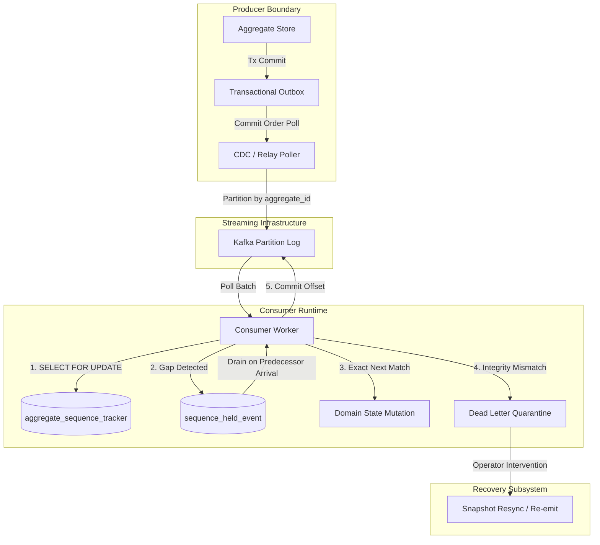
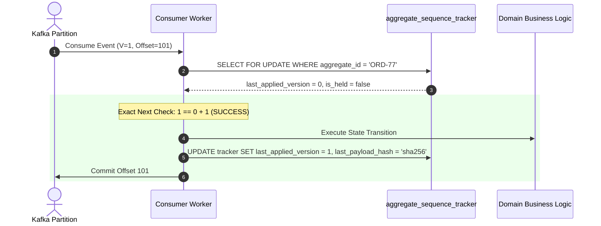
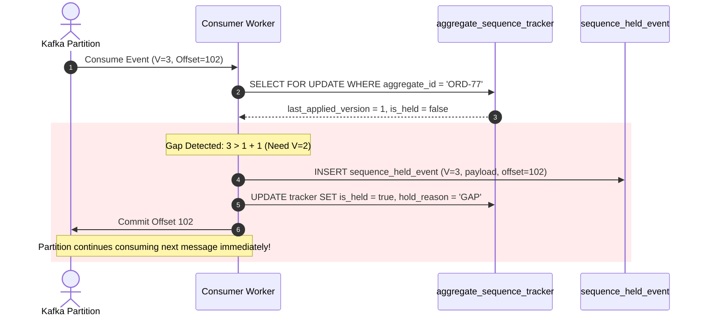
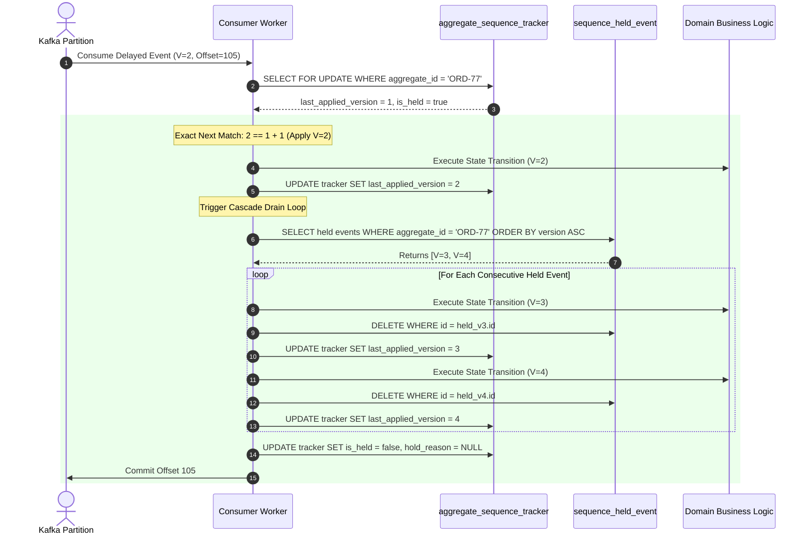
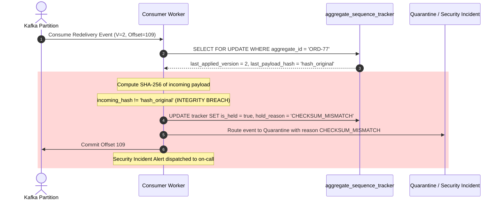
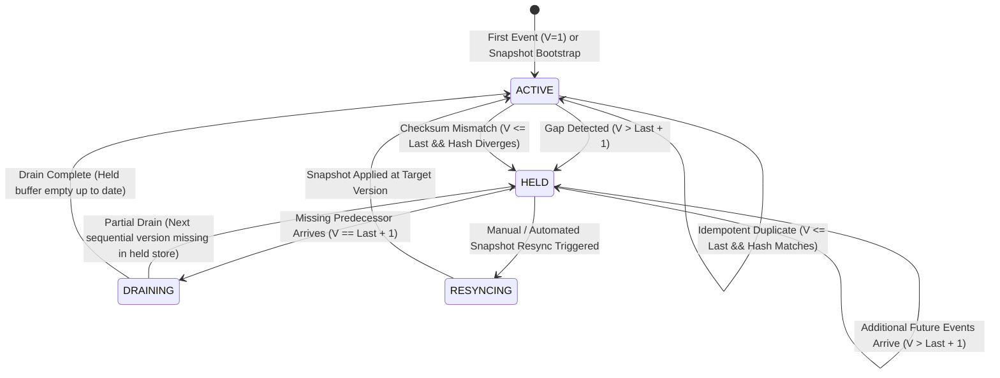

# Event Ordering Protection — System Architecture & Workflow Diagrams

## 1. Context & Architecture Boundary
This document details the visual execution workflows for **Event Ordering Protection (WP-4)**, governing how Kafka partitions, consumer workers, database sequence trackers, and held event stores coordinate to guarantee strict ordering without halting partitions.

---

## 2. Component Relationship Diagram

---

## 3. Detailed Sequence Execution Flows

### 3.1 Normal Path: Exact-Next Sequential Processing
When an event arrives matching $E.version == last\_applied + 1$, it is applied directly to the business state.

---

### 3.2 Gap Path: Out-of-Order Delivery & Aggregate Parking
When an event arrives ahead of sequence ($V=3$ when current is $V=1$), the event is durably held and the aggregate is parked. The partition is NOT stopped.

---

### 3.3 Recovery Path: Predecessor Arrival & Multi-Version Cascade Drain
When missing version $V=2$ arrives, it applies and triggers a sequential drain of buffered future versions.

---

### 3.4 Security & Integrity Path: Content Mismatch on Duplicate
When a redelivered version has a payload digest that differs from the original, execution halts for that key and alerts are triggered.

---

## 4. Aggregate Ordering State Machine

