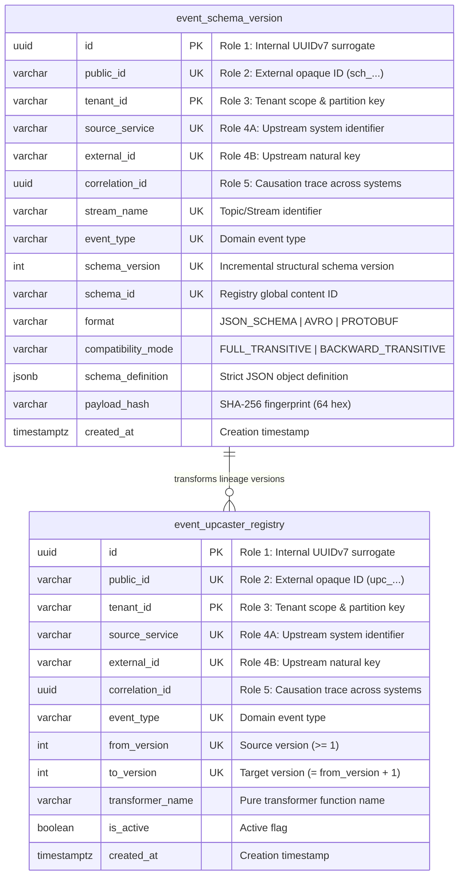
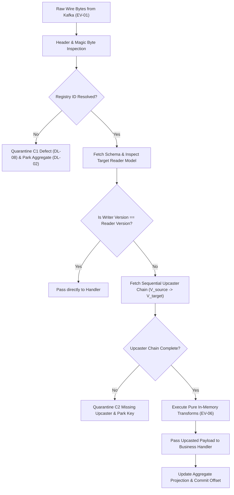

# Architectural Decision Record: Event Versioning & Schema Compatibility Engine (WP-2)

## 1. Title & Metadata
* **Status**: APPROVED
* **Date**: 2026-11-04
* **Decision Makers**: Platform Architecture Guild, Chief Strategist
* **Governing Specification**: [Event Versioning Business Logic Decision Tree (v2)](file:///home/btpl-lap-22/live/System-Architect/event-driven-platform/docs/features/event-versioning/business-logic.md)

---

## 2. Context & Problem Statement
In distributed event-driven and event-sourced topologies, event payloads are immutable historical facts recorded on durable commit logs. As services evolve across independent release cadences:
1. **Schema Divergence**: Producers mutate wire schemas (adding, renaming, or deprecating fields) while downstream consumers or historical replay engines operate on compiled expectations.
2. **Deserialization Crashes**: Incompatible schema evolution breaks deserializers in consumer loops, triggering infinite fetch retries, crashes, or catastrophic DLQ quarantine storms.
3. **Poison Aggregates**: Without version translation, old events replayed from the event store fail downstream handlers, unnecessarily parking aggregates across the platform.
4. **Semantic Corruption**: Structural compatibility checks (such as bare JSON schemas or unannotated types) do not detect unit, precision, or meaning alterations (e.g. converting float dollars to integer cents under the same field name), leading to silent financial corruption.

---

## 3. Decision Drivers & Invariants (EV-01 to EV-12)
* **EV-01: One Aggregate, One Ordered Stream**: All event types emitted by an aggregate share a single Kafka topic partitioned strictly by `aggregate_id`.
* **EV-02: Three Version Kinds Separation**: Strict differentiation between:
  * *Stream Version*: Major breaking remodeling reflected in the topic suffix (e.g. `orders.order.v1`).
  * *Schema Version*: Registry-assigned structural schema ID embedded in message headers/payloads.
  * *Aggregate Version*: Sequential instance state sequence (gapless, $1, 2, 3 \dots$) used for ordering and idempotency.
* **EV-03: Writer Schema Identifiable from Bytes**: Registry schema ID is deterministically embedded in every serialized envelope.
* **EV-04: Transitive Compatibility**: Wire schemas are evaluated under `FULL_TRANSITIVE` or `BACKWARD_TRANSITIVE` policies prior to production deployment.
* **EV-05: Immutability of Field Semantics**: A field name never changes its meaning, unit, scale, or tax basis. New meaning requires a new field name or new event type.
* **EV-06: Pure & Deterministic Upcasting**: Upcasters are pure, total, fact-preserving, zero-I/O transformations executing in sequential step order ($V_n \to V_{n+1}$).
* **EV-09: Aggregate Version Continuity**: Stream migrations ($V1 \to V2$) preserve continuous aggregate version sequences without resetting to 1.
* **EV-10: Immutability of Source Bytes**: Upcasting is strictly performed in-memory upon reading. Retained events in Kafka, Outbox, and Event Store are never rewritten in place.

---

## 4. Entity-Relationship Data Model & Database Writing Rules

Every table strictly complies with [Database Writing Rules (`05-db-writing-rules.md`)](file:///home/btpl-lap-22/live/System-Architect/llm-obs-policies/rules/folder-structure/05-db-writing-rules.md), declaring the mandatory **5 Identifier Roles** and trigger-enforced immutability.

### 4.1 Visual Entity-Relationship Diagram

### 4.2 Storage Gate Constraints & Guarantees
1. **Surrogate PKs**: Both tables declare composite Primary Keys `(tenant_id, id)` using UUIDv7.
2. **Public Identifiers**: Opaque IDs verified with strict regular expressions (`^sch_[0-9a-zA-Z]{26}$` and `^upc_[0-9a-zA-Z]{26}$`).
3. **Immutability Enforcement**: Database triggers `trg_event_schema_version_immutability` and `trg_event_upcaster_immutability` reject updates to `id`, `public_id`, `tenant_id`, or `correlation_id` with SQLSTATE `23514`.
4. **Sequential Step Upcasting**: Check constraint `to_version = from_version + 1` guarantees that upcasters only register pure, adjacent single-step transformations.

---

## 5. Architectural Pipeline & In-Memory Upcasting Workflow

---

## 6. Real-Life Production Use Cases

### 6.1 Multi-Currency & Minor Units Transition
* **Business Challenge**: An enterprise billing platform originally modeled order prices as floating-point numbers (`"price": 19.99`). Floating-point arithmetic during batch settlement accumulated rounding discrepancies.
* **Evolution**: Schema Version 2 introduced integer minor units `"amount_cents": 1999` and explicit `"currency": "USD"`, marking `"price"` as deprecated.
* **Upcaster Guarantee**: Upcaster `order_v1_to_v2` executes during event ingestion or historical replay. When a historical V1 event is read, the upcaster deterministically derives `amount_cents = round(price * 100)` and `currency = "USD"`. The consumer business handler only implements the V2 model, eliminating double-accounting logic.

### 6.2 Zero-Downtime Microservice Upgrades (Expand / Contract)
* **Business Challenge**: Introducing mandatory `warehouse_id` on `OrderPlaced` events without coordinating deployment downtime across 14 independent consumer teams.
* **Evolution**:
  1. *Phase E1 (Expand)*: Producer publishes both legacy fields and new optional `warehouse_id`.
  2. *Phase E2 (Migrate)*: Consumers deploy upcasters that supply regional fulfillment defaults for legacy events lacking the field.
  3. *Phase C1 (Contract)*: Consumers transition to the modern model. Telemetry verifies zero reads of legacy fields before the producer ceases emission.

---

## 7. Product & Operational Metrics

| Metric | Target SLA | Warning Threshold | Remediation Runbook |
| :--- | :--- | :--- | :--- |
| `event_versioning_compatibility_violations_total` | `0` | $> 0$ in CI | Block merge; review breaking contract changes with architecture guild |
| `event_versioning_upcast_duration_ms` | $P99 < 1.0\text{ms}$ | $> 3.0\text{ms}$ | Profile in-memory JSON transform memory allocations |
| `event_versioning_unknown_schema_id_total` | `0` | $\ge 1$ | Trigger C1 DLQ alert; verify Apicurio cross-region replication |
| `event_versioning_chain_length` | Avg $\le 2$ | $> 5$ steps | Schedule stream compaction or V-major stream migration (§11) |
| `event_versioning_upcast_failures_total` | `0` | $> 0$ | Trigger immediate page; dispatch RB-02 hotfix for defective upcaster |
