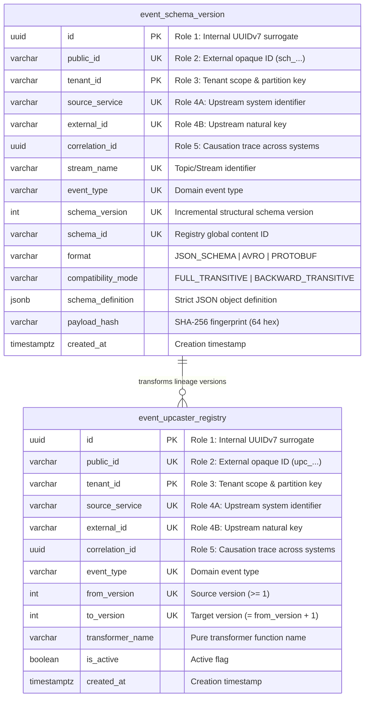
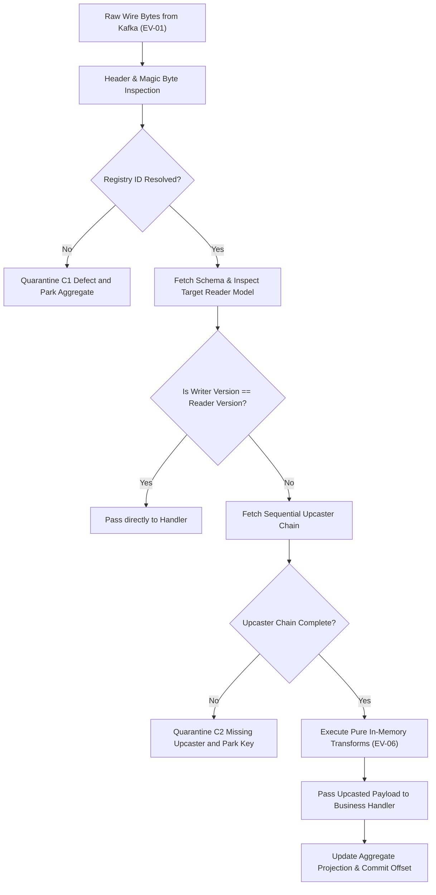
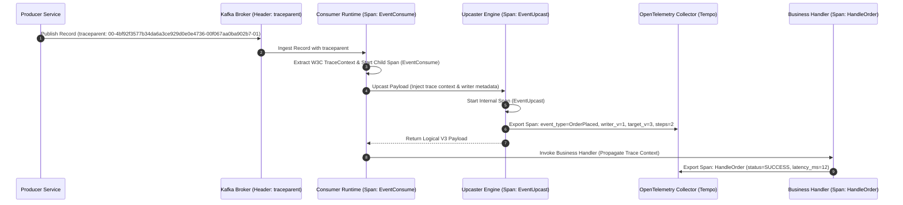

# Architectural Decision Record: Event Versioning & Schema Compatibility Engine (WP-2)

## 1. Title & Metadata
* **Status**: APPROVED
* **Date**: 2026-11-04
* **Decision Makers**: Platform Architecture Guild, Chief Strategist
* **Governing Specification**: [Event Versioning Business Logic Decision Tree (v2)](file:///home/btpl-lap-22/live/System-Architect/event-driven-platform/docs/features/event-versioning/business-logic.md)

---

## 2. Context & Problem Statement
In distributed event-driven and event-sourced topologies, event payloads are immutable historical facts recorded on durable commit logs. As services evolve across independent release cadences:
1. **Schema Divergence**: Producers mutate wire schemas (adding, renaming, or deprecating fields) while downstream consumers or historical replay engines operate on compiled expectations.
2. **Deserialization Crashes**: Incompatible schema evolution breaks deserializers in consumer loops, triggering infinite fetch retries, crashes, or catastrophic DLQ quarantine storms.
3. **Poison Aggregates**: Without version translation, old events replayed from the event store fail downstream handlers, unnecessarily parking aggregates across the platform.
4. **Semantic Corruption**: Structural compatibility checks (such as bare JSON schemas or unannotated types) do not detect unit, precision, or meaning alterations (e.g. converting float dollars to integer cents under the same field name), leading to silent financial corruption.
5. **Traceability Blind Spots**: Deserialization mutations and multi-step upcasting across historical events risk dropping OpenTelemetry `traceparent` contexts and losing correlation between the original writer schema and the final business mutation.

---

## 3. Decision Drivers & Invariants (EV-01 to EV-12)
* **EV-01: One Aggregate, One Ordered Stream**: All event types emitted by an aggregate share a single Kafka topic partitioned strictly by `aggregate_id`.
* **EV-02: Three Version Kinds Separation**: Strict differentiation between:
  * *Stream Version*: Major breaking remodeling reflected in the topic suffix (e.g. `orders.order.v1`).
  * *Schema Version*: Registry-assigned structural schema ID embedded in message headers/payloads.
  * *Aggregate Version*: Sequential instance state sequence (gapless, $1, 2, 3 \dots$) used for ordering and idempotency.
* **EV-03: Writer Schema Identifiable from Bytes**: Registry schema ID is deterministically embedded in every serialized envelope.
* **EV-04: Transitive Compatibility**: Wire schemas are evaluated under `FULL_TRANSITIVE` or `BACKWARD_TRANSITIVE` policies prior to production deployment.
* **EV-05: Immutability of Field Semantics**: A field name never changes its meaning, unit, scale, or tax basis. New meaning requires a new field name or new event type.
* **EV-06: Pure & Deterministic Upcasting**: Upcasters are pure, total, fact-preserving, zero-I/O transformations executing in sequential step order ($V_n \to V_{n+1}$).
* **EV-09: Aggregate Version Continuity**: Stream migrations ($V1 \to V2$) preserve continuous aggregate version sequences without resetting to 1.
* **EV-10: Immutability of Source Bytes**: Upcasting is strictly performed in-memory upon reading. Retained events in Kafka, Outbox, and Event Store are never rewritten in place.

---

## 4. Entity-Relationship Data Model & Database Writing Rules

Every table strictly complies with [Database Writing Rules (`05-db-writing-rules.md`)](file:///home/btpl-lap-22/live/System-Architect/llm-obs-policies/rules/folder-structure/05-db-writing-rules.md), declaring the mandatory **5 Identifier Roles** and trigger-enforced immutability.

### 4.1 Visual Entity-Relationship Diagram

### 4.2 Storage Gate Constraints & Guarantees
1. **Surrogate PKs**: Both tables declare composite Primary Keys `(tenant_id, id)` using UUIDv7.
2. **Public Identifiers**: Opaque IDs verified with strict regular expressions (`^sch_[0-9a-zA-Z]{26}$` and `^upc_[0-9a-zA-Z]{26}$`).
3. **Immutability Enforcement**: Database triggers `trg_event_schema_version_immutability` and `trg_event_upcaster_immutability` reject updates to `id`, `public_id`, `tenant_id`, or `correlation_id` with SQLSTATE `23514`.
4. **Sequential Step Upcasting**: Check constraint `to_version = from_version + 1` guarantees that upcasters only register pure, adjacent single-step transformations.

---

## 5. Architectural Pipeline & In-Memory Upcasting Workflow

---

## 6. End-to-End Distributed Tracing & Telemetry Architecture

Every message moving through the schema resolution and upcasting pipeline retains uninterrupted distributed tracing across process boundaries, ensuring complete end-to-end auditability.

### 6.1 Trace Context Preservation Invariants:
1. **W3C `traceparent` Forwarding**: The carrier `traceparent` extracted from Kafka headers is parsed into Go `context.Context` via OpenTelemetry text map propagators before deserialization.
2. **Upcast Span Annotation**: When an event traverses the upcasting engine ($V_1 \to V_3$), a dedicated span `event.upcast` is recorded as a direct child of the consume span. Attributes include:
   - `messaging.event_type`: The past-tense domain event name.
   - `schema.writer_version`: Source version recorded at write time.
   - `schema.target_version`: Reader schema compiled into the consumer runtime.
   - `upcaster.steps_applied`: Count of sequential step transformations executed.
   - `upcaster.duration_ms`: Execution latency of the in-memory transformations.
3. **Quarantine Baggage**: If an upcasting step fails or a schema ID is unknown, the complete W3C trace ID, span ID, and correlation ID are persisted into `dead_letter_quarantine` so triage operators can jump directly from the triage UI to the Tempo trace.

---

## 7. Real-Life Production Edge Cases

### 7.1 Multi-Currency & Minor Units Transition
* **Business Challenge**: An enterprise billing platform originally modeled order prices as floating-point numbers (`"price": 19.99`). Floating-point arithmetic during batch settlement accumulated rounding discrepancies.
* **Evolution**: Schema Version 2 introduced integer minor units `"amount_cents": 1999` and explicit `"currency": "USD"`, marking `"price"` as deprecated.
* **Upcaster Guarantee**: Upcaster `order_v1_to_v2` executes during event ingestion or historical replay. When a historical V1 event is read, the upcaster deterministically derives `amount_cents = round(price * 100)` and `currency = "USD"`. The consumer business handler only implements the V2 model, eliminating double-accounting logic.

### 7.2 Zero-Downtime Microservice Upgrades (Expand / Contract)
* **Business Challenge**: Introducing mandatory `warehouse_id` on `OrderPlaced` events without coordinating deployment downtime across 14 independent consumer teams.
* **Evolution**:
  1. *Phase E1 (Expand)*: Producer publishes both legacy fields and new optional `warehouse_id`.
  2. *Phase E2 (Migrate)*: Consumers deploy upcasters that supply regional fulfillment defaults for legacy events lacking the field.
  3. *Phase C1 (Contract)*: Consumers transition to the modern model. Telemetry verifies zero reads of legacy fields before the producer ceases emission.

### 7.3 Interleaved Schema Versions During Rolling Deployments (F7.3.1)
* **Production Scenario**: A producer service runs 20 Kubernetes pods. During a rolling deployment lasting 8 minutes, half the pods emit Schema Version 2 while the remaining pods emit Schema Version 3 for the same customer aggregate stream.
* **Edge Case Danger**: Aggregate `ord_987` receives event sequence:
  - $V=1$ with Schema Version 2 from old pod.
  - $V=2$ with Schema Version 3 from new pod.
  - $V=3$ with Schema Version 2 from old pod.
* **Architectural Handling**: Consumers must never assume that schema versions increase monotonically. The consumer runtime dynamically inspects each message envelope's embedded schema ID, resolves the specific writer schema, and upcasts on a strictly per-event basis. The aggregate version sequence ($V=1, 2, 3$) remains completely unhindered and gapless.

### 7.4 Historical Replay with Retired Schema Horizons (F12.4 & F14.1)
* **Production Scenario**: A regulatory audit requires replaying a 3-year-old financial audit trail from object store cold archive. The events were emitted using Schema V1, which has been retired from active production for 24 months.
* **Edge Case Danger**: If the schema registry purged historical IDs or developers removed "unused" V1 upcasters to clean up code, the audit replay crashes immediately, rendering historical records permanently unreadable.
* **Architectural Handling**: 
  1. **Readability Horizon (EV-07)**: Schemas and upcaster code can never be deleted while retained bytes exist in Kafka, Outbox, DB, or long-term cold archives.
  2. **Registry Snapshot Bundling**: Cold archives store exported schema registry snapshots alongside raw event byte batches.
  3. **Multi-Step Step-Wise Execution**: The upcaster engine applies $V_1 \to V_2 \to V_3 \to V_4$ sequentially, allowing modern handlers to read 3-year-old raw bytes without requiring manual database migration scripts.

### 7.5 Structural Renaming with Zero Fact Loss (EV-12 & F10.6)
* **Production Scenario**: An organization splits a legacy monolithic nested object `"customer_info": {"name": "Alice", "address": "123 Main St"}` into normalized root properties `"customer_name"` and `"shipping_address"`.
* **Edge Case Danger**: A naive upcaster might map `"address"` to `"shipping_address"`, losing billing address information or inventing a dummy country code.
* **Architectural Handling**: Upcasters are strictly fact-preserving. Missing optional attributes are mapped to explicit `null` (never fabricated constants like `"country": "US"`). Any transformation that cannot preserve 100% of the input facts is rejected during CI golden testing (G5), requiring a major stream migration (§11) rather than an in-memory upcaster.

---

## 8. Product & Operational Metrics

| Metric | Target SLA | Warning Threshold | Remediation Runbook |
| :--- | :--- | :--- | :--- |
| `event_versioning_compatibility_violations_total` | `0` | $> 0$ in CI | Block merge; review breaking contract changes with architecture guild |
| `event_versioning_upcast_duration_ms` | $P99 < 1.0\text{ms}$ | $> 3.0\text{ms}$ | Profile in-memory JSON transform memory allocations |
| `event_versioning_unknown_schema_id_total` | `0` | $\ge 1$ | Trigger C1 DLQ alert; verify Apicurio cross-region replication |
| `event_versioning_chain_length` | Avg $\le 2$ | $> 5$ steps | Schedule stream compaction or V-major stream migration (§11) |
| `event_versioning_upcast_failures_total` | `0` | $> 0$ | Trigger immediate page; dispatch RB-02 hotfix for defective upcaster |
| `event_versioning_trace_carrier_missing_total` | `0` | $> 0$ | Page producer on broken W3C traceparent injection |

---

## Deep Failure-First Architectural Principles

### 1. Existential Purpose & The Catastrophe Prevented

Enterprise business models change constantly; database columns are added, calculations are modified, and workflows branch. In distributed event systems, historical events cannot be modified once committed. If an application modifies an event format without explicit versioning strategies, older consumers crash, and historical event replays fail completely.

### 2. Internal Algorithmic Mechanics & State Invariants

The platform enforces Semantic Versioning for event types. Non-breaking changes (adding optional fields with defaults) increment minor versions (OrderPlaced v1.1). Breaking changes (type shifts, semantic alterations) mint a new major version or new event type (OrderPlacedV2). Consumer pipelines implement in-flight Upcasters: when an event from 2024 (v1.0) is consumed, the upcaster deterministically transforms it into the current domain representation (v1.2) in memory before handing it to business logic.

### 3. Core Architectural Principles

* **Monotonic Version Progression**: Event schema versions must advance sequentially; retrospective alterations to historically registered versions are strictly prohibited.
* **Rigid Compatibility Guarantees**: Evolution must declare Backward, Forward, or Full compatibility rules to support independent microservice deployment cadences.
* **Boundary Upcasting Normalization**: Historical events are normalized to the current canonical domain model at the infrastructure adapter layer, keeping business services clean.
* **Permanent Field Deprecation Cycle**: Fields cannot be removed in minor releases; they must be deprecated, made optional, and phased out across major version milestones.

### 4. The Architect's Meta-Questions (Failure-First Evaluation)

1. **Why is upcasting superior to maintaining separate consumer code paths for every historical version? (Maintaining v1, v2, and v3 handlers in business code creates massive cyclomatic complexity; upcasters normalize legacy events at the ingress boundary).**
2. **Why must newly added fields always declare a default value? (If an older producer emits a payload without the field, a newer consumer reading the event will fail or inject null pointers unless a default is formally declared).**
3. **When should we create a new event type instead of a new version? (When the business meaning changes fundamentally: e.g. CustomerAddressChanged vs CustomerRelocated; schema versioning handles data shapes, event types handle domain semantics).**

---

## Authoritative References & Production Citations

* **[Greg Young: Versioning in an Event Sourced System](https://leanpub.com/esversioning)**
  - *Architectural Rationale & Implementation Grounding*: The authoritative book on schema migration strategies, upcasting, event adapters, and versioning patterns in event stores.
* **[Martin Fowler: Parallel Change (Expand and Contract Pattern)](https://martinfowler.com/bliki/ParallelChange.html)**
  - *Architectural Rationale & Implementation Grounding*: Evolutionary architecture pattern for introducing non-breaking changes across distributed, independently deployed services.
* **[Confluent: Schema Evolution and Compatibility Modes](https://docs.confluent.io/platform/current/schema-registry/fundamentals/schema-evolution.html)**
  - *Architectural Rationale & Implementation Grounding*: Detailed reference on BACKWARD, FORWARD, FULL, and NONE compatibility transitions in streaming pipelines.
* **[Vaughn Vernon: Implementing Domain-Driven Design (Chapter 8: Domain Events)](https://kalele.io/books/implementing-domain-driven-design/)**
  - *Architectural Rationale & Implementation Grounding*: Best practices on event contract longevity, schema version tracking, and aggregate version mapping.

## Amendment 2026-11-07: Upcaster registration route and built-in identity transformer

### Problem observed
`POST /api/v1/schemas/upcast` could never succeed. Every call returned `400` "incomplete upcast chain", because there was no HTTP way to register an upcaster definition for a version step and nothing to run for steps that only add fields.

### Root cause
The service had `RegisterUpcaster` but no route exposed it (the feature was built independently, RC5), and the `UpcasterEngine` started with an empty transformer map, so even a registered additive step had no transformer to execute.

### Decision / fix
- New route `POST /api/v1/schemas/upcasters` -> `EventVersioningHandler.RegisterUpcaster`. Body (`RegisterUpcasterInput`): `tenantId`, `sourceService`, `externalId`, optional `correlationId`, `eventType`, `fromVersion`, `toVersion`, `transformerName`. Success is `201`. Errors go through `classifyServiceError` (`errors.As`), so validation -> 400 and a duplicate `externalId` -> 409.
- `UpcasterEngine` now pre-registers a built-in transformer named `identity` (`IdentityTransformerName`) that returns the payload unchanged. Additive version bumps (new optional field with a default) are expressed as a registered upcaster using `identity`, with no code change needed. We chose a built-in no-op over auto-skipping missing steps because the chain-completeness check (no silent gaps in the version graph, EV invariants) stays strict: every step must still be explicitly registered.

### API-visible behavior change
- New endpoint `POST /api/v1/schemas/upcasters` (additive).
- `POST /api/v1/schemas/upcast` can now succeed once the chain is registered with known transformers.

### Verification
Route verified live; the identity upcast path is unit tested in `src/features/event-versioning/tests/event_versioning_service_test.go`. (The end-to-end register-then-upcast sequence was not recorded as a live run in the verified facts.)

### Remaining gaps
- Custom (non-identity) transformers must be registered in code at startup; none are registered by the application bootstrap today.
- An unknown `transformerName` is accepted at registration and only fails at upcast time with 400.
