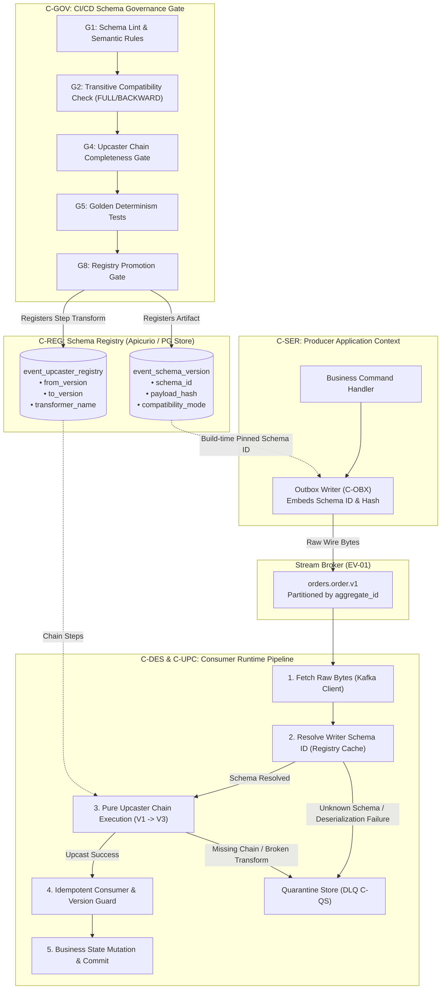
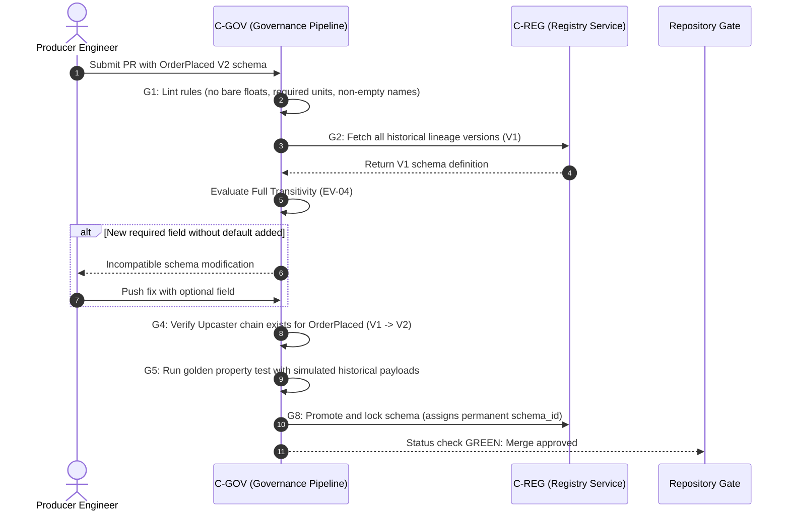
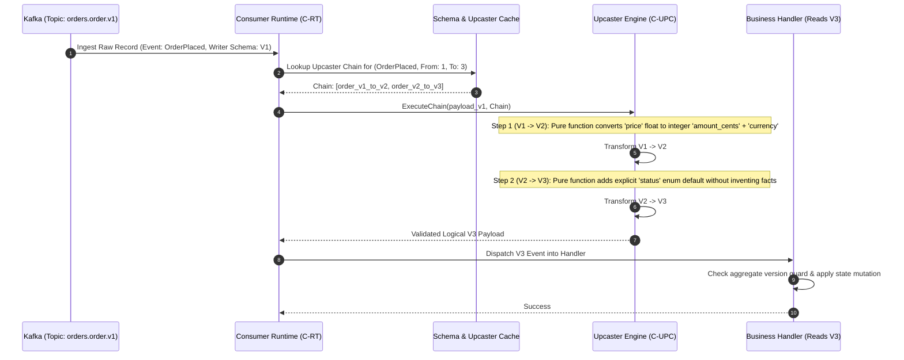

# Event Versioning — System Architecture & Workflow Diagrams

## 1. High-Level Architectural Context & Component Map



---

## 2. Invariant Enforcement Sequence Diagrams

### 2.1 EV-04: Transitive Compatibility CI Gate (`FULL_TRANSITIVE`)



---

### 2.2 EV-06: Deterministic In-Memory Upcasting Pipeline ($V_1 \to V_3$)



---

## 3. Major Stream Migration & Zero-Downtime Cutover (EV-09 / §11)

```mermaid
sequenceDiagram
    autonumber
    participant Prod as Producer App
    participant DB as Producer PostgreSQL (Outbox)
    participant V1 as Topic orders.order.v1
    participant V2 as Topic orders.order.v2 (Re-modeled)
    participant ConsV1 as Consumer V1 (Legacy)
    participant ConsV2 as Consumer V2 (Shadow / New)

    Note over Prod,DB: §11.2 Dual-Publishing Phase (Atomic Single Tx)
    Prod->>DB: INSERT Outbox Row V1 + INSERT Outbox Row V2 (Same aggregate version)
    DB-->>V1: Relay emits to orders.order.v1
    DB-->>V2: Relay emits to orders.order.v2

    Note over ConsV2: §11.3 Shadow Parity Validation
    V2->>ConsV2: Consume and compute shadow projection
    ConsV2->>ConsV2: Verify state parity against ConsV1 live projections (100% match)

    Note over ConsV1,ConsV2: Cutover Gate: Switch Consumer Groups
    ConsV1->>ConsV1: Stop consuming V1 stream
    ConsV2->>ConsV2: Promote to primary reader; advance offsets based on continuous aggregate_version (EV-09)

    Note over Prod,DB: §11.4 Contraction Phase
    Prod->>DB: Contract outbox writes: Stop emitting V1 rows
```

