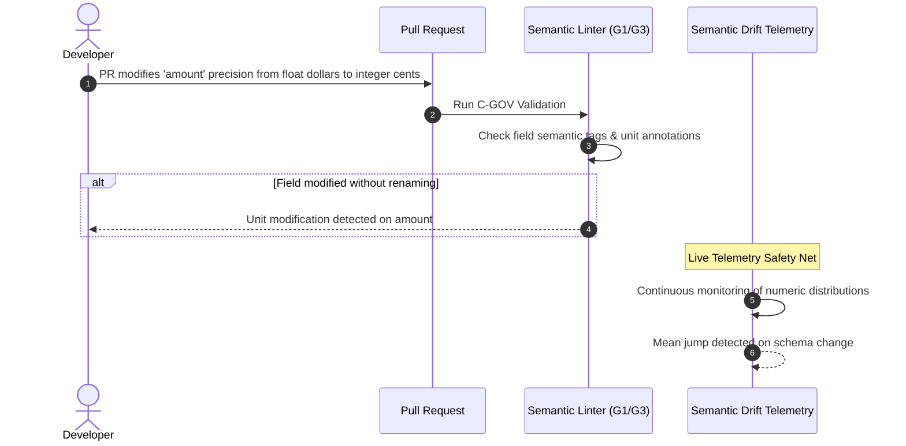

# Event Versioning — Failure Cases & Mitigation Tree

This document formalizes the production failure scenarios from the [Event Versioning Decision Tree (v2)](file:///home/btpl-lap-22/live/System-Architect/event-driven-platform/docs/features/event-versioning/business-logic.md), mapping root causes to automated detections and operational remediations.

---

## 1. Failure Node Taxonomy

| Failure Code | Severity | Scenario | Root Cause | Handling & Mitigation | Automated Detection |
| :--- | :--- | :--- | :--- | :--- | :--- |
| **F3.1** | `CORRUPT` | Per-event-type topics | Independent topics per event type break aggregate ordering | Consolidate into aggregate-level topic `orders.order.v1` (EV-01) | Version guard gap/stale counter spikes |
| **F4.1.1** | `OUTAGE` | New enum symbol added | Older readers crash on unhandled enum symbols | Declare explicit fallback enum defaults (`UNSPECIFIED = 0`) | Schema lint gate (G1); unhandled enum exceptions |
| **F6.1** | `CORRUPT` | Unit change under same field name | Producer changes dollars to cents or tax basis under existing `amount` field | Require new field name (e.g. `amount_cents` + `currency`) (EV-05) | Semantic drift monitor (distribution shifts) |
| **F7.2.1** | `OUTAGE` | Registry down at producer startup | Producer fails initialization because schema ID cannot be resolved | Pin schema IDs and artifacts at build/deploy time (C-SER) | Producer startup readiness health check alerts |
| **F7.2.2** | `CORRUPT` | Auto-registration in production | Producer registers unreviewed schema bypassing CI governance | Registry ACL locks write access strictly to CI pipeline role | Registry audit log alerts on non-pipeline writes |
| **F8.1** | `CORRUPT` | Inconsistent expand/contract writes | Producer writes conflicting values in old vs new fields | Single generator function derives both fields with property tests | Ingestion assertion check comparing legacy & modern fields |
| **F9.1** | `OUTAGE` | Unknown schema ID at consumer | Mirrored topics or un-replicated registry in DR | Quarantine message (C1/C2 DLQ) and park key; halt if $> 50$ keys | `event_versioning_unknown_schema_id_total` spike |
| **F10.1** | `CORRUPT` | Fabricated default in upcaster | Upcaster injects assumed value (e.g. `USD`) for unrecorded past data | Strictly forbidden by EV-12; unknown must stay `null`/explicit | CI property tests; golden sample verification |
| **F10.2** | `CORRUPT` | Upcaster consults database/network | Upcaster performs external I/O breaking deterministic replay | Enforce pure function constraint; enrich in business handler | Static analysis blocks I/O in upcaster packages |
| **F10.4** | `OUTAGE` | Missing upcaster in production | Historical V1 event arrives at consumer reading V3 with no chain | CI completeness gate (G4); C1/C2 DLQ quarantine on arrival | Upcaster lookup failure counter; quarantine alert |
| **F11.2** | `CORRUPT` | Aggregate version reset on stream migration | Topic V2 restarts aggregate sequence at version 1 | EV-09 continuity enforcement; consumer rejects version regressing | Idempotent consumer version gap alert |

---

## 2. Failure Handling Sequence Diagrams

### 2.1 F9.1 & F10.4: Unknown Schema / Missing Upcaster Chain Isolation

```mermaid
sequenceDiagram
    autonumber
    participant Kafka as Kafka Stream
    participant CRT as Consumer Runtime (C-RT)
    participant Reg as Schema / Upcaster Registry
    participant DLQ as Dead-Letter Quarantine (C-QS)
    participant Park as Aggregate Parking Store

    Kafka->>CRT: Deliver Event Record (Schema ID: 9948, Event: OrderPlaced)
    CRT->>Reg: Lookup Schema ID 9948 & Upcaster Chain
    alt Schema ID Unknown or Chain Missing
        Reg-->>CRT: Error: ERR_SCHEMA_NOT_FOUND / ERR_CHAIN_INCOMPLETE
        CRT->>CRT: Classify Error as C1 (Poison Payload Defect)
        CRT->>DLQ: Store quarantined event
        CRT->>Park: Park aggregate key
        CRT->>Kafka: Advance partition offset
        Note over CRT,Park: Aggregate is parked; live stream proceeds
    end
```

---

### 2.2 F6.1: Semantic Drift Detection & Pipeline Interception




## 3. Amendment 2026-11-07: Failure Nodes Added

| Failure Code | Severity | Scenario | Root Cause | Handling & Mitigation | Automated Detection |
| :--- | :--- | :--- | :--- | :--- | :--- |
| **F-EV-A1** | `OUTAGE` | Upcast request with no registered chain (previously unavoidable because the register route was missing) | Upcasters could not be registered over HTTP | Register each step with `POST /api/v1/schemas/upcasters`; use `transformerName: "identity"` for additive bumps. Missing step still fails with `400 incomplete upcast chain`. | 400 on `/schemas/upcast`; chain-gap check |
| **F-EV-A2** | `DEGRADE` | Duplicate upcaster registration | Same `externalId` re-sent | `409 CONFLICT` (treat as already registered) | 409 on `/schemas/upcasters` |
| **F-EV-A3** | `DEGRADE` | Unknown `transformerName` registered | Name is not validated against the engine at registration (open gap) | Registration succeeds (201) but `/schemas/upcast` fails `400` | 400 at upcast time. Operator action: register a transformer in code at startup, or re-register the step with `identity`. |
| **F-EV-A4** | `DEGRADE` | Custom transformer needed | No custom transformers are registered at startup | Deploy code that registers the transformer before the step is used | 400 at upcast |
