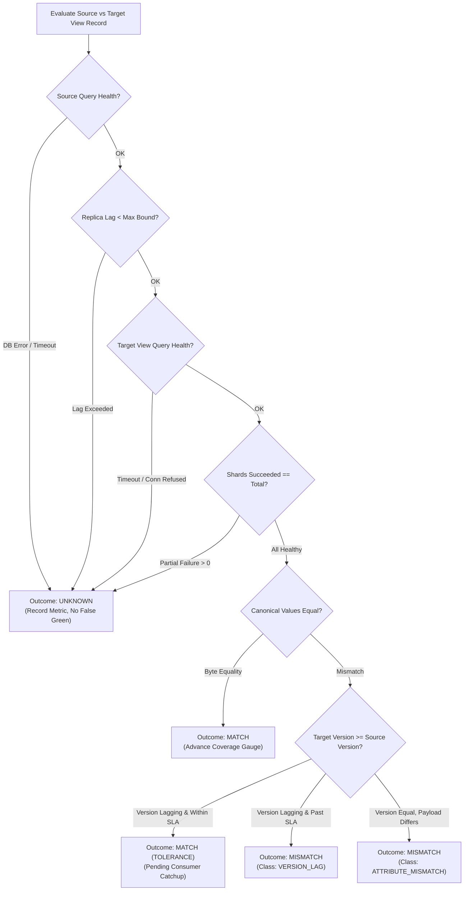
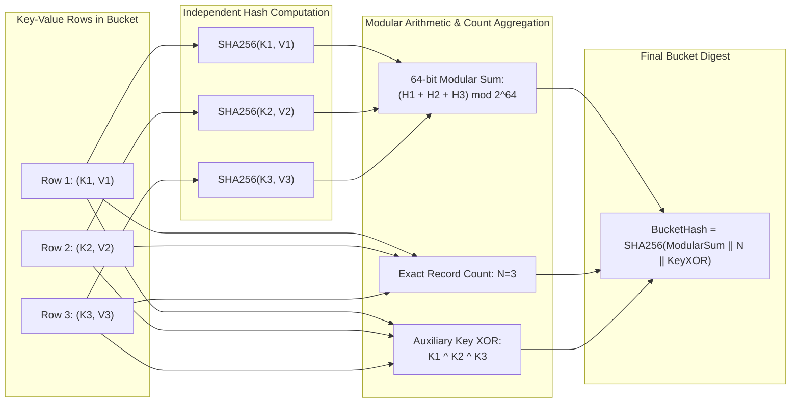
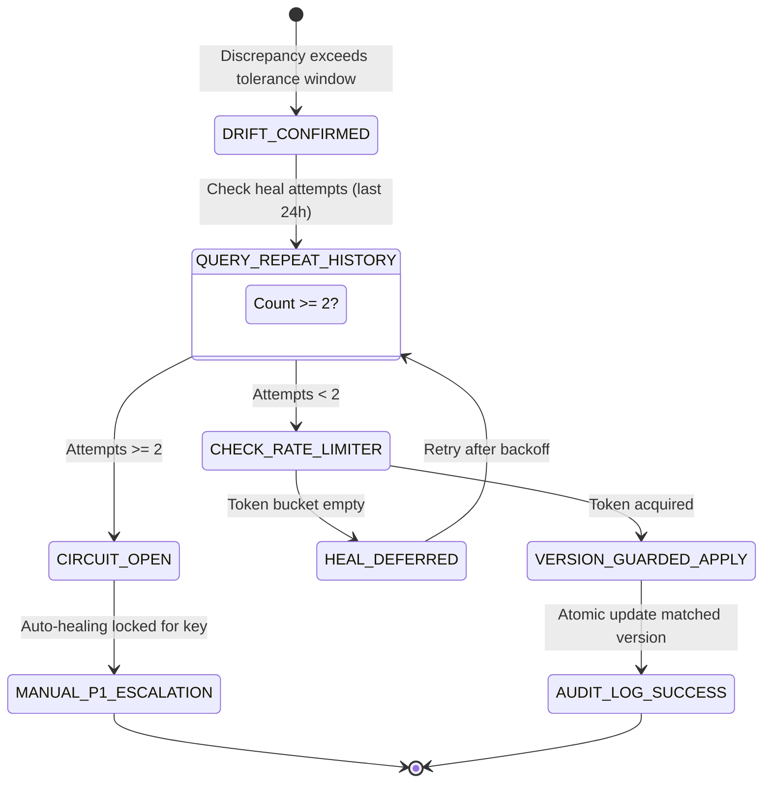
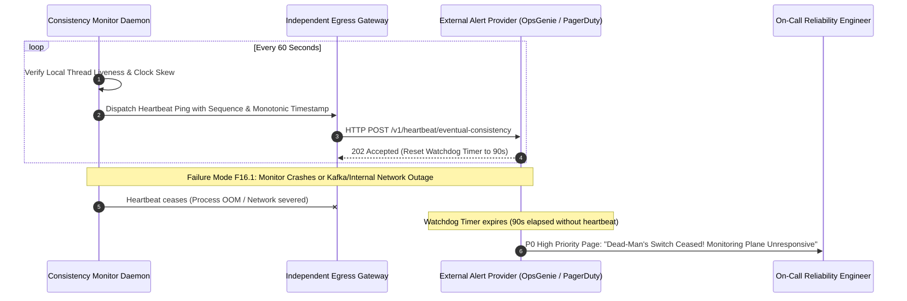

# Eventual Consistency Monitoring Architecture & Runtime Diagrams (WP-14)

This document contains Mermaid diagrams illustrating the runtime architectures, decision engines, state machines, three-valued logic pipelines, and self-healing safety circuits of the Eventual Consistency Monitoring subsystem per the [Eventual Consistency Monitoring Specification](file:///home/btpl-lap-22/live/System-Architect/event-driven-platform/docs/features/eventual-consistency-monitoring/business-logic.md).

---

## 1. End-to-End Consistency Verification & Alerting Pipeline

```mermaid
flowchart TD
    subgraph Ingestion ["Telemetry & Probing Sources"]
        CAN["Stratified Synthetic Canary Prober<br/>(Every Stream Partition)"]
        WTR["Continuous Watermark Observer<br/>(Consumer LSN / Offset Lag)"]
        SWP["Background Merkle Bucket Sweeper<br/>(Range Checksums & Deep Audits)"]
        INV["Business Domain Invariant Probes<br/>(Sum debits == credits)"]
    end

    subgraph Comparator ["Three-Valued Logic Engine (EC-12)"]
        EVAL["Record Normalizer & Canonical Serializer<br/>(UTC, Minor Currency, Lowercase UUID)"]
        DEC{"Three-Valued Comparator<br/>(Handles Shard Drops & Timeouts)"}
    end

    subgraph Outcomes ["Evaluation State Space"]
        MTC["MATCH<br/>(Consistent, Increment Coverage SLO)"]
        UNK["UNKNOWN<br/>(Partial Shards, Lagging Replicas, Timeouts)"]
        MIS["MISMATCH<br/>(Quarantine in Tolerance Window)"]
    end

    subgraph Quarantine ["Hysteresis & Classification"]
        TOL{"Elapsed >= T_tolerance?"}
        CLF["Drift Taxonomy Classifier<br/>(GHOST | MISSING | ATTRIBUTE_MISMATCH | MANUAL_WRITE)"]
        HEAL["Rate-Limited Self-Healing Circuit<br/>(Max 2 heals/24h per key)"]
        DEAD["External Dead-Man's Switch<br/>(60s Invariant Heartbeat Out-of-Band)"]
    end

    CAN --> EVAL
    WTR --> EVAL
    SWP --> EVAL
    INV --> EVAL
    EVAL --> DEC
    DEC -->|Success & Exact Equality| MTC
    DEC -->|Error, Shard Timeout, Replica Lag| UNK
    DEC -->|Value or Version Divergence| MIS
    MIS --> TOL
    TOL -->|No (In-Flight Propagation)| MTC
    TOL -->|Yes (Persistent Divergence)| CLF
    CLF --> HEAL
    MTC --> DEAD
```

---

## 2. Three-Valued Decision Matrix (EC-12)



---

## 3. Duplicate-Proof Merkle Bucket Checksum (F17.5)



---

## 4. Self-Healing Circuit & Repeat-Heal Breaker (F21.1)



---

## 5. External Dead-Man's Switch Heartbeat Architecture (EC-15)



