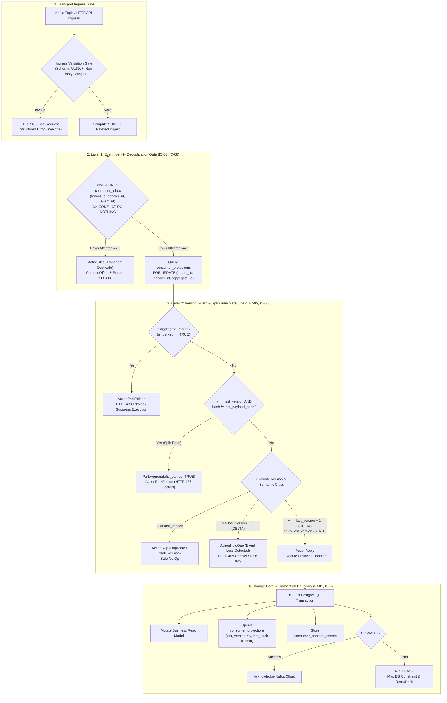
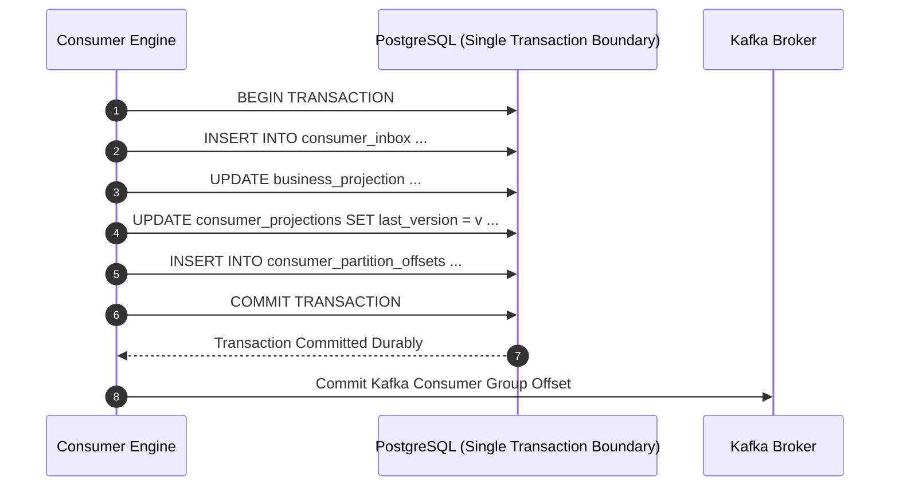
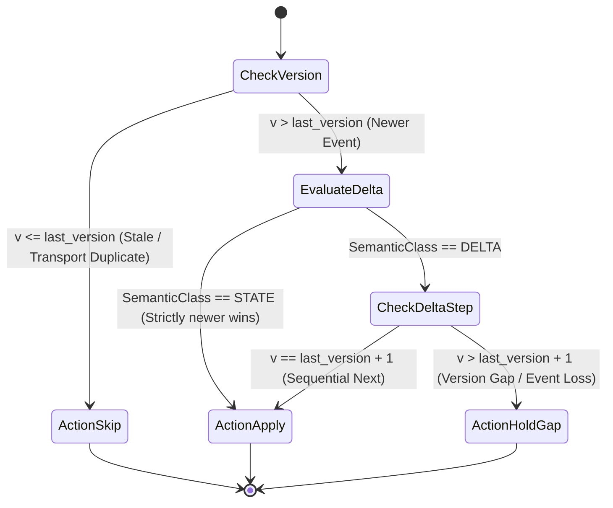
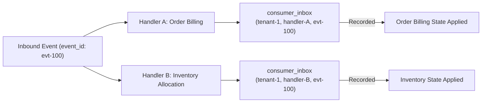

# Architectural Decision Record (ADR): Idempotent Consumers with Two-Layer Defense

* **Status:** Accepted
* **Date:** 2026-11-04
* **Deciders:** Lead Systems Architect & Platform Core Engineering
* **Feature Scope:** `src/features/idempotent-consumers/`, `src/api/rest/v1/`, `database/migrations/`
* **Governing Decision Tree:** `docs/features/idempotent-consumers/business-logic.md` (v2)

---

## 1. Context and Problem Statement

In distributed message brokers like Apache Kafka, delivery guarantees are strictly **at-least-once**. Network partitions, consumer group rebalances, worker crashes prior to offset commits, and producer outbox retries routinely deliver duplicate and out-of-order events.

Without dedicated consumer idempotency and version fencing:
- **Delta Mutations** (e.g. account debit, inventory decrement, order item additions) get double-applied, corrupting financial ledgers and state projections.
- **Stale Replays** (e.g. DLQ redrives, historical reconciliation replays, or partition rebalance zombies) overwrite newer aggregate state.
- **Split-Brain Collision** (e.g. database restore on upstream producer minting new payload for an already emitted version) silently diverges read models.

---

## 2. Invariants & Decision Drivers (from `business-logic.md` v2)

* **IC-01 Atomic Effect**: Dedupe record (`consumer_inbox`) + aggregate projection state (`consumer_projections`) + partition offset (`consumer_partition_offsets`) are updated in **ONE local database transaction**.
* **IC-02 Effect-Once Semantics**: Exactly-once exists solely as an idempotent effect at the consumer; transport is at-least-once forever.
* **IC-03 Identity**: Dedupe key is the producer-assigned `event_id`, identical across redeliveries.
* **IC-04 Two Layers of Protection**:
  - *Layer 1 (Event Identity)*: Catches transport and relay duplicates via `consumer_inbox (tenant_id, handler_id, event_id)`.
  - *Layer 2 (Aggregate Version Guard)*: Catches stale, reordered, and replayed events permanently via `consumer_projections.last_version`.
* **IC-05 Version Rule**:
  - $v \le \text{last\_version} \implies$ duplicate/stale $\implies$ acknowledge, skip.
  - $v = \text{last\_version} + 1 \implies$ apply effect and advance version.
  - $v > \text{last\_version} + 1 \implies$ **GAP** (upstream loss) $\implies$ hold key, never apply, page on-call.
* **IC-06 Delta vs State Semantics**:
  - *State Events*: Full snapshots allow "strictly newer wins" ($v > \text{last\_version}$).
  - *Delta Events*: Strict next-version ($v = \text{last\_version} + 1$) + `event_id` dedupe required.
* **IC-07 Offset After Effect**: Offset is advanced only after the database effect commits.
* **IC-08 Dedupe Scope**: Scoped to `(tenant_id, handler_id, event_id)`, never `event_id` alone.
* **IC-10 No Ordering Bypass**: DLQ redrives must pass through the version guard; stale events are skipped.

---

## 3. Comprehensive Visual Architectural Diagrams

### 3.1 End-to-End Consumer Pipeline Architecture



---

## 4. Invariant-Specific Mermaid Diagrams

### 4.1 Invariant IC-01: Atomic Effect & Offset Boundary


### 4.2 Invariant IC-05: Version Rule Gate (DELTA vs STATE)


### 4.3 Invariant IC-08: Deduplication Scoped Per Handler


---

## 5. Failure Case Sequence Diagrams

### 5.1 F3.1.5 & F4.4: Zombie Consumer Overwrite Prevention
```mermaid
sequenceDiagram
    autonumber
    actor ZC as Zombie Consumer (Stalled GC)
    actor NC as New Owner Consumer (Partition Reassigned)
    participant DB as PostgreSQL (consumer_projections)

    Note over NC: Processes Event V=3 successfully
    NC->>DB: UPDATE consumer_projections SET last_version = 3 WHERE last_version < 3
    DB-->>NC: 1 Row Updated (last_version = 3)

    Note over ZC: Awakens from GC pause, attempts to apply Event V=2
    ZC->>DB: UPDATE consumer_projections SET last_version = 2 WHERE last_version < 2
    DB-->>ZC: 0 Rows Affected (Conditional Update Failed)
    Note over ZC: Stale write silently rejected; zero lost updates!
```

### 5.2 F3.2.4: Split-Brain Same Version Divergent Content Collision
```mermaid
sequenceDiagram
    autonumber
    actor Producer as Upstream Producer (Dual-Leader / DB Restore)
    participant Engine as Consumer Engine
    participant DB as PostgreSQL (consumer_projections)

    Producer->>Engine: Deliver Event V=2 (Payload: {amount: 100}, Hash: 0xAAAA)
    Engine->>DB: Apply V=2 (last_version = 2, last_payload_hash = 0xAAAA)
    
    Producer->>Engine: Redeliver Event V=2 (Payload: {amount: 200}, Hash: 0xBBBB)
    Engine->>DB: Query Projection (last_version=2, last_payload_hash=0xAAAA)
    Note over Engine: Detect Hash Mismatch: 0xAAAA != 0xBBBB!
    Engine->>DB: UPDATE consumer_projections SET is_parked = TRUE
    Engine-->>Producer: HTTP 423 Locked (ActionParkPoison)
    Note over Engine: Aggregate isolated; alerts on-call dashboard
```

### 5.3 F3.2.5: Out-of-Order First Event Arrival ($V > 1$)
```mermaid
sequenceDiagram
    autonumber
    actor Broker as Kafka Partition
    participant Engine as Consumer Engine
    participant DB as PostgreSQL (consumer_projections)

    Broker->>Engine: Ingest First Event Seen: V=2 (OrderShipped)
    Engine->>DB: GetProjection (not found -> current_version = 0)
    Note over Engine: DELTA Event expects V=0+1=1. Received V=2!
    Engine-->>Broker: ActionHoldGap (HTTP 409 Conflict)
    Note over Engine: Key held; downstream ledger corruption prevented
```

---

## 6. PostgreSQL Storage Gate Constraint Registry

To satisfy **05-db-writing-rules.md Section 8**, database constraint violations are translated deterministically:

| Constraint Name | Description | PostgreSQL Type | Canonical Error Code |
|---|---|---|---|
| `consumer_inbox_dedupe_uk` | Duplicate `(tenant_id, handler_id, event_id)` | UNIQUE | `CONFLICT` (409) |
| `consumer_inbox_tenant_id_ck` | Non-empty trimmed tenant string | CHECK | `VALIDATION_FAILED` (400) |
| `consumer_inbox_handler_id_ck` | Non-empty trimmed handler string | CHECK | `VALIDATION_FAILED` (400) |
| `consumer_inbox_aggregate_version_ck` | Monotonic version $\ge 1$ | CHECK | `VALIDATION_FAILED` (400) |
| `consumer_inbox_payload_hash_ck` | SHA-256 64-char hex format | CHECK | `VALIDATION_FAILED` (400) |
| `consumer_projections_last_version_ck`| Non-negative projection version $\ge 0$ | CHECK | `VALIDATION_FAILED` (400) |

---

## 7. Consequences and Trade-offs

* **Positive**:
  - Eliminates duplicate mutations under any transport failure or redelivery scenario.
  - Guarantees per-aggregate ordering safety and halts corruption before state changes occur.
  - Zero application leakage of database internals via centralized error mapping.
* **Negative**:
  - Version gaps (`ActionHoldGap`) block partition processing unless delegated to non-blocking retry topics.
  - Inbox table requires periodic partition archiving (`PurgeIntervalHours = 48`) to prevent storage bloat.

---

## Deep Failure-First Architectural Principles

### 1. Existential Purpose & The Catastrophe Prevented

Distributed message delivery in systems like Apache Kafka is strictly at-least-once. Network timeouts, consumer group rebalances, and producer retries routinely deliver duplicate copies of the same event. If a consumer naively applies mutations upon every arrival, financial accounts are debited twice, duplicate orders are shipped, and system state is permanently corrupted.

### 2. Internal Algorithmic Mechanics & State Invariants

The service implements a Two-Layer Defense: Layer 1 (Transport Identity) inserts the event_id into a dedicated consumer_inbox table inside the same local database transaction as the business mutation (ON CONFLICT DO NOTHING); if 0 rows are affected, it is a duplicate and immediately skipped. Layer 2 (Aggregate Version Guard) checks the aggregate's last_version: v = last+1 applies; v <= last drops as stale; v > last+1 holds as a gap. If an event shares the current version but has a divergent payload hash, it is quarantined as a split-brain poison pill.

### 3. Core Architectural Principles

* **Two-Layer Defense Architecture**: Deduplication enforces both transport identity checks (inbox dedupe) and business aggregate monotonic version fencing.
* **Single Local Atomic Transaction**: Inbox recording, aggregate projection mutation, and offset advancement must execute inside one atomic database transaction.
* **Strict Version Continuity**: Incremental delta mutations require strict next-version alignment ($N+1$); out-of-order gap events are held to prevent corrupted projections.
* **Split-Brain Content Fencing**: Events sharing an aggregate version but bearing divergent cryptographic hashes indicate split-brain upstream state and are immediately quarantined.

### 4. The Architect's Meta-Questions (Failure-First Evaluation)

1. **Why is checking an in-memory cache (like Redis) insufficient for consumer deduplication? (If Redis crashes or suffers a network partition, the consumer loses its dedupe state and double-applies mutations; inbox deduplication MUST share the atomic ACID transaction of the state mutation).**
2. **How do we prevent the consumer_inbox table from growing infinitely and consuming all disk space? (We implement a background compaction job that purges inbox records older than our message retention window (e.g. 48 hours) using index-partitioned truncations).**
3. **Why must we treat DELTA events differently from STATE events? (STATE events carry full snapshots and can apply 'strictly newer wins' (v > last); DELTA events represent incremental mathematical mutations (+10) and require strict next-version sequencing (v == last+1)).**

---

## Authoritative References & Production Citations

* **[Pat Helland: Idempotence Is Not a Free Lunch (ACM Queue 2012)](https://queue.acm.org/detail.cfm?id=2187821)**
  - *Architectural Rationale & Implementation Grounding*: Deep architectural dive into side-effects, message redelivery mechanics, and building robust idempotent software services.
* **[Gregor Hohpe: Idempotent Receiver Pattern](https://www.enterpriseintegrationpatterns.com/patterns/messaging/IdempotentReceiver.html)**
  - *Architectural Rationale & Implementation Grounding*: Authoritative pattern on designing receivers capable of safely processing duplicate messages without unintended side-effects.
* **[Apache Kafka KIP-98: Exactly Once Delivery and Transactional Messaging](https://cwiki.apache.org/confluence/display/KAFKA/KIP-98)**
  - *Architectural Rationale & Implementation Grounding*: Seminal Kafka enhancement specification detailing idempotent producers, transactional coordinators, and consumer read-committed modes.
* **[Martin Kleppmann: Designing Data-Intensive Applications (Chapter 11: Idempotence)](https://dataintensive.net/)**
  - *Architectural Rationale & Implementation Grounding*: Definitive analysis of deduplication mechanisms, unique constraint guards, and distributed transaction atomicity.

## Amendment 2026-11-07: Inbox event validation (eventId UUID, semanticClass enum)

### Problem observed
- `POST /api/v1/consumers/inbox` with a non-UUID `eventId` returned 500.
- An unrecognised `semanticClass` (e.g. `BOGUS`) was silently treated as `DELTA`, applying the gap-hold version rule to a stream the caller intended otherwise.

### Root cause
- RC2: `eventId` format was enforced only by the Postgres UUID column, so the failure surfaced as a 500.
- Handler mapping: `idempotent-consumers.handler.go: Consume` set `semantic = DELTA` and switched to `STATE` only when the string equalled the STATE constant; any other value fell into DELTA. The service-level contract did not validate the enum.
- RC1: the handler used a bare `err.(*appErrors.ApplicationError)` assertion, which misses wrapped errors.

### Decision / fix
- `ValidateInboundConsumerEvent` rejects a non-empty `eventId` that is not a UUID and any `semanticClass` other than `STATE` or `DELTA`, with 400 field-level details.
- The handler passes the caller's `semanticClass` through unchanged; only an empty value defaults to `DELTA` (preserving the previous default for omitted fields).
- The handler uses `errors.As`.

### API-visible behavior change
- Non-UUID `eventId`: 500 becomes 400.
- Unknown `semanticClass`: silent DELTA becomes 400. **Breaking** for clients sending unrecognised values; empty still defaults to `DELTA`.
- Existing rule tests were updated to UUID fixtures.

### Verification
Re-tested live: both cases return 400; empty `semanticClass` still accepted. Unit test `TestValidateInboundConsumerEvent_EventIDAndSemanticClass` added (`tests/idempotent_consumers_validation_test.go`).

### Remaining gaps
- No HTTP-level test; the default-to-`DELTA` for empty `semanticClass` remains an implicit choice that could mask producer omissions.
