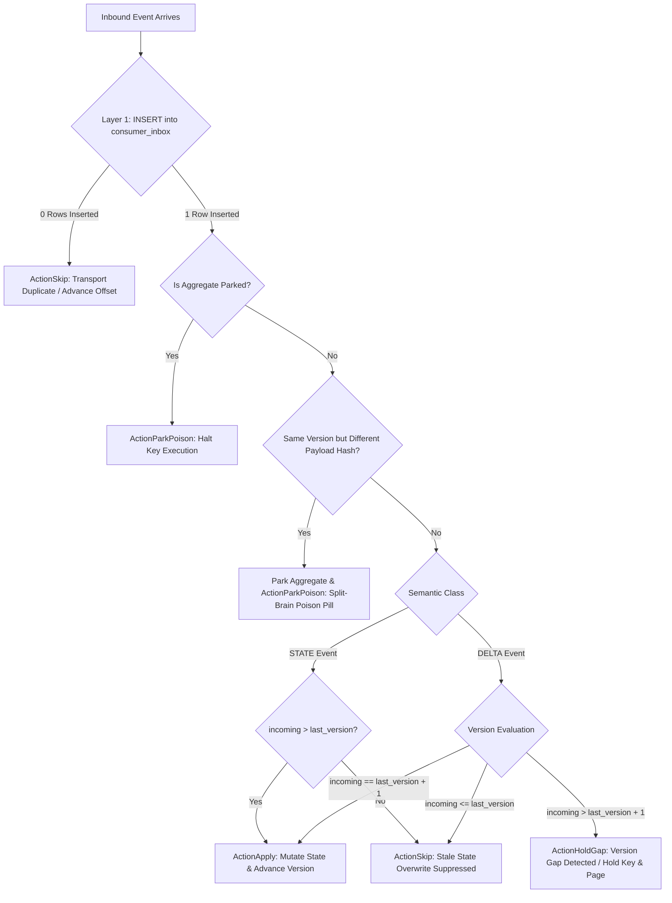

# ADR: Idempotent Consumer Pattern with Two-Layer Defense (Inbox & Version Guard)

* **Status:** Accepted
* **Date:** 2026-11-04
* **Deciders:** Lead Systems Architect & Platform Core Engineering
* **Feature Scope:** `src/features/idempotent-consumers/`, `src/api/`

---

## 1. Context and Problem Statement

In distributed streaming architectures (e.g. Apache Kafka), transport guarantees are strictly **at-least-once**. Network reconnects, broker leader rebalances, producer retries, and consumer crashes frequently lead to duplicate deliveries of events.

Without dedicated consumer-side idempotency:
- Delta events (e.g., account debits, order balance changes, inventory increments) get double-applied, causing corrupted business balances.
- Stale events replayed from Dead Letter Queues (DLQ) or manual offset rewinds overwrite newer aggregate state.

---

## 2. Invariants & Decision Drivers (from business-logic.md v2)

* **IC-01 Atomic Effect**: Dedupe record + business effect + partition offset position commit in ONE transaction, ONE store.
* **IC-02 Effect-Once Semantics**: Exactly-once exists solely as an idempotent effect at the consumer; transport is at-least-once forever.
* **IC-03 Identity**: Dedupe key is the producer-assigned `event_id`, identical across every redelivery and re-publish.
* **IC-04 Two Layers of Defense**:
  - *Layer 1 (Event Identity)*: Catches transport and relay duplicates via `consumer_inbox (tenant_id, handler_id, event_id)`.
  - *Layer 2 (Aggregate Version Guard)*: Catches stale, reordered, and replayed events permanently via `consumer_projections.last_version`.
* **IC-05 Version Rule**:
  - $\text{version} \le \text{last\_applied} \implies$ duplicate / stale $\implies$ acknowledge & skip.
  - $\text{version} = \text{last\_applied} + 1 \implies$ apply effect and advance version.
  - $\text{version} > \text{last\_applied} + 1 \implies$ **GAP** (upstream loss) $\implies$ hold key, do not apply, page on-call.
* **IC-06 Delta vs State Semantics**:
  - *State Events*: Full snapshots of aggregate state allow "strictly newer wins" ($\text{version} > \text{last\_applied}$).
  - *Delta Events*: Incremental mutations require strict next-version ($\text{version} = \text{last\_applied} + 1$) + `event_id` dedupe.
* **IC-08 Dedupe Scope**: Scoped to `(handler_id, event_id)` so multiple distinct consumers reading the same event do not suppress each other's effects.

---

## 3. Architectural Diagrams

### 3.1 Two-Layer Consumer Execution Sequence

```mermaid
sequenceDiagram
    autonumber
    actor Broker as Apache Kafka / HTTP Ingress
    participant Handler as Idempotent Consumer Ingress
    participant Service as Consumer Domain Service
    participant Repo as PostgreSQL (Inbox & Projections)
    participant Projection as Business Domain Projection

    Broker->>Handler: Ingest Event (event_id, handler_id, aggregate_id, version, payload)
    activate Handler
    Handler->>Service: ConsumeEvent(InboundConsumerEvent)
    activate Service

    rect rgb(240, 248, 255)
    Note over Service,Repo: Layer 1: Transport Deduplication (Inbox Claim)
    Service->>Repo: RecordInbox (INSERT ... ON CONFLICT DO NOTHING)
    alt Event Already Processed by this Handler (0 rows affected)
        Repo-->>Service: Duplicate Detected (false)
        Service-->>Handler: ActionSkip (Duplicate skipped; advance offset)
        Handler-->>Broker: 200 OK
    end
    end

    rect rgb(255, 250, 240)
    Note over Service,Repo: Layer 2: Aggregate Version Guard & Semantic Evaluation
    Service->>Repo: GetProjection(tenant_id, aggregate_type, aggregate_id)
    Repo-->>Service: Return current last_version & last_payload_hash

    alt Aggregate Is Parked (Poison Pill Active)
        Service-->>Handler: ActionParkPoison (Aggregate locked; do not process)
        Handler-->>Broker: 423 Locked
    else Split-Brain / Divergent Content (Same version, different SHA-256)
        Service->>Repo: ParkAggregate(split-brain divergence)
        Service-->>Handler: ActionParkPoison (Poison aggregate isolated)
        Handler-->>Broker: 423 Locked
    else Version Evaluation: Incoming <= Last Version
        Service-->>Handler: ActionSkip (Stale event; safe no-op)
        Handler-->>Broker: 200 OK
    else Version Evaluation: Incoming > Last Version + 1 (DELTA event)
        Service-->>Handler: ActionHoldGap (Upstream loss detected; hold key)
        Handler-->>Broker: 409 Conflict (Alert on-call)
    else Version Evaluation: Valid Next Version (v == last + 1, or newer STATE)
        Service->>Repo: ApplyProjectionEffect(version, event_id, payload_hash)
        Repo-->>Service: Confirmed
        Service-->>Handler: ActionApply (Effect applied & committed)
        Handler-->>Broker: 200 OK
    end
    end
    deactivate Service
    deactivate Handler
```

### 3.2 Decision Flowchart for Event Evaluation



---

## 4. Specific Failure Modes & Handling

| Failure Code | Scenario | Impact | Code Mitigation | Detection |
|---|---|---|---|---|
| **F3.1.1** | Unique violation on inbox handled as exception | Aborts entire transaction; retries fail | `INSERT ... ON CONFLICT DO NOTHING`; rows affected check determines duplicate without aborting tx | Error rate metric excludes duplicates |
| **F3.1.4** | Partitioned inbox loses uniqueness | Cross-partition duplicates processed | Inbox partitioned strictly by producer-stamped event creation time, or kept unpartitioned | Uniqueness check audit |
| **F3.1.5** | Zombie consumer (losing group rebalance) | Concurrently processes older event | Layer 2 Version Guard checks incoming version against `last_version`; stale zombie writes are rejected | Stale version skip counter |
| **F3.2.2** | Strictly newer rule mistakenly used for DELTA | Skips intermediate balance updates; corrupts ledger | DELTA events strictly enforce $v = \text{last} + 1$; gaps trigger `ActionHoldGap` | Gap detection metric |
| **F3.2.4** | Divergent content on same version | Upstream restore / split-brain corruption | Payload SHA-256 hash comparison against `last_payload_hash`; divergence automatically parks aggregate | Hash mismatch counter |
| **F4.3** | DLQ re-drive after newer versions applied | Stale event overwrites fresh state | Re-driven events pass through Layer 2 Version Guard; stale versions are skipped and reported | DLQ stale skip metric |
