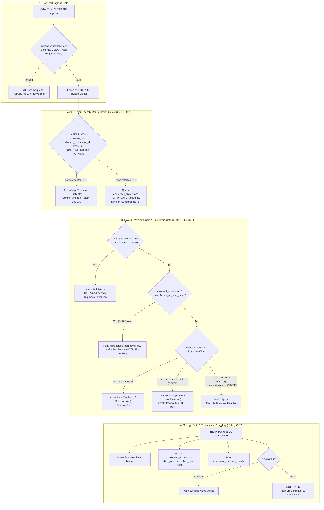
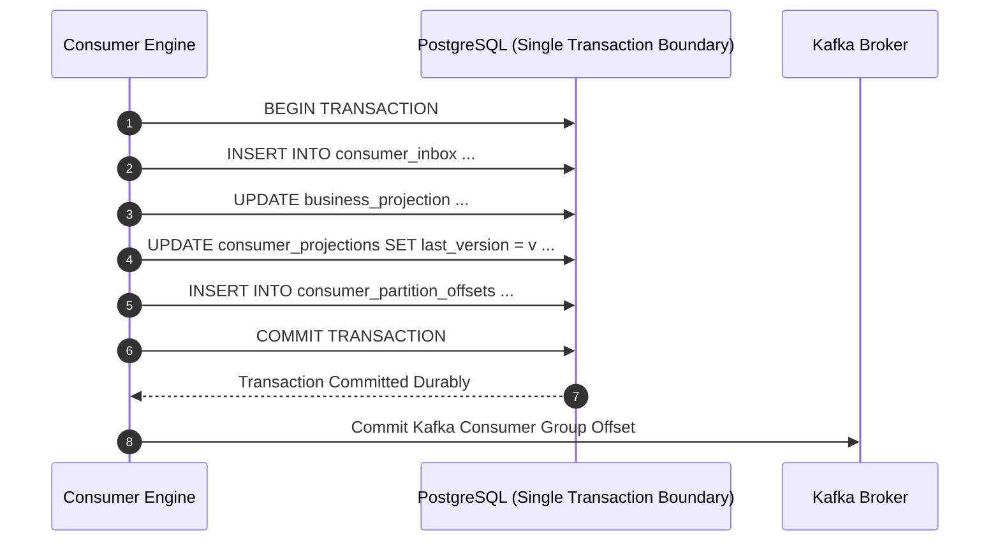
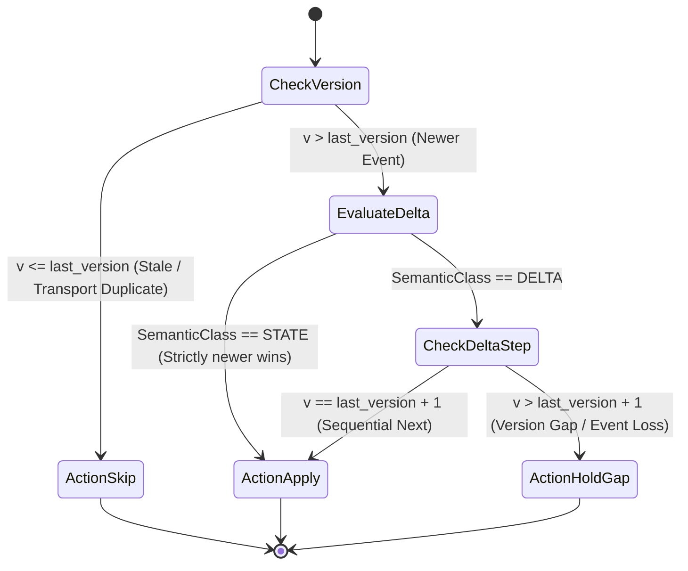
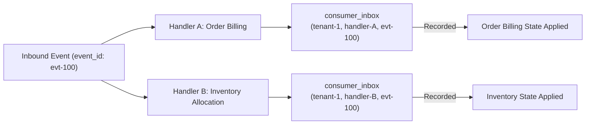

# Idempotent Consumer Visual Architecture and Invariant Flows

---

## 1. Complete System Flow



---

## 2. Invariant IC-01: Atomic Effect Sequence



---

## 3. Invariant IC-05: Version Rule State Machine



---

## 4. Invariant IC-08: Deduplication Scoped Per Handler



---

## 5. Failure Case Sequence Diagrams

### 5.1 F3.1.5 & F4.4: Zombie Consumer Overwrite Prevention
```mermaid
sequenceDiagram
    autonumber
    actor ZC as Zombie Consumer (Stalled GC)
    actor NC as New Owner Consumer (Partition Reassigned)
    participant DB as PostgreSQL (consumer_projections)

    Note over NC: Processes Event V=3 successfully
    NC->>DB: UPDATE consumer_projections SET last_version = 3 WHERE last_version < 3
    DB-->>NC: 1 Row Updated (last_version = 3)

    Note over ZC: Awakens from GC pause, attempts to apply Event V=2
    ZC->>DB: UPDATE consumer_projections SET last_version = 2 WHERE last_version < 2
    DB-->>ZC: 0 Rows Affected (Conditional Update Failed)
    Note over ZC: Stale write silently rejected; zero lost updates!
```

### 5.2 F3.2.4: Split-Brain Same Version Divergent Content Collision
```mermaid
sequenceDiagram
    autonumber
    actor Producer as Upstream Producer (Dual-Leader / DB Restore)
    participant Engine as Consumer Engine
    participant DB as PostgreSQL (consumer_projections)

    Producer->>Engine: Deliver Event V=2 (Payload: {amount: 100}, Hash: 0xAAAA)
    Engine->>DB: Apply V=2 (last_version = 2, last_payload_hash = 0xAAAA)
    
    Producer->>Engine: Redeliver Event V=2 (Payload: {amount: 200}, Hash: 0xBBBB)
    Engine->>DB: Query Projection (last_version=2, last_payload_hash=0xAAAA)
    Note over Engine: Detect Hash Mismatch: 0xAAAA != 0xBBBB!
    Engine->>DB: UPDATE consumer_projections SET is_parked = TRUE
    Engine-->>Producer: HTTP 423 Locked (ActionParkPoison)
    Note over Engine: Aggregate isolated; alerts on-call dashboard
```

### 5.3 F3.2.5: Out-of-Order First Event Arrival ($V > 1$)
```mermaid
sequenceDiagram
    autonumber
    actor Broker as Kafka Partition
    participant Engine as Consumer Engine
    participant DB as PostgreSQL (consumer_projections)

    Broker->>Engine: Ingest First Event Seen: V=2 (OrderShipped)
    Engine->>DB: GetProjection (not found -> current_version = 0)
    Note over Engine: DELTA Event expects V=0+1=1. Received V=2!
    Engine-->>Broker: ActionHoldGap (HTTP 409 Conflict)
    Note over Engine: Key held; downstream ledger corruption prevented
```
