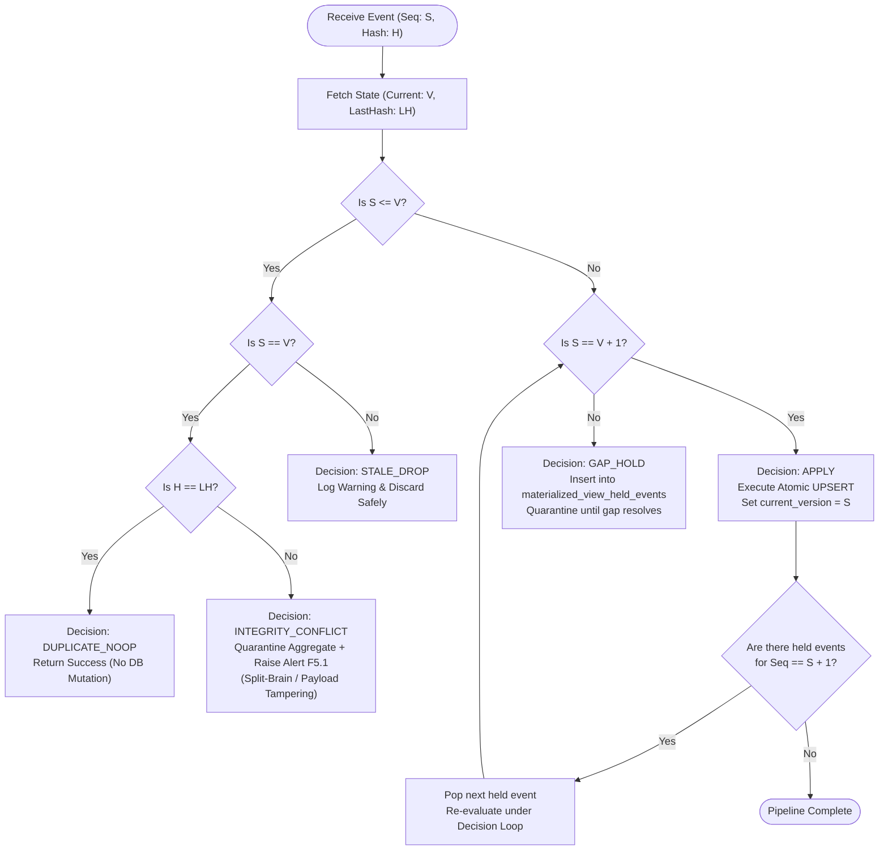
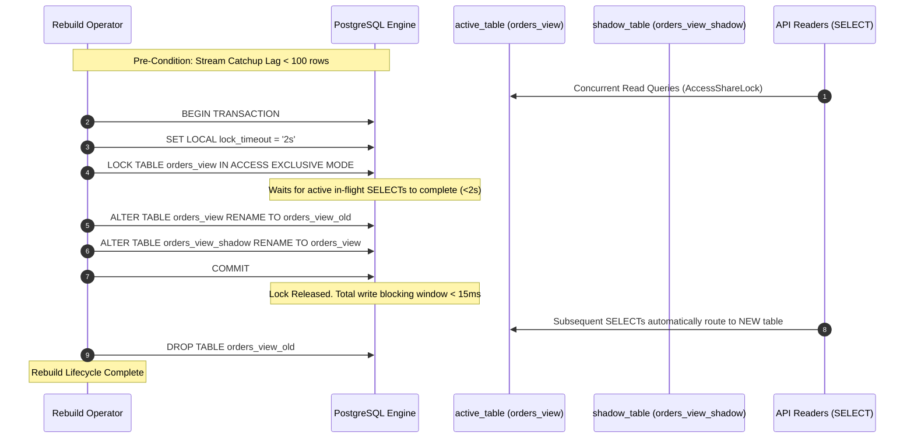
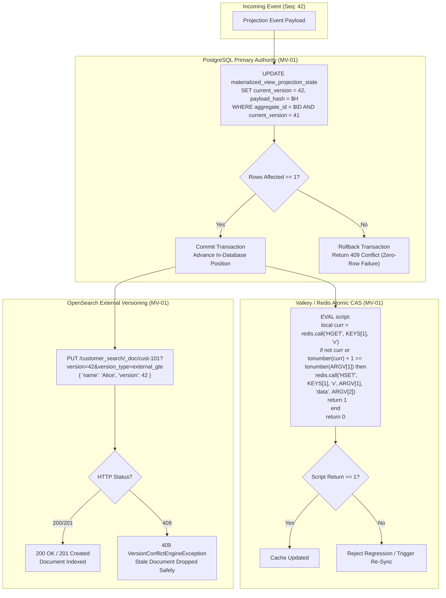

# Architectural Decision Record: Materialized Views, Projection Monotonicity & Zero-Downtime Rebuilds (WP-13)

## 1. Title & Metadata
* **Status**: APPROVED
* **Date**: 2026-11-06
* **Decision Makers**: Platform Architecture Guild, Data Infrastructure Board, Chief Distributed Systems Architect
* **Governing Specification**: [Materialized Views Production System Design Tree (v2)](file:///home/btpl-lap-22/live/System-Architect/event-driven-platform/docs/features/materialized-views/business-logic.md)

---

## 2. Context & Problem Statement
In event-driven architectures, read models and materialized views are decoupled from write models. Events stream from Kafka or transactional outbox logs into projection handlers that maintain denormalized read views. Without strict architectural controls, this decoupling introduces critical vulnerabilities:

1. **Out-of-Order / Backward State Overwrites (MV-01, CORRUPT)**: Events arriving out of order (due to transient network partitions, consumer group rebalances, or parallel retries) can cause an older event version (e.g., sequence 2) to overwrite a newer materialized projection (e.g., sequence 5), silently rolling back aggregate state.
2. **Silent Failure on Zero-Row Updates (MV-02, CORRUPT)**: Standard SQL UPDATE statements return success even when 0 rows match the conditional WHERE clause. Treating a zero-row update as a success masks concurrent race conditions and causes silent data drift.
3. **Dual-Write Inconsistencies Across Derived Stores (MV-04, MV-05, DRIFT)**: Materialized views often fan out to multiple query stores (PostgreSQL relational tables, Redis key-value caches, OpenSearch full-text indices). Dual-writing to secondary stores without an authoritative primary store leads to irreconcilable divergence when network hiccups occur.
4. **Catastrophic Rebuild Downtime (MV-10, OUTAGE)**: Truncating or dropping an active view table to rebuild it from historical event streams causes catastrophic query outages for API consumers during the entire duration of the backfill (which can take hours or days for large topics).
5. **Phantom / Unquarantined Event Gaps (F3.2, CORRUPT)**: If event sequence 3 is missed and event sequence 4 arrives, applying sequence 4 directly produces corrupt aggregations (such as balance calculations or delta rollups). Gaps must be detected and quarantined until missing sequences arrive or timeouts expire.
6. **GDPR / Tenant Erasure Leaks (MV-11, COMPLIANCE)**: If views store plaintext tenant data without cryptographic isolation or tenant-scoped lifecycle boundaries, crypto-shredding on the primary event store leaves zombie personal data in read models.

---

## 3. Decision Drivers & Architecture Invariants (MV-01 to MV-12)

* **MV-01: Every write is version-guarded by the store that holds the data [Certain]**:
  Every projection update evaluates aggregate sequence monotonicity: `new_version == current_version + 1`. Regression attempts (`new_version < current_version`) are rejected.
* **MV-02: Zero-row update results are failures, never silent success [Certain]**:
  Conditional atomic updates verify that exactly 1 row was updated. A 0-row return is mapped to an explicit concurrency conflict error and retried or quarantined.
* **MV-03: Dedupe, guard, mutation, and position are atomic per store [Certain]**:
  Within PostgreSQL, projection state mutation, version check, idempotency hash verification, and cursor advancement are executed in a single atomic transaction.
* **MV-04: One authoritative primary store per view [Certain]**:
  Every materialized view designates exactly one primary store (PostgreSQL) as the source of truth. Secondary query targets are derived.
* **MV-05: Derived stores (Redis/OpenSearch) are disposable and rebuilt from primary [Certain]**:
  Redis and OpenSearch are never treated as independent authorities. If a derived index drifts, it is wiped and re-projected from the primary view tables.
* **MV-06: Every view defines its consistency mode (Eventual, Token-Bounded, Strict-Serial) [Certain]**:
  API callers receive explicit consistency contracts. Token-bounded views support read-your-own-writes via monotonic version tokens (`cv_tok_{view}_{seq}`).
* **MV-07: Projections are strictly deterministic functions of event payloads [Certain]**:
  Projection handlers contain zero external I/O, zero random generation, and zero system clock dependencies. The same sequence of events produces byte-for-byte identical projections.
* **MV-08: Views never write back to write models [Certain]**:
  Unidirectional data flow is strictly enforced. Read models never emit domain command mutations back to transactional write tables.
* **MV-09: Freshness is explicit and measured against SLO [Certain]**:
  Each view registry record defines `freshness_slo_ms`. Materialization lag exceeding the SLO triggers metric alerts and degrades the view status.
* **MV-10: View rebuilds use zero-downtime blue/green swap [Certain]**:
  Rebuilding a view populates a shadow table (`{view_name}_shadow`) in the background via historical replay + stream catchup. Once caught up to target LSN, an atomic table rename or pointer swap switches live queries with zero query downtime.
* **MV-11: Views are tenant-scoped and cryptographic-erasure aware [Certain]**:
  All tables enforce composite tenant keys `(tenant_id, id)`. Cryptographic shredding invalidates projection keys immediately.
* **MV-12: Materialized view definitions are versioned code [Certain]**:
  Schema migrations and projection transformations are managed via versioned migration scripts and OpenAPI contracts.

---

## 4. Considered Alternatives

### Alternative A: Postgres Native Materialized Views (`REFRESH MATERIALIZED VIEW CONCURRENTLY`)
* **Pros**: Native database feature; simple SQL syntax.
* **Cons**: Blocks writes or locks tables during refresh; cannot handle high-throughput streaming events from Kafka; requires unique index on all columns; cannot fan out to Redis or OpenSearch; no gap quarantine capability.
* **Decision**: REJECTED.

### Alternative B: Direct Dual-Writing from Consumer Handlers to Postgres + Redis + OpenSearch
* **Pros**: No separate replication pipeline.
* **Cons**: Non-atomic dual writes create partial failure modes; network timeout to OpenSearch leaves Postgres updated and search out-of-sync; rebuilds require replaying to all three targets simultaneously.
* **Decision**: REJECTED in favor of Authoritative Primary Store with Outbox / Changefeed Replication (`MV-04`, `MV-05`).

### Alternative C: Hexagonal Application-Managed Materialized Views with Blue/Green State Machine
* **Pros**: Application enforces version monotonicity, deterministic hashing, gap quarantine, and zero-downtime shadow table promotion; primary store provides transactional safety; derived stores are reliably backfilled.
* **Cons**: Requires dedicated state tracking tables (`materialized_view_projection_state`, `materialized_view_rebuild_log`).
* **Decision**: ADOPTED.

---

## 5. Consequences

### Positive Consequences
* Absolute projection integrity: stale events are dropped, duplicates are no-ops, and gaps are quarantined.
* Zero downtime during view re-indexing and schema evolution via the 5-phase blue/green state machine.
* Clear read-your-own-writes guarantees via token-bounded consistency.
* Polyglot storage readiness (PostgreSQL, Redis, OpenSearch) without dual-write corruption.

### Negative Consequences / Operational Trade-Offs
* Additional storage overhead for projection version records and held event quarantine queues.
* Rebuild execution requires temporary 2x storage footprint for shadow tables until old tables are decommissioned.

---

## 6. Detailed Architectural Decision Models & Interaction Blueprints

### 6.1 Version Monotonicity & Quarantine Decision Logic (§5)
Every projection mutation must pass through the deterministic decision matrix prior to acquiring a database write lock:

### 6.2 Zero-Downtime Blue/Green Table Rename DDL Sequence (MV-10)
To avoid blocking concurrent queries during view schema migration or backfills, the table promotion step runs in an explicit short-lived transaction with a 2-second lock timeout:

### 6.3 Polyglot Storage Guarding Mechanics (MV-01, MV-04, MV-05)
Derived stores must enforce identical monotonicity without independent authority:

---

## 7. Operational Defenses & Verification

* **Full Diagram Inventory**: Complete 9-diagram operational suite is cataloged in [Materialized Views Diagrams](file:///home/btpl-lap-22/live/System-Architect/event-driven-platform/docs/features/materialized-views/diagrams.md).
* **Failure Catalog**: Complete 18-scenario forensic catalog is maintained in [Materialized Views Failure Cases](file:///home/btpl-lap-22/live/System-Architect/event-driven-platform/docs/features/materialized-views/failure-cases.md).
* **CI Verification Gate**: Every commit verifies version monotonicity guards, state machine transitions, and zero inline comments.

## Amendment 2026-11-07: Duplicate-view 409, unknown-view 404, and per-tenant rebuild uniqueness

### Problem observed
- Registering a duplicate view or starting a duplicate rebuild returned `400` carrying a raw constraint name.
- `POST /api/v1/materialized-views/query` for an unknown view returned `200` with `version 0`, indistinguishable from an empty-but-real view.

### Root cause
- RC2: unique violations went through the generic `database.MapDatabaseError`, which produced a class-23 message including the constraint name.
- RC3/RC4: `QueryViewWithConsistencyToken` never checked that the view exists.

### Decision / fix
- `mapUniqueViolation` in the Postgres adapter converts SQLSTATE 23505 into a conflict `ApplicationError` (409) with domain messages: "a materialized view with this view_name is already registered for the tenant" (`RegisterView`) and "a rebuild with this rebuild_id already exists" (`InitiateRebuild`). Other errors keep using `MapDatabaseError`.
- `QueryViewWithConsistencyToken` validates `tenant_id` and `view_name` non-empty (400), then calls `GetViewByName`, so an unknown view returns 404.
- Uniqueness facts: `materialized_view_registry.view_name` is already `UNIQUE (tenant_id, view_name)` (an earlier claim that it was global was wrong). `materialized_view_rebuild_log.rebuild_id` was globally unique (migration 0015), which let one tenant block another.
- **Migration 0028** (`database/migrations/sql/0028_scope_partitioning_and_rebuild_uniqueness_per_tenant.sql`, with `.rollback.sql`) changes it to `UNIQUE (tenant_id, rebuild_id)` (constraint `uk_materialized_view_rebuild_log_tenant_rebuild_id`, replacing `uk_materialized_view_rebuild_log_rebuild_id`); it also scopes two partitioning constraints (see partitioning-strategy). Reversible, lock risk LOW, schema only. **NOT applied to the live database** (`serve` does not run migrations; the live DB has no `schema_migrations` table) - apply through the migration tooling. Rollback re-adds global uniqueness and fails if tenants already share a rebuild_id.

### API-visible behavior change
Duplicate view/rebuild `400` -> `409`; unknown view query `200 version 0` -> `404` (**breaking** for clients that polled until the view appeared); missing tenant/view `400`.

### Verification
Live: duplicate view -> 409; unknown view query -> 404. Unit test `TestQueryViewUnknownViewIsNotFound` in `src/features/materialized-views/tests/materialized_views_query_unit_test.go`.

### Remaining gaps
The rebuild-duplicate 409 and the 0028 constraint change are unverified against live Postgres (migration not applied; no Postgres-backed CI test). Until 0028 is applied, a rebuild_id collision across tenants still conflicts.

## Amendment 2026-11-07 (second pass): migration 0028 applied

Migration 0028 was applied to the live dev database: `materialized_view_rebuild_log.rebuild_id` is now unique per `(tenant_id, rebuild_id)`. Verified for partitioning topics (two tenants registered the same `topic_name`).

Verified live on the compose-deployed image (`chiefj/event-driven-platform:v2`) and by unit tests; see ADR-0002 "Closed in a second pass".
