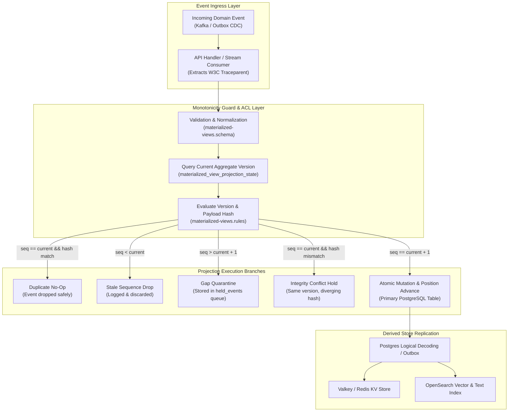
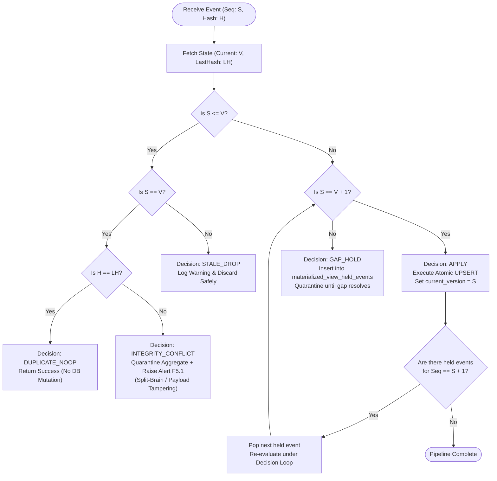
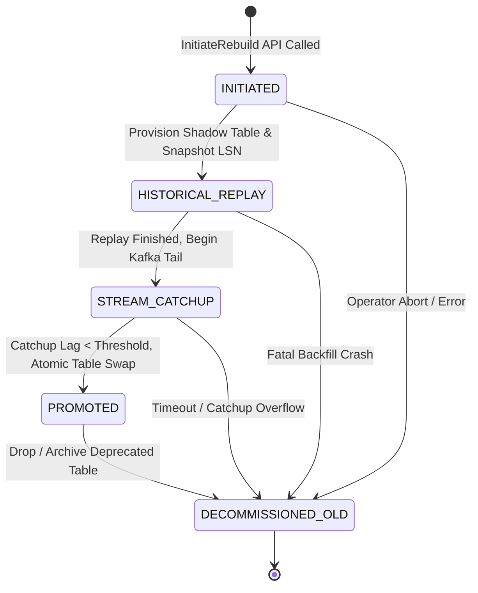
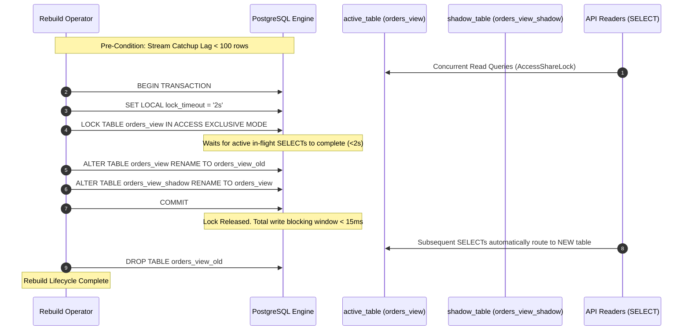
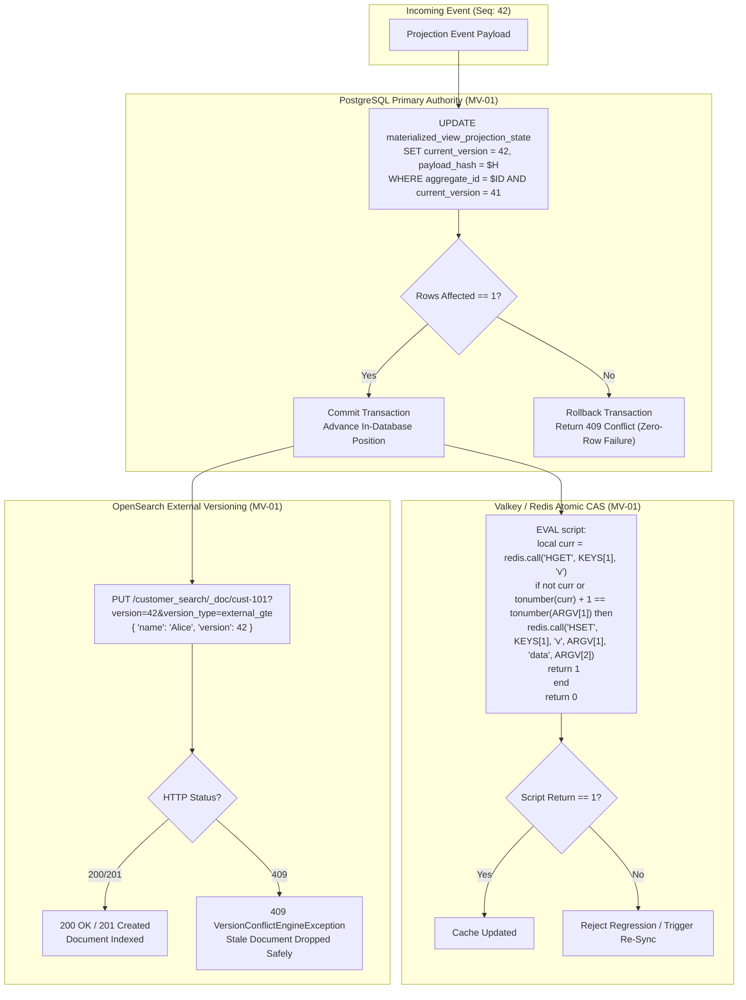
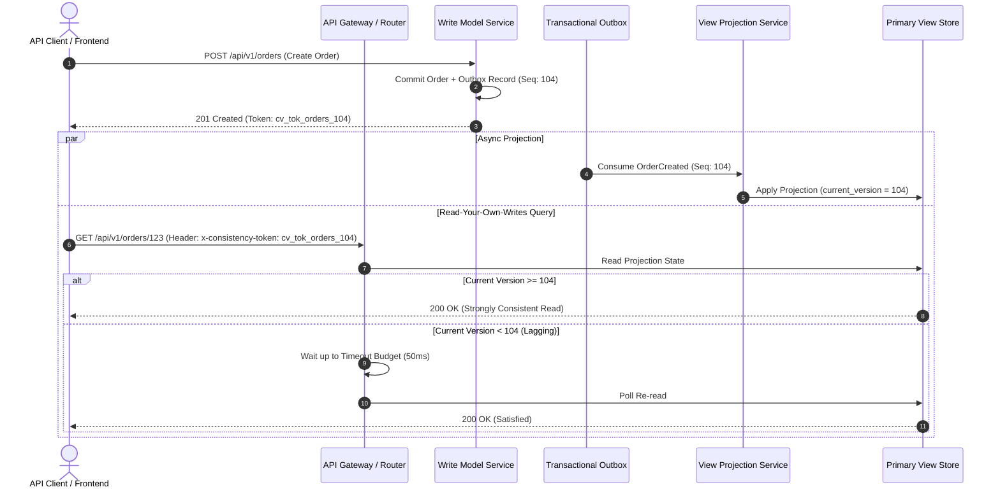
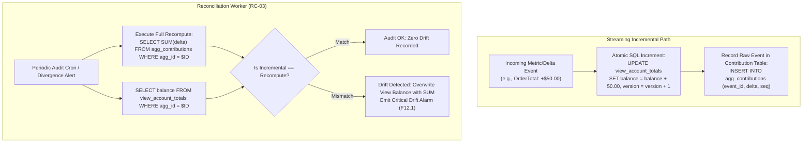
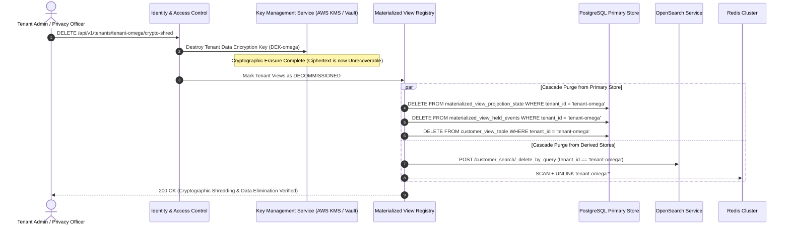
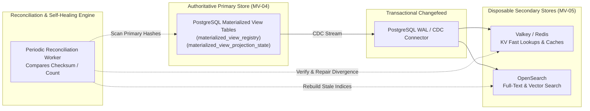

# Materialized Views Architecture & Execution Diagrams (WP-13)

This document contains Mermaid diagrams illustrating the runtime architectures, decision engines, state machines, polyglot storage guards, and zero-downtime cutover mechanics of the Materialized Views system per the [Materialized Views Business Logic Specification](file:///home/btpl-lap-22/live/System-Architect/event-driven-platform/docs/features/materialized-views/business-logic.md).

---

## 1. End-to-End View Projection Pipeline

---

## 2. Version Monotonicity & Gap Quarantine Decision Tree (§5)

---

## 3. Blue/Green View Rebuild State Machine (MV-10)

---

## 4. Atomic PostgreSQL Blue/Green Table Swap Execution Sequence

---

## 5. Polyglot Store Concurrency & External Versioning Mechanics

---

## 6. Consistency Tokens & Read-Your-Own-Writes Flow (§9)

---

## 7. V-AGG Delta Rollup vs Contribution Table Reconciliation DAG (§7.2, RC-03)

---

## 8. Multi-Tenant Cryptographic Shredding Cascade (MV-11, MT-09)

---

## 9. Polyglot Target Fan-Out & Reconciliation Architecture

