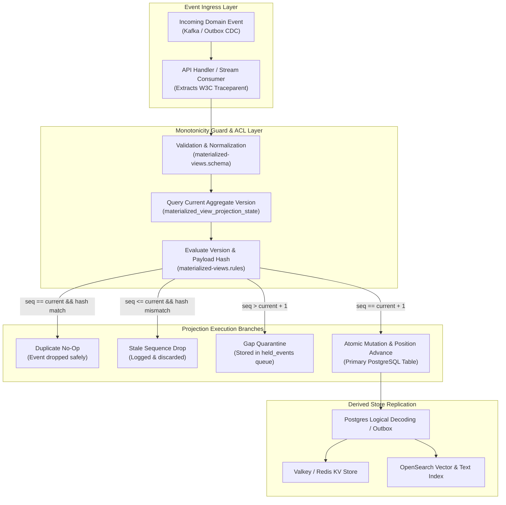
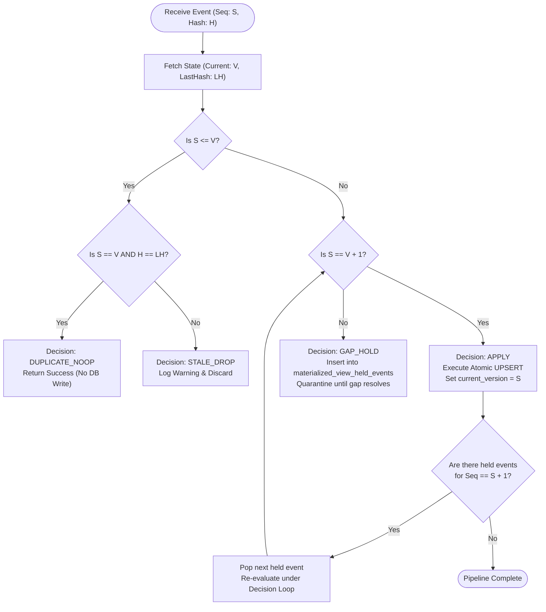
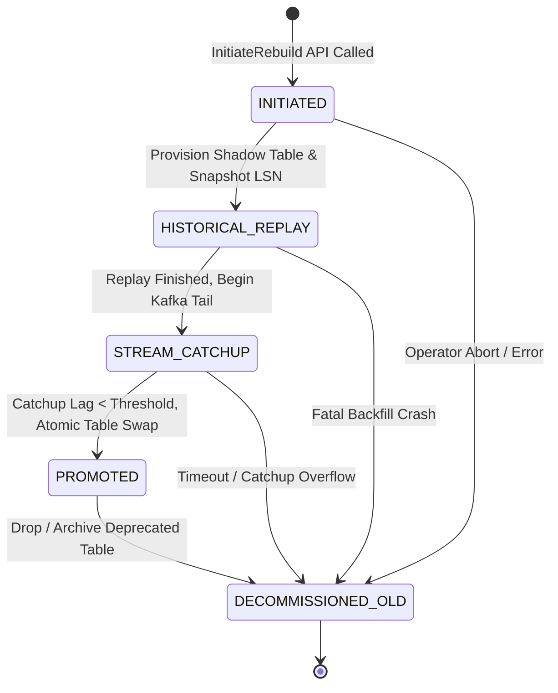
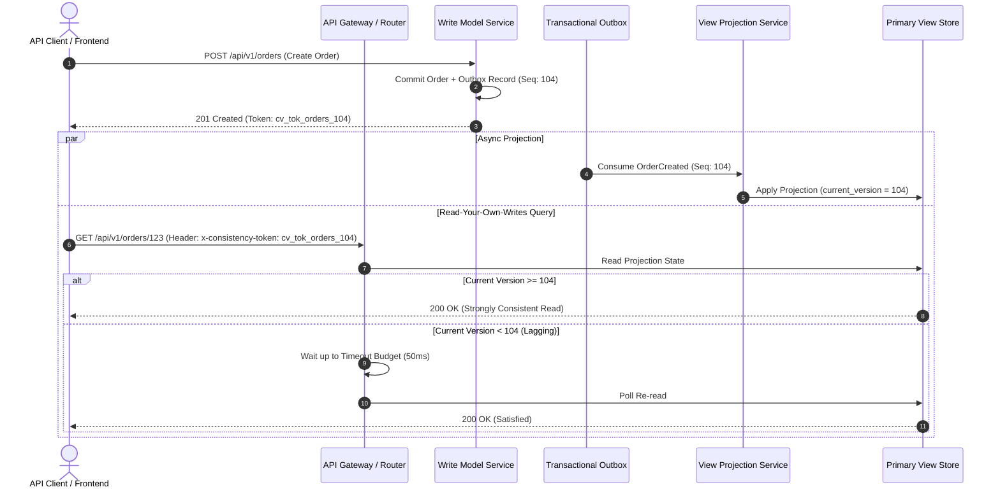
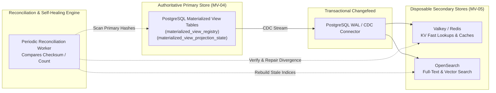

# Materialized Views Architecture & Execution Diagrams (WP-13)

This document contains Mermaid diagrams illustrating the runtime architectures, decision engines, state machines, and consistency models of the Materialized Views system.

---

## 1. End-to-End View Projection Pipeline

---

## 2. Version Monotonicity & Gap Quarantine Decision Tree

---

## 3. Blue/Green View Rebuild State Machine (MV-10)

---

## 4. Consistency Tokens & Read-Your-Own-Writes Flow

---

## 5. Polyglot Target Fan-Out & Reconciliation Architecture

