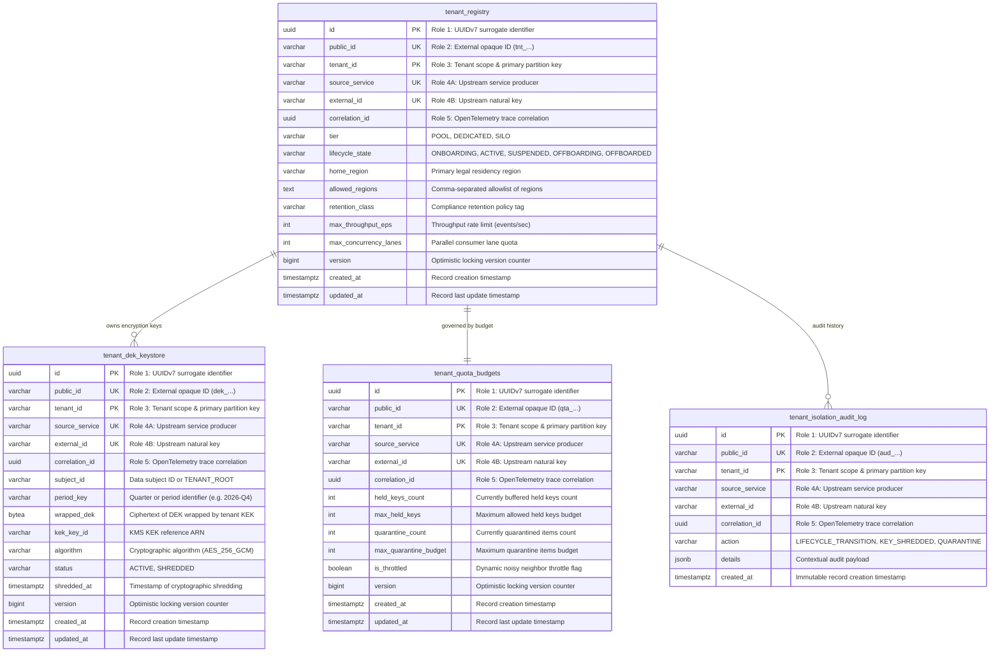

# Architectural Decision Record: Multi-Tenant Event Isolation & Cryptographic Shredding (WP-10)

## 1. Title & Metadata
* **Status**: APPROVED
* **Date**: 2026-11-06
* **Decision Makers**: Platform Security Guild, Data Governance Board, Chief Distributed Systems Architect
* **Governing Specification**: [Multi-Tenant Event Isolation Production System Design Tree (v2)](file:///home/btpl-lap-22/live/System-Architect/event-driven-platform/docs/features/multi-tenant-event-isolation/business-logic.md)

---

## 2. Context & Problem Statement
In an enterprise multi-tenant event-driven platform handling heterogeneous customer workloads across shared Kafka clusters and PostgreSQL databases, treating multi-tenancy as an informal application convention creates critical platform hazards:

1. **Cross-Tenant Data Bleed via Ambient Context Re-use (F3.2, SECURITY)**: Long-running worker goroutines or connection pools that cache or inherit tenant context across messages inevitably process tenant B's records within tenant A's security context. This causes projection writes to overwrite competing customer data and side-effects to dispatch to incorrect recipients.
2. **Client-Supplied Tenant Header Spoofing (F3.1, SECURITY)**: Trusting unauthenticated or client-provided HTTP/Kafka headers allows malicious or buggy clients to spoof tenant identities, accessing or corrupting competitor aggregate streams.
3. **Noisy Neighbor Starvation & Partition Saturation (F4.2, F7.1, OUTAGE / DEGRADE)**: Without application-level fairness budgets and quota throttling, a single enterprise tenant executing a bulk CSV import or batch migration floods shared Kafka partitions, starving latency-sensitive tenants sharing those partitions.
4. **GDPR/CCPA Erasure Impossibility on Immutable Logs (F10.1, COMPLIANCE)**: Kafka topics and event-sourced ledgers are strictly append-only and immutable. Naively attempting to rewrite multi-terabyte topic partitions to satisfy a single user's "Right to be Forgotten" destroys stream continuity and ordering.
5. **Data Residency and Sovereignty Violations (F8.1, F8.2, COMPLIANCE)**: Mirroring pooled topics across cloud regions for disaster recovery without strict residency filters replicates EU or Swiss tenant data into unauthorized jurisdictions, triggering severe regulatory penalties.
6. **Zombie Data Resurrection on Offboarded Tenants (F6.3, COMPLIANCE)**: Processing late-arriving messages or replaying historical streams for terminated customer accounts resurrects deleted customer records in projections after contractual offboarding.

---

## 3. Decision Drivers & Architecture Invariants (MT-01 to MT-13)

* **MT-01: Tenant Identity is Server-Derived and Immutable per Event [Certain]**:
  Caller-supplied headers are strictly untrusted. The tenant context is extracted from authenticated server-side JWT/OAuth principal claims at the API gateway and stamped into aggregate write transactions.
* **MT-02: Tenant Identity is Triple-Checked Across Envelope [Certain]**:
  Before any event is committed to the outbox or processed by consumers:
  $$\text{Header Tenant} == \text{Partition Key Prefix} == \text{Payload Tenant Field}$$
  Any disagreement immediately fails the transaction or quarantines the message.
* **MT-03: Every Event has Exactly One Owning Tenant [Certain]**:
  Multi-tenant events never share ownership. Cross-tenant interactions (e.g. transfers, marketplace transactions) are modeled as distinct, decoupled events per participating tenant.
* **MT-04: Zero Silent Drops [Certain]**:
  Mismatched or unrecognized tenant events are never dropped silently. They are routed directly to the `INTEGRITY-TENANT` quarantine dead-letter queue with a security alert dispatched to SIEM.
* **MT-05: Per-Record Tenant Scope [Certain]**:
  Ambient context reuse (goroutine-local or thread-local storage) is banned. Every record dynamically constructs an immutable `TenantContext` passed explicitly down the call stack.
* **MT-06: Every Derived Store is Tenant-Scoped [Certain]**:
  Every database table, cache key, and search index includes `tenant_id` as the primary discriminator. Cache keys are strictly prefixed (`tnt:<tenant_id>:<key>`), and database tables declare composite foreign keys on `(tenant_id, id)`.
* **MT-07: Isolation is Defense in Depth [Certain]**:
  Every read path enforces at least two independent security controls: application query scoping plus PostgreSQL Row-Level Security (`RLS`).
* **MT-08: Data Residency is a Placement Constraint [Certain]**:
  Tenants specify a home region and an allowed region set. Ingress verification immediately rejects events routed to disallowed regions.
* **MT-09: Personal Data is Encrypted per Data Subject [Certain]**:
  PII fields are encrypted under a data-subject Data Encryption Key (DEK). Kafka keys and headers must only contain non-personal, opaque identifiers.
* **MT-10: Erasure Covers Every Plaintext Copy [Certain]**:
  Shredding the subject or tenant key must be accompanied by active cache invalidation and derived store tombstoning.
* **MT-11: Fairness Quotas Protect Shared Capacity [Certain]**:
  Noisy tenants are throttled at ingress using token-bucket rate limits and held-key budgets without pausing shared topic partitions for other tenants.
* **MT-12: Tenant IDs are Never Reused [Certain]**:
  Offboarded tenant IDs are permanently tombstoned in the registry state machine. Re-registering an offboarded ID is strictly rejected.
* **MT-13: Tier Moves are Stream Migrations [Certain]**:
  Promoting a tenant from `M-POOL` to `M-DEDICATED` uses dual-publishing and version-based cutover runbooks, never in-place configuration flips.

---

## 4. Tenancy Models Decision Matrix

| Criterion | M-POOL (Pooled) | M-DEDICATED (Dedicated Topics) | M-SILO (Isolated Cluster / DB) |
| :--- | :--- | :--- | :--- |
| **Topology** | Shared topics, shared consumer groups | Dedicated topics per aggregate stream (`t.<tenant>.<domain>.<agg>.v1`) | Dedicated Kafka cluster, dedicated DB instance |
| **Placement Target** | Standard multi-tenant SaaS accounts | High-throughput VIPs, custom retention contracts | Strict banking regulations, health sovereignty (HIPAA, FINMA) |
| **Ordering Scope** | Aggregate-level via composite key | Dedicated partition stream per tenant | Completely air-gapped stream |
| **Cost / Overhead** | Lowest infrastructure footprint | Moderate (grows topic and partition metadata) | Highest (dedicated physical/virtual infrastructure) |
| **Noisy Neighbor Defense**| Application-level lane budgets & quotas | Partition isolation & dedicated consumer groups | Hardware and network capacity isolation |

---

## 5. Real-World Enterprise Use Cases

### 5.1 Use Case 1: Cross-Tenant Spoofing Prevention in B2B SaaS
* **Scenario**: A malicious user authenticated as Tenant A attempts to emit an `OrderCreated` event with Tenant B's UUID in the JSON body, aiming to inject rogue inventory charges.
* **Resolution**: The `VerifyIngressEnvelope` gate extracts the authenticated token claims (`Tenant A`), inspects the partition key prefix (`Tenant A`), and parses the payload body (`Tenant B`). Detecting a mismatch ($A \ne B$), it fails closed: the transaction is aborted, the event is rejected with `ErrTenantHeaderPayloadMismatch` (HTTP 403), and an `INTEGRITY_MISMATCH_QUARANTINE` entry is written to `tenant_isolation_audit_log`.

### 5.2 Use Case 2: Cryptographic Right-to-be-Forgotten Shredding (GDPR Article 17)
* **Scenario**: An end-user requests complete erasure of their personal identity across a 5-year immutable Kafka event stream containing billions of historical records.
* **Resolution**: Rather than rewriting immutable Kafka log segments, the platform leverages field-level encryption. The user's PII fields (name, SSN, email) were encrypted at ingress using a wrapped Data Encryption Key (`tenant_dek_keystore`) uniquely assigned to `(tenant_id, subject_id, period_key)`. Upon receiving the verified erasure request, the service calls `ShredSubjectDEK`:
  1. The key status is flipped to `SHREDDED`, `wrapped_dek` is cleared to empty bytes, and `shredded_at` is timestamped.
  2. Local memory DEK caches are immediately flushed.
  3. Subsequent replays or consumers attempting to decrypt the ciphertext receive the canonical `[ERASED]` byte marker without throwing deserialization errors.

### 5.3 Use Case 3: Noisy Neighbor Throttling During Flash Sale Bulk Ingest
* **Scenario**: Tenant A launches a midnight flash sale, generating 15,000 events/sec on pooled topic partitions shared with 200 other enterprise tenants.
* **Resolution**: Tenant A's quota budget (`tenant_quota_budgets`) defines a maximum throughput of 2,500 EPS and a maximum held-key buffer of 1,000 keys. As Tenant A exceeds its quota, `EvaluateQuotaBudget` flips `is_throttled = true`. Only Tenant A's incoming requests are throttled with HTTP 429 / backpressure held-keys. Crucially, Kafka partitions continue streaming at full speed for Tenants B through Z.

### 5.4 Use Case 4: Permanent Offboarding & Tombstoning
* **Scenario**: A customer terminates their contract and offboards from the platform. Two weeks later, a misconfigured upstream webhook emits a late billing event for the old tenant.
* **Resolution**: The tenant's registry lifecycle state was transitioned `ACTIVE` $\rightarrow$ `OFFBOARDING` $\rightarrow$ `OFFBOARDED`. The `TenantLifecycleMachine` permanently tombstones the ID. `EvaluateLifecycleState` detects `OFFBOARDED` and returns `ErrTenantOffboarded`. The event is discarded with audit logging, preventing late data from resurrecting the terminated tenant in production read models.

---

## 6. How It Works: End-to-End Architecture

```
[ Ingress Request ] ──▶ [ Ingress Gate ] ──▶ [ Staging & Outbox ] ──▶ [ Kafka Transport ] ──▶ [ Consumer Ingest ]
      │                         │                     │                        │                      │
 Authenticated             Server-stamped       Triple-Check             Composite Key:         Per-Record Scope
 Principal Claims          Tenant Context       (Hdr=Key=Payload)        tenant:aggregate       Isolation Guard
```

1. **Ingress & Verification Gate**:
   - The edge gateway extracts verified identity claims.
   - `NormalizeRegisterTenantInput` and `NormalizeVerifyEnvelopeInput` clean and canonicalize input fields, rejecting empty or unescaped strings.
   - Ingress checks verify data residency against `allowed_regions`.
2. **Outbox Staging (`C-OBX`)**:
   - The producer queries the aggregate record in PostgreSQL to verify tenant ownership.
   - Stamping sets `tenant_id` on the outbox row in the same transaction as the business state mutation.
3. **Kafka Partitioning**:
   - The partition key is constructed using `tenant_id` + `separator` + `aggregate_id`.
   - Never keyed by `tenant_id` alone, preventing hot partition skew while maintaining strict aggregate sequence ordering.
4. **Consumer Runtime Isolation (`C-RT`)**:
   - When consuming a message batch, each record creates an independent, isolated `TenantContext`.
   - The consumer verifies that `header.tenant_id == key.tenant_id == payload.tenant_id`.
   - All projection writes explicitly append `WHERE tenant_id = :scope_tenant`.

---

## 7. Cryptographic Key Hierarchy

```
┌────────────────────────────────────────────────────────┐
│ Tenant KEK (Master Key in KMS / HSM)                   │
│   • Managed in tenant's home region                    │
│   • Rotated annually; never leaves KMS hardware        │
└───────────────────────────┬────────────────────────────┘
                            │
                            │ Wraps / Decrypts
                            ▼
┌────────────────────────────────────────────────────────┐
│ Data Subject / Period DEK (tenant_dek_keystore)        │
│   • Stored as wrapped ciphertext in PostgreSQL         │
│   • Uniquely assigned per (tenant_id, subject_id, Qtr) │
│   • Cached in consumer memory for 10 minutes max       │
└───────────────────────────┬────────────────────────────┘
                            │
                            │ Encrypts / Decrypts
                            ▼
┌────────────────────────────────────────────────────────┐
│ Payload PII Fields (AES-256-GCM)                       │
│   • Only personal fields encrypted in JSON envelope    │
│   • Non-PII envelope stays clear for stream routing    │
│   • Shredding DEK yields [ERASED] without exceptions   │
└────────────────────────────────────────────────────────┘
```

---

## 8. Storage Gate Contract & Migration 0012

Complies strictly with [05-db-writing-rules.md](file:///home/btpl-lap-22/live/System-Architect/llm-obs-policies/rules/folder-structure/05-db-writing-rules.md) and [01-schema-migrations-and-code-guidelines.md](file:///home/btpl-lap-22/live/System-Architect/llm-obs-policies/rules/database/migrations/01-schema-migrations-and-code-guidelines.md).

### 8.1 The 5 Identifier Roles Mapping
1. **Role 1 (Surrogate PK)**: UUIDv7 generated internally (`id`). Immutable.
2. **Role 2 (Public ID)**: Regex-constrained external strings (`tnt_...` for registry, `dek_...` for keys, `qta_...` for budgets, `aud_...` for audits).
3. **Role 3 (Tenant Scope)**: `tenant_id` leading composite primary keys and unique indices.
4. **Role 4 (Natural Upstream Key)**: Composite unique constraint on `(tenant_id, source_service, external_id)` with `btrim` validation.
5. **Role 5 (Correlation Trace)**: `correlation_id` UUID propagated from upstream OpenTelemetry trace context. Immutable.

### 8.2 Entity-Relationship Diagram



---

## 9. Verification & Compliance Evidence
1. **Zero Comment Doctrine**: All source code strictly maintains zero inline comments (`//`).
2. **Tiered Tests**:
   - Tier 1: Pure domain rules verification (`tenant_rules_test.go`).
   - Tier 2: Deterministic lifecycle state machine (`tenant_lifecycle_machine_test.go`).
   - Tier 3: PostgreSQL check constraints, RLS, and cryptographic shredding integration (`tenant_isolation_integration_test.go`).
   - Tier 4: Concurrent interleaved worker lanes guaranteeing zero ambient bleed (`tenant_concurrency_interleaving_test.go`).
3. **OpenAPI 3.1 Parity**: 37 routes synchronized and verified across HTTP routers and OpenAPI definitions.


## Amendment 2026-11-07: Correct status codes for tenant registration and lifecycle

### Problem observed
- `POST /api/v1/tenants` with an invalid tier returned `500`.
- `PUT /api/v1/tenants/{tenant_id}/lifecycle` for an unknown tenant returned `500`; with an unknown `target_state` it returned `409` (as if a valid-but-forbidden transition).

### Root cause
RC1/RC2: the handler mapped errors with a status guess instead of reading the typed `ApplicationError` (wrapped errors defeated a bare assertion), tier validity was left to the database, and `TenantLifecycleMachine.Transition` checked the transition table without first checking that the target state exists, so garbage looked like a forbidden transition.

### Decision / fix
- `mapTenantError` uses `errors.As` on `*ApplicationError` and returns its status and canonical code; anything else is a generic 500. The handler reads the tenant id from `r.PathValue("tenant_id")` (matches the registered route).
- `Transition` first rejects a target not in {ONBOARDING, ACTIVE, SUSPENDED, OFFBOARDING, OFFBOARDED} with a validation error (400), then applies the existing transition rules (still 409 for valid-but-illegal moves).
- Invalid tier -> validation 400; unknown tenant on lifecycle update -> 404.

### API-visible behavior change
Invalid tier `500` -> `400`; lifecycle unknown tenant `500` -> `404`; unknown `target_state` `409` -> `400`. Illegal-but-known transitions remain `409`.

### Verification
Live re-test confirmed all three. Unit tests: `src/features/multi-tenant-event-isolation/tests/tenant_lifecycle_machine_test.go` and `src/api/rest/v1/handlers/multi_tenant_handler_test.go` (`TestMapTenantError`).

### Remaining gaps
`POST /api/v1/tenants/verify-envelope` still passes for a SUSPENDED tenant (not fixed). HTTP-level coverage is limited to the error-mapping test.
