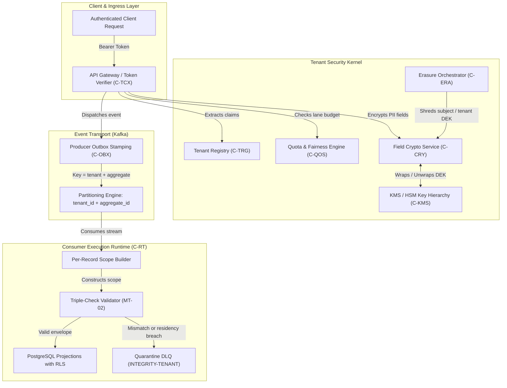
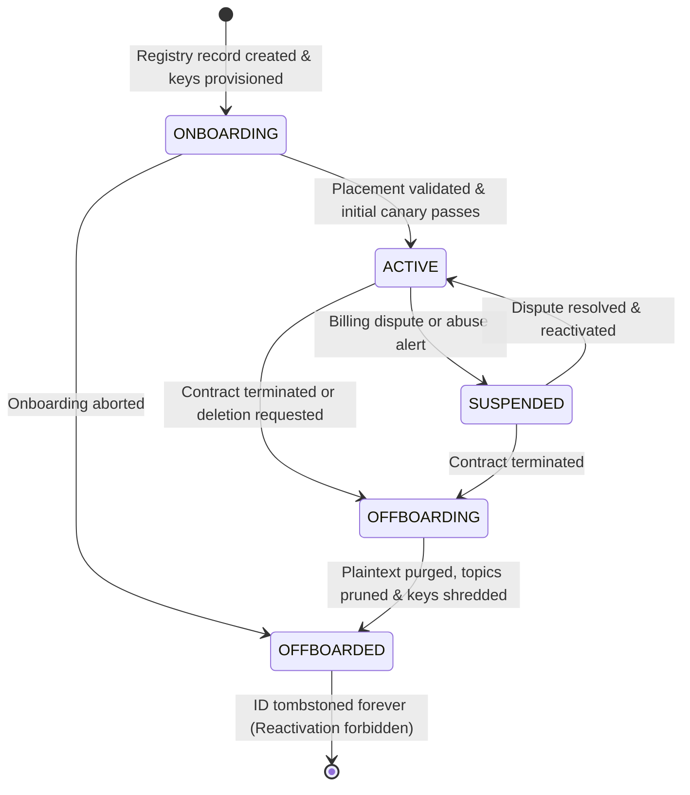
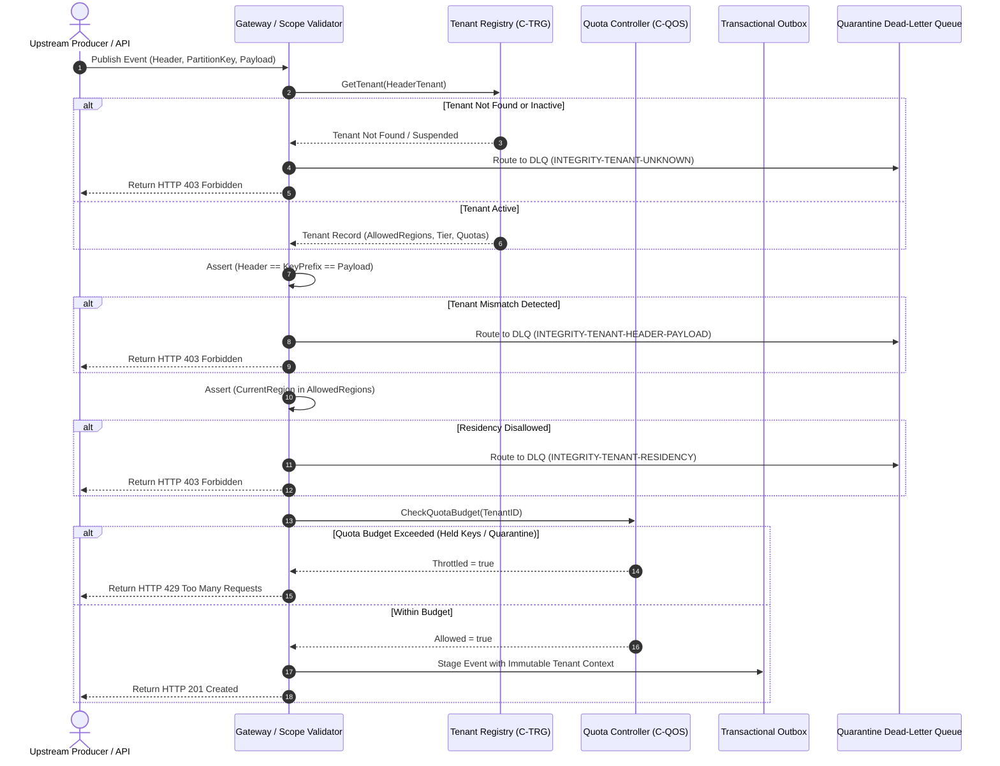
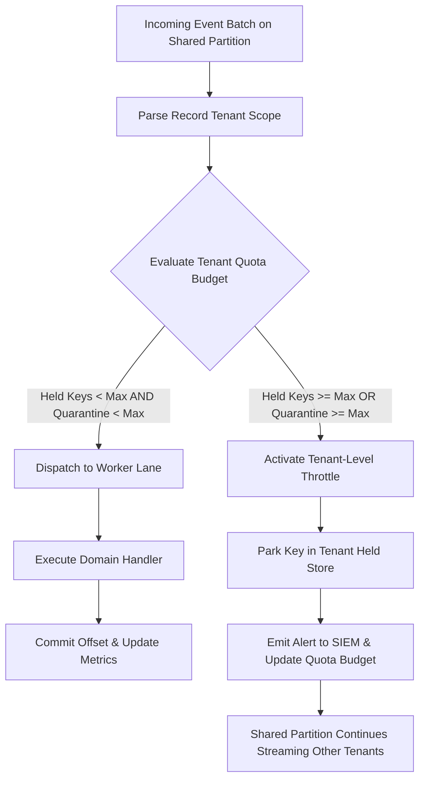
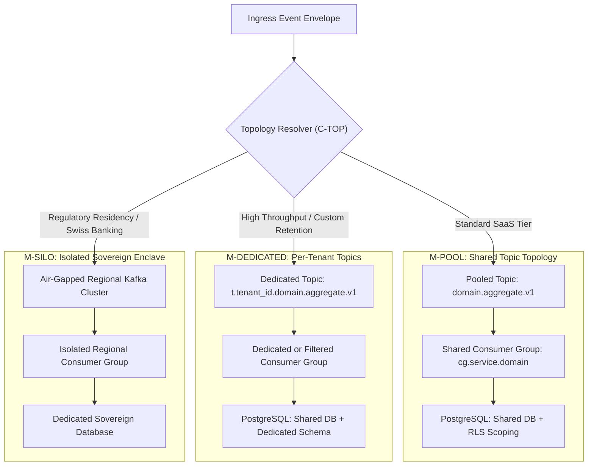
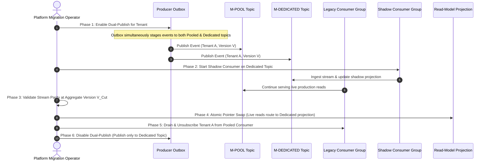
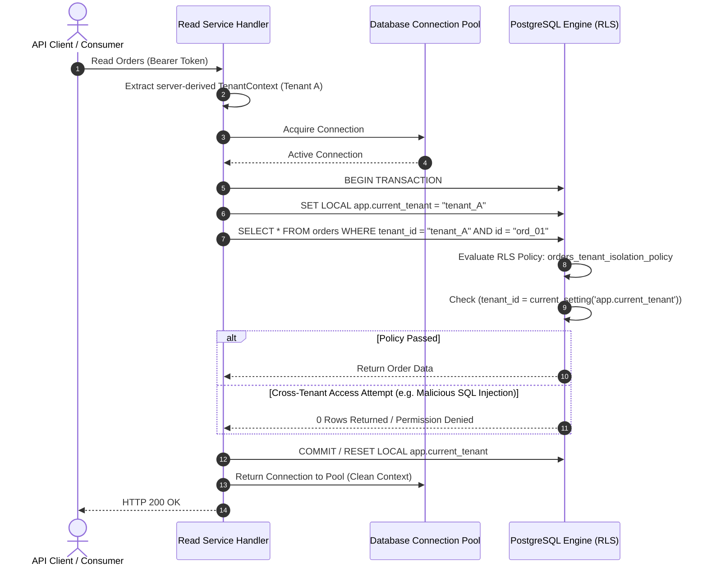

# Multi-Tenant Event Isolation — Architecture Diagrams & Workflows

This document visualizes the core architecture, runtime lifecycles, cryptographic key management, and noisy-neighbor quota enforcement of the Multi-Tenant Event Isolation subsystem.

---

## 1. High-Level Component Interaction Map

The Multi-Tenant Event Isolation engine enforces strict boundary isolation at every stage of ingestion, transport, consumption, and storage.



---

## 2. Tenant Lifecycle State Machine

The tenant lifecycle is governed by a deterministic finite state machine (`MT-12`). Once a tenant reaches `OFFBOARDED`, its ID is permanently tombstoned to prevent data resurrection.



---

## 3. Ingress Envelope Triple-Check Verification Flow

Every incoming event must satisfy the invariant: `Header Tenant == Key Prefix Tenant == Payload Tenant`. Mismatches trigger immediate fail-closed quarantine.



---

## 4. Cryptographic Key Shredding & Right-to-be-Forgotten Flow

This sequence visualizes GDPR Right-to-be-Forgotten execution on an immutable append-only event stream using field-level encryption.

```mermaid
sequenceDiagram
    autonumber
    actor User as Data Subject (End-User)
    participant Orchestrator as Erasure Orchestrator (C-ERA)
    participant Keystore as Tenant DEK Keystore (C-KMS)
    participant Cache as Consumer Memory DEK Cache
    participant Stream as Kafka Historical Replay / Consumer

    User->>Orchestrator: Submit GDPR Erasure Request (subject_id)
    Orchestrator->>Orchestrator: Verify identity, retention rules & legal holds
    
    Orchestrator->>Keystore: ShredSubjectDEK(tenant_id, subject_id, period_key)
    Keystore->>Keystore: Set status = "SHREDDED", clear wrapped_dek
    Keystore-->>Orchestrator: Key Shredded Confirmation
    
    Orchestrator->>Cache: Broadcast InvalidateCache(tenant_id, subject_id)
    Cache->>Cache: Flush local memory DEK entry
    
    Note over Stream,Keystore: Future Historical Replay of Encrypted Event
    Stream->>Cache: FetchPlaintextDEK(tenant_id, subject_id)
    Cache-->>Stream: Cache Miss
    Stream->>Keystore: GetDEK(tenant_id, subject_id)
    Keystore-->>Stream: Status = "SHREDDED"
    Stream->>Stream: Return [ERASED] byte marker
    Stream->>Stream: Deserialization succeeds; PII safely omitted
```

---

## 5. Noisy-Neighbor Fair Queueing & Dynamic Throttling Flow

Shared partitions serve multiple tenants simultaneously. When a rogue tenant saturates capacity, only that tenant is throttled while others continue processing without interruption.



---

## 6. Tenancy Model Topology & Routing

The platform dynamically routes event streams across three distinct topology models based on customer tier, contractual isolation, and data sovereignty requirements.



---

## 7. Stream Tier Migration Cutover Workflow (MT-13)

Migrating a tenant from `M-POOL` to `M-DEDICATED` without stopping live traffic, dropping events, or breaking partition ordering requires a version-based cutover runbook.



---

## 8. Defense-in-Depth Read Path & PostgreSQL RLS Enforcement

Every database read transaction enforces defense in depth (`MT-07`): application-level query scoping combined with PostgreSQL session-scoped Row-Level Security (`RLS`).



---

## 9. Binary Encrypted Event Envelope Architecture

To balance event streaming observability with strict GDPR right-to-be-forgotten shredding, envelopes separate non-personal routing headers from field-level encrypted payloads.

```
┌────────────────────────────────────────────────────────────────────────┐
│ PUBLIC CLEAR ENVELOPE (Stream Routing & Filtering)                     │
├────────────────────────────────────────────────────────────────────────┤
│ • event_id:       "019302bf-9c76-78e2-b13e-108781628172" (UUIDv7)     │
│ • tenant_id:      "tenant_enterprise_01"                              │
│ • aggregate_id:   "ord_9876543210" (Opaque external ID)                │
│ • aggregate_type: "order"                                              │
│ • aggregate_seq:  4                                                    │
│ • event_type:     "OrderCompleted"                                     │
│ • schema_version: "1.2.0"                                              │
│ • correlation_id: "019302bf-9c76-78e2-b13e-108781628173"              │
│ • occurred_at:    "2026-11-06T10:15:00Z"                               │
├────────────────────────────────────────────────────────────────────────┤
│ CRYPTOGRAPHIC KEY METADATA                                             │
├────────────────────────────────────────────────────────────────────────┤
│ • subject_id:     "usr_sub_109283" (End-user ID)                       │
│ • period_key:     "2026-Q4"                                            │
│ • dek_key_id:     "dek_019302bf9c7678e2b13e"                           │
│ • algorithm:      "AES_256_GCM"                                        │
├────────────────────────────────────────────────────────────────────────┤
│ ENCRYPTED FIELD PAYLOAD                                                │
├────────────────────────────────────────────────────────────────────────┤
│ {                                                                      │
│   "order_total_cents": 15000,                                          │
│   "currency": "USD",                                                   │
│   "customer_pii": "CIPHERTEXT(nonce=12B, tag=16B, data=AES_GCM(...))" │
│ }                                                                      │
│                                                                        │
│ ──▶ Upon Subject DEK Shredding:                                        │
│     "customer_pii" ──▶ "[ERASED]"                                      │
└────────────────────────────────────────────────────────────────────────┘
```


