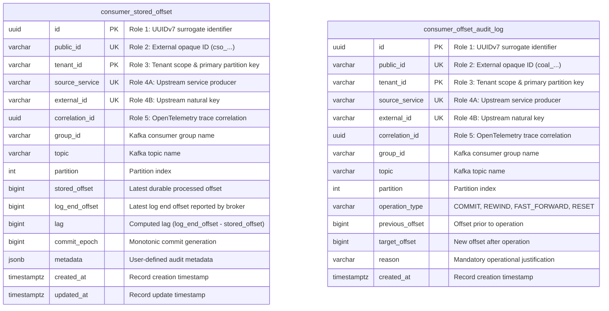
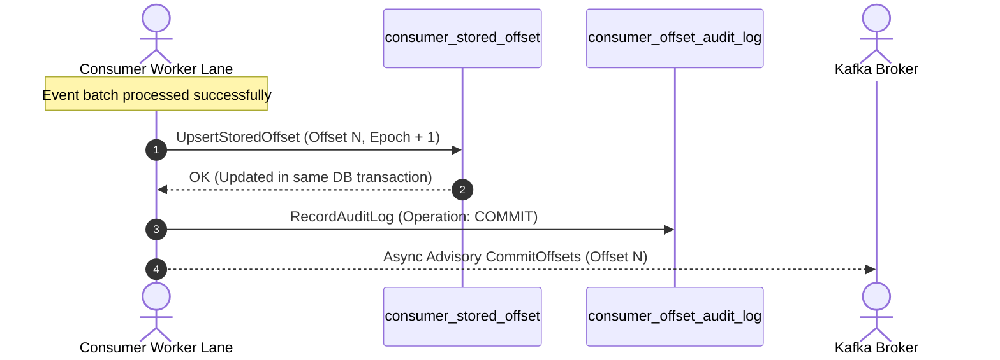
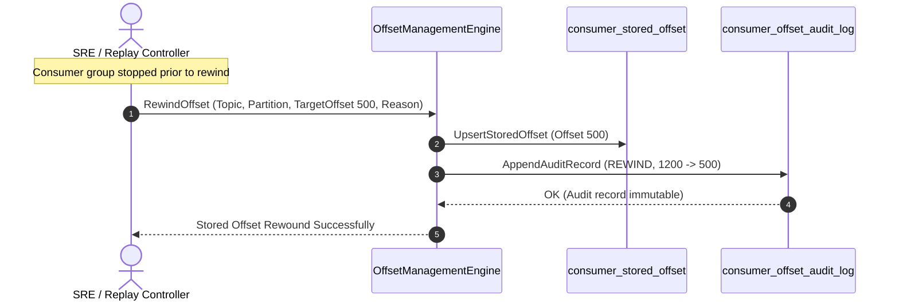

# Architectural Decision Record: Authoritative Stored Offset Management & Drift Remediation (WP-7)

## 1. Title & Metadata
* **Status**: APPROVED
* **Date**: 2026-11-04
* **Decision Makers**: Platform Architecture Guild, Chief Distributed Systems Architect
* **Governing Specification**: [Offset Management Decision Tree](file:///home/btpl-lap-22/live/System-Architect/event-driven-platform/docs/features/offset-management/business-logic.md)

---

## 2. Context & Problem Statement
In distributed event streaming architectures, naive reliance on Kafka's internal `__consumer_offsets` topic creates severe operational hazards:
1. **Auto-Commit Data Loss**: Default Kafka consumer configurations with `enable.auto.commit = true` commit offsets on periodic background timers. If a pod crashes mid-batch, uncommitted records are silently skipped upon consumer restart, resulting in permanent data loss.
2. **Advisory Offset Drift**: Offsets committed to Kafka brokers are decoupled from relational database transactions. If a worker commits mutations to Postgres and is terminated before the Kafka offset commit completes, duplicate processing occurs upon rebalance.
3. **Poison Batch Partition Lockups**: When an unprocessable corrupted payload halts a worker lane, standard consumers stall indefinitely or crash loop. Operational teams require a deterministic, auditable mechanism to fast-forward past poison batches without broker-level hacks.
4. **Historical State Replay**: For disaster recovery or downstream schema migrations, consumers must rewind offsets to arbitrary historical coordinates while strictly maintaining tenant isolation and auditability.

---

## 3. Decision Drivers & Architecture Invariants
* **Invariant OM-01 (Strict Ban on Auto-Commit)**: `enable.auto.commit` is permanently set to `false`. Offsets advance strictly via manual, atomic commit-after-process semantics.
* **Invariant OM-02 (Authoritative Stored Offsets in Database)**: Partition offsets are persisted directly in `consumer_stored_offset` within the same database transaction that applies business effects. Kafka broker commits are strictly advisory.
* **Invariant OM-03 (Monotonic Commit Epoch & Zero Regression)**: Routine commits must strictly advance (`new_offset >= current_offset`). Decreasing an offset requires an explicit administrative rewind command with audit logging.
* **Invariant OM-04 (Append-Only Audit Ledger)**: Every administrative rewind, fast-forward, and routine commit writes to `consumer_offset_audit_log`, protected by immutability triggers.
* **Invariant OM-05 (Multi-Tier Lag Drift Detection)**: Partition lag ($L = \text{LogEndOffset} - \text{StoredOffset}$) is monitored with 3 operational tiers:
  - `HEALTHY`: $L < 1,000$ (Steady state)
  - `SURGE`: $L \ge 10,000$ with active progress (Triggers consumer scale-out)
  - `STALLED`: $L \ge 10,000$ with $0\text{ msg/sec}$ throughput (Triggers P1 stall alert)

---

## 4. Entity-Relationship Data Model & Database Writing Rules
Complies strictly with [05-db-writing-rules.md](file:///home/btpl-lap-22/live/System-Architect/llm-obs-policies/rules/folder-structure/05-db-writing-rules.md):

---

## 5. Execution Sequence Diagrams

### 5.1 Atomic Commit-After-Process

### 5.2 Administrative Rewind for Historical Replay

---

## 6. Consequences & Trade-offs
### Positive
* **Zero Message Loss**: Banning auto-commit guarantees that failed records are never marked committed.
* **Exact Drift Visibility**: SRE dashboards calculate lag directly from durable database state rather than broker cache drift.
* **Emergency Unblocking**: Poison batches can be bypassed via verified fast-forward without broker restarts.

### Negative & Mitigations
* **Write Amplification**: Every batch updates `consumer_stored_offset`. *Mitigation*: Piggybacked directly onto existing business database transactions.
