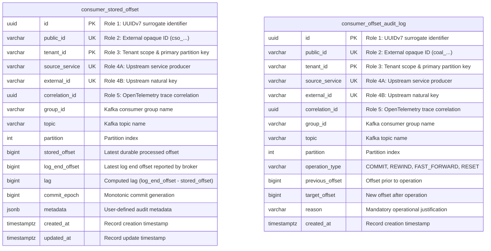
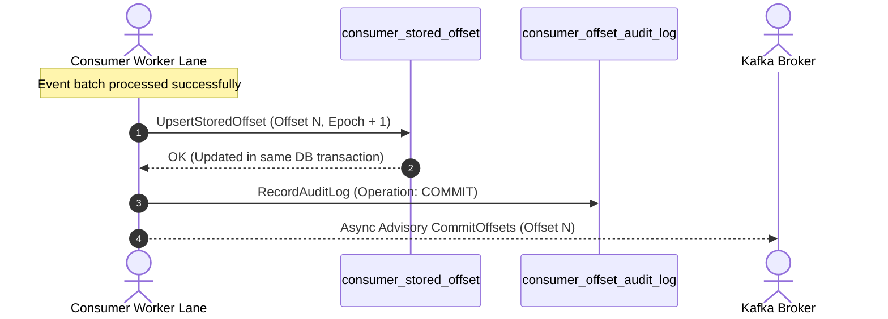
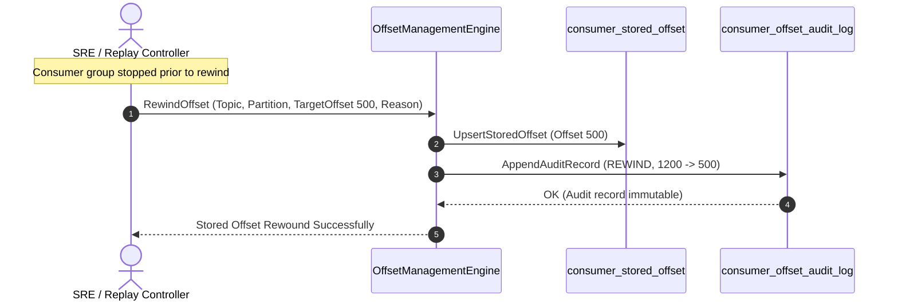

# Architectural Decision Record: Authoritative Stored Offset Management & Drift Remediation (WP-7)

## 1. Title & Metadata
* **Status**: APPROVED
* **Date**: 2026-11-04
* **Decision Makers**: Platform Architecture Guild, Chief Distributed Systems Architect
* **Governing Specification**: [Offset Management Decision Tree](file:///home/btpl-lap-22/live/System-Architect/event-driven-platform/docs/features/offset-management/business-logic.md)

---

## 2. Context & Problem Statement
In distributed event streaming architectures, naive reliance on Kafka's internal `__consumer_offsets` topic creates severe operational hazards:
1. **Auto-Commit Data Loss**: Default Kafka consumer configurations with `enable.auto.commit = true` commit offsets on periodic background timers. If a pod crashes mid-batch, uncommitted records are silently skipped upon consumer restart, resulting in permanent data loss.
2. **Advisory Offset Drift**: Offsets committed to Kafka brokers are decoupled from relational database transactions. If a worker commits mutations to Postgres and is terminated before the Kafka offset commit completes, duplicate processing occurs upon rebalance.
3. **Poison Batch Partition Lockups**: When an unprocessable corrupted payload halts a worker lane, standard consumers stall indefinitely or crash loop. Operational teams require a deterministic, auditable mechanism to fast-forward past poison batches without broker-level hacks.
4. **Historical State Replay**: For disaster recovery or downstream schema migrations, consumers must rewind offsets to arbitrary historical coordinates while strictly maintaining tenant isolation and auditability.

---

## 3. Decision Drivers & Architecture Invariants
* **Invariant OM-01 (Strict Ban on Auto-Commit)**: `enable.auto.commit` is permanently set to `false`. Offsets advance strictly via manual, atomic commit-after-process semantics.
* **Invariant OM-02 (Authoritative Stored Offsets in Database)**: Partition offsets are persisted directly in `consumer_stored_offset` within the same database transaction that applies business effects. Kafka broker commits are strictly advisory.
* **Invariant OM-03 (Monotonic Commit Epoch & Zero Regression)**: Routine commits must strictly advance (`new_offset >= current_offset`). Decreasing an offset requires an explicit administrative rewind command with audit logging.
* **Invariant OM-04 (Append-Only Audit Ledger)**: Every administrative rewind, fast-forward, and routine commit writes to `consumer_offset_audit_log`, protected by immutability triggers.
* **Invariant OM-05 (Multi-Tier Lag Drift Detection)**: Partition lag ($L = \text{LogEndOffset} - \text{StoredOffset}$) is monitored with 3 operational tiers:
  - `HEALTHY`: $L < 1,000$ (Steady state)
  - `SURGE`: $L \ge 10,000$ with active progress (Triggers consumer scale-out)
  - `STALLED`: $L \ge 10,000$ with $0\text{ msg/sec}$ throughput (Triggers P1 stall alert)

---

## 4. Entity-Relationship Data Model & Database Writing Rules
Complies strictly with [05-db-writing-rules.md](file:///home/btpl-lap-22/live/System-Architect/llm-obs-policies/rules/folder-structure/05-db-writing-rules.md):

---

## 5. Execution Sequence Diagrams

### 5.1 Atomic Commit-After-Process

### 5.2 Administrative Rewind for Historical Replay

---

## 6. Consequences & Trade-offs
### Positive
* **Zero Message Loss**: Banning auto-commit guarantees that failed records are never marked committed.
* **Exact Drift Visibility**: SRE dashboards calculate lag directly from durable database state rather than broker cache drift.
* **Emergency Unblocking**: Poison batches can be bypassed via verified fast-forward without broker restarts.

### Negative & Mitigations
* **Write Amplification**: Every batch updates `consumer_stored_offset`. *Mitigation*: Piggybacked directly onto existing business database transactions.

---

## Deep Failure-First Architectural Principles

### 1. Existential Purpose & The Catastrophe Prevented

Kafka consumers track their position in the commit log using Offsets. If a consumer commits offsets automatically on a background timer (auto-commit), it will commit offsets for messages that are still in-memory; when the consumer crashes, those messages are lost forever. Conversely, failing to commit offsets causes consumers to re-read thousands of already-processed messages upon restart.

### 2. Internal Algorithmic Mechanics & State Invariants

The platform enforces strict Post-Processing Offset Commits. After a consumer processes an event and successfully commits the database mutation, it records the new offset in the local database and asynchronously commits it to Kafka's internal __consumer_offsets topic. Commits must be strictly monotonically increasing; backward commits are rejected as corrupted rebalances unless an authorized replay action is active.

### 3. Core Architectural Principles

* **Post-Effect Offset Commits**: Partition offsets are committed only AFTER the business transaction has safely committed to the database, ensuring zero data loss.
* **Strictly Monotonic Progression**: Offset progression must strictly increase ($O_{\text{new}} > O_{\text{current}}$); backward mutations fail as corrupted commits.
* **Epoch-Fenced Rebalance Protection**: Offset commits must validate consumer generation epochs, preventing stale partition owners from overwriting commits of newly assigned consumers.
* **Dual-Store Transaction Synchronization**: Offsets are anchored atomically inside the local transactional database alongside the event effect, and mirrored to Kafka for lag tracking.

### 4. The Architect's Meta-Questions (Failure-First Evaluation)

1. **Why is auto-commit (enable.auto.commit=true) banned in high-reliability financial systems? (Auto-commit runs on an arbitrary timer independent of business logic completion, guaranteeing silent data loss during worker crashes).**
2. **What happens during a consumer group rebalance if an offset commit is delayed? (The consumer group coordinator uses Generation Epochs to reject stale commits from zombie consumers, preventing split-brain state overwrites).**
3. **Why do we store offsets in both PostgreSQL and Kafka? (Storing offsets in PostgreSQL allows atomic commit with the business mutation; syncing to Kafka allows standard cluster monitoring tools to track consumer lag accurately).**

---

## Authoritative References & Production Citations

* **[Apache Kafka Offsets Topic Architecture & Consumer Internals](https://kafka.apache.org/documentation/#impl_offsettracking)**
  - *Architectural Rationale & Implementation Grounding*: Technical reference detailing how Kafka manages partition commit logs in the internal `__consumer_offsets` topic.
* **[Kafka KIP-62: Allow Consumer to Commit Specific Offset Ranges](https://cwiki.apache.org/confluence/display/KAFKA/KIP-62)**
  - *Architectural Rationale & Implementation Grounding*: Apache Kafka improvement proposal addressing precision offset management, manual commit control, and rebalance coordination.
* **[Gunnar Morling: Exactly-Once Processing in Kafka with Debezium and Outbox](https://debezium.io/blog/2019/02/19/reliable-microservices-data-exchange-with-the-outbox-pattern/)**
  - *Architectural Rationale & Implementation Grounding*: Architectural analysis of coordinating database state with streaming offsets to achieve end-to-end consistency.
* **[Martin Kleppmann: Stream Processing - Offsets, Checkpoints and Replay](https://dataintensive.net/)**
  - *Architectural Rationale & Implementation Grounding*: Deep conceptual breakdown of log watermarking, checkpointing strategies, and fault recovery.

## Amendment 2026-11-07: Rewind invariants, input validation and lag route

### Problem observed
1. `POST /api/v1/offsets/rewind` accepted a target offset ahead of the stored offset (a forward jump disguised as a rewind) and accepted a rewind for a partition that had no stored offset.
2. `GET /api/v1/offsets/lag` was not registered (404/405 from the mux).
3. `POST /api/v1/offsets/commit` with blank ids, negative values or a non-UUID `correlationId` reached Postgres and returned raw `pq:` errors.

### Root cause
1. `RewindOffset` read the stored offset but ignored the error (`if err == nil && existing != nil`), defaulting `prevOffset` and `logEndOffset` to 0, and never compared the target with either (RC3, RC4 stub-like behavior).
2. The handler `HandleEvaluateLag` existed but the router never registered it (RC5).
3. Validation was delegated to Postgres types/CHECKs (RC2).

### Decision / fix
Rewind invariants now enforced in `OffsetManagementService.RewindOffset`, in this order:
1. Partition key valid (`tenantId`, `groupId`, `topic` non-empty with no leading/trailing whitespace; `partition >= 0`) and envelope valid (`sourceService`, `externalId` trimmed non-empty; `correlationId` a UUID) -> 400.
2. A stored offset must exist for the partition, otherwise the repository's not-found error is returned (404). Rewind never creates an offset.
3. `targetOffset <= stored offset`, else `ErrRewindForwardJump` surfaced as 400 ("use fast-forward to move forward").
4. `targetOffset <= logEndOffset`, else `ErrRewindBeyondLogEnd` as 400.
`CommitOffset` now validates the same key/envelope plus `0 <= offset <= logEndOffset` and `logEndOffset >= 0` before touching the repository (400). `ComputeFastForwardOffset` returns the sentinel `ErrInvalidFastForward` when `shiftBy <= 0`. Service-level validation was chosen over DB constraints so clients get clean 400s without constraint text.

`GET /api/v1/offsets/lag` is registered in `offset-management.router.go`. Parameters: `tenant_id` or `tenantId` (fallback header `X-Tenant-Id`), `group_id`/`groupId`, `topic` (all required, else 400), optional `partition` (non-negative integer, default 0), `rate` (default 1 per the verified facts).

### API-visible behavior change
- Rewind forward jump / beyond log end: accepted -> `400`; unknown partition: accepted -> `404` (**breaking** for callers that used rewind to seed or advance offsets).
- Commit invalid input: raw-pq error -> clean `400`.
- New endpoint `GET /api/v1/offsets/lag` (additive).

### Verification
Live: forward-jump and unknown-partition rewinds rejected; lag endpoint returned lag 90 for a seeded partition. Unit test `TestRewindAndCommitBounds` in `src/features/offset-management/tests/offset_bounds_test.go`.

### Remaining gaps
- The rewind precondition "consumer group must be stopped" (`ErrConsumerGroupMustBeStopped`) is defined in rules; this amendment did not verify that rewind enforces it.
- No HTTP-level tests for the router/handler.
