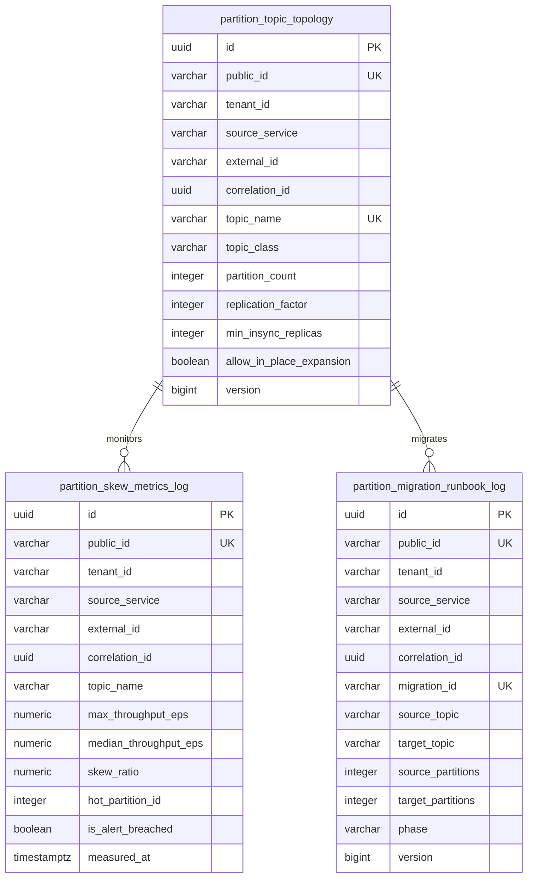

# Architectural Decision Record: Partitioning Strategy, Key Hashing Parity & Stream Migration (WP-12)

## 1. Title & Metadata
* **Status**: APPROVED
* **Date**: 2026-11-06
* **Decision Makers**: Platform Architecture Guild, Data Infrastructure Board, Chief Distributed Systems Architect
* **Governing Specification**: [Partitioning Strategy Production System Design Tree (v2)](file:///home/btpl-lap-22/live/System-Architect/event-driven-platform/docs/features/partitioning-strategy/business-logic.md)

---

## 2. Context & Problem Statement
In an event-driven architecture, Kafka topic partitioning is the foundation of horizontal scalability, parallelism, and per-entity ordering. However, treating partitioning as an informal infrastructure detail creates fatal operational and data consistency failure modes:

1. **Ordering Destruction via In-Place Partition Expansion (PT-04, CORRUPT)**: Kafka routes keyed records using hash modulo: $\text{partition} = \text{hash}(\text{key}) \pmod N$. Running `kafka-topics.sh --alter --partitions` changes $N$ in place. Subsequent events for an aggregate immediately hash to new partitions while earlier events remain unprocessed on old partitions. Downstream consumers consume events out-of-order, corrupting stateful aggregates and projections.
2. **Cross-Language Hashing Divergence (PT-01, CORRUPT)**: The Java Kafka producer defaults to Murmur2 with a 31-bit positive bitmask (`hash & 0x7fffffff`). Go (`librdkafka`), Python, and Node.js clients default to CRC32 unless explicitly configured. If disparate microservices publish to the same topic using default partitioners, identical aggregate keys resolve to different partitions, destroying ordering.
3. **Integer.MIN_VALUE Modulo Overflow (F3.2, CORRUPT)**: Naive partitioner implementations calculating `Math.abs(Murmur2(key)) % N` crash or produce negative partition indexes when the hash evaluates to `Integer.MIN_VALUE` (`-2147483648`), because `Math.abs(-2147483648) == -2147483648` in two's-complement 32-bit arithmetic.
4. **Hot-Partition Saturation / Celebrity Tenant Starvation (F2.3, F4.2, OUTAGE / DEGRADE)**: When partition keys possess low cardinality (e.g., partitioning strictly by `tenant_id` or `country_code`), high-volume tenants saturate a single broker and partition, causing consumer lag spikes, memory prefetch exhaustion, and consumer group rebalance storms.
5. **GDPR/CCPA Non-Compliance on Topic Keys (PT-08, F2.5, COMPLIANCE)**: Kafka partition keys are stored in unencrypted message metadata and retained indefinitely on compacted topics. Stamping PII (emails, phone numbers) into partition keys violates cryptographic shredding invariants (`MT-09`, `MT-10`).
6. **Co-Partitioning Incoherence in Stream Joins (PT-07, F7.1, CORRUPT)**: When stream-processing pipelines join multiple topics (e.g., orders joined with payments), any discrepancy in partition counts or hashing algorithms produces silent join mismatches.

---

## 3. Decision Drivers & Architecture Invariants (PT-01 to PT-10)

* **PT-01: Same Key $\rightarrow$ Same Partition Across All Clients and Languages [Certain]**:
  Every producer client in every language must implement canonical Murmur2 hashing with 31-bit positive masking. Cross-language affinity test vectors are enforced in CI.
* **PT-02: Key = Ordering Scope = Aggregate Identity [Certain]**:
  The partition key must uniquely represent the ordering domain aggregate (`tenant_id:aggregate_type:aggregate_id`). Random UUIDs, timestamps, or sequence counters are strictly rejected.
* **PT-03: Key Bytes are Stable for Aggregate Lifetime [Certain]**:
  Key format, character case, separator delimiters, and UTF-8 encoding remain immutable across an aggregate's lifecycle.
* **PT-04: Partition Count of Keyed Topics Never Changes in Place [Certain]**:
  Topics belonging to `K_ORDERED`, `K_COMPACTED`, or `K_COPART` classes enforce `allow_in_place_expansion = FALSE`. Capacity scaling requires blue/green topic migrations (`C-MIG`).
* **PT-05: One Aggregate is Never Split Across Partitions [Certain]**:
  Key salting or suffixing on ordered topics is banned. All events for an aggregate land on the exact same partition.
* **PT-06: Capacity is Sized for the Growth Horizon at Creation [Certain]**:
  Topic partition count is calculated based on empirical write/read baselines with a 2.5x peak burst multiplier and a 12-to-24-month forecast.
* **PT-07: Co-Partitioned Topics Share Partition Count and Partitioner [Certain]**:
  Joined topic sets must be provisioned with identical partition counts and identical Murmur2 hashing.
* **PT-08: Keys Carry Zero Personal Data (PII) [Certain]**:
  Partition keys must consist solely of opaque domain identifiers. Email addresses, phone numbers, and names are strictly rejected.
* **PT-09: Null Keys Permitted Exclusively on `K_UNORDERED` Topics [Certain]**:
  Keyed topics reject null or empty keys at the producer layer. Round-robin / sticky routing is restricted to un-ordered telemetry topics.
* **PT-10: Partition-Local State is Never Authoritative Across Layout Changes [Certain]**:
  Held-key caches, in-flight ordering buffers, and deduplication states are keyed by aggregate ID, never by partition ID.

---

## 4. Key Architectural Decisions

### 4.1 Topic Class Taxonomy & In-Place Expansion Lock

| Topic Class | Ordering Guarantee | Compaction Policy | In-Place Expansion Allowed? | Migration Mechanism |
| :--- | :--- | :--- | :--- | :--- |
| **`K_ORDERED`** | Strict per-aggregate ordering | Delete (time-based) | **NO (`allow_in_place_expansion = FALSE`)** | Blue/Green Migration Runbook (`C-MIG`) |
| **`K_COMPACTED`** | Latest state per aggregate key | Compact | **NO (`allow_in_place_expansion = FALSE`)** | Blue/Green Migration Runbook (`C-MIG`) |
| **`K_COPART`** | Stream join co-partitioning | Delete or Compact | **NO (`allow_in_place_expansion = FALSE`)** | Synchronized Multi-Topic Migration |
| **`K_UNORDERED`** | No ordering required (telemetry) | Delete | **YES (`allow_in_place_expansion = TRUE`)** | In-place partition addition permitted |

### 4.2 Murmur2 Hashing with 31-Bit Positive Bitmasking
To ensure 100% parity with Kafka's JVM reference implementation and prevent negative index crashes:
$$\text{raw\_hash} = \text{Murmur2}(\text{key\_bytes})$$
$$\text{positive\_hash} = \text{raw\_hash} \;\&\; \text{0x7fffffff}$$
$$\text{partition} = \text{positive\_hash} \pmod N$$
This explicitly avoids `Math.abs(-2147483648)` integer overflow.

### 4.3 Hot Partition & Skew Detection Engine
The skew monitor computes real-time partition throughput skew:
$$\text{skew\_ratio} = \frac{\text{throughput}_{\max}}{\text{throughput}_{\text{median}}}$$
* If $\text{skew\_ratio} \le 3.0$: Routing remains healthy (`MAINTAIN_CURRENT_ROUTING`).
* If $\text{skew\_ratio} > 3.0$: The system breaches `SKEW_ALERT` and mandates `ISOLATE_HOT_AGGREGATE_TO_DEDICATED_TOPIC`, preventing noisy neighbor degradation.

### 4.4 Blue/Green Stream Migration Runbook (`C-MIG`)
When a keyed topic reaches capacity, scaling is executed via a 6-phase state machine:
1. `PLANNED`: Target topic provisioned with higher partition count ($N_{\text{target}} > N_{\text{source}}$).
2. `PROVISIONING_TARGET`: Kafka topics created and validated for co-partitioning alignment.
3. `DUAL_PUBLISHING`: Outbox relay publishes to both source and target topics.
4. `DRAINING_SOURCE`: Upstream producers stop writing to source; consumers drain source lag to zero.
5. `CUTOVER`: Consumers switch consumer groups to target topic.
6. `DECOMMISSIONED`: Source topic archived and removed from routing registry.

---

## 5. Database Migration 0014 Schema

The physical persistence layer is codified in `0014_create_partitioning_strategy_tables.sql` and satisfies the 9-field migration header, 5 identifier roles, `btrim` check constraints, and immutability triggers:



---

## 6. REST API & OpenAPI 3.1 Parity

The Partitioning Strategy feature exposes 5 REST operations under `/api/v1/partitioning`:
1. `POST /api/v1/partitioning/topologies`: Register topic topology and enforce immutable partition expansion policies.
2. `POST /api/v1/partitioning/keys/calculate`: Calculate deterministic partition index, raw Murmur2 hash, and 31-bit positive mask for key bytes.
3. `POST /api/v1/partitioning/skew/evaluate`: Ingest per-partition telemetry, evaluate skew ratios, and trigger hot-key alerts.
4. `POST /api/v1/partitioning/migrations`: Initiate blue/green stream migration runbook in `PLANNED` state.
5. `PUT /api/v1/partitioning/migrations/phase`: Advance migration runbook phase with optimistic concurrency verification.

---

## 7. Verification & Test Strategy
* **Tier 1 (Unit Rules)**: Validates invariants `PT-01` through `PT-10`, PII pattern rejection, and topic class expansion policies.
* **Tier 2 (State Machine)**: Verifies valid stream migration phase transitions and terminal state permanence (`DECOMMISSIONED`).
* **Tier 3 (Murmur2 Affinity)**: Tests hash determinism, 31-bit positive bitmasking, and demonstrates key remapping risks under partition expansion.
* **Tier 4 (PostgreSQL Integration)**: Tests persistence, check constraints, optimistic locking, and immutability triggers against live PostgreSQL.

---

## Deep Failure-First Architectural Principles

### 1. Existential Purpose & The Catastrophe Prevented

Apache Kafka achieves horizontal throughput by splitting topics into partitions that run concurrently across different brokers. However, if events are partitioned randomly, total ordering for an entity is destroyed. Conversely, if all events share a single key or key distribution is heavily skewed, a single partition becomes a bottleneck (hot-spot), starving that broker while other nodes sit idle.

### 2. Internal Algorithmic Mechanics & State Invariants

The platform applies a deterministic Murmur2 hashing algorithm to the business partition key (e.g. hash(tenant_id + ':' + entity_id) % num_partitions). This guarantees two invariants: (1) All events for the same aggregate instance land on the exact same partition in linear order. (2) Events are uniformly distributed across the cluster. For high-volume hot entities, bounded pseudo-random salting is applied.

### 3. Core Architectural Principles & Systems Philosophy

#### Principle 1: Deterministic Causal Key Hash Sharding
* **Design Philosophy & Epistemology**:
  Kafka guarantees message order within a single partition, never across partitions. If events for the same entity are scattered across random partitions, causal order is destroyed. The philosophy is Deterministic Entity-Key Affinity: all events belonging to the same causal entity must hash to the exact same partition for their entire lifecycle.
* **Threat Vector Defeated**: Out-of-order state corruption where an OrderCancelled event is processed before an OrderPlaced event because they landed on different partitions.
* **Storage & State Invariant**:
```text
Partition = Murmur2(EntityKey) % TotalPartitionCount
All events for EntityKey mapped to identical partition index
```
* **Implementation Mechanism**:
  Producers strictly specify the entity's primary business identifier (e.g., `account_id`) as the message key. Kafka's default Murmur2 partitioner hashes the key to ensure strict single-partition FIFO serialization.
* **Non-Negotiable Trade-Off**: Throughput per entity is bounded by the processing speed of a single consumer reading that partition.

---

#### Principle 2: High-Cardinality Key Selection (Hot-Spot Prevention)
* **Design Philosophy & Epistemology**:
  Choosing a low-cardinality partitioning key (such as `country_code` or `status`) guarantees disastrous traffic skew: 80% of events route to the 'US' partition while other partitions sit idle. The philosophy is High-Entropy Cardinality: partitioning keys must have millions of distinct, evenly distributed values to spread load uniformly across the partition cluster.
* **Threat Vector Defeated**: Hot partition collapse where a single broker and consumer are overwhelmed with 90% of traffic while sibling partitions sit completely idle.
* **Storage & State Invariant**:
```text
Cardinality(PartitionKey) >> TotalPartitionCount
TrafficDistributionVariance across partitions <= 15%
```
* **Implementation Mechanism**:
  Architecture standards mandate high-cardinality keys (e.g., UUIDv7 `order_id`, `customer_id`). Linters reject low-cardinality enums as partition keys during CI code reviews.
* **Non-Negotiable Trade-Off**: Cross-entity aggregation queries cannot be satisfied from a single partition; cross-partition analytics require multi-partition consumers or stream-table joins.

---

#### Principle 3: Salted Sub-Partitioning for Mega-Tenants
* **Design Philosophy & Epistemology**:
  In B2B platforms, a mega-tenant (e.g., Walmart) can generate 100x more traffic than standard tenants. Routing all of Walmart's events to a single partition creates a massive processing bottleneck. The philosophy is Controlled Salting: for high-volume entities where causal ordering across distinct sub-flows is unnecessary, salt the key to distribute events across a fixed sub-pool of partitions.
* **Threat Vector Defeated**: Unavoidable partition saturation and lag explosion caused by enterprise mega-tenants outgrowing single-partition throughput limits.
* **Storage & State Invariant**:
```text
PartitionKey = TenantID || '_' || (Hash(SubEntityID) % SaltFactor)
Events for identical SubEntityID remain strictly ordered
```
* **Implementation Mechanism**:
  The producer checks if the entity exceeds high-volume thresholds. If true, it appends a deterministic salt: `tenant123_subItem456`. This distributes Walmart's events across 10 dedicated partitions while preserving order within each sub-item flow.
* **Non-Negotiable Trade-Off**: Loss of total global order across the entire tenant's event stream; order is preserved only within each salted sub-flow.

---

#### Principle 4: Topic Over-Partitioning Invariant
* **Design Philosophy & Epistemology**:
  Expanding the partition count of an active, keyed topic alters the Murmur2 hash modulo, scattering subsequent events for existing entities to new partitions and permanently destroying causal order. The philosophy is Upfront Over-Partitioning: calculate the 3-year peak horizontal scale requirement on Day 1 and provision that partition count from inception.
* **Threat Vector Defeated**: Permanent ordering corruption caused by increasing partition counts on live, active Kafka topics.
* **Storage & State Invariant**:
```text
PartitionCount(Topic) == Fixed Constant
InitialPartitions >= MaxAnticipatedConsumerInstances * 2
```
* **Implementation Mechanism**:
  Platform provisioning templates mandate sizing topics based on peak forecast (e.g., 30 or 60 partitions). Increasing partitions later is forbidden without a formal blue/green topic migration.
* **Non-Negotiable Trade-Off**: Slight memory and file-handle overhead on Kafka brokers for managing higher partition counts from Day 1.

### 4. The Architect's Meta-Questions (Failure-First Evaluation)

1. **Why is hashing on a timestamp (e.g., `YYYY-MM-DD-HH`) a catastrophic partitioning strategy?**
   * *Answer*: Hashing on a timestamp routes 100% of all platform traffic during that hour to a single partition, completely overloading one broker while all other partitions sit 100% idle. High-entropy entity IDs must be used instead.
2. **How does Kafka handle message ordering when a message is published without a key (key = null)?**
   * *Answer*: When key is null, Kafka's default partitioner uses sticky round-robin partitioning, distributing batches evenly across all partitions. This maximizes throughput but provides zero entity-level ordering guarantees.
3. **What is the maximum number of consumer pods that can parallelize work on a topic with 32 partitions?**
   * *Answer*: Exactly 32 consumer pods. Any additional consumer pods beyond 32 will sit completely idle, as Kafka assigns each partition to at most one consumer instance within a consumer group.

---
## Authoritative References & Production Citations

* **[Martin Kleppmann: Designing Data-Intensive Applications (Chapter 6: Partitioning)](https://dataintensive.net/)**
  - *Architectural Rationale & Implementation Grounding*: Definitive theoretical and practical guide on key-range partitioning, hash-based routing, rebalancing, and hot-spot mitigation.
* **[Austin Appleby: MurmurHash3 Algorithm Specification](https://github.com/aappleby/smhasher)**
  - *Architectural Rationale & Implementation Grounding*: The industry-standard non-cryptographic hash function used by Apache Kafka and Cassandra for uniform partition distribution.
* **[Confluent: How to Choose the Number of Topics and Partitions in Your Kafka Cluster](https://www.confluent.io/blog/how-choose-number-topics-partitions-kafka-cluster/)**
  - *Architectural Rationale & Implementation Grounding*: Engineering guidelines on balancing partition parallelism against broker memory, end-to-end latency, and rebalance overhead.
* **[Kafka Documentation: DefaultPartitioner Implementation Details](https://kafka.apache.org/documentation/#producerapi)**
  - *Architectural Rationale & Implementation Grounding*: Official code documentation explaining hash-to-partition mapping, null-key sticky batching, and custom partitioner contracts.

## Amendment 2026-11-07: Duplicate handling and per-tenant uniqueness (migration 0028)

### Problem observed
Registering a duplicate topic topology, migration runbook, or advancing a migration with a stale `expectedPhase` returned `400`/`500` with raw constraint text or a plain string error instead of a conflict.

### Root cause
RC1/RC2: `SaveTopicTopology` and `CreateMigrationRunbook` wrapped every database error as `NewInternalError(err.Error())`, leaking the constraint message; the phase-conflict error in `AdvanceMigration` was a plain `fmt.Errorf` the handler could not map to 409. Separately, migration 0014 declared `topic_name` and `migration_id` globally unique, so one tenant could block another.

### Decision / fix
- `mapInsertError` in `partition_postgres.adapter.go`: SQLSTATE 23505 -> `NewConflictError` (409): "a topic topology with this topic_name already exists for the tenant" / "a migration with this migration_id already exists for the tenant"; other errors remain internal errors.
- `AdvanceMigration` returns `NewConflictError("phase conflict: expected X, current Y")` (409).
- **Migration 0028** (`database/migrations/sql/0028_scope_partitioning_and_rebuild_uniqueness_per_tenant.sql`, rollback `...rollback.sql`): drops `uk_partition_topic_topology_topic_name` and adds `uk_partition_topic_topology_tenant_topic_name UNIQUE (tenant_id, topic_name)`; drops `uk_partition_migration_runbook_log_migration_id` and adds `uk_partition_migration_runbook_log_tenant_migration_id UNIQUE (tenant_id, migration_id)`; same for `materialized_view_rebuild_log.rebuild_id`. Why: all lookups are already tenant-scoped, so global uniqueness only caused cross-tenant interference. Reversible, lock risk LOW, schema only. **NOT applied to the live database** (startup `serve` does not run migrations; the live DB has no `schema_migrations` table): apply via the migration tooling. Rollback restores global uniqueness and fails if tenants now share values.

### API-visible behavior change
Duplicate topology/migration and phase conflicts: `400/500` -> `409` with a domain message. After 0028 is applied, two tenants may use the same `topic_name`/`migration_id` (before, the second got a conflict). Note the 409 message already says "for the tenant" although the database constraint is global until 0028 is applied.

### Verification
Mapping verified by code reading and the live materialized-views duplicate check (the shared pattern); no dedicated live run or unit test for partitioning duplicates was recorded in the verified facts (unverified).

### Remaining gaps
Migration 0028 is unapplied; no Postgres-backed CI coverage for the unique-violation mapping.


## Amendment 2026-11-07 (second pass): migration 0028 applied

Migration 0028 was applied to the live dev database: `partition_topic_topology.topic_name` and `partition_migration_runbook_log.migration_id` are unique per tenant. Verified live: two tenants registered the same `topic_name`. The rollback script was not exercised.

Verified live on the compose-deployed image (`chiefj/event-driven-platform:v2`) and by unit tests; see ADR-0002 "Closed in a second pass".
