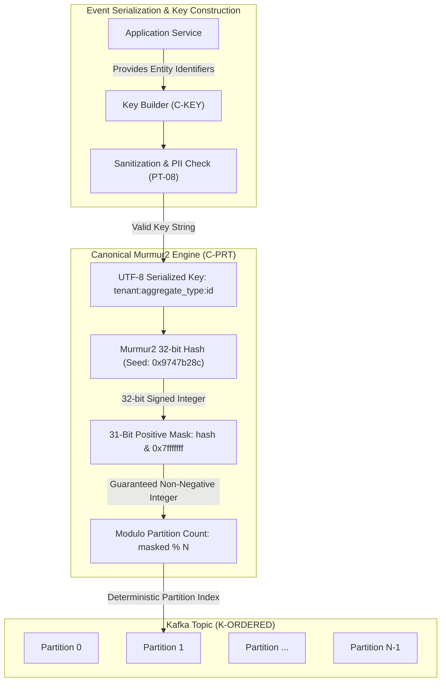
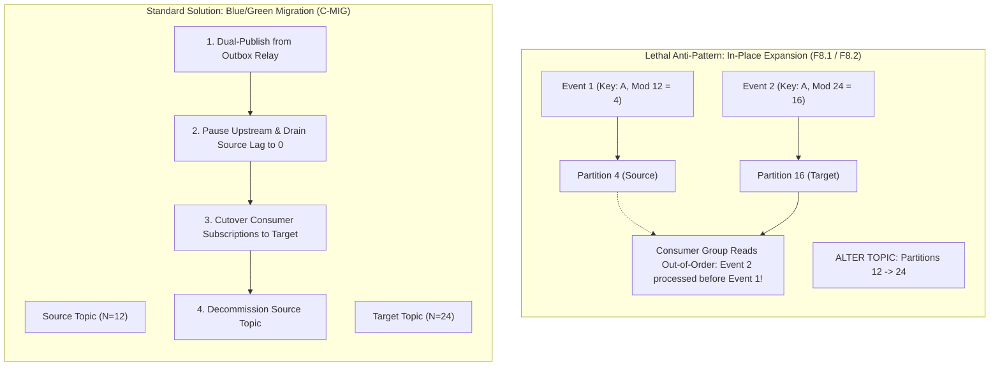
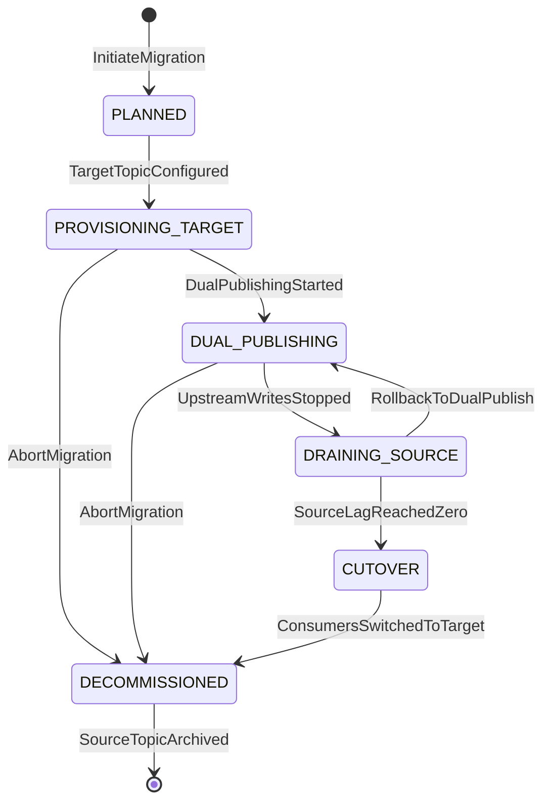
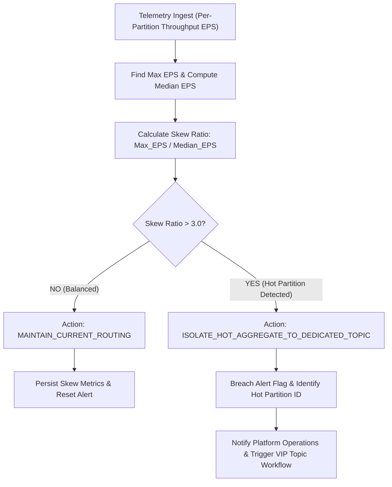
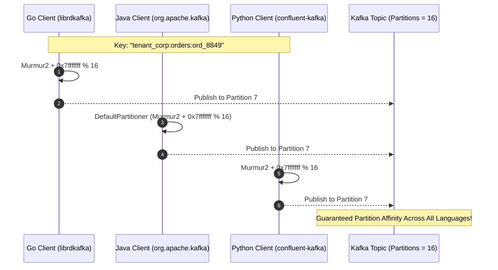

# Partitioning Strategy — Architectural Diagrams

This document contains Mermaid diagrams illustrating key partitioning mechanisms, hashing invariants, and migration protocols.

---

## 1. Key Hashing Pipeline & Murmur2 31-Bit Positive Bitmasking

---

## 2. In-Place Expansion Hazard vs Blue/Green Stream Migration

---

## 3. Stream Migration Runbook State Machine (C-MIG)

---

## 4. Hot Partition Skew Detection & VIP Routing Engine

---

## 5. Cross-Language Partitioning Parity Verification

