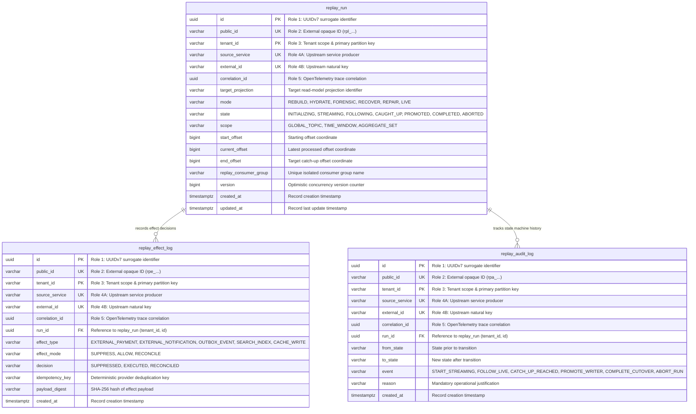
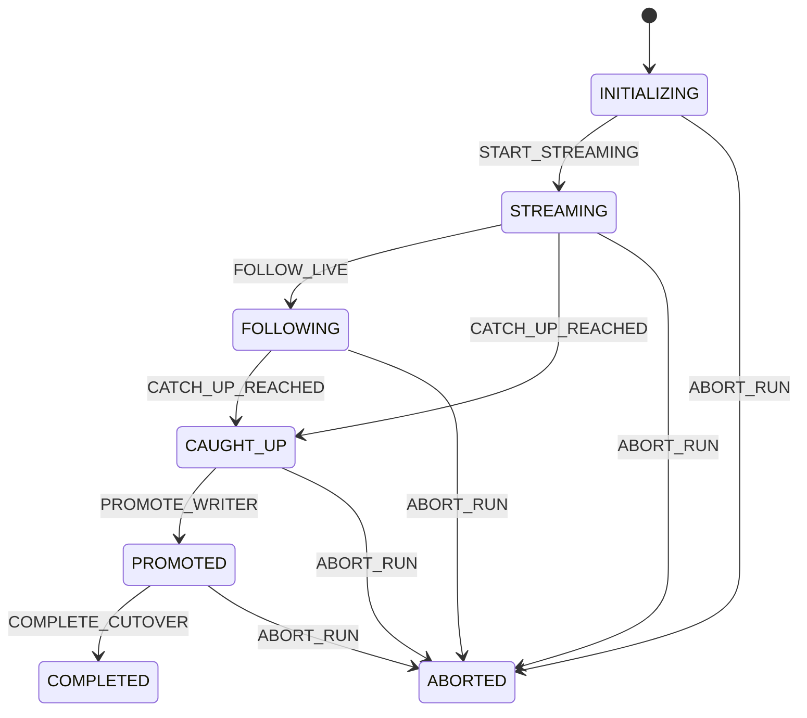
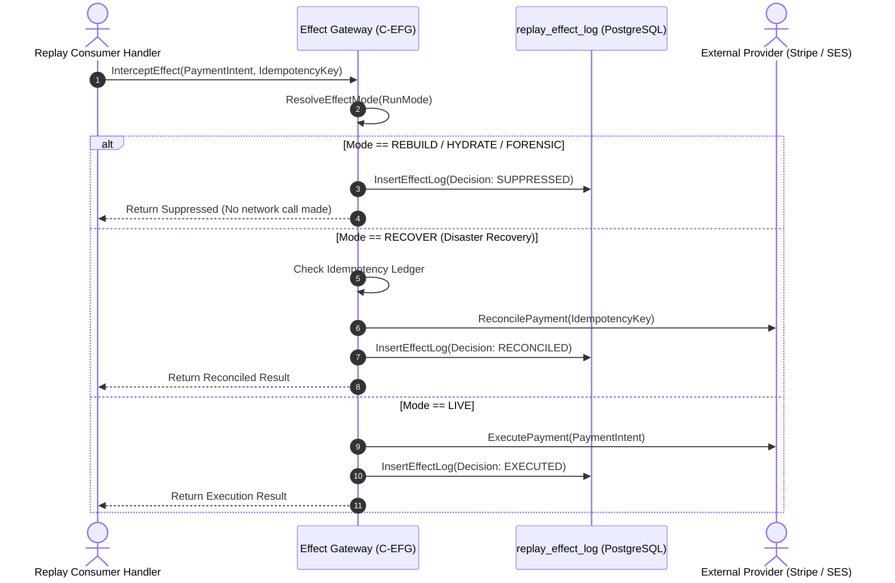

# Architectural Decision Record: Historical Stream Replay Engine & Side-Effect Control (WP-9)

## 1. Title & Metadata
* **Status**: APPROVED
* **Date**: 2026-11-05
* **Decision Makers**: Platform Architecture Guild, Chief Distributed Systems Architect
* **Governing Specification**: [Replay Mechanism Production System Design Tree (v2)](file:///home/btpl-lap-22/live/System-Architect/event-driven-platform/docs/features/replay-mechanism/business-logic.md)

---

## 2. Context & Problem Statement
In event-sourced and event-driven architectures, historical event streams represent the immutable ledger of truth. However, replaying historical messages through existing business consumer logic introduces severe platform hazards:

1. **Production Group Rebalance & Live Partition Freeze (F6.1)**: If a replay task joins the live consumer group or reads with an existing group ID, Kafka triggers stop-the-world partition rebalances, evicting live pods and corrupting real-time event streaming.
2. **Duplicate Side-Effect Disasters (F7.2, F7.3)**: Handlers frequently fire external side-effects (e.g. charging credit cards via Stripe, sending emails via SES, emitting outbox events to downstream microservices). Replaying 6 months of historical data naively re-executes these actions, producing catastrophic financial and operational liabilities.
3. **State Corruption via Non-Deterministic Handlers (F8.1, F8.2)**: Handlers generating random UUIDs or evaluating `time.Now()` at replay time generate state projections with diverging IDs and false "expired" statuses that differ from original historical reality.
4. **Data Loss from Broken Replay-to-Kafka Handoffs (F3.4)**: When replaying beyond Kafka log retention via cold object storage archives, failing to verify retention margins before handing off to live partitions creates unfillable sequence gaps.
5. **Lock Contention During Live Cutover (F12.1)**: Swapping shadow read models under live high-throughput traffic using long table locks causes database lock queues to cascade into platform-wide API outages.

---

## 3. Decision Drivers & Architecture Invariants (RP-01 to RP-12)

* **RP-01: Replay Never Touches Production Groups or Stores [Certain]**: Orchestration strictly rejects manifests targeting live group IDs or active production tables. Every replay run executes with an ephemeral group ID (`replay.<target>.<timestamp>`) and writes to isolated shadow tables or indices.
* **RP-02: Effects Fail Closed [Certain]**: The Effect Gateway (`C-EFG`) strictly suppresses all external mutations (payments, emails, webhooks, downstream outbox events) unless the run mode is `LIVE` or the effect is explicitly permitted.
* **RP-03: One Effect Path [Certain]**: Handlers possess zero direct network clients for external providers. All outbound mutations are evaluated through the centralized Effect Gateway interface.
* **RP-04: Replay Coverage is Proven, Not Assumed [Certain]**: Before historical streaming begins, source offsets across archive storage and live Kafka partitions must be verified to form a contiguous, gapless range.
* **RP-05: Per-Aggregate Ordering & Exact-Next Application Hold During Replay [Certain]**: Replay runners enforce the exact same sequence tracking, held-key mechanics, and version guards as live consumers.
* **RP-06: Deterministic Handlers [Certain]**: Projections use injected event time (never wall clock) and derive primary keys deterministically from `(event_id, purpose)`.
* **RP-07: Write Ownership Hands Off, Never Dropped [Certain]**: During cutover, the replay runner is promoted to a live writer before the legacy consumer is decommissioned, preventing gaps in projection updates.
* **RP-08: Rollback Stays Cheap Until Decommission [Certain]**: The legacy projection remains maintained in dual-run mode throughout a 7-day observation window. Rollback requires only a read-pointer redefinition.
* **RP-09: Parity Against Source of Truth [Certain]**: State equivalence is validated at matching aggregate versions. Any unexplained difference between target projection and source write model blocks promotion.
* **RP-10: Run Manifest is Immutable & Complete [Certain]**: Manifests pin handler build SHA, schema versions, start/end offsets, and effect policies. Altering a run mid-flight is forbidden.
* **RP-11: Replay Honors Cryptographic Erasure [Certain]**: Replaying historical streams respects GDPR/privacy shredding; crypto-shredded records remain unreadable ciphertext.
* **RP-12: Replay Cannot Degrade Live Traffic Beyond Budget [Certain]**: Read rates from Kafka and write throughput to target stores are throttled. Automatic backpressure halts replay if live production consumer lag breaches SLOs.

---

## 4. Run Modes & Effect Gateway Policy

The Effect Gateway (`C-EFG`) enforces strict policy modes per run intent:

| Run Mode | Target Namespace | External Payments | Notifications | Consumer Outbox | Search / Cache |
| :--- | :--- | :--- | :--- | :--- | :--- |
| **`REBUILD`** | Shadow table / index | **SUPPRESS** | **SUPPRESS** | **SUPPRESS** | **ALLOW** (namespaced) |
| **`HYDRATE`** | Shadow table / index | **SUPPRESS** | **SUPPRESS** | **SUPPRESS** | **ALLOW** (namespaced) |
| **`FORENSIC`** | Read-only audit store | **SUPPRESS** | **SUPPRESS** | **SUPPRESS** | **SUPPRESS** |
| **`RECOVER`** | Restored primary store | **RECONCILE** | **RECONCILE** | **RECONCILE** | **ALLOW** |
| **`LIVE`** | Production store | **ALLOW** | **ALLOW** | **ALLOW** | **ALLOW** |

---

## 5. Storage Gate Contract & Database Writing Rules

Complies strictly with [05-db-writing-rules.md](file:///home/btpl-lap-22/live/System-Architect/llm-obs-policies/rules/folder-structure/05-db-writing-rules.md) and [01-schema-migrations-and-code-guidelines.md](file:///home/btpl-lap-22/live/System-Architect/llm-obs-policies/rules/database/migrations/01-schema-migrations-and-code-guidelines.md).

### 5.1 The 5 Identifier Roles Mapping
1. **Role 1 (Surrogate PK)**: UUIDv7 generated internally (`id`). Immutable.
2. **Role 2 (Public ID)**: Regex-constrained external strings (`rpl_...` for runs, `rpe_...` for effect logs, `rpa_...` for audits) matching `^[a-z]{3}_[0-9a-zA-Z]{26}$`.
3. **Role 3 (Tenant Scope)**: `tenant_id` leading composite primary keys and unique indices.
4. **Role 4 (Natural Upstream Key)**: Composite unique constraint on `(tenant_id, source_service, external_id)` with `btrim` validation.
5. **Role 5 (Correlation Trace)**: `correlation_id` UUID propagated from upstream OpenTelemetry trace context. Immutable.

### 5.2 Optimistic Concurrency & Audit Columns
- `replay_run` includes `version BIGINT NOT NULL DEFAULT 1`, auto-incremented by trigger on update.
- `replay_effect_log` and `replay_audit_log` are append-only ledgers protected by plpgsql triggers rejecting `UPDATE` and `DELETE`.

### 5.3 Entity-Relationship Diagram

---

## 6. State Machine & Execution Workflows

### 6.1 State Machine Lifecycle

### 6.2 Side-Effect Gateway Interception Workflow

---

## 7. Verification & Test Evidence
Automated test suite located at `src/features/replay-mechanism/tests/`:
* `TestRuleGenerateReplayConsumerGroup`: Verifies isolation of ephemeral consumer group names (RP-01).
* `TestRuleResolveEffectMode_Rebuild`: Verifies payments and notifications default to SUPPRESS in REBUILD mode (RP-02).
* `TestRuleResolveEffectMode_Recover`: Verifies RECONCILE mode in disaster recovery (RP-02).
* `TestRuleValidateOffsetAdvance_RegressionRejected`: Verifies monotonic offset advancement.
* `TestMachineTransition_Lifecycle`: Verifies full deterministic state machine transitions.
* `TestServiceCreateReplayRun`: Verifies run record initialization and audit trail creation.
* `TestServiceEvaluateEffect_SuppressExternalInRebuild`: Verifies end-to-end effect gateway ledger logging.

