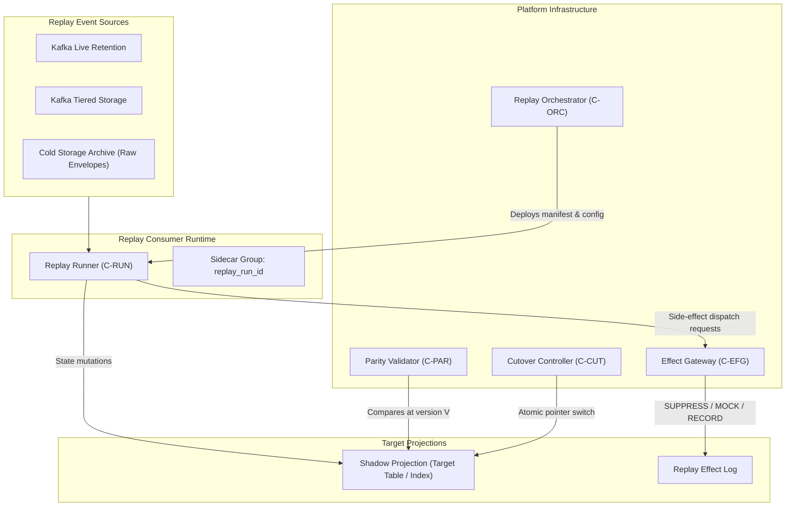
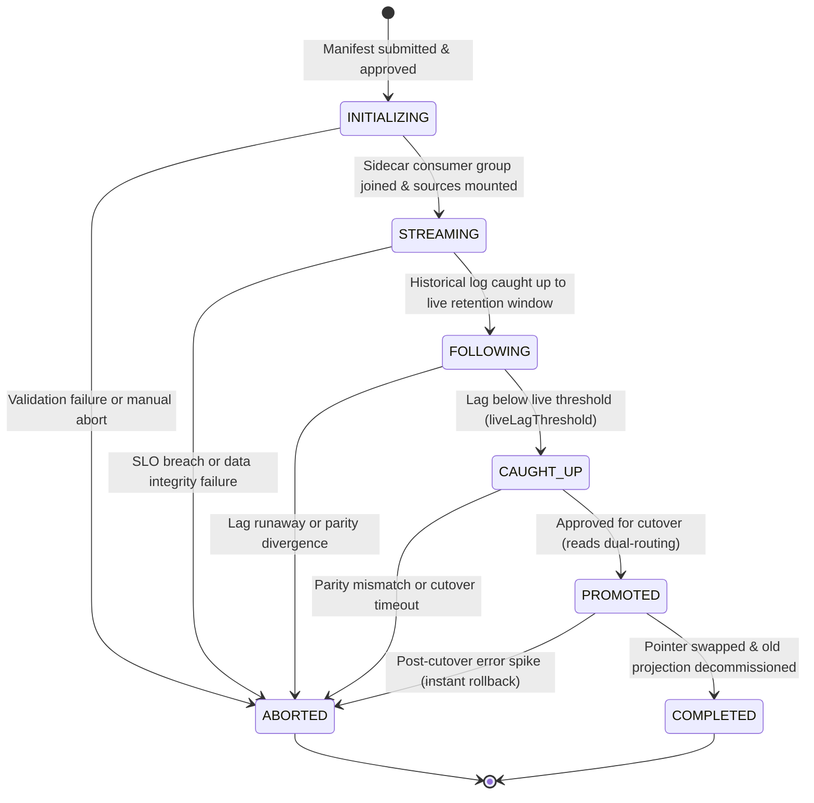
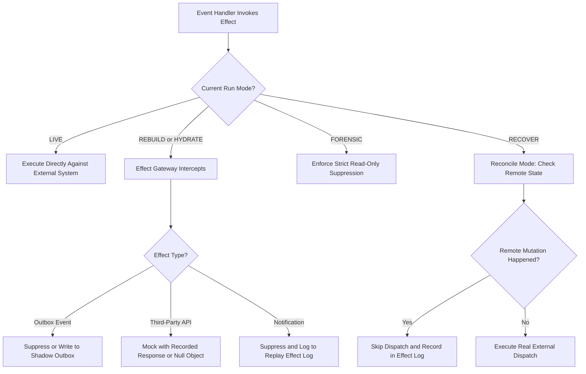
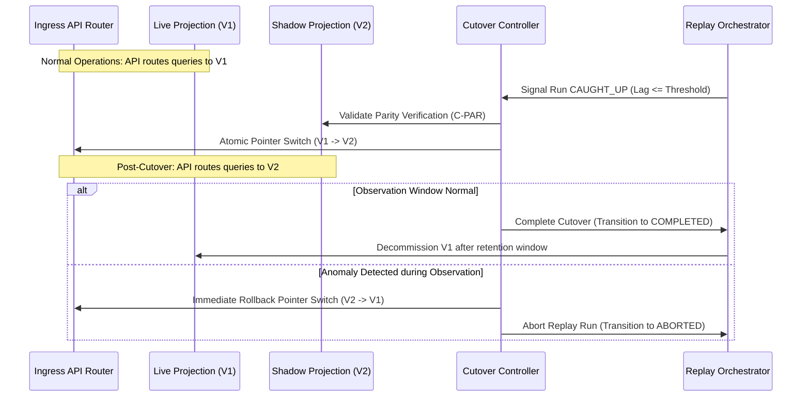

# Replay Mechanism — Architecture Diagrams & Workflows

This document visualizes the core architecture, runtime lifecycles, side-effect governance, and zero-downtime cutover mechanics of the Replay Mechanism.

---

## 1. High-Level Component Interaction Map

The Replay Orchestrator provisions an isolated consumer group (`RP-01`), streams historical and live event logs, and guarantees that external mutations strictly pass through the Effect Gateway (`RP-02`, `RP-03`).

---

## 2. Replay Run Lifecycle State Machine

The replay lifecycle progresses through six sequential operational states, terminating in `COMPLETED` or aborting to `ABORTED`.

---

## 3. Side-Effect Gateway Decision Engine

External effects (SMS, email, payments, outbox publication, cache invalidation) are routed according to the active declared run mode.

---

## 4. Dual-Run Atomic Cutover and Rollback Topology

During the promotion window, writes are dual-directed or handed off while maintaining immediate zero-downtime rollback capability.

