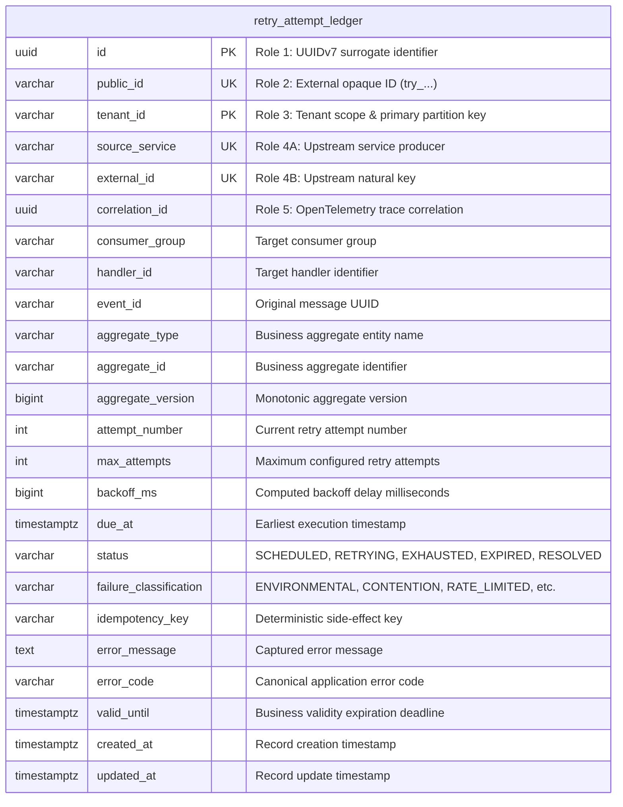
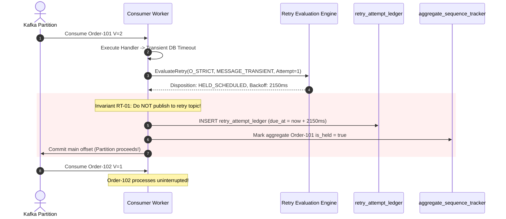
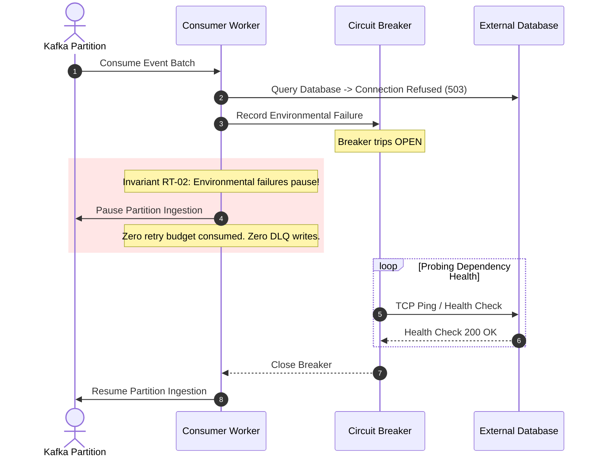

# Architectural Decision Record: Resilient Failure Classification & Retry Engine (WP-5)

## 1. Title & Metadata
* **Status**: APPROVED
* **Date**: 2026-11-04
* **Decision Makers**: Platform Architecture Guild, Chief Distributed Systems Architect
* **Governing Specification**: [Retry Handling Business Logic Decision Tree (v2)](file:///home/btpl-lap-22/live/System-Architect/event-driven-platform/docs/features/retry-topics/business-logic.md)

---

## 2. Context & Problem Statement
Consumer event processing inevitably encounters failures ranging from database deadlocks, network timeouts, and downstream API 429 rate limits, to permanent JSON deserialization errors.

Naive retry implementations create severe production outages:
1. **Ordering Inversion via Retry Topics (RT-01)**: On aggregate streams with delta semantics (`O-STRICT`), routing a failed $V=2$ event to a delayed retry topic (`topic-retry-5m`) while the main partition moves forward causes $V=3$ to execute before $V=2$, permanently corrupting account balances.
2. **Environmental Retry Amplification (RT-02)**: When downstream infrastructure (e.g. database failover, DNS outage) returns errors, continuing to process messages burns the per-message retry budget and floods DLQ quarantine with false positives while amplifying load against a recovering database.
3. **Ghost Side-Effects Across Attempts (RT-08)**: Retrying non-idempotent operations without deterministic idempotency keys creates duplicate payment charges or duplicate external mutations.
4. **Poll Loop Thread Starvation (RT-04)**: Executing `Thread.sleep()` or in-memory blocking waits inside the Kafka poll loop leads to consumer group heartbeat timeouts, triggering cascade rebalances and partition churn.

---

## 3. Decision Drivers & Invariants (RT-01 to RT-11)
* **RT-01: Ordering Never Traded for Throughput**: Streams categorized as `O-STRICT` or `O-STATE` strictly prohibit retry topic routing. Retries must execute via held-key scheduled wakeups (`HELD_SCHEDULED`), parking only the aggregate key while the partition advances.
* **RT-02: Environmental Failures Pause, Never Retry-Route**: Connection refused, 503 Service Unavailable, and broker unreachability trip circuit breakers to pause consumer ingestion. They never consume individual message retry budgets.
* **RT-03: Durable Attempt Ledger**: All retry attempts are persisted in PostgreSQL table `retry_attempt_ledger`, keyed by `(tenant_id, consumer_group, handler_id, event_id, attempt_number)`.
* **RT-04: No Sleeping in Poll Loop**: Blocking sleeps inside message loops are prohibited. Delays use scheduled wakeups or pause/resume mechanics.
* **RT-07: Business Validity Deadlines**: If `valid_until` expires before `due_at`, the event transitions to `EXPIRED` instead of executing a stale retry.
* **RT-08: Deterministic Idempotency Keys**: Side-effect tokens are derived deterministically via $\text{SHA-256}(\text{handler\_id} \mathbin{\Vert} \text{event\_id} \mathbin{\Vert} \text{effect})$ across all attempts.
* **RT-11: Cryptographically Jittered Backoff**: Exponential backoff incorporates $\pm 20\%$ entropy to avoid thundering herd synchronizations.

---

## 4. Entity-Relationship Data Model & Database Writing Rules
Complies strictly with [05-db-writing-rules.md](file:///home/btpl-lap-22/live/System-Architect/llm-obs-policies/rules/folder-structure/05-db-writing-rules.md) using the 5 Identifier Roles:

---

## 5. Execution Sequence Diagrams

### 5.1 Ordered Stream Held Scheduled Retry (RT-01, RT-03)

### 5.2 Environmental Outage Circuit Pause (RT-02)

---

## Deep Failure-First Architectural Principles

### 1. Existential Purpose & The Catastrophe Prevented

When a consumer encounters a transient failure (e.g. a downstream database deadlock or temporary network timeout), retrying immediately in-place blocks the Kafka partition. Because partitions are sequential, halting on message 100 blocks messages 101 to 10,000 behind it. If the dependency takes 30 seconds to recover, the entire partition grinds to a halt.

### 2. Internal Algorithmic Mechanics & State Invariants

The platform implements Non-Blocking Multi-Tiered Retry Topics. When a transient error occurs, the consumer publishes the failed message to a delayed retry topic (e.g. orders.retry.10s) with an incremented retry_count header, and commits the original partition offset immediately. Separate background worker pools consume from retry topics using exponential backoff with randomized jitter. If attempts exceed the maximum threshold, the message escalates to the DLQ.

### 3. Core Architectural Principles

* **Non-Blocking Escalation**: Transient failures must be routed to dedicated delayed retry topics, preventing head-of-line blocking on the primary partition.
* **Exponential Jitter Backoff**: Retry intervals must scale exponentially with randomized jitter to eliminate thundering herd storms on recovering systems.
* **Strict Attempt Cap Escalation**: Retries enforce a strict maximum attempt count (e.g. 3 attempts); exhausted messages automatically escalate to the DLQ.
* **Context Envelope Preservation**: Retried messages preserve all original headers, trace contexts, and causation IDs to maintain end-to-end observability.

### 4. The Architect's Meta-Questions (Failure-First Evaluation)

1. **Why must we add randomized jitter to retry delays? (Without jitter, 5,000 messages that failed simultaneously will all retry at the exact same second, creating a massive thundering herd that re-crashes the recovering database).**
2. **What is the trade-off of using non-blocking retry topics? (Non-blocking retries sacrifice strict global ordering across that partition for high throughput; messages 101–110 proceed while message 100 is retried in the background).**
3. **How do we distinguish between transient retryable errors and permanent non-retryable errors? (Transient errors: network timeouts, DB deadlocks, 503 HTTP responses; Permanent errors: schema validation failures, corrupted JSON, 400 Bad Request — permanent errors skip retry and go directly to DLQ).**

---

## Authoritative References & Production Citations

* **[Uber Engineering: Resilient Message Processing with Kafka Retry Topics](https://www.uber.com/blog/reliable-reprocessing-and-dead-letter-queues-with-apache-kafka/)**
  - *Architectural Rationale & Implementation Grounding*: Seminal engineering post introducing multi-tiered non-blocking retry topics with exponential backoff in streaming architectures.
* **[Spring Kafka Documentation: Non-Blocking Retries and DLT Configuration](https://docs.spring.io/spring-kafka/reference/kafka/annotation-error-handling.html)**
  - *Architectural Rationale & Implementation Grounding*: Production-tested architectural framework for configuring topic-based delayed retries without partition head-of-line blocking.
* **[AWS Architecture: Exponential Backoff and Jitter](https://aws.amazon.com/blogs/architecture/exponential-backoff-and-jitter/)**
  - *Architectural Rationale & Implementation Grounding*: Mathematical analysis demonstrating how adding randomized jitter eliminates cascading failure and thundering herd retry storms.
* **[Confluent: Error Handling Strategies in Event-Driven Systems](https://www.confluent.io/blog/error-handling-patterns-in-kafka/)**
  - *Architectural Rationale & Implementation Grounding*: Comprehensive guide on distinguishing transient vs fatal errors and orchestrating non-blocking quarantine topics.

## Amendment 2026-11-07 (second pass): tenant scope required

`GET /retries/due` returns 400 when `tenant_id` is missing (previously 200 with `data:null`).

Verified live on the compose-deployed image (`chiefj/event-driven-platform:v2`) and by unit tests; see ADR-0002 "Closed in a second pass".
